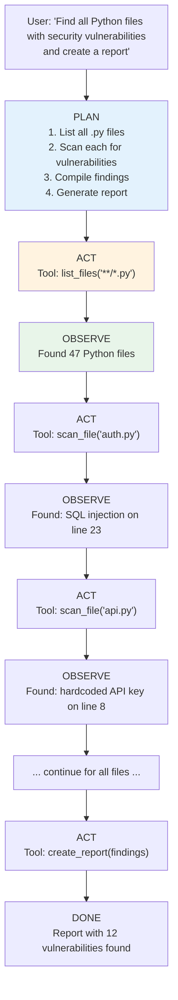

# 09.02 — The Agent Loop

> **One sentence:** An AI agent is an LLM in a loop — it observes the environment, decides what action to take, executes it, observes the result, and repeats until the task is complete.

---

## What Makes an Agent Different from a Chatbot?

```
Chatbot:  User asks → Model responds → Done
Agent:    User asks → Model PLANS → Model ACTS → Model OBSERVES → 
          Model RE-PLANS → Model ACTS again → ... → Task complete
```



---

## The Core Agent Loop

```python
from openai import OpenAI
import json

client = OpenAI()

class Agent:
    """
    A simple but complete AI agent.
    The core loop: think → act → observe → repeat.
    """
    
    def __init__(self, system_prompt: str, tools: list[dict], tool_functions: dict):
        self.system_prompt = system_prompt
        self.tools = tools
        self.tool_functions = tool_functions
        self.messages = [{"role": "system", "content": system_prompt}]
        self.max_iterations = 20  # Safety limit
    
    def run(self, task: str) -> str:
        """Execute a task using the agent loop."""
        self.messages.append({"role": "user", "content": task})
        
        for iteration in range(self.max_iterations):
            print(f"\n--- Iteration {iteration + 1} ---")
            
            # THINK: Ask the model what to do next
            response = client.chat.completions.create(
                model="gpt-4o",
                messages=self.messages,
                tools=self.tools,
                tool_choice="auto"
            )
            
            message = response.choices[0].message
            self.messages.append(message)
            
            # CHECK: Is the agent done?
            if not message.tool_calls:
                print(f"Agent finished: {message.content[:100]}...")
                return message.content
            
            # ACT: Execute tool calls
            for tool_call in message.tool_calls:
                func_name = tool_call.function.name
                args = json.loads(tool_call.function.arguments)
                
                print(f"  Action: {func_name}({json.dumps(args)[:80]})")
                
                # Execute the tool
                try:
                    result = self.tool_functions[func_name](**args)
                    result_str = json.dumps(result) if not isinstance(result, str) else result
                except Exception as e:
                    result_str = f"Error: {str(e)}"
                
                print(f"  Result: {result_str[:80]}...")
                
                # OBSERVE: Add result to context
                self.messages.append({
                    "role": "tool",
                    "tool_call_id": tool_call.id,
                    "content": result_str
                })
        
        return "Max iterations reached. Task may be incomplete."

# ─── Example: Research Agent ─────────────────────────────────

# Define tools
tools = [
    {
        "type": "function",
        "function": {
            "name": "web_search",
            "description": "Search the web for information",
            "parameters": {
                "type": "object",
                "properties": {
                    "query": {"type": "string", "description": "Search query"}
                },
                "required": ["query"]
            }
        }
    },
    {
        "type": "function",
        "function": {
            "name": "read_url",
            "description": "Read the content of a webpage",
            "parameters": {
                "type": "object",
                "properties": {
                    "url": {"type": "string", "description": "URL to read"}
                },
                "required": ["url"]
            }
        }
    },
    {
        "type": "function",
        "function": {
            "name": "save_note",
            "description": "Save a research note",
            "parameters": {
                "type": "object",
                "properties": {
                    "title": {"type": "string"},
                    "content": {"type": "string"}
                },
                "required": ["title", "content"]
            }
        }
    }
]

# Implement tools
def web_search(query: str) -> dict:
    # In production, call a real search API
    return {"results": [{"title": "Example", "url": "https://example.com", "snippet": "..."}]}

def read_url(url: str) -> str:
    # In production, fetch and parse the URL
    return "Article content here..."

def save_note(title: str, content: str) -> dict:
    return {"status": "saved", "title": title}

# Create and run the agent
agent = Agent(
    system_prompt="""You are a research assistant. 
    When given a topic, search for information, read relevant sources, 
    and compile a comprehensive summary. Save your findings as notes.""",
    tools=tools,
    tool_functions={
        "web_search": web_search,
        "read_url": read_url,
        "save_note": save_note
    }
)

result = agent.run("Research the latest advances in quantum computing in 2024")
```

---

## Agent Patterns

### ReAct (Reasoning + Acting)

```python
# ReAct pattern: explicit reasoning before each action
REACT_SYSTEM_PROMPT = """You are an agent that solves tasks step by step.

For each step, use this format:
Thought: [Your reasoning about what to do next]
Action: [The tool to call]
Observation: [You'll see the result here]
... repeat ...
Thought: I now have enough information to answer.
Final Answer: [Your complete answer]

Always think before acting. If a tool returns an error, try a different approach.
"""
```

### Plan-and-Execute

```python
class PlanAndExecuteAgent:
    """
    Two-phase agent:
    1. Create a complete plan upfront
    2. Execute each step, adjusting if needed
    """
    
    def run(self, task: str) -> str:
        # Phase 1: Plan
        plan = self._create_plan(task)
        print(f"Plan:\n{plan}")
        
        # Phase 2: Execute each step
        results = []
        for i, step in enumerate(plan):
            print(f"\nExecuting step {i+1}: {step}")
            result = self._execute_step(step, results)
            results.append(result)
            
            # Re-plan if step failed
            if result.get("status") == "failed":
                plan = self._replan(task, plan, results, i)
        
        # Synthesize final answer
        return self._synthesize(task, results)
    
    def _create_plan(self, task: str) -> list[str]:
        response = client.chat.completions.create(
            model="gpt-4o",
            messages=[{
                "role": "user",
                "content": f"Create a step-by-step plan to accomplish this task. "
                           f"Return steps as a numbered list.\n\nTask: {task}"
            }]
        )
        # Parse numbered list into steps
        return response.choices[0].message.content.split("\n")
```

---

## Agent Challenges

| Challenge | Problem | Solution |
|-----------|---------|----------|
| **Infinite loops** | Agent repeats same action | Max iterations + loop detection |
| **Wrong tool choice** | Agent picks wrong tool | Better tool descriptions + examples |
| **Context overflow** | Too many iterations fill context | Summarize earlier steps |
| **Error handling** | Tool errors crash the agent | Try/catch + retry + fallback |
| **Cost control** | Agents can make many API calls | Budget limits + early stopping |

```python
# Safety guardrails for agents
class SafeAgent(Agent):
    def __init__(self, *args, max_cost: float = 1.0, **kwargs):
        super().__init__(*args, **kwargs)
        self.total_cost = 0.0
        self.max_cost = max_cost
        self.action_history = []
    
    def run(self, task: str) -> str:
        for iteration in range(self.max_iterations):
            # Check cost budget
            if self.total_cost > self.max_cost:
                return f"Budget exceeded (${self.total_cost:.2f}). Partial results: ..."
            
            # Check for loops (same action repeated)
            if len(self.action_history) >= 3:
                last_3 = self.action_history[-3:]
                if len(set(last_3)) == 1:
                    return f"Loop detected. Agent stuck on: {last_3[0]}"
            
            # Normal agent step...
```

---

## Key Takeaways

1. **Agent = LLM + tools + loop** — observe, think, act, repeat
2. **ReAct pattern** (reason, then act) is the most reliable approach
3. **Safety guardrails** are essential — max iterations, cost limits, loop detection
4. **Context management** is critical — summarize old steps to prevent overflow
5. **Agents are powerful but unpredictable** — always have a human-in-the-loop fallback

---

## 💼 FAANG Interview Questions

1. *"Design an agent that can debug a failing CI/CD pipeline."*
2. *"How do you prevent an agent from running forever or spending too much?"*
3. *"Compare a simple chatbot vs. an agent. When is each appropriate?"*
