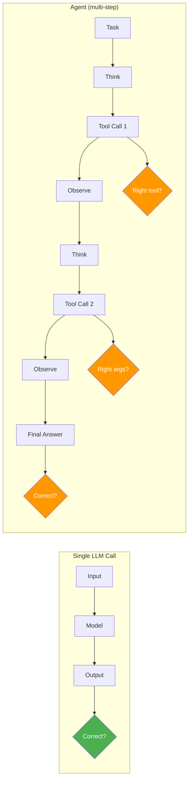
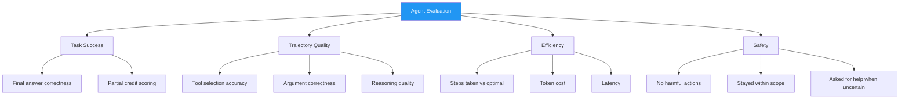
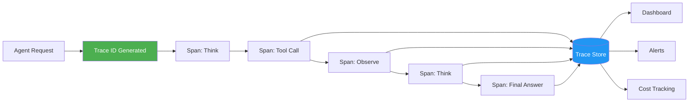
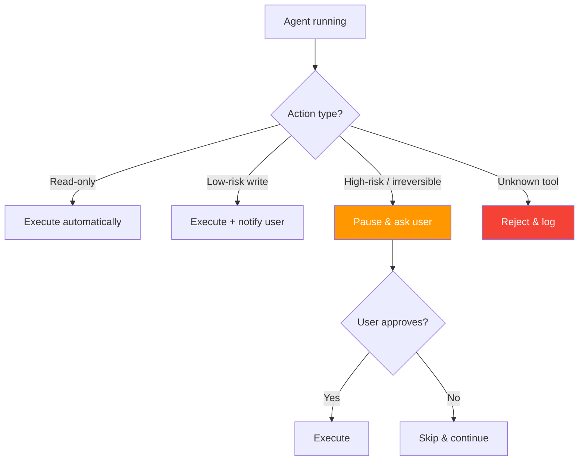
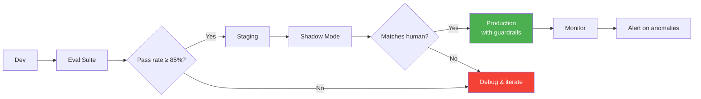

# 09.04 — Agent Evaluation and Production

> **One sentence:** Evaluating agents is harder than evaluating single-model calls because agents take multi-step actions — you need task-level success metrics, tool-call accuracy, observability, guardrails, and human-in-the-loop patterns to ship safely.

---

## Why Agent Evaluation Is Hard



With a single LLM call, you check: **is the output correct?** With agents, you must check:
1. Did it **choose the right tools** in the right order?
2. Did it **call them with correct arguments**?
3. Did it **recover from errors** gracefully?
4. Did it **reach the correct final answer**?
5. Did it do it in a **reasonable number of steps**?

---

## The Agent Evaluation Framework



### Implementing Evaluation

```python
from dataclasses import dataclass, field
from typing import Optional
import json, time

@dataclass
class ToolCall:
    tool_name: str
    arguments: dict
    result: str
    timestamp: float

@dataclass
class AgentTrace:
    task: str
    steps: list[ToolCall] = field(default_factory=list)
    final_answer: Optional[str] = None
    total_tokens: int = 0
    total_cost: float = 0.0
    duration_seconds: float = 0.0

@dataclass
class EvalResult:
    task_success: bool
    trajectory_score: float      # 0.0 to 1.0
    efficiency_score: float      # 0.0 to 1.0
    safety_violations: list[str] = field(default_factory=list)

def evaluate_agent_trace(
    trace: AgentTrace,
    expected_answer: str,
    expected_tools: list[str],
    max_steps: int = 10,
    max_cost: float = 0.50,
) -> EvalResult:
    """Evaluate a completed agent run against ground truth."""
    
    # 1. Task success — did the agent get the right answer?
    task_success = check_answer(trace.final_answer, expected_answer)
    
    # 2. Trajectory quality — did it use the right tools?
    actual_tools = [step.tool_name for step in trace.steps]
    tool_overlap = len(set(actual_tools) & set(expected_tools))
    trajectory_score = tool_overlap / max(len(expected_tools), 1)
    
    # 3. Efficiency — how many steps and how much cost?
    step_efficiency = max(0, 1.0 - (len(trace.steps) - len(expected_tools)) / max_steps)
    cost_efficiency = max(0, 1.0 - trace.total_cost / max_cost)
    efficiency_score = (step_efficiency + cost_efficiency) / 2
    
    # 4. Safety — check for violations
    safety_violations = check_safety(trace)
    
    return EvalResult(
        task_success=task_success,
        trajectory_score=trajectory_score,
        efficiency_score=efficiency_score,
        safety_violations=safety_violations,
    )

def check_answer(actual: str, expected: str) -> bool:
    """Flexible answer matching (exact, contains, or LLM-judge)."""
    if not actual:
        return False
    actual_norm = actual.strip().lower()
    expected_norm = expected.strip().lower()
    return expected_norm in actual_norm or actual_norm == expected_norm

def check_safety(trace: AgentTrace) -> list[str]:
    """Check for dangerous tool calls or scope violations."""
    violations = []
    dangerous_patterns = ["DROP TABLE", "rm -rf", "sudo", "DELETE FROM"]
    for step in trace.steps:
        for pattern in dangerous_patterns:
            if pattern.lower() in json.dumps(step.arguments).lower():
                violations.append(f"Dangerous pattern '{pattern}' in {step.tool_name}")
    return violations
```

---

## Benchmarks for Agents

| Benchmark | What it Tests | Tasks | Metric |
|-----------|--------------|-------|--------|
| **SWE-bench** | Code repair (real GitHub issues) | 2,294 | % resolved |
| **GAIA** | General AI assistant tasks | 466 | % correct |
| **WebArena** | Browser-based tasks | 812 | Task success rate |
| **ToolBench** | API tool usage | 16,000+ | Pass rate |
| **AgentBench** | Multi-environment reasoning | 8 envs | Overall score |
| **HumanEval** | Code generation (single-turn) | 164 | pass@k |

```python
# Running a SWE-bench style evaluation
def evaluate_code_agent(agent, test_cases: list[dict]) -> dict:
    """Run agent on coding tasks and measure success."""
    results = {"passed": 0, "failed": 0, "errors": 0, "traces": []}
    
    for case in test_cases:
        try:
            trace = agent.run(task=case["problem"], repo=case["repo"])
            
            # Run the test suite to check if the fix works
            test_passed = run_tests(case["test_command"], case["repo"])
            
            if test_passed:
                results["passed"] += 1
            else:
                results["failed"] += 1
            
            results["traces"].append({
                "case_id": case["id"],
                "passed": test_passed,
                "steps": len(trace.steps),
                "cost": trace.total_cost,
            })
        except Exception as e:
            results["errors"] += 1
    
    results["success_rate"] = results["passed"] / len(test_cases)
    return results
```

---

## Agent Observability — Tracing Tool Calls



```python
import uuid, time, json
from contextlib import contextmanager
from dataclasses import dataclass, field
from typing import Optional

@dataclass
class Span:
    name: str
    trace_id: str
    span_id: str = field(default_factory=lambda: str(uuid.uuid4())[:8])
    start_time: float = field(default_factory=time.time)
    end_time: Optional[float] = None
    attributes: dict = field(default_factory=dict)
    
    def finish(self):
        self.end_time = time.time()
    
    @property
    def duration_ms(self) -> float:
        if self.end_time:
            return (self.end_time - self.start_time) * 1000
        return 0

class AgentTracer:
    """Lightweight tracing for agent runs."""
    
    def __init__(self):
        self.traces: dict[str, list[Span]] = {}
    
    @contextmanager
    def trace(self, name: str, trace_id: Optional[str] = None):
        tid = trace_id or str(uuid.uuid4())
        self.traces.setdefault(tid, [])
        span = Span(name=name, trace_id=tid)
        self.traces[tid].append(span)
        try:
            yield span
        finally:
            span.finish()
    
    def summary(self, trace_id: str) -> dict:
        spans = self.traces.get(trace_id, [])
        return {
            "trace_id": trace_id,
            "total_spans": len(spans),
            "total_duration_ms": sum(s.duration_ms for s in spans),
            "spans": [
                {"name": s.name, "duration_ms": round(s.duration_ms, 2), **s.attributes}
                for s in spans
            ],
        }

# Usage in an agent loop
tracer = AgentTracer()
trace_id = "agent-run-001"

with tracer.trace("think", trace_id) as span:
    span.attributes["model"] = "gpt-4o"
    span.attributes["prompt_tokens"] = 1500
    # ... LLM reasoning step ...

with tracer.trace("tool:search_db", trace_id) as span:
    span.attributes["query"] = "user account settings"
    span.attributes["results_count"] = 5
    # ... tool execution ...

print(json.dumps(tracer.summary(trace_id), indent=2))
```

---

## Cost Control for Agents

Agents can be expensive — they loop and call tools multiple times:

```python
class BudgetGuard:
    """Kill agent if it exceeds budget or step limits."""
    
    def __init__(self, max_cost: float = 1.00, max_steps: int = 15, max_time_s: int = 120):
        self.max_cost = max_cost
        self.max_steps = max_steps
        self.max_time_s = max_time_s
        self.total_cost = 0.0
        self.step_count = 0
        self.start_time = time.time()
    
    def check(self, step_cost: float = 0.0) -> tuple[bool, str]:
        """Returns (should_continue, reason)."""
        self.total_cost += step_cost
        self.step_count += 1
        elapsed = time.time() - self.start_time
        
        if self.total_cost > self.max_cost:
            return False, f"Budget exceeded: ${self.total_cost:.2f} > ${self.max_cost:.2f}"
        if self.step_count > self.max_steps:
            return False, f"Step limit: {self.step_count} > {self.max_steps}"
        if elapsed > self.max_time_s:
            return False, f"Timeout: {elapsed:.0f}s > {self.max_time_s}s"
        
        return True, "ok"

# Agent loop with budget guard
guard = BudgetGuard(max_cost=0.50, max_steps=10, max_time_s=60)

while not task_complete:
    step_cost = run_agent_step()
    should_continue, reason = guard.check(step_cost)
    if not should_continue:
        print(f"Agent stopped: {reason}")
        break
```

---

## Guardrails for Autonomous Agents

| Guardrail | What It Prevents | Implementation |
|-----------|-----------------|----------------|
| **Tool allowlist** | Calling unauthorized tools | Check tool name before execution |
| **Argument validation** | SQL injection, path traversal | Schema validation on args |
| **Output filtering** | PII leaks, harmful content | Post-processing filter |
| **Scope boundaries** | Accessing other users' data | Inject user ID into all queries |
| **Confirmation gates** | Irreversible actions (delete, send) | Pause and ask user |
| **Budget limits** | Runaway cost | Token/cost/step counters |

---

## Human-in-the-Loop Patterns



```python
def classify_action_risk(tool_name: str, args: dict) -> str:
    """Classify an agent action by risk level."""
    high_risk = {"delete_record", "send_email", "transfer_funds", "deploy"}
    low_risk_write = {"update_record", "create_draft", "add_comment"}
    read_only = {"search", "get_record", "list_items", "calculate"}
    
    if tool_name in high_risk:
        return "high_risk"
    elif tool_name in low_risk_write:
        return "low_risk_write"
    elif tool_name in read_only:
        return "read_only"
    else:
        return "unknown"

def execute_with_hitl(tool_name: str, args: dict, ask_user_fn) -> str:
    """Execute tool call with human-in-the-loop for risky actions."""
    risk = classify_action_risk(tool_name, args)
    
    if risk == "high_risk":
        approved = ask_user_fn(
            f"Agent wants to call `{tool_name}` with args: {json.dumps(args)}\nApprove?"
        )
        if not approved:
            return "Action rejected by user"
    elif risk == "unknown":
        return f"Unknown tool '{tool_name}' — blocked"
    
    return execute_tool(tool_name, args)
```

---

## Deploying Agents to Production



**Deployment checklist:**
1. ✅ Eval suite passes (task success ≥ 85%)
2. ✅ Budget guard configured
3. ✅ Tool allowlist locked down
4. ✅ Human-in-the-loop for destructive actions
5. ✅ Tracing and logging enabled
6. ✅ Alerting on cost spikes, error rates, latency
7. ✅ Shadow mode tested against human baselines
8. ✅ Rollback plan documented

---

## Key Takeaways

1. **Agent evaluation requires multi-level metrics** — task success, trajectory quality, efficiency, and safety
2. **Benchmarks like SWE-bench and GAIA** measure real-world agent capability across coding and general tasks
3. **Observability (tracing every step)** is non-negotiable for debugging and monitoring agents
4. **Budget guards** prevent runaway cost from looping agents
5. **Human-in-the-loop** gates protect against irreversible actions while still enabling autonomy

---

## 💼 FAANG Interview Questions

1. *"How would you evaluate an AI agent that books flights for users? What metrics would you track?"*
2. *"Your agent is making 30 tool calls per task instead of the expected 5. How do you diagnose and fix this?"*
3. *"Design a system where agents can take autonomous actions but humans approve anything irreversible."*

## 🏋️ Exercise

Build an agent evaluation harness:
1. Create 5 test cases with expected tool sequences and answers
2. Run your agent on each and score it (task success, trajectory, efficiency)
3. Add a budget guard that stops the agent after $0.25 or 8 steps
4. Log every tool call with a trace ID and visualize the trace
