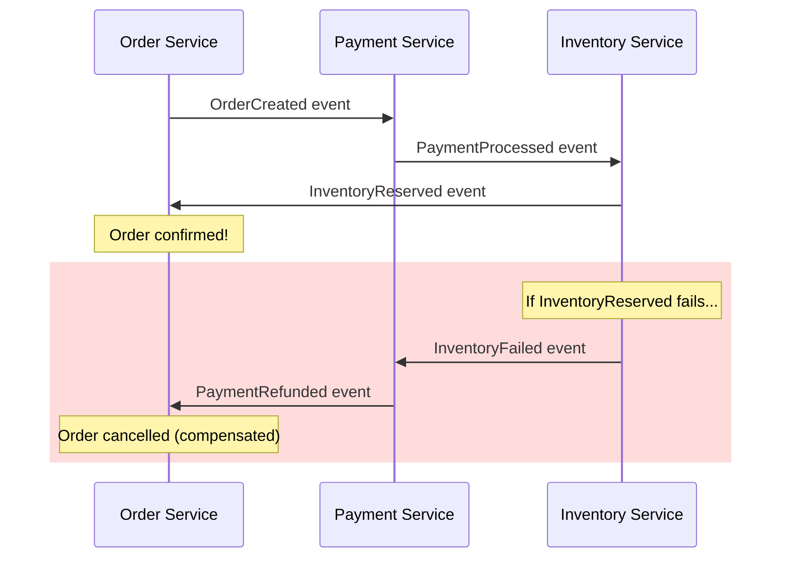
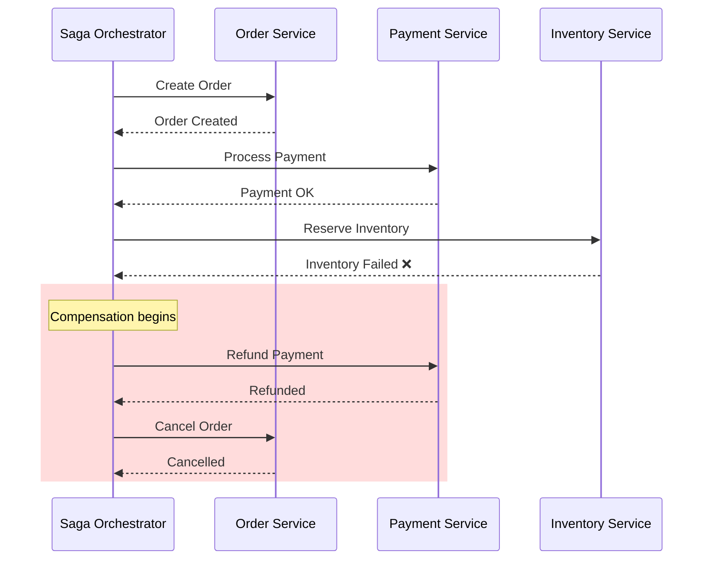
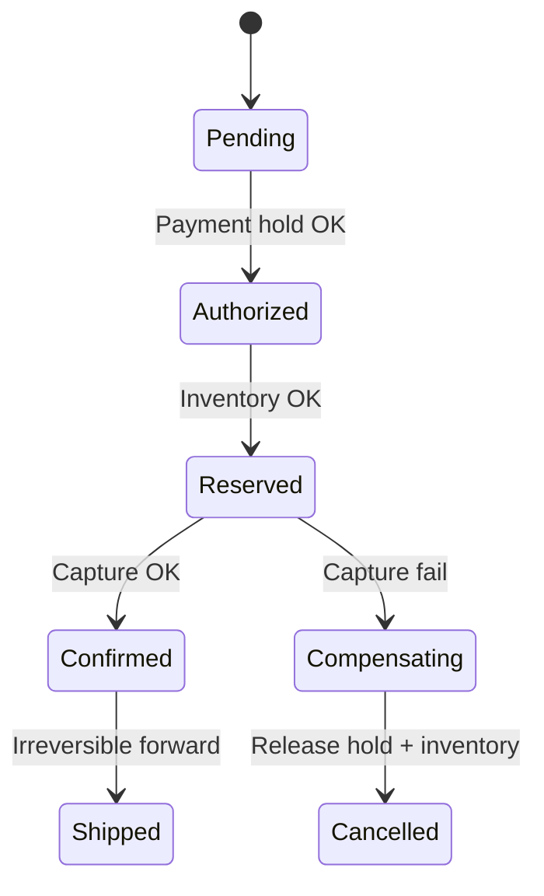

# Saga Patterns

## What Problem Does It Solve?

In a monolith, you have a single database and can wrap multiple operations in one ACID transaction. But in microservices, each service owns its own database. How do you maintain data consistency across services **without** a distributed transaction (2PC)?

> **The Saga pattern breaks a distributed transaction into a sequence of local transactions**, each with a compensating action to undo its work if a later step fails.

---

## Core Concept

Think of booking a vacation:

1. **Book Flight** → success ✅
2. **Book Hotel** → success ✅
3. **Charge Credit Card** → fails ❌

Without a saga, you'd have a booked flight and hotel but no payment. With a saga, steps 1 and 2 are **compensated** (cancelled) when step 3 fails.

```
Each local transaction:
  ┌──────────────┐
  │  T1 → T2 → T3  (forward transactions)
  │  C1 ← C2 ← C3  (compensating transactions)
  └──────────────┘
```

---

## Two Saga Coordination Strategies

### 1. Choreography-Based Saga

Each service **listens** for events and decides what to do next. There is no central coordinator.



**Pros:**
- Simple, loosely coupled
- No single point of failure

**Cons:**
- Hard to track the overall flow
- Cyclic dependencies can emerge
- Difficult to debug

---

### 2. Orchestration-Based Saga

A central **Saga Orchestrator** tells each service what to do and handles failures.



**Pros:**
- Centralized logic → easier to understand and debug
- Avoids cyclic dependencies

**Cons:**
- Orchestrator is a single point of failure (mitigate with replication)
- More coupling to the orchestrator

---

## Code Example: Orchestration Saga (Node.js)

```typescript
// saga-orchestrator.ts

interface SagaStep<T> {
  name: string;
  execute: (context: T) => Promise<void>;
  compensate: (context: T) => Promise<void>;
}

class SagaOrchestrator<T> {
  private steps: SagaStep<T>[] = [];
  private executedSteps: SagaStep<T>[] = [];

  addStep(step: SagaStep<T>): this {
    this.steps.push(step);
    return this;
  }

  async run(context: T): Promise<void> {
    for (const step of this.steps) {
      try {
        console.log(`Executing: ${step.name}`);
        await step.execute(context);
        this.executedSteps.push(step);
      } catch (error) {
        console.error(`Failed at: ${step.name}. Starting compensation...`);
        await this.compensate(context);
        throw new Error(`Saga failed at step "${step.name}": ${error}`);
      }
    }
    console.log("Saga completed successfully!");
  }

  private async compensate(context: T): Promise<void> {
    // Compensate in reverse order
    for (const step of [...this.executedSteps].reverse()) {
      try {
        console.log(`Compensating: ${step.name}`);
        await step.compensate(context);
      } catch (compError) {
        // Log and continue — compensation must be best-effort
        console.error(`Compensation failed for ${step.name}: ${compError}`);
      }
    }
  }
}

// --- Usage ---

interface OrderContext {
  orderId: string;
  userId: string;
  amount: number;
  paymentId?: string;
}

const saga = new SagaOrchestrator<OrderContext>();

saga
  .addStep({
    name: "Create Order",
    execute: async (ctx) => {
      // POST /orders → creates order in Order DB
      ctx.orderId = "ORD-123";
    },
    compensate: async (ctx) => {
      // DELETE /orders/ORD-123 → removes the order
      console.log(`Cancelled order ${ctx.orderId}`);
    },
  })
  .addStep({
    name: "Process Payment",
    execute: async (ctx) => {
      // POST /payments → charges user
      ctx.paymentId = "PAY-456";
    },
    compensate: async (ctx) => {
      // POST /payments/PAY-456/refund → refunds user
      console.log(`Refunded payment ${ctx.paymentId}`);
    },
  })
  .addStep({
    name: "Reserve Inventory",
    execute: async (_ctx) => {
      // Simulate failure
      throw new Error("Out of stock");
    },
    compensate: async (_ctx) => {
      console.log("Inventory reservation released");
    },
  });

// Execute
saga.run({ orderId: "", userId: "user-1", amount: 99.99 });
// Output:
//   Executing: Create Order
//   Executing: Process Payment
//   Executing: Reserve Inventory
//   Failed at: Reserve Inventory. Starting compensation...
//   Compensating: Process Payment
//   Refunded payment PAY-456
//   Compensating: Create Order
//   Cancelled order ORD-123
```

---

## When to Use Which?

| Factor | Choreography | Orchestration |
|---|---|---|
| **Number of services** | 2–4 services | 4+ services |
| **Complexity** | Simple flows | Complex, branching flows |
| **Coupling** | Loose | Medium (via orchestrator) |
| **Visibility** | Hard to trace | Easy to trace |
| **Best for** | Simple event chains | Order processing, booking systems |

---

## Key Design Rules

1. **Compensations must be idempotent** — they might be retried.
2. **Compensations must be commutative** — order shouldn't matter for correctness.
3. **Use a "saga log"** — persist the state of each step so you can recover after crashes.
4. **Semantic locks** — mark resources as "pending" during the saga to prevent other transactions from using them.

---

## Real-World Examples

- **Netflix** uses orchestrated sagas for subscription management
- **Uber** uses sagas for ride booking (reserve driver → calculate fare → charge rider)
- **Amazon** uses saga-like flows for order fulfillment across warehouses

---

## Key Takeaways

- Sagas trade **atomicity** for **availability** (they're eventually consistent)
- Always design compensating transactions alongside your forward transactions
- Orchestration is generally preferred for anything non-trivial
- Combine with **idempotency keys** and **saga logs** for production resilience

---

## Senior Pitfalls

| Mistake | Impact | Fix |
|---------|--------|-----|
| Compensating with literal `DELETE` mirrors | Business undo ≠ technical undo; audit and legal violations | Semantic compensations (refund, credit, status flags) |
| Choreography for payment-critical flows | No global state; stuck trips invisible until reconciliation | Orchestrator + persisted saga log for money paths |
| Missing idempotency on forward/compensate steps | Double charge on retry | Idempotency keys per step; store step outcomes |
| No timeout on saga steps | Resources held indefinitely; inventory locks | Per-step deadlines; escalation and manual intervention queue |
| Ordering compensations backward incorrectly | Later step compensated before earlier dependency | Define compensation DAG; test failure injection per step |
| Sharing DB between saga services | Tight coupling; not a distributed transaction boundary | Outbox per service; API contracts per step |

---

## Production-grade Practice

1. **Build:** Implement orchestrated saga (3 steps) with in-memory state machine; inject failure on step 2 and verify compensation order and final consistency.
2. **Debug:** Replay duplicate Kafka events into saga consumer without idempotency; add dedupe table and prove zero duplicate side effects.
3. **Measure:** Time-to-complete and stuck-saga count under 1% poison messages; SLO for saga completion p99.
4. **Capacity plan:** Size orchestrator DB (saga rows/sec, retention for audit) and worker pool for peak checkout events.

---

## FAANG Interview Deep Dive

### Real-world FAANG examples

**Netflix (subscription & billing orchestration)**  
Netflix’s member lifecycle spans identity, entitlements, payment instruments, and regional tax rules across dozens of services. Long-running flows (plan change mid-cycle, dunning after card failure, grace-period downgrade) are modeled as **orchestrated sagas** with persisted state machines—not 2PC across billing and playback. Compensation is asymmetric: a failed charge triggers refund/retry policies, while entitlement revocation is **forward-only** with TTL (you don’t “un-watch” already streamed bytes). Interview signal: they care about **semantic compensations** (business meaning of undo), not literal `DELETE` mirrors of every step.

**Uber (trip lifecycle)**  
A ride is a saga: match driver → start trip → fare calculation → payment → driver payout → ratings. Choreography handles high-volume **event fan-out** (location, ETA), but the **money path** is orchestrated with explicit states and idempotent payment APIs. If payment fails after trip end, compensation does not delete the trip record—it moves the trip to `payment_failed` and triggers collections. Candidates should articulate **which steps are compensable vs. irreversible**.

**Amazon (order fulfillment)**  
Order placement splits inventory reservation, payment auth/capture, and multi-warehouse shipment into local transactions. Fulfillment uses **saga logs + outbox** so a crashed worker resumes from last committed step. Partial shipment is normal: the saga completes in **multiple forward branches** rather than one global rollback. This is why interviewers push back on “just use a distributed transaction.”



### Interview Q&A

### Q: Why not use 2PC/XA across microservices instead of sagas?
**A:** 2PC blocks resources on all participants until the coordinator decides, hurting availability under partitions and coupling failure domains. Sagas trade **atomicity** for **eventual consistency** with explicit compensations. At Google/Meta scale, coordinators become bottlenecks and locks on external PSPs (Stripe, Adyen) are unacceptable. Use sagas when each step has a **clear local transaction** and business-defined undo; reserve 2PC for **single data store** or tightly owned infrastructure (e.g., one shard’s internal workflow).

### Q: Choreography vs orchestration for a 6-step checkout—what do you pick?
**A:** Orchestration when you need **visibility, branching, timeouts, and human-in-the-loop** (fraud review). Choreography when 2–3 services react to domain events with stable contracts and no central team owns the flow. Hybrid is common: orchestrator for payment path, choreography for analytics. Trade-off: orchestrator SPOF mitigated by active-active state store (DynamoDB/Cassandra) and idempotent step handlers; choreography risks **implicit distributed state machine** nobody owns.

### Q: How do you handle a compensation that fails?
**A:** Treat compensation as **at-least-once** with idempotency keys. Persist saga state (`RUNNING`, `COMPENSATING`, `FAILED_COMPENSATION`). Alert on `FAILED_COMPENSATION` for manual reconciliation—Stripe refunds, inventory “un-reserve” queues. Never assume compensation order alone guarantees correctness; use **semantic locks** (order status `PENDING_PAYMENT`) so concurrent sagas don’t double-charge.

### Q: Is a saga eventually consistent? What does the user see?
**A:** Yes. UX patterns: **pending** UI, optimistic updates with rollback, or synchronous orchestration only for the **minimal critical path** (auth + inventory hold) then async for the rest. Interview depth: define **consistency window SLAs** (“order confirmed within 5s or show error”) vs. background fulfillment.

### Q: How does this relate to the Outbox pattern?
**A:** Each local transaction writes business data + outbox row atomically; a relay publishes events. Sagas without outbox risk **dual-write** bugs (DB committed, event lost). At Amazon/Stripe, outbox + consumer idempotency is the default production pairing.

```typescript
// Idempotent compensation (sketch)
async function refundPayment(paymentId: string, idempotencyKey: string) {
  const existing = await refunds.findByKey(idempotencyKey);
  if (existing) return existing;
  return stripe.refunds.create({ payment_intent: paymentId }, { idempotencyKey });
}
```

### Common mistakes candidates make

- Claiming sagas are “ACID across services”—they are **not**; interviewers expect you to name what invariant you **actually** guarantee (e.g., “no double charge,” not “all tables identical at all times”).
- Designing compensations as naive inverse SQL (`DELETE` row) when the business requires **audit trails**, refunds, or irreversible side effects (email sent, GPU job started).
- Ignoring **ordering and concurrency**: two sagas on the same aggregate without versioning or locks.
- Choosing choreography for complex flows and being unable to answer “show me the saga state for order X in prod.”

### Decision framework

| Signal | When to use sagas | When NOT to use sagas |
|--------|-------------------|------------------------|
| **Transaction span** | Multiple services, each with own DB, long-running | Single DB—use local ACID |
| **Consistency need** | Business tolerates seconds/minutes of partial state | Hard invariant requiring linearizable cross-service commit |
| **Failure modes** | Compensations are defined and testable | “Undo” is legally/operationally impossible |
| **Flow complexity** | Branching, timeouts, human steps | One fire-and-forget event |
| **Team maturity** | Saga log, idempotency, monitoring in place | Greenfield with no observability—fix boundaries first |
| **Volume** | Thousands of concurrent sagas with partitioned orchestrators | Low volume where workflow engine + one DB suffices |
