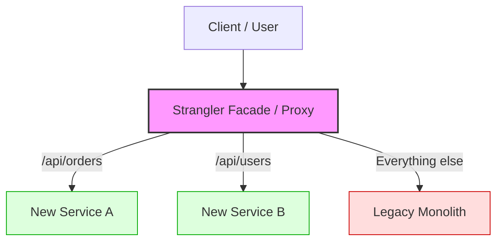
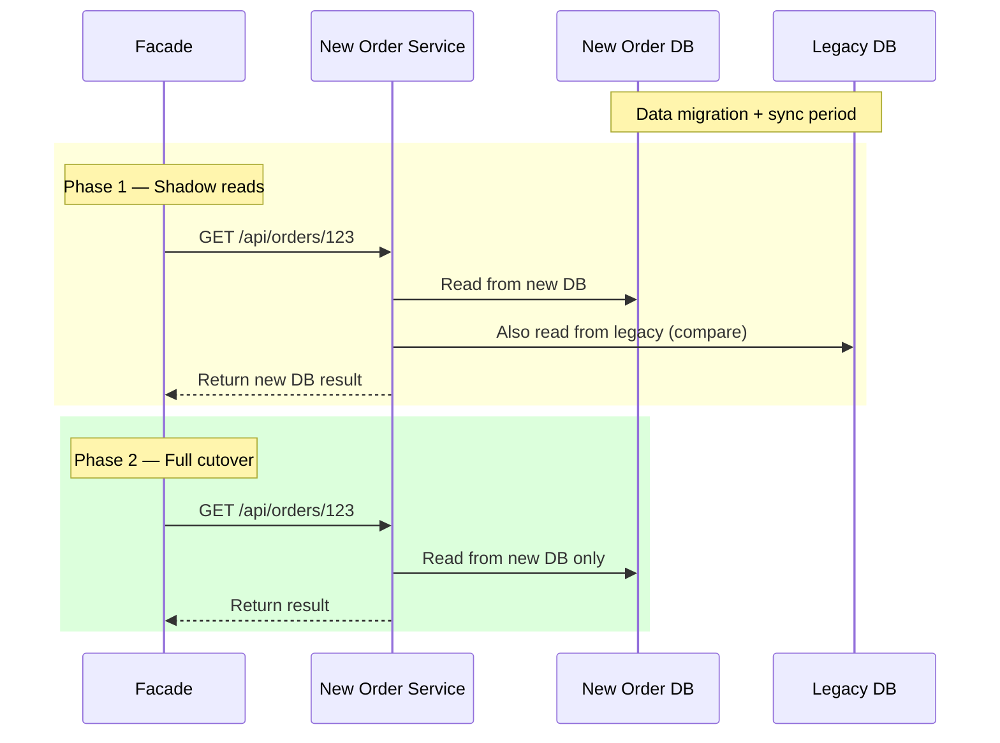
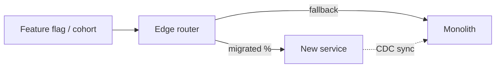

# Strangler Fig Pattern

## What Problem Does It Solve?

You have a **large, monolithic legacy system** and you want to migrate to microservices. But you can't do a "big bang" rewrite — that's too risky and takes too long. How do you incrementally replace a monolith?

> **The Strangler Fig pattern** lets you incrementally replace parts of a legacy system by routing traffic to new services, one feature at a time — like a strangler fig tree that slowly grows around and replaces its host tree.

---

## The Analogy

In nature, a **strangler fig** seed lands on a host tree, grows roots down to the ground, and eventually envelops and replaces the host tree entirely.

```
Phase 1: Seed          Phase 2: Growing        Phase 3: Replaced
┌─────────────┐       ┌─────────────┐         ┌─────────────┐
│   Monolith  │       │  ┌────────┐ │         │ ┌─────────┐ │
│             │       │  │New Svc │ │         │ │ New     │ │
│  Feature A  │       │  │  A     │ │         │ │ System  │ │
│  Feature B  │  →    │  └────────┘ │    →    │ │ A,B,C   │ │
│  Feature C  │       │  Feature B  │         │ └─────────┘ │
│             │       │  Feature C  │         │             │
└─────────────┘       └─────────────┘         └─────────────┘
```

---

## How It Works



The **Strangler Facade** (usually a reverse proxy or API gateway) is the key component. It intercepts all traffic and decides:
- Should this go to the **new service**? → Route there
- Not migrated yet? → Route to the **legacy monolith**

---

## Step-by-Step Migration

### Step 1: Identify a Bounded Context

Pick a module from the monolith that is:
- Well-defined with clear boundaries
- Low-risk (not the payment system on day one!)
- Has clear APIs/interfaces

### Step 2: Build the New Service

Implement the same functionality as a standalone microservice:

```python
# new_order_service.py (FastAPI)
from fastapi import FastAPI

app = FastAPI()

@app.get("/api/orders/{order_id}")
async def get_order(order_id: str):
    # New implementation using new database
    order = await new_order_db.find(order_id)
    return {"id": order.id, "status": order.status, "items": order.items}

@app.post("/api/orders")
async def create_order(order: OrderRequest):
    # New business logic
    result = await order_service.create(order)
    return {"id": result.id, "status": "created"}
```

### Step 3: Set Up the Facade (Proxy)

```nginx
# nginx.conf acting as Strangler Facade

upstream legacy_monolith {
    server monolith.internal:8080;
}

upstream new_order_service {
    server orders.internal:3000;
}

upstream new_user_service {
    server users.internal:3001;
}

server {
    listen 80;

    # ✅ Migrated: Route to new service
    location /api/orders {
        proxy_pass http://new_order_service;
    }

    # ✅ Migrated: Route to new service
    location /api/users {
        proxy_pass http://new_user_service;
    }

    # ⏳ Not yet migrated: Route to legacy
    location / {
        proxy_pass http://legacy_monolith;
    }
}
```

### Step 4: Migrate Data



### Step 5: Decommission the Old Module

Once you're confident:
1. Remove the route from legacy in the facade
2. Remove the code from the monolith
3. Drop legacy tables (after a grace period)

---

## Code Example: Programmatic Facade (Node.js)

```typescript
// strangler-proxy.ts
import express from "express";
import { createProxyMiddleware } from "http-proxy-middleware";

const app = express();

// Configuration: which routes are migrated
const routeConfig = {
  "/api/orders":    "http://new-order-service:3000",
  "/api/users":     "http://new-user-service:3001",
  "/api/products":  "http://new-product-service:3002",
  // everything else → legacy
};

// Feature flags for gradual rollout
const featureFlags = {
  "/api/orders": { enabled: true, rolloutPercent: 100 },
  "/api/users":  { enabled: true, rolloutPercent: 50 },  // 50% canary
  "/api/products": { enabled: false, rolloutPercent: 0 }, // not yet
};

// Set up routes for migrated services
for (const [path, target] of Object.entries(routeConfig)) {
  const flag = featureFlags[path];

  app.use(path, (req, res, next) => {
    if (flag?.enabled && Math.random() * 100 < flag.rolloutPercent) {
      // Route to new service
      console.log(`[STRANGLER] ${path} → NEW service`);
      createProxyMiddleware({ target, changeOrigin: true })(req, res, next);
    } else {
      // Route to legacy
      console.log(`[STRANGLER] ${path} → LEGACY`);
      next(); // falls through to legacy catch-all
    }
  });
}

// Catch-all: everything not migrated goes to legacy
app.use(
  "/",
  createProxyMiddleware({
    target: "http://legacy-monolith:8080",
    changeOrigin: true,
  })
);

app.listen(80, () => {
  console.log("Strangler Facade running on :80");
});
```

---

## Migration Strategies Within Strangler Fig

| Strategy | Description | Risk |
|---|---|---|
| **Route-based** | Redirect entire URL paths | Low |
| **Header-based** | Use custom headers to route specific users | Low |
| **Percentage-based** | Canary — route X% to new, (100-X)% to old | Medium |
| **Feature-flag** | Toggle per feature at runtime | Low |
| **Dark launching** | New service processes but doesn't serve response | Very Low |

---

## Anti-Patterns to Avoid

1. **Sharing a database** between monolith and new service — you're just creating a distributed monolith
2. **Big-bang cutover** — defeats the purpose of incremental migration
3. **No data validation** — always compare old vs new results during shadow period
4. **Ignoring the facade** — the facade should eventually disappear too; don't let it become a monolith

---

## Real-World Examples

- **Amazon** migrated from a monolith to microservices over ~6 years using this pattern
- **Shopify** incrementally extracted services from their Ruby monolith
- **The Guardian** (newspaper) migrated from Java to Scala using a strangler approach

---

## Key Takeaways

- Start with **low-risk, well-bounded** modules
- The **facade/proxy** is the heart of the pattern
- Use **shadow reads** and **canary routing** to build confidence
- Never share a database between old and new — that's not strangling, that's co-dependency
- The goal is to eventually **delete the monolith entirely**

---

## Senior Pitfalls

| Mistake | Impact | Fix |
|---------|--------|-----|
| Shared database between monolith and microservice | Cannot delete legacy; schema coupling forever | Strangle data: API boundary + sync/outbox, then split DB |
| Big-bang route flip for high-traffic path | Revenue incident; rollback harder than forward | Canary %, shadow reads, feature flags per route |
| No traffic comparison metrics old vs new | Silent wrong answers until customer complaints | Diff responses in shadow; metric parity dashboards |
| Migrating write path before read path | Dual-write complexity without read validation | Reads first (shadow), then writes with reconciliation |
| Leaving “temporary” proxy routes for years | Two code paths; security patches doubled | Sunset dates; delete routes when traffic < 1% |
| Underestimating session/auth coupling | Users logged out or wrong tenant after cutover | Centralize identity; sticky sessions only as bridge |

---

## Production-grade Practice

1. **Build:** Route 5% of one API through new service behind edge proxy; compare latency and error rate to monolith for one week.
2. **Debug:** Run shadow traffic to new stack without serving responses; catalog schema/field mismatches before any cutover.
3. **Measure:** Track % traffic on legacy per endpoint; gate decommission on <0.1% for 30 days with no Sev-2 from that path.
4. **Capacity plan:** Dual-run period CPU/memory for running monolith + new services; budget 6–12 months overlap cost.

---

## FAANG Interview Deep Dive

### Real-world FAANG examples

**Amazon (retail platform evolution)**  
Amazon’s move from the Obidos-era monolith to service-oriented fulfillment did not happen via a single rewrite. Teams extracted **bounded contexts** (catalog, cart, pricing) behind routing layers while the monolith still owned shared tables initially—then **dual-write / CDC** migrated data off shared schemas. The interview lesson: Amazon eventually paid the price for shared DB; strangler success required **stopping new features in the monolith** for migrated domains.

**Shopify (Ruby monolith → modular extraction)**  
Shopify used componentization inside the monolith (packwerk-style boundaries) before extracting high-churn domains (payments, identity). The **strangler facade** was often their edge + internal RPC routing, with **shadow traffic** comparing responses. They emphasize **vertical slices** (one user journey end-to-end) over horizontal “extract all repositories.”

**Google (internal legacy replacements)**  
Large Google teams replace C++/Java monoliths behind **traffic directors** and **feature flags** tied to identity cohorts. Migration includes **read path first** (new service serves, monolith still writes) then **write cutover** with reconciliation jobs. Interviewers care about **rollback**: can you route 100% back to legacy in &lt;5 minutes without data loss?



### Interview Q&A

### Q: What’s the first module you strangler—payments or admin reports?
**A:** Neither on day one unless forced. Pick a **well-bounded, medium-traffic, reversible** domain (e.g., product recommendations read API). Payments need PCI scope, idempotency, and reconciliation—extract after you’ve proven facade + data sync discipline. Trade-off: boring first slice builds organizational muscle; exciting first slice risks company-ending incidents.

### Q: Can the new service read from the monolith database during migration?
**A:** Short-term **read-only** access is a common stepping stone; **shared writable** schema is an anti-pattern (distributed monolith). Better: **CDC/outbox** from monolith DB to new store, or API-based anti-corruption layer. If you share writes, interviewers should hear you say **dual-write with reconciliation** and why it’s painful.

### Q: How do you validate correctness during shadow mode?
**A:** Sample traffic: execute both paths, **diff responses** (semantic diff, not JSON string equality), metrics on mismatch rate, block cutover if &gt; threshold. Log correlation IDs across legacy and new. For writes, use **dark launch** (process without committing) or write to shadow tables.

### Q: When do you delete code from the monolith?
**A:** After **traffic = 100%** for a sustained window, **data backfill complete**, and **no downstream still calls monolith module**. Run a “tombstone period” where monolith route returns 410 with redirect. Measure: error rate, p99 latency, support tickets.

### Q: Does the strangler facade become permanent technical debt?
**A:** It should **shrink** as legacy dies—eventually merge into a standard API gateway or mesh ingress. If the facade accumulates business logic, you’ve built a **new monolith**. Keep routing, auth termination, and migration toggles there; not domain rules.

### Common mistakes candidates make

- **Big-bang cutover** while claiming “we use strangler fig.”
- **Shared mutable database** between monolith and microservice without a documented sync/reconciliation story.
- Migrating **horizontal layers** (all DAOs) instead of **vertical user journeys**.
- No **rollback plan** or feature-flagged routing—interviewers treat this as operational immaturity.

### Decision framework

| Signal | When to use strangler fig | When NOT to use strangler fig |
|--------|---------------------------|-------------------------------|
| **System age** | Large legacy, continuous delivery needed | Greenfield—build modular monolith |
| **Risk tolerance** | Must ship during migration | Small codebase—rewrite in place may be cheaper |
| **Domain clarity** | Bounded contexts emerging | Domain unknown—strangler freezes wrong cuts |
| **Traffic shape** | Canary/shadow routing available | All-or-nothing batch jobs only |
| **Data** | CDC, backfill, reconciliation feasible | Strong cross-module FK graph with no escape |
| **Org** | Teams can own extracted services | Single team—modular monolith first |
