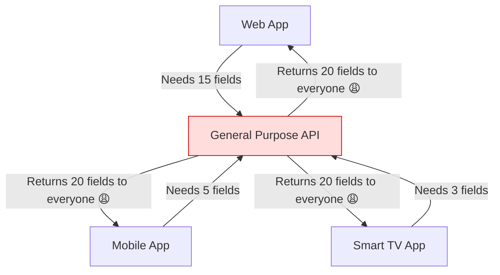
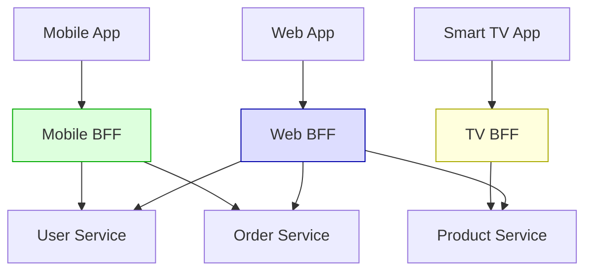
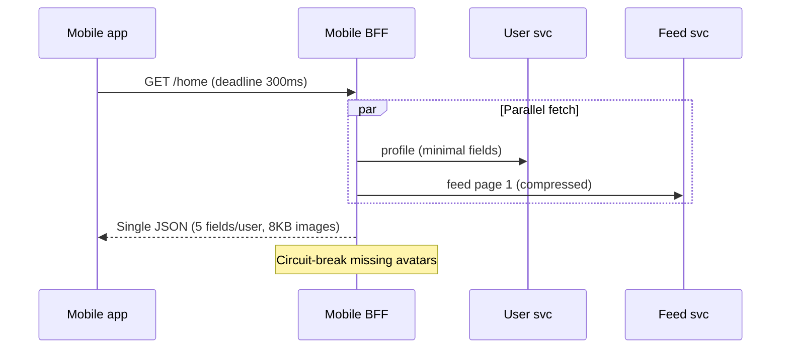

# Backend For Frontend (BFF)

## What Problem Does It Solve?

You have a single general-purpose API backend, but your **mobile app** needs different data than your **web app**, which needs different data than your **smart TV app**. You end up with:

- Over-fetching (mobile gets data it doesn't need)
- Under-fetching (web needs extra calls)
- One API trying to serve everyone and serving no one well

> **BFF (Backend For Frontend)** gives each frontend its **own dedicated backend** that serves exactly the data and format that frontend needs.

---

## The Problem Without BFF



**Problems:**
- Mobile wastes bandwidth downloading unused fields
- Web needs multiple API calls to assemble one page
- API becomes bloated with `if (platform === 'mobile')` logic

---

## The Solution With BFF



Each BFF:
- Aggregates data from multiple microservices
- Shapes the response for its specific frontend
- Handles authentication/authorization specific to that platform
- Can be owned by the frontend team

---

## Code Example

### Without BFF — General API (bloated)

```javascript
// general-api/routes/dashboard.js
app.get("/api/dashboard", async (req, res) => {
  const user = await userService.getUser(req.userId);
  const orders = await orderService.getOrders(req.userId);
  const recommendations = await productService.getRecommendations(req.userId);
  const analytics = await analyticsService.getUserAnalytics(req.userId);
  const notifications = await notificationService.getAll(req.userId);

  // Returns EVERYTHING — mobile doesn't need analytics or full notifications
  res.json({
    user,              // 20 fields
    orders,            // full order objects with line items
    recommendations,   // 50 products with images
    analytics,         // charts data
    notifications,     // 100+ notifications
  });
});
```

### With BFF — Mobile BFF (lean and focused)

```typescript
// mobile-bff/routes/dashboard.ts
import express from "express";

const app = express();

app.get("/api/dashboard", async (req, res) => {
  // Fetch only what mobile needs, in parallel
  const [user, recentOrders] = await Promise.all([
    userService.getUser(req.userId),
    orderService.getRecentOrders(req.userId, { limit: 5 }),
  ]);

  // Shape response specifically for mobile
  res.json({
    user: {
      name: user.name,
      avatar: user.avatarUrl,        // mobile-optimized image
      loyaltyPoints: user.points,
    },
    recentOrders: recentOrders.map((o) => ({
      id: o.id,
      status: o.status,
      total: o.total,
      itemCount: o.items.length,     // just count, not full items
    })),
    unreadNotifications: user.unreadCount,  // just a count!
  });
});

app.listen(3001, () => console.log("Mobile BFF on :3001"));
```

### With BFF — Web BFF (rich and detailed)

```typescript
// web-bff/routes/dashboard.ts
import express from "express";

const app = express();

app.get("/api/dashboard", async (req, res) => {
  // Web needs more data — fetch it all
  const [user, orders, recommendations, analytics, notifications] =
    await Promise.all([
      userService.getUser(req.userId),
      orderService.getOrders(req.userId, { limit: 20 }),
      productService.getRecommendations(req.userId, { limit: 12 }),
      analyticsService.getUserAnalytics(req.userId),
      notificationService.getAll(req.userId, { limit: 50 }),
    ]);

  res.json({
    user: {
      ...user,
      avatar: user.avatarUrlHiRes,  // high-res for web
    },
    orders: orders.map((o) => ({
      ...o,
      items: o.items,              // full line items for web
      trackingUrl: o.trackingUrl,
    })),
    recommendations,
    analytics: {
      spendingChart: analytics.monthlySpend,
      topCategories: analytics.categories,
    },
    notifications,
  });
});

app.listen(3000, () => console.log("Web BFF on :3000"));
```

---

## BFF Architecture Decisions

### Who Owns the BFF?

```
Option A: Frontend team owns BFF          Option B: Dedicated BFF team
┌──────────────────────────────┐          ┌──────────────────────────────┐
│  Web Team                    │          │  BFF Team                    │
│  ├── React App               │          │  ├── Web BFF                 │
│  └── Web BFF ← owns this     │          │  ├── Mobile BFF              │
│                              │          │  └── TV BFF                  │
│  Mobile Team                 │          │                              │
│  ├── React Native App        │          │  Web Team → requests changes │
│  └── Mobile BFF ← owns this  │          │  Mobile Team → requests      │
└──────────────────────────────┘          └──────────────────────────────┘

✅ Recommended: Option A                   ❌ Bottleneck risk
```

**Option A is preferred** because the frontend team knows exactly what data they need and can iterate independently.

---

## GraphQL as a BFF Alternative

GraphQL can sometimes replace a dedicated BFF because the client decides what data to fetch:

```graphql
# Mobile query — fetches minimal data
query MobileDashboard {
  user(id: "123") {
    name
    avatarUrl
    loyaltyPoints
  }
  recentOrders(limit: 5) {
    id
    status
    total
  }
}

# Web query — fetches rich data
query WebDashboard {
  user(id: "123") {
    name
    email
    avatarUrlHiRes
    address { street city country }
  }
  orders(limit: 20) {
    id
    status
    total
    items { name quantity price }
    trackingUrl
  }
  recommendations(limit: 12) {
    id
    name
    imageUrl
    price
  }
}
```

**But** GraphQL doesn't fully replace BFF when you need:
- Platform-specific auth (OAuth for web, biometric for mobile)
- Different caching strategies per platform
- Platform-specific business logic

---

## When to Use BFF

| Scenario | Use BFF? |
|---|---|
| Single frontend (e.g., only web) | ❌ Overkill |
| 2+ frontends with very different needs | ✅ Yes |
| Mobile + Web with same data needs | ❌ One API is fine |
| Mobile + Web + IoT + TV | ✅ Definitely |
| Migrating from monolith | ✅ BFF can be the facade |

---

## Key Takeaways

- **One BFF per frontend type** — don't share BFFs across platforms
- **Frontend team should own their BFF** — they know their data needs
- BFFs aggregate, transform, and optimize data for their specific client
- Consider **GraphQL** as a lighter alternative for simpler cases
- BFF is not a place for **business logic** — that stays in downstream services
- Watch for **code duplication** across BFFs — extract shared logic into libraries

---

## Senior Pitfalls

| Mistake | Impact | Fix |
|---------|--------|-----|
| One BFF serving web, iOS, and Android | Lowest-common-denominator API; mobile pays web tax | Separate BFF per client family with shared domain services |
| BFF becomes orchestration god-object | Deploy bottleneck; same failures as monolith | Thin aggregation; push logic to domain services |
| N+1 service calls from BFF | Tail latency explodes on home feed | Batch APIs, GraphQL DataLoader pattern, parallel with budgets |
| Duplicating authorization in every BFF | Policy drift; security holes on one client | Shared authz library or central PDP; BFF enforces token only |
| Caching personalized responses at CDN | User A sees User B data | Cache only public fragments; private at origin |
| No contract tests between BFF and clients | Mobile store review blocked on breaking JSON | Consumer-driven contracts; schema versioning |

---

## Production-grade Practice

1. **Build:** Split one generic API into mobile BFF (minimal payload) and web BFF (rich); measure bytes per session and TTFB.
2. **Debug:** Trace one slow screen load; identify serial downstream calls and refactor to batched domain API.
3. **Measure:** p99 BFF latency vs sum of backend latencies (parallelism efficiency); target <1.2× slowest dependency.
4. **Capacity plan:** BFF instances per peak concurrent users; include connection pools to each downstream service.

---

## FAANG Interview Deep Dive

### Real-world FAANG examples

**Netflix (device-specific APIs)**  
Netflix serves TV, mobile, web, and partner devices with different codec, DRM, and UI constraints. Client teams historically relied on **tailored API aggregations** (and GraphQL at the edge for some surfaces) so a TV app doesn’t download phone-sized artwork metadata. Architecture decision: **domain services stay canonical**; presentation-specific shaping and caching TTLs live at the edge/BFF layer.

**Spotify (client platforms)**  
Mobile needs offline-first bundles; web needs rich playlist metadata. BFFs (or client-specific gateway graphs) **fan in** multiple backend domains (social, catalog, playback) with platform-specific pagination and field masks. Interview angle: BFF owns **orchestration latency budget**—parallel calls with deadlines and partial degradation (show playlist without friend avatars).

**Meta (mobile vs web feed)**  
Feed ranking and GraphQL-like field selection reduce over-fetching, but mobile still uses **lighter payloads** and different **auth/session** flows (app attestation, cookie vs token). BFF pattern appears as **product-specific gateway tiers**, not one mega `/api` for all clients. Trade-off: duplicate aggregation logic vs. client complexity—Meta leans on schema + codegen with strict ownership.



### Interview Q&A

### Q: BFF vs API Gateway—where does auth live?
**A:** Gateway: TLS, rate limits, JWT validation, coarse routing. BFF: **session semantics**, device-specific OAuth, translating tokens to internal service credentials, **per-client authorization** (TV pairing codes). Putting heavy business auth in gateway couples all clients; duplicating in every BFF needs a **shared auth library**.

### Q: When does GraphQL replace a BFF?
**A:** When clients need **flexible field selection** and you can enforce **query cost limits**, persisted queries, and server-side batching (DataLoader). GraphQL does **not** replace BFF when you need **platform-specific branching** (push notification registration on mobile only) or different **caching** (CDN for web, on-device for mobile). Many FAANG answers: “GraphQL at the edge + thin BFF for platform quirks.”

### Q: Isn’t a BFF just a god service?
**A:** It becomes one if you put **domain rules** there. Correct BFF: aggregation, mapping, caching, protocol adaptation. Wrong BFF: pricing, inventory rules, fraud scoring. Test: if web and mobile BFFs diverge on business logic, extract a **domain service**.

### Q: How do you handle N+1 calls from a BFF?
**A:** Parallel `Promise.all` with per-upstream timeouts, **batch APIs** downstream (`GET /users?ids=`), GraphQL dataloader, or **materialized read models** for hot screens. Interviewers want numbers: 6 serial 40ms calls = 240ms; parallel capped at slowest dependency.

### Q: One BFF per team or per client type?
**A:** **Per client type** (or per product surface), owned by the client team. Sharing one BFF across iOS + Android + Web recreates the general API problem. Shared **npm package** for HTTP clients and mappers, not shared deployable.

```typescript
// BFF: deadline + partial response
const [user, feed] = await Promise.allSettled([
  withTimeout(userClient.getLite(userId), 150),
  withTimeout(feedClient.getPage(userId, 1), 200),
]);
return {
  user: user.status === "fulfilled" ? user.value : { id: userId },
  feed: feed.status === "fulfilled" ? feed.value : { items: [], degraded: true },
};
```

### Common mistakes candidates make

- Putting **core business logic** in the BFF because “it’s faster to ship.”
- **One shared BFF** for all platforms—reintroduces `if (mobile)` spaghetti.
- No **timeout/cancellation** propagation—BFF becomes tail-latency multiplier.
- Calling BFF a fix for **bad domain boundaries** (chatty microservices)—fix services or add read models first.

### Decision framework

| Signal | When to use BFF | When NOT to use BFF |
|--------|-----------------|---------------------|
| **Clients** | 2+ platforms with different payload/latency needs | Single web SPA, same shape |
| **Aggregation** | Home screen needs 5+ services | One service per screen |
| **Ownership** | Frontend teams can own deployable | No capacity—use GraphQL + gateway |
| **Logic** | Presentation mapping only | Domain rules leaking into BFF |
| **Scale** | Need per-client rate limits and caching | Thin CRUD—general API + OpenAPI |
| **Migration** | Strangler facade for monolith decomposition | Internal-only gRPC already optimal |
