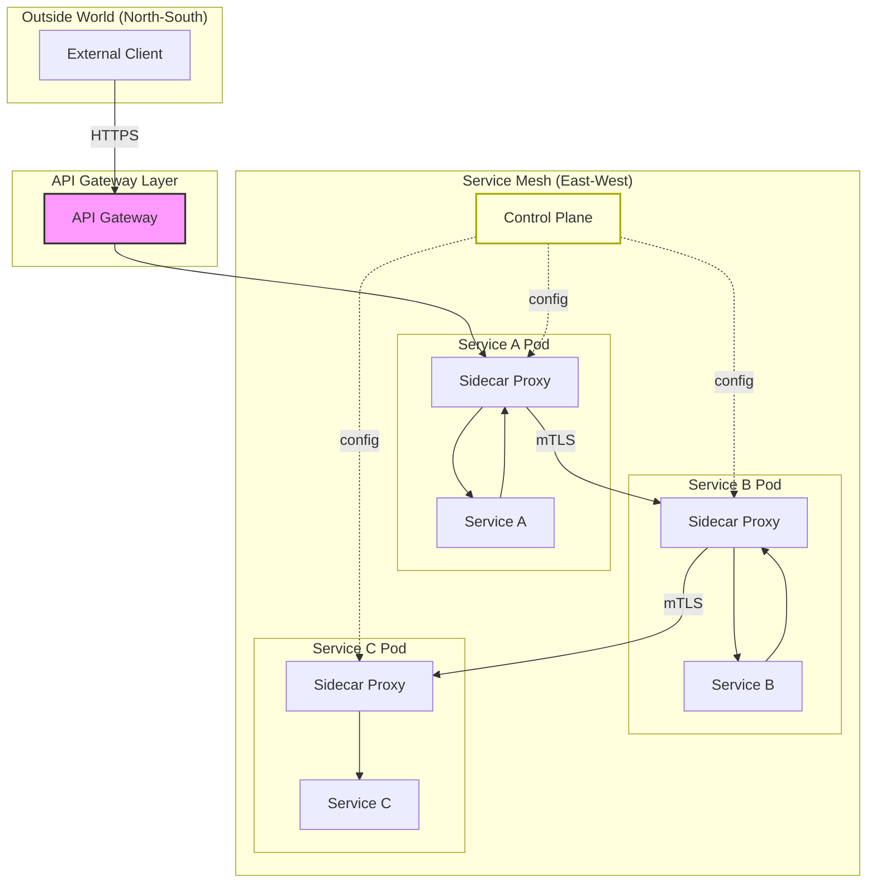
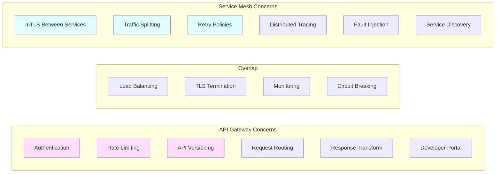
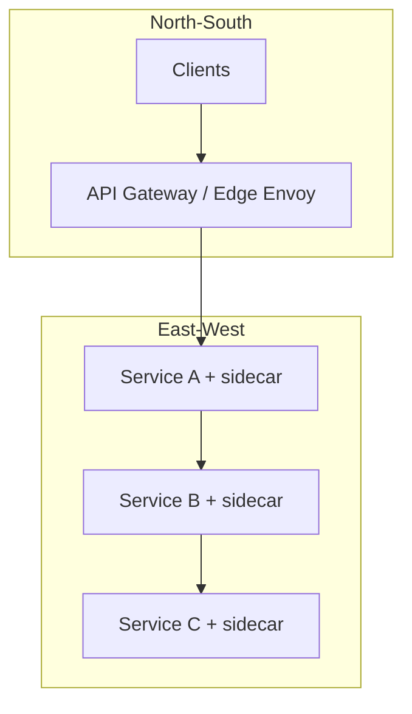

# API Gateway vs Service Mesh

## The Core Question

Both an **API Gateway** and a **Service Mesh** manage traffic between services. So what's the difference?

> **API Gateway** = manages traffic from **outside** (north-south traffic: client → services)  
> **Service Mesh** = manages traffic **between** services (east-west traffic: service → service)

---

## Visual Overview



---

## API Gateway — Deep Dive

### What It Does

An API Gateway sits at the **edge** of your system and handles:

```
Client Request → [API Gateway] → Backend Service
                     │
                     ├── Authentication (JWT, API keys)
                     ├── Rate Limiting
                     ├── Request Routing
                     ├── Load Balancing
                     ├── SSL Termination
                     ├── Request/Response Transformation
                     ├── Caching
                     ├── API Versioning
                     └── Logging & Monitoring
```

### Code Example: API Gateway with Express

```typescript
// api-gateway.ts
import express from "express";
import rateLimit from "express-rate-limit";
import jwt from "jsonwebtoken";

const app = express();

// --- Rate Limiting ---
const limiter = rateLimit({
  windowMs: 15 * 60 * 1000,    // 15 minutes
  max: 100,                     // 100 requests per window
  message: "Too many requests",
});
app.use(limiter);

// --- Authentication Middleware ---
function authenticate(req, res, next) {
  const token = req.headers.authorization?.split(" ")[1];
  if (!token) return res.status(401).json({ error: "No token" });

  try {
    req.user = jwt.verify(token, process.env.JWT_SECRET);
    next();
  } catch {
    return res.status(403).json({ error: "Invalid token" });
  }
}

// --- Route to Services ---
app.use("/api/orders", authenticate, proxy("http://order-service:3000"));
app.use("/api/users", authenticate, proxy("http://user-service:3001"));
app.use("/api/products", proxy("http://product-service:3002")); // public

// --- Response Transformation ---
app.use("/api/v1/orders", authenticate, async (req, res) => {
  const data = await fetch("http://order-service:3000/orders");
  const orders = await data.json();

  // Transform for v1 API clients
  res.json({
    orders: orders.map((o) => ({
      id: o.id,
      total: o.total,
      // v1 doesn't expose internal fields
    })),
  });
});

app.listen(80);
```

### Popular API Gateways

| Gateway | Type | Best For |
|---|---|---|
| **Kong** | Open source | Plugin ecosystem |
| **AWS API Gateway** | Managed | AWS-native apps |
| **NGINX** | Open source | High performance |
| **Traefik** | Open source | Docker/K8s native |
| **Apigee** | Managed | Enterprise API management |

---

## Service Mesh — Deep Dive

### What It Does

A service mesh manages communication **between** your microservices using **sidecar proxies** that run alongside each service:

```
┌──────────────────────────────────────┐
│  Pod / Container                     │
│  ┌────────────┐   ┌───────────────┐  │
│  │ Your       │◄─►│ Sidecar Proxy │  │  ← All traffic goes through proxy
│  │ Service    │   │ (Envoy)       │  │
│  └────────────┘   └───────────────┘  │
└──────────────────────────────────────┘
          Your code knows NOTHING about:
          • mTLS encryption
          • Retries
          • Circuit breaking
          • Load balancing
          • Tracing
```

### Service Mesh Capabilities

```yaml
# Istio VirtualService — Traffic splitting (canary deployment)
apiVersion: networking.istio.io/v1beta1
kind: VirtualService
metadata:
  name: order-service
spec:
  hosts:
    - order-service
  http:
    - route:
        - destination:
            host: order-service
            subset: v1
          weight: 90        # 90% to v1
        - destination:
            host: order-service
            subset: v2
          weight: 10        # 10% to v2 (canary)
```

```yaml
# Istio DestinationRule — Circuit breaking
apiVersion: networking.istio.io/v1beta1
kind: DestinationRule
metadata:
  name: order-service
spec:
  host: order-service
  trafficPolicy:
    connectionPool:
      tcp:
        maxConnections: 100
      http:
        h2UpgradePolicy: DEFAULT
        http1MaxPendingRequests: 100
        http2MaxRequests: 1000
    outlierDetection:
      consecutive5xxErrors: 5       # After 5 errors...
      interval: 30s                  # ...checked every 30s...
      baseEjectionTime: 30s         # ...eject for 30s
      maxEjectionPercent: 50        # Max 50% of hosts ejected
```

```yaml
# Istio PeerAuthentication — Mutual TLS
apiVersion: security.istio.io/v1beta1
kind: PeerAuthentication
metadata:
  name: default
  namespace: production
spec:
  mtls:
    mode: STRICT    # All service-to-service traffic MUST use mTLS
```

### Popular Service Meshes

| Mesh | Proxy | Best For |
|---|---|---|
| **Istio** | Envoy | Feature-rich, Kubernetes |
| **Linkerd** | linkerd2-proxy (Rust) | Simplicity, low overhead |
| **Consul Connect** | Envoy / built-in | Multi-platform (VMs + K8s) |
| **AWS App Mesh** | Envoy | AWS-native |

---

## Head-to-Head Comparison



| Feature | API Gateway | Service Mesh |
|---|---|---|
| **Traffic direction** | North-South (external → internal) | East-West (internal ↔ internal) |
| **Authentication** | API keys, JWT, OAuth | mTLS (certificate-based) |
| **Rate limiting** | ✅ Yes (per client/API key) | ⚠️ Limited |
| **Load balancing** | ✅ Basic | ✅ Advanced (locality-aware) |
| **Circuit breaking** | ⚠️ Some | ✅ Advanced |
| **Retries** | ⚠️ Basic | ✅ Configurable per-route |
| **Tracing** | ⚠️ Edge-level | ✅ Full distributed tracing |
| **Traffic splitting** | ⚠️ Basic | ✅ Fine-grained (canary, A/B) |
| **Protocol support** | HTTP/REST, GraphQL | HTTP, gRPC, TCP |
| **Deployment** | Centralized | Distributed (sidecar per service) |
| **Performance overhead** | Low (one hop) | Medium (two extra hops per call) |

---

## When to Use What

```
                    ┌─────────────────────────────────┐
                    │  Do you have external clients?  │
                    └────────────┬────────────────────┘
                                 │
                    ┌────────────▼────────────────────┐
                    │           YES                    │
                    │  → You need an API Gateway       │
                    └────────────┬────────────────────┘
                                 │
           ┌─────────────────────▼─────────────────────┐
           │  Do you have many services (10+)          │
           │  communicating with each other?            │
           └──────────┬───────────────┬────────────────┘
                      │               │
              ┌───────▼──────┐ ┌──────▼──────┐
              │     YES      │ │     NO      │
              │ → Add a      │ │ → API       │
              │   Service    │ │   Gateway   │
              │   Mesh too   │ │   is enough │
              └──────────────┘ └─────────────┘
```

**Use API Gateway when:**
- External clients need access to your services
- You need rate limiting, API key management, developer portal
- You need request/response transformation

**Use Service Mesh when:**
- 10+ microservices with complex inter-service communication
- You need zero-trust security (mTLS everywhere)
- You want traffic management without changing application code
- You need fine-grained observability

**Use Both when:**
- Large-scale microservice architecture with external APIs
- API Gateway at the edge, Service Mesh internally

---

## Key Takeaways

- **API Gateway** = bouncer at the door (controls who comes in)
- **Service Mesh** = security cameras + traffic lights inside (controls how things move internally)
- Most production systems use **both** together
- Service meshes add latency (~1-2ms per hop) — worth it at scale, overkill for 3 services
- Start with an API Gateway; add a service mesh when internal traffic complexity justifies it

---

## Senior Pitfalls

| Mistake | Impact | Fix |
|---------|--------|-----|
| Gateway doing business logic | Unversioned rules; outage affects all clients | North-south at gateway; east-west policy in mesh/services |
| Mesh everywhere on day one | Operational tax before service count justifies it | Gateway + libraries first; mesh when mTLS and traffic policy scale |
| Double TLS termination (gateway + mesh) | CPU burn; cert rotation nightmares | Terminate at edge; mesh mTLS inside trust zone |
| Rate limiting only at gateway | Internal abuse and retry storms bypass | Limit at gateway and critical service entry |
| Ignoring gateway as single blast radius | Misconfig takes down all APIs | Staged config rollout; canary gateways per region |
| Service mesh without observability budget | High-cardinality metrics cost; blind during incidents | Tail sampling; RED metrics per service not per pod label explosion |

---

## Production-grade Practice

1. **Build:** Put JWT validation and rate limit at API gateway; enforce mTLS between two services with mesh or sidecar—document trust boundaries.
2. **Debug:** Simulate retry storm from one client; verify limiters at gateway and downstream circuit breakers engage.
3. **Measure:** CPU overhead of mesh sidecars at 1k RPS per pod; decide break-even service count for your org.
4. **Capacity plan:** Gateway connection limits vs peak TLS handshakes; autoscale rules before marketing events.

---

## FAANG Interview Deep Dive

### Real-world FAANG examples

**Lyft / Uber (Envoy origin story)**  
Envoy was built because **north-south** (mobile → edge) and **east-west** (service → service) needed consistent observability, retries, and timeouts without reimplementing in every language. Edge gateways handle **public auth and WAF**; mesh sidecars enforce **mTLS, per-route retries, and outlier detection** between hundreds of internal RPCs. Interview point: mesh value appears when **polyglot services** and **deep call graphs** make library-based resilience inconsistent.

**Google (GFE + internal RPC stack)**  
Google Front Ends terminate TLS and route externally; internal traffic uses **stubby/gRPC** with identity, load balancing, and tracing in the RPC layer—conceptually “mesh without Istio marketing.” Kubernetes adopters mirror this with **Ingress/Gateway API + mesh** (GKE, internal platforms).

**Amazon (API Gateway + App Mesh / VPC lattice)**  
AWS customers often pair **API Gateway/ALB** for external REST with **App Mesh or VPC Lattice** for internal service identity and routing. Stripe-scale external APIs emphasize **idempotency keys and rate limits at the edge**; internal payment adjacency services use **strict mTLS and least-privilege service accounts**.



### Interview Q&A

### Q: Do I need a service mesh with only 5 microservices?
**A:** Usually **no**. A shared client library + centralized observability may suffice. Mesh pays off at **10+ services**, **multi-language**, need for **uniform mTLS** and **traffic shifting without redeploys**. Cost: ~1–3ms hop latency, CPU for sidecars, control-plane operational load. At 5 services, interviewers expect “gateway + good HTTP/gRPC middleware.”

### Q: Can the API Gateway do mTLS between services?
**A:** Gateway terminates client TLS and may re-encrypt to backends, but it’s **not** a replacement for east-west zero trust—compromised internal network bypasses gateway. Mesh provides **per-pod identity** and L7 policy between any pair. Trade-off: gateway-centric mTLS = hub-and-spoke bottleneck; mesh = distributed policy.

### Q: Where do retries belong—gateway or mesh?
**A:** **Idempotent GET** retries can live at edge; **dangerous retries** on POST belong only with idempotency keys and typically at **caller or mesh** with explicit policy. Double retry at gateway **and** mesh multiplies load—configure one layer as primary. FAANG pattern: mesh handles service-to-service retry budgets; gateway handles client-facing 429/503 semantics.

### Q: Istio vs Linkerd for a new platform team?
**A:** Linkerd: lower overhead, simpler ops, Rust proxy—good for **small platform teams**. Istio: richer traffic management, WASM extensibility, steeper learning curve—good when you need **advanced canaries, multi-cluster**. Both require **SRE ownership**; “install and forget” fails interviews.

### Q: How does this interact with Kubernetes Ingress?
**A:** Ingress (or Gateway API) is **north-south into cluster**; mesh is **in-cluster east-west**. Common stack: `Client → Cloud LB → Ingress/Gateway → mesh-enabled service → mesh calls`. Duplicating rate limiting in Ingress and gateway product is redundant—pick one edge policy owner.

### Common mistakes candidates make

- Treating **API Gateway and mesh as interchangeable**—shows confusion on traffic direction.
- Adopting Istio on day one **without** SLOs or tracing—adds latency with no operability win.
- Putting **business logic** in gateway plugins (Kong Lua) that should live in services.
- **Double encryption/retry** stacks with no documented ownership—causes retry storms.

### Decision framework

| Signal | API Gateway | Service Mesh | Both |
|--------|-------------|--------------|------|
| **External API** | Required | Optional | Gateway + mesh internal |
| **Service count** | Any | Often 10+ with deep graphs | Large microservice estate |
| **Security** | OAuth, API keys, WAF | mTLS, service identity | Zero-trust end-to-end |
| **Traffic mgmt** | Coarse routes, versioning | Canary, fault injection, per-route | Full stack |
| **Team** | API platform team | Infra/SRE mesh team | Mature platform org |
| **When NOT** | — | 3 services, one language | Mesh before gateway basics |
