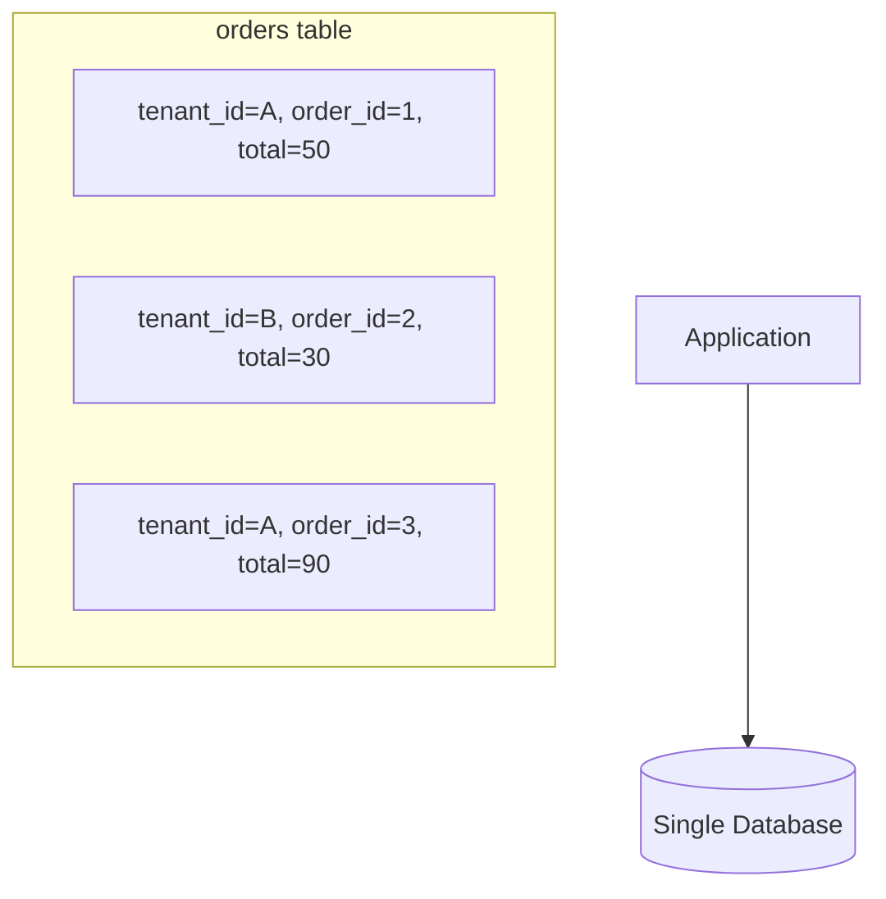
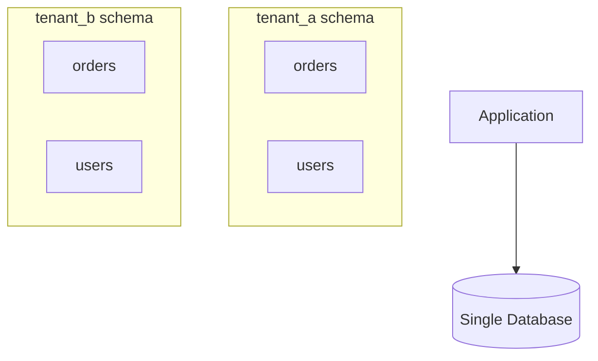
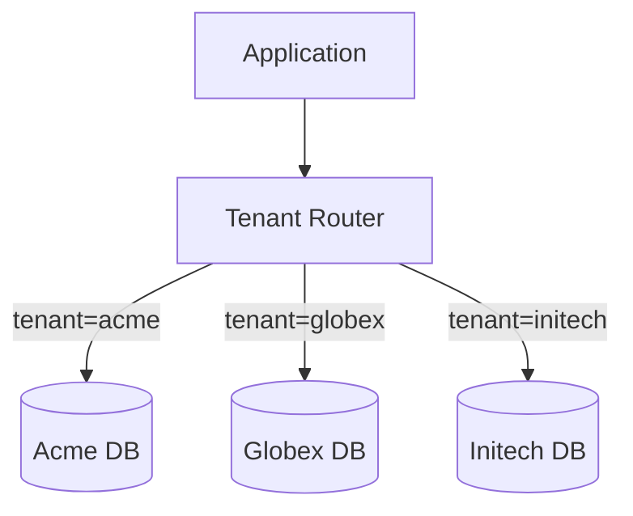
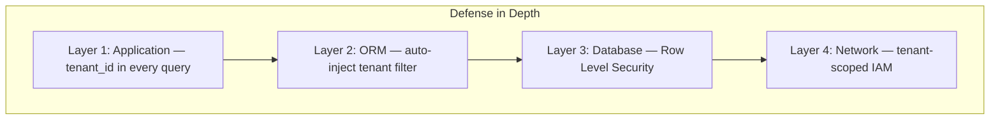
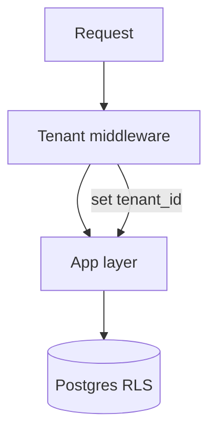

# Multi-Tenancy Architecture

## What Is Multi-Tenancy?

Imagine an apartment building: many tenants (families) live in the same building but each has their own private apartment. They **share** infrastructure (plumbing, electricity, elevators) but their **data** (belongings) is isolated.

> **Multi-tenancy** is a software architecture where a **single instance** of an application serves **multiple tenants** (customers/organizations), with each tenant's data isolated from the others.

---

## Single-Tenant vs Multi-Tenant

```
Single-Tenant (one instance per customer):
┌──────────┐  ┌──────────┐  ┌──────────┐
│ App + DB │  │ App + DB │  │ App + DB │
│ Tenant A │  │ Tenant B │  │ Tenant C │
└──────────┘  └──────────┘  └──────────┘
     3 apps, 3 databases, 3x cost 💸

Multi-Tenant (one instance, many customers):
          ┌──────────────────┐
          │   Shared App     │
          │ ┌──┬──┬──┐       │
          │ │ A│ B│ C│ Data  │
          │ └──┴──┴──┘       │
          └──────────────────┘
     1 app, shared infra, lower cost ✅
```

---

## Three Multi-Tenancy Models

### Model 1: Shared Database, Shared Schema

All tenants share the same database and tables. A `tenant_id` column separates data.



```sql
-- Every query MUST include tenant_id
SELECT * FROM orders WHERE tenant_id = 'tenant_a' AND status = 'active';

-- ⚠️ DANGER: Forgetting tenant_id = data leak!
SELECT * FROM orders WHERE status = 'active';  -- Returns ALL tenants' data!
```

```python
# Safe approach: Middleware that auto-injects tenant_id

class TenantMiddleware:
    """Automatically filters all queries by tenant_id."""
    
    def __init__(self, get_response):
        self.get_response = get_response
    
    def __call__(self, request):
        # Extract tenant from subdomain: acme.myapp.com → "acme"
        tenant_id = request.META['HTTP_HOST'].split('.')[0]
        
        # Store in thread-local for ORM to use
        set_current_tenant(tenant_id)
        
        return self.get_response(request)


# SQLAlchemy example with automatic tenant filtering
class TenantQuery(Query):
    def get(self, *args, **kwargs):
        # Auto-inject tenant_id into every query
        return super().filter(
            self._entity.tenant_id == get_current_tenant()
        ).get(*args, **kwargs)
```

| Pros | Cons |
|---|---|
| Lowest cost | Risk of data leaks if you forget `tenant_id` |
| Easy to manage | Noisy neighbor problem (one tenant's queries slow everyone) |
| Simple onboarding | Hard to customize per tenant |

---

### Model 2: Shared Database, Separate Schemas

Each tenant gets their own **schema** (namespace) within the same database.



```sql
-- PostgreSQL: Create schema per tenant
CREATE SCHEMA tenant_acme;
CREATE TABLE tenant_acme.orders (id SERIAL, total DECIMAL);

CREATE SCHEMA tenant_globex;
CREATE TABLE tenant_globex.orders (id SERIAL, total DECIMAL);

-- Switch schema based on tenant
SET search_path TO tenant_acme;
SELECT * FROM orders;  -- Only sees acme's orders
```

```python
# Django with django-tenants (PostgreSQL schema-based)
# settings.py

DATABASES = {
    'default': {
        'ENGINE': 'django_tenants.postgresql_backend',
        'NAME': 'multi_tenant_db',
    }
}

MIDDLEWARE = [
    'django_tenants.middleware.main.TenantMainMiddleware',  # auto-switches schema
    # ...
]

# The middleware reads the subdomain and sets the PostgreSQL search_path
# acme.myapp.com → SET search_path TO tenant_acme;
# globex.myapp.com → SET search_path TO tenant_globex;
```

| Pros | Cons |
|---|---|
| Better isolation than shared schema | Schema migrations must run per tenant |
| Can customize indexes per tenant | Not all databases support schemas well |
| PostgreSQL RLS adds security | More complex ops (100 tenants = 100 schemas) |

---

### Model 3: Separate Databases

Each tenant gets their **own database** entirely.



```python
# Database router for Django
class TenantDatabaseRouter:
    def db_for_read(self, model, **hints):
        tenant = get_current_tenant()
        return f"tenant_{tenant}"  # returns "tenant_acme", etc.
    
    def db_for_write(self, model, **hints):
        tenant = get_current_tenant()
        return f"tenant_{tenant}"

# settings.py
DATABASES = {
    'default': {},
    'tenant_acme': {
        'ENGINE': 'django.db.backends.postgresql',
        'NAME': 'acme_db',
        'HOST': 'acme-db.rds.amazonaws.com',
    },
    'tenant_globex': {
        'ENGINE': 'django.db.backends.postgresql',
        'NAME': 'globex_db',
        'HOST': 'globex-db.rds.amazonaws.com',
    },
}
```

| Pros | Cons |
|---|---|
| Strongest isolation | Highest cost (one DB per tenant) |
| Easy per-tenant backup/restore | Complex connection management |
| No noisy neighbor | Hard to run cross-tenant queries |
| Regulatory compliance easy | Operational overhead at scale |

---

## Comparison Table

| Factor | Shared Schema | Separate Schema | Separate DB |
|---|---|---|---|
| **Data Isolation** | Low (code-enforced) | Medium (DB-enforced) | High (physical) |
| **Cost** | Lowest | Low | Highest |
| **Customization** | Hard | Medium | Easy |
| **Onboarding Speed** | Instant | Fast | Slow |
| **Noisy Neighbor** | High risk | Medium risk | None |
| **Regulatory** | Hard | Medium | Easy |
| **Scalability** | ~1000s tenants | ~100s tenants | ~10s tenants |

---

## Tenant Identification Strategies

```typescript
// Strategy 1: Subdomain
// acme.myapp.com → tenant = "acme"
function getTenantFromSubdomain(req: Request): string {
  const host = req.headers.host;              // "acme.myapp.com"
  return host.split(".")[0];                   // "acme"
}

// Strategy 2: Path prefix
// myapp.com/acme/api/orders → tenant = "acme"
function getTenantFromPath(req: Request): string {
  return req.path.split("/")[1];              // "acme"
}

// Strategy 3: Header
// X-Tenant-ID: acme
function getTenantFromHeader(req: Request): string {
  return req.headers["x-tenant-id"] as string;
}

// Strategy 4: JWT claim
// JWT payload: { sub: "user123", tenant: "acme" }
function getTenantFromJWT(req: Request): string {
  const token = req.headers.authorization?.split(" ")[1];
  const payload = jwt.verify(token, secret);
  return payload.tenant;
}
```

---

## Handling Tenant-Specific Customization

```typescript
// Feature flags per tenant
interface TenantConfig {
  tenantId: string;
  features: {
    advancedReporting: boolean;
    customBranding: boolean;
    apiAccess: boolean;
    maxUsers: number;
  };
  plan: "free" | "pro" | "enterprise";
  customDomain?: string;
}

const tenantConfigs: Record<string, TenantConfig> = {
  acme: {
    tenantId: "acme",
    features: {
      advancedReporting: true,
      customBranding: true,
      apiAccess: true,
      maxUsers: 500,
    },
    plan: "enterprise",
    customDomain: "app.acme.com",
  },
  smallbiz: {
    tenantId: "smallbiz",
    features: {
      advancedReporting: false,
      customBranding: false,
      apiAccess: false,
      maxUsers: 5,
    },
    plan: "free",
  },
};
```

---

## Security Considerations



```sql
-- PostgreSQL Row Level Security (RLS) — defense in depth
ALTER TABLE orders ENABLE ROW LEVEL SECURITY;

CREATE POLICY tenant_isolation ON orders
  USING (tenant_id = current_setting('app.current_tenant'));

-- Even if your app code has a bug, the DB enforces isolation
SET app.current_tenant = 'acme';
SELECT * FROM orders;  -- Only returns acme's orders, guaranteed by DB
```

---

## Key Takeaways

- **Start with shared schema** (model 1) for SaaS startups — lowest cost, fastest to build
- **Move to separate schemas** when you need better isolation or per-tenant customization
- **Use separate databases** for enterprise clients with strict compliance needs
- **Always use Row Level Security** as a safety net, even with application-level filtering
- **Identify tenants early** in the request pipeline (middleware) — don't pass `tenant_id` around manually
- The biggest risk in multi-tenancy is **cross-tenant data leakage** — test for it obsessively

---

## Senior Pitfalls

| Mistake | Impact | Fix |
|---------|--------|-----|
| Row-level tenancy without `tenant_id` in every query | Cross-tenant data leak; compliance failure | RLS, middleware guards, integration tests per tenant |
| Silo-per-tenant for all customers on day one | Cost and ops scale linearly with logos | Tiered model: pool → bridge → silo for enterprise only |
| Noisy neighbor on shared schema | One tenant’s batch job degrades everyone | Per-tenant rate limits, resource queues, noisy-neighbor detection |
| Backup/restore at cluster level only | Cannot restore single tenant after bad migration | Logical backups or tenant-scoped restore drills |
| Custom schema per tenant without migration tooling | 500 schemas × migration = impossible Friday | Automate schema registry; limit customization surface |
| Encoding tenant in subdomain only | Host header attacks; cache poisoning | Resolve tenant server-side from signed token + RLS |

---

## Production-grade Practice

1. **Build:** Prototype pool vs schema-per-tenant for same workload; compare query plans and connection pool sizing.
2. **Debug:** Run load as tenant A only; verify tenant B p99 unchanged (isolation test).
3. **Measure:** Cost per tenant at 10th, 50th, 90th percentile usage; define when to offer silo upsell.
4. **Capacity plan:** Max tenants per DB instance given connection limit and storage; trigger shard/silo before 70% cap.

---

## FAANG Interview Deep Dive

### Real-world FAANG examples

**Salesforce (multi-tenant from day one)**  
Salesforce’s architecture is the canonical **shared schema + tenant_id** model at massive scale, with metadata-driven schema (custom fields per org). They invest heavily in **query planners, governor limits, and noisy-neighbor throttling** because one tenant’s SOQL-heavy report cannot take down others. Interview lesson: shared DB works when **platform enforces quotas** and **tenant context is mandatory** in every code path.

**Slack (workspace isolation)**  
Each workspace is a tenant with strict **data isolation** expectations (enterprise compliance). Slack combines application-level workspace IDs with infrastructure partitioning for largest customers (**enterprise grid** may get stronger isolation). Signal for interviews: **tiered tenancy**—SMB on shared pool, enterprise on dedicated cells or DBs.

**Stripe (Connect accounts)**  
Stripe models merchants as isolated **accounts** with API keys scoped per connected account. Sensitive financial data pushes toward **strong isolation and audit**; platform APIs use **account header** (`Stripe-Account`) analogous to tenant context. Cross-tenant leakage is existential—defense in depth: authZ, row scope, and **separate encryption keys** for large merchants.



### Interview Q&A

### Q: Shared schema vs database-per-tenant for a 50-person B2B SaaS?
**A:** Start **shared schema + RLS** for cost and velocity. Move to **dedicated DB** when contracts require it (HIPAA, data residency, custom backup RPO) or one tenant exceeds **noisy-neighbor** thresholds. Hybrid (“pools of tenants per DB”) is how many scale-ups avoid 10,000 RDS instances.

### Q: How do you prevent the `WHERE tenant_id` footgun?
**A:** **Never trust developers to remember**: ORM global filters, middleware setting `app.current_tenant`, integration tests that **fail if cross-tenant read succeeds**, static analysis, and PostgreSQL **RLS** as backstop. At interview depth: mention **break-glass admin queries** that bypass RLS with audit logging.

### Q: What is the noisy neighbor problem and mitigations?
**A:** One tenant’s heavy query or bulk import starves others on shared infra. Mitigations: **per-tenant rate limits**, connection pool caps, read replica routing for analytics, **queue-based imports**, cgroup/K8s quotas, and **noisy tenant detection** (p99 latency by tenant_id tag in metrics).

### Q: How do you run migrations with 5,000 tenant schemas?
**A:** **Schema-per-tenant** scales poorly for DDL—use migration orchestration (parallel workers, backoff), **expand-contract** for zero-downtime, or prefer **shared schema** with feature flags. Separate DB tenants migrate independently but multiply operational cost.

### Q: Subdomain vs JWT tenant claim?
**A:** Subdomain (`acme.app.com`) is UX-friendly and early routing; **JWT claim** is authoritative for authZ (subdomain spoofing, custom domains). Best practice: resolve tenant from **signed token**, validate host mapping for custom domains, never trust `X-Tenant-ID` alone without auth.

```python
# RLS session variable (defense in depth)
def set_tenant(conn, tenant_id: str):
    conn.execute("SELECT set_config('app.current_tenant', %s, true)", (tenant_id,))
```

### Common mistakes candidates make

- **Optional `tenant_id`** in queries or caches—one bug leaks all data.
- Storing tenant only in **session** without re-validating on every request.
- **Global cache keys** without tenant prefix (`user:123` collides across tenants).
- Picking **DB-per-tenant** on day one and drowning in **connection/migration ops**.

### Decision framework

| Signal | When to use model | When NOT to use |
|--------|-------------------|-----------------|
| **Shared schema** | Many small tenants, fast onboarding, cost-sensitive | Strict regulatory isolation per customer |
| **Schema-per-tenant** | Moderate count, need DDL isolation | Thousands of tenants + frequent migrations |
| **DB-per-tenant** | Enterprise contracts, data residency | High tenant count, lean ops team |
| **RLS** | Always as safety net with shared schema | Sole isolation layer without app tests |
| **Custom domains** | Enterprise branding | Without mapping table tied to auth |
| **Cross-tenant analytics** | Warehouse with tenant partition key | Ad-hoc SQL on OLTP without filters |
