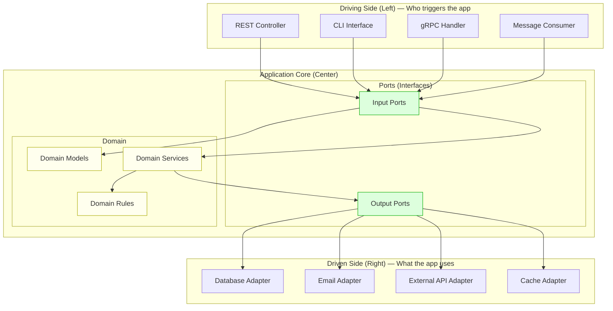
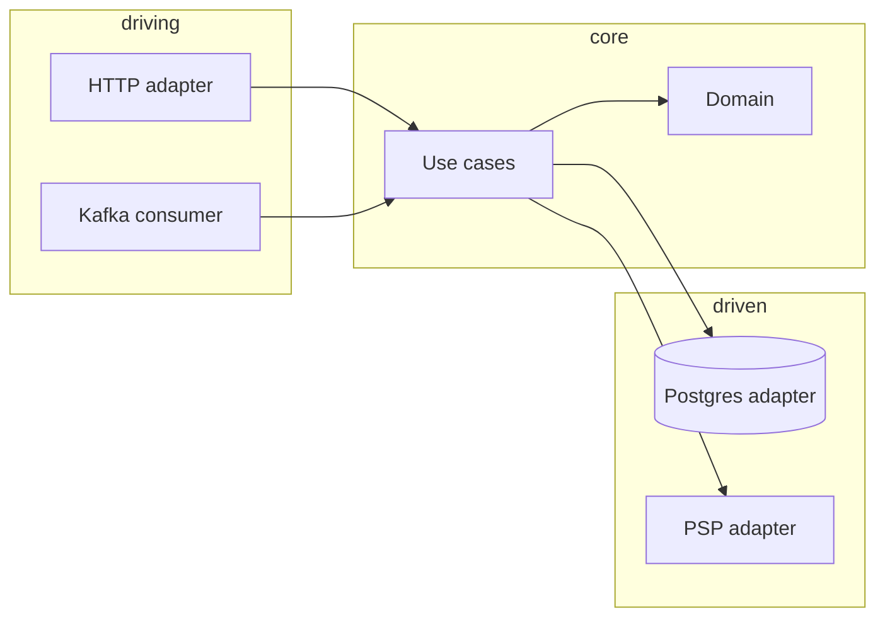

# Hexagonal Architecture (Ports & Adapters)

## What Problem Does It Solve?

Your business logic is **tangled** with your database, your web framework, and your third-party APIs. Want to switch from PostgreSQL to MongoDB? Rewrite half the app. Want to test business rules? You need a running database. Everything is coupled.

> **Hexagonal Architecture** (a.k.a. Ports & Adapters) puts your **business logic at the center** and makes all external concerns (DB, APIs, UI) plug in through well-defined interfaces — like USB ports on a laptop.

---

## The Core Idea

```
Traditional Layered Architecture:       Hexagonal Architecture:
┌─────────────┐                         
│  Controller  │                                  ┌──────────┐
├─────────────┤                         ┌────────►│   REST   │
│  Service     │                         │         │ Adapter  │
├─────────────┤                         │         └──────────┘
│  Repository  │                    ┌────┴────┐
├─────────────┤                    │          │   ┌──────────┐
│  Database    │                   │ BUSINESS │◄─►│ Database │
└─────────────┘                    │   CORE   │   │ Adapter  │
                                   │          │   └──────────┘
Dependency flows DOWN              └────┬────┘
(business logic depends                │         ┌──────────┐
 on database!)                         └────────►│  Email   │
                                                  │ Adapter  │
                                                  └──────────┘
                                   Dependencies point INWARD
                                   (nothing depends on frameworks!)
```

---

## Anatomy of Hexagonal Architecture



### Key Terms

| Term | Meaning | Example |
|---|---|---|
| **Port** | An interface (contract) | `OrderRepository` interface |
| **Adapter** | An implementation of a port | `PostgresOrderRepository` |
| **Driving Adapter** | Triggers the application | REST controller, CLI, message consumer |
| **Driven Adapter** | Used by the application | Database, email service, cache |
| **Domain** | Pure business logic | Order rules, pricing calculations |

---

## Complete Code Example (TypeScript)

Let's build an **Order system** using hexagonal architecture.

### Step 1: Domain Models (the center — no dependencies)

```typescript
// domain/models/Order.ts

export class Order {
  constructor(
    public readonly id: string,
    public readonly customerId: string,
    public readonly items: OrderItem[],
    public status: OrderStatus = "pending",
  ) {}

  get total(): number {
    return this.items.reduce((sum, item) => sum + item.price * item.quantity, 0);
  }

  confirm(): void {
    if (this.items.length === 0) {
      throw new Error("Cannot confirm an empty order");
    }
    if (this.status !== "pending") {
      throw new Error(`Cannot confirm order in status: ${this.status}`);
    }
    this.status = "confirmed";
  }

  cancel(): void {
    if (this.status === "shipped") {
      throw new Error("Cannot cancel a shipped order");
    }
    this.status = "cancelled";
  }
}

export interface OrderItem {
  productId: string;
  name: string;
  price: number;
  quantity: number;
}

export type OrderStatus = "pending" | "confirmed" | "shipped" | "cancelled";
```

### Step 2: Ports (interfaces — still no dependencies)

```typescript
// domain/ports/OrderRepository.ts (Output Port)
export interface OrderRepository {
  save(order: Order): Promise<void>;
  findById(id: string): Promise<Order | null>;
  findByCustomerId(customerId: string): Promise<Order[]>;
}

// domain/ports/NotificationService.ts (Output Port)
export interface NotificationService {
  sendOrderConfirmation(order: Order): Promise<void>;
  sendOrderCancellation(order: Order): Promise<void>;
}

// domain/ports/PaymentGateway.ts (Output Port)
export interface PaymentGateway {
  charge(customerId: string, amount: number): Promise<PaymentResult>;
  refund(paymentId: string): Promise<void>;
}

export interface PaymentResult {
  paymentId: string;
  success: boolean;
}
```

### Step 3: Application Service (Input Port implementation — orchestrates domain)

```typescript
// application/OrderService.ts

import { Order } from "../domain/models/Order";
import { OrderRepository } from "../domain/ports/OrderRepository";
import { NotificationService } from "../domain/ports/NotificationService";
import { PaymentGateway } from "../domain/ports/PaymentGateway";

// Input Port: what the outside world can do
export interface CreateOrderUseCase {
  execute(command: CreateOrderCommand): Promise<string>;
}

export interface ConfirmOrderUseCase {
  execute(orderId: string): Promise<void>;
}

export interface CreateOrderCommand {
  customerId: string;
  items: { productId: string; name: string; price: number; quantity: number }[];
}

// Implementation
export class OrderApplicationService
  implements CreateOrderUseCase, ConfirmOrderUseCase
{
  constructor(
    private readonly orderRepo: OrderRepository,       // Output Port
    private readonly notifications: NotificationService, // Output Port
    private readonly payments: PaymentGateway,           // Output Port
  ) {}

  async execute(command: CreateOrderCommand): Promise<string> {
    const order = new Order(
      crypto.randomUUID(),
      command.customerId,
      command.items,
    );

    await this.orderRepo.save(order);
    return order.id;
  }

  async confirmOrder(orderId: string): Promise<void> {
    const order = await this.orderRepo.findById(orderId);
    if (!order) throw new Error("Order not found");

    // Domain logic (inside the Order model)
    order.confirm();

    // Charge payment (via output port)
    const payment = await this.payments.charge(order.customerId, order.total);
    if (!payment.success) {
      throw new Error("Payment failed");
    }

    await this.orderRepo.save(order);
    await this.notifications.sendOrderConfirmation(order);
  }
}
```

### Step 4: Driven Adapters (right side — implementations of output ports)

```typescript
// adapters/driven/PostgresOrderRepository.ts
import { Pool } from "pg";
import { Order } from "../../domain/models/Order";
import { OrderRepository } from "../../domain/ports/OrderRepository";

export class PostgresOrderRepository implements OrderRepository {
  constructor(private pool: Pool) {}

  async save(order: Order): Promise<void> {
    await this.pool.query(
      `INSERT INTO orders (id, customer_id, items, status, total)
       VALUES ($1, $2, $3, $4, $5)
       ON CONFLICT (id) DO UPDATE SET status = $4`,
      [order.id, order.customerId, JSON.stringify(order.items),
       order.status, order.total],
    );
  }

  async findById(id: string): Promise<Order | null> {
    const result = await this.pool.query(
      "SELECT * FROM orders WHERE id = $1", [id],
    );
    return result.rows[0] ? this.toDomain(result.rows[0]) : null;
  }

  async findByCustomerId(customerId: string): Promise<Order[]> {
    const result = await this.pool.query(
      "SELECT * FROM orders WHERE customer_id = $1", [customerId],
    );
    return result.rows.map(this.toDomain);
  }

  private toDomain(row: any): Order {
    return new Order(row.id, row.customer_id, row.items, row.status);
  }
}

// adapters/driven/StripePaymentGateway.ts
import Stripe from "stripe";
import { PaymentGateway, PaymentResult } from "../../domain/ports/PaymentGateway";

export class StripePaymentGateway implements PaymentGateway {
  private stripe: Stripe;

  constructor(apiKey: string) {
    this.stripe = new Stripe(apiKey);
  }

  async charge(customerId: string, amount: number): Promise<PaymentResult> {
    const intent = await this.stripe.paymentIntents.create({
      amount: Math.round(amount * 100),
      currency: "usd",
      customer: customerId,
    });
    return { paymentId: intent.id, success: intent.status === "succeeded" };
  }

  async refund(paymentId: string): Promise<void> {
    await this.stripe.refunds.create({ payment_intent: paymentId });
  }
}
```

### Step 5: Driving Adapters (left side — what triggers the application)

```typescript
// adapters/driving/OrderController.ts (REST adapter)
import express from "express";
import { CreateOrderUseCase } from "../../application/OrderService";

export function createOrderRouter(orderService: CreateOrderUseCase) {
  const router = express.Router();

  router.post("/orders", async (req, res) => {
    try {
      const orderId = await orderService.execute({
        customerId: req.body.customerId,
        items: req.body.items,
      });
      res.status(201).json({ orderId });
    } catch (error) {
      res.status(400).json({ error: error.message });
    }
  });

  return router;
}
```

### Step 6: Composition Root (wire everything together)

```typescript
// main.ts — the only place that knows about concrete implementations
import { Pool } from "pg";
import express from "express";
import { OrderApplicationService } from "./application/OrderService";
import { PostgresOrderRepository } from "./adapters/driven/PostgresOrderRepository";
import { StripePaymentGateway } from "./adapters/driven/StripePaymentGateway";
import { EmailNotificationService } from "./adapters/driven/EmailNotificationService";
import { createOrderRouter } from "./adapters/driving/OrderController";

// Create adapters (implementations)
const pool = new Pool({ connectionString: process.env.DATABASE_URL });
const orderRepo = new PostgresOrderRepository(pool);
const payments = new StripePaymentGateway(process.env.STRIPE_KEY!);
const notifications = new EmailNotificationService();

// Create application service (inject adapters)
const orderService = new OrderApplicationService(orderRepo, notifications, payments);

// Create driving adapter (REST)
const app = express();
app.use(express.json());
app.use("/api", createOrderRouter(orderService));

app.listen(3000);
```

---

## The Power: Easy Testing

Because the domain depends only on **interfaces**, you can test with fakes:

```typescript
// tests/OrderService.test.ts
import { OrderApplicationService } from "../application/OrderService";
import { Order } from "../domain/models/Order";

// In-memory fake implementations — no database needed!
class InMemoryOrderRepo {
  private orders: Map<string, Order> = new Map();

  async save(order: Order) { this.orders.set(order.id, order); }
  async findById(id: string) { return this.orders.get(id) || null; }
  async findByCustomerId(cid: string) {
    return [...this.orders.values()].filter(o => o.customerId === cid);
  }
}

class FakePaymentGateway {
  async charge() { return { paymentId: "fake-pay", success: true }; }
  async refund() {}
}

class FakeNotifications {
  public sent: Order[] = [];
  async sendOrderConfirmation(order: Order) { this.sent.push(order); }
  async sendOrderCancellation() {}
}

describe("OrderService", () => {
  it("should create and confirm an order", async () => {
    const repo = new InMemoryOrderRepo();
    const notifications = new FakeNotifications();
    const payments = new FakePaymentGateway();

    const service = new OrderApplicationService(repo, notifications, payments);

    const orderId = await service.execute({
      customerId: "cust-1",
      items: [{ productId: "p1", name: "Widget", price: 10, quantity: 2 }],
    });

    await service.confirmOrder(orderId);

    const order = await repo.findById(orderId);
    expect(order?.status).toBe("confirmed");
    expect(notifications.sent).toHaveLength(1);
  });
});
```

---

## Folder Structure

```
src/
├── domain/                    # 🟡 Center — pure business logic
│   ├── models/
│   │   └── Order.ts
│   └── ports/
│       ├── OrderRepository.ts       # Output Port (interface)
│       ├── NotificationService.ts   # Output Port (interface)
│       └── PaymentGateway.ts        # Output Port (interface)
├── application/               # 🟢 Use cases — orchestration
│   └── OrderService.ts              # Input Port + implementation
├── adapters/                  # 🔵 External world
│   ├── driving/                     # Left side (triggers the app)
│   │   ├── OrderController.ts       # REST adapter
│   │   └── OrderConsumer.ts         # Kafka adapter
│   └── driven/                      # Right side (used by the app)
│       ├── PostgresOrderRepository.ts
│       ├── StripePaymentGateway.ts
│       └── EmailNotificationService.ts
└── main.ts                    # Composition root (wiring)
```

---

## The Dependency Rule

```
          ❌ Dependencies must NEVER point outward
          ✅ Dependencies ALWAYS point inward

    Adapters → Application → Domain
    (outer)    (middle)      (center)

    Domain knows NOTHING about:
    ✗ Express, Fastify, or any web framework
    ✗ PostgreSQL, MongoDB, or any database
    ✗ Stripe, Twilio, or any third-party service
    ✗ Kafka, RabbitMQ, or any message broker
```

---

## Key Takeaways

- **Domain is king** — it has zero external dependencies
- **Ports** are interfaces; **Adapters** are implementations
- You can swap PostgreSQL for MongoDB by writing a new adapter — zero domain changes
- Testing is trivial because you inject fakes for all output ports
- The **Composition Root** (`main.ts`) is the only place that knows about concrete implementations
- Hexagonal architecture is overkill for simple CRUD apps — use it when business logic is complex

---

## Senior Pitfalls

| Mistake | Impact | Fix |
|---------|--------|-----|
| Ports/interfaces for every line of code | Abstraction fatigue; no delivery velocity | Hexagon at domain boundary; adapters at integration edges |
| Domain importing framework types | JPA/Hibernate leaks into business rules | Pure domain module; map in adapter layer |
| Fake adapters in production config | “In-memory repo” wired by mistake | Strict DI profiles; integration tests use real adapters |
| One adapter per DB forever | Cannot add read replica or event store | Multiple driven adapters behind same port |
| Skipping contract tests on inbound adapters | HTTP shape drifts from use cases | OpenAPI/contract tests from port definitions |
| Hexagon as folder rename only | `services/` still god classes | Enforce dependency rule: domain has zero outward deps |

---

## Production-grade Practice

1. **Build:** Extract payment domain with `PaymentPort` and swap in-memory vs Postgres adapter without changing domain tests.
2. **Debug:** Introduce breaking change in external API; fix only inbound adapter while domain tests stay green.
3. **Measure:** Count of framework imports in domain package (target zero); CI gate on dependency graph.
4. **Capacity plan:** Team ownership per hexagon side (inbound vs outbound adapters) for a 20-service estate.

---

## FAANG Interview Deep Dive

### Real-world FAANG examples

**Stripe (payments domain core)**  
Payment logic (state machines, idempotency, ledger invariants) is isolated from **HTTP handlers, DynamoDB/Postgres adapters, and PSP webhooks**. Adapters translate external wire formats; domain enforces **“never double capture.”** Interview signal: ports enable **simulation testing** of edge cases (dispute, partial refund) without hitting Stripe test mode for every unit test.

**Netflix (domain-driven service boundaries)**  
Not every service is textbook hexagonal, but high-change domains use **clear inward dependencies**: recommendation scoring separate from data fetch adapters (Cassandra, S3 feature stores). Swapping storage or adding a gRPC driving adapter doesn’t rewrite scoring rules.

**Uber (marketplace pricing / dispatch)**  
Pricing rules and matching constraints live in **libraries with minimal framework imports**; surrounding services plug in geospatial adapters, supply feeds, and experiment flags. Hexagonal thinking appears as **“core library + thin service shell”** to share logic across batch and online paths.



### Interview Q&A

### Q: Hexagonal vs clean architecture vs layered—what’s the interview answer?
**A:** Same **dependency rule**: domain at center, infrastructure at edge. Hexagonal emphasizes **ports/adapters** vocabulary; clean architecture adds explicit **use case layer**. Layered (controller → service → repo) often **leaks** DB into “service.” Pick one vocabulary; demonstrate **inward dependencies** and testability.

### Q: Where do DTOs and validation live?
**A:** **Driving adapters** map HTTP/JSON to commands; **domain** validates invariants (cannot ship empty order). Avoid anemic domain where all logic sits in “service class” passing through. Trade-off: some validation is API-contract (format) vs business rule (max items)—split accordingly.

### Q: Is the repository pattern always an output port?
**A:** Yes for **domain persistence abstraction**. Anti-pattern: repository returning ORM entities with lazy-load framework behavior into domain. Map to **domain models** in the adapter. Interview bonus: discuss **CQRS**—separate read ports when query shape diverges.

### Q: When is hexagonal overkill?
**A:** CRUD admin with no rules, prototype, or **single framework** app with 6-month lifetime. Use when **rules change often**, multiple entry points (HTTP + queue + CLI), or **compliance testing** demands isolated domain. Staff answer: “modular monolith with packages” before full ports/adapters ceremony.

### Q: How big should the composition root be?
**A:** `main.ts` / DI module wires concrete adapters—**only place** that imports Postgres, Stripe, Express. Enables swapping test fakes without conditional logic in domain. In large systems, one composition root per deployable, shared kernel for domain only.

```typescript
// Driving adapter stays thin
router.post("/orders", async (req, res) => {
  const id = await createOrder.execute(toCommand(req.body));
  res.status(201).json({ orderId: id });
});
```

### Common mistakes candidates make

- **Anemic domain**—entities are bags of fields; all logic in “application service.”
- Ports that mirror **framework concepts** (`ExpressRequestRepository`) instead of domain language.
- **Leaking transactions** across ports without a unit-of-work abstraction—domain shouldn’t know `@Transactional`.
- Creating **50 interfaces** for a todo app—interviewers want proportional design.

### Decision framework

| Signal | When to use hexagonal | When NOT to use |
|--------|----------------------|-----------------|
| **Logic complexity** | Rich rules, state machines, money | Simple CRUD |
| **Entry points** | HTTP + events + batch | Single REST API |
| **Change frequency** | Adapters swap (DB, PSP) often | Stable stack |
| **Testing** | Need fast domain tests without DB | Integration-only coverage acceptable |
| **Team** | Enforced module boundaries | Solo dev, throwaway prototype |
| **Scale** | Modular monolith or service extractable core | 200-line script |
