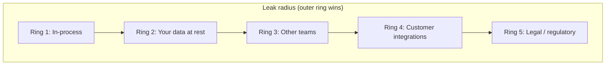
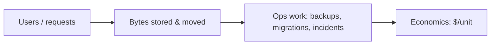
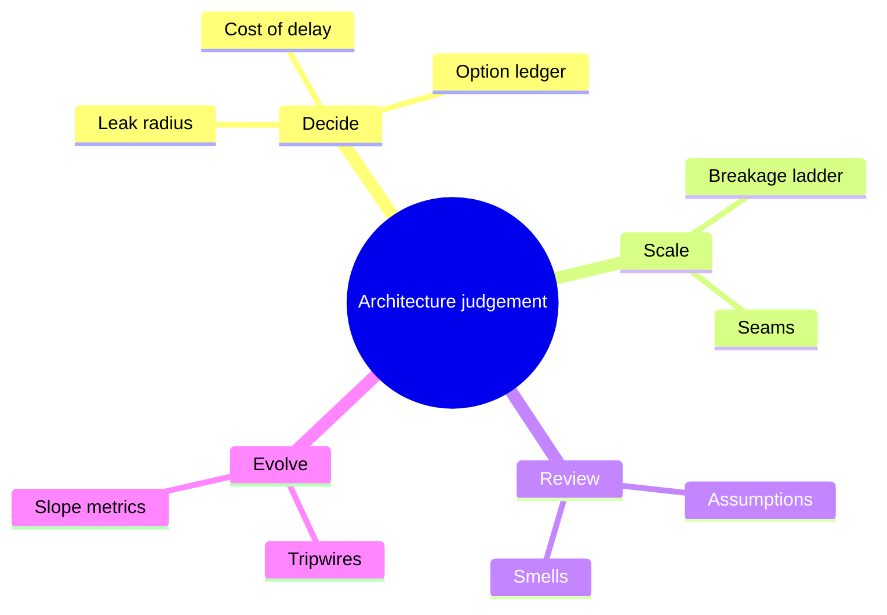

# Architecture Thinking: Trade-offs, Scale, Review & Signals

How senior architects reason—reversibility, cost of delay, fitness functions, reading designs like a reviewer, planning for the next order of magnitude, and recognizing when an architecture has run its course.

> **Theme:** Most painful architecture failures are not “wrong option picked by an idiot.” They are **right-looking choices made with the wrong process**—unpriced delay, un-falsifiable assumptions, or defaults that accrete while the RFC stays open.

---

## 1. How architects reason about trade-offs

### 1.1 Reversibility is not a property of the decision

Bezos’s Type 1 / Type 2 (one-way vs two-way doors) is useful and often **misapplied**. Reversibility is a function of **time and dependents**. Almost every decision is two-way on day one; it becomes one-way as code, data, teams, and customers accrete.

**Practical question:** *How fast does reversal cost grow, and what makes it grow?*

The driver is **leak radius**—what the decision touches:

| Leak target | Examples | Reversal character |
|-------------|----------|-------------------|
| In-process code | Retry policy, internal struct | Refactor + deploy (~1×) |
| Data at rest | ID scheme, money as float, soft-delete semantics | Migration, dual-read/write (~10×) |
| Other teams’ code | Event schema, shared tables | N roadmaps, deprecation (~30×) |
| Customer code | Public API, webhooks, SDK behavior | Multi-year sunset (~100×) |
| Contracts & regulators | Residency, SLA credits, audit retention | Renegotiation—not yours to reverse |

**Classify by the outermost ring touched**—not how big the decision *feels*. A “library choice” that fixes wire serialization has silently moved from ring 1 to ring 3.

> **Pitfall:** A reversal you have not rehearsed is not a reversal. Knight Capital (2012) is the canonical case: “reuse the flag” looked reversible; remediation made it worse. If you cannot name the reversal mechanism and when it last ran, **score the decision one ring further out**.

---

### 1.2 Cost of delay

**Not deciding is a decision—usually made by a default.**

| | Cheap to reverse | Expensive to reverse |
|--|------------------|---------------------|
| **Expensive to wait** | Decide today, one owner | Decide now, **buy insurance** (seams, one tenant, tripwires) |
| **Cheap to wait** | Take the platform default | **Defer with a scheduled moment**—or accretion wins |

**Decision by accretion:** An open RFC on order IDs does not stay open. Week 1: ORM default ships `serial int`. Week 30: sharding plan discovers sequential IDs leak volume. The decision was “never made” formally but **made by the next migration**.

```mermaid
gantt
    title Decision by accretion (illustrative)
    dateFormat X
    axisFormat %s
    section RFC
    ID scheme debate open     :0, 30
    section Reality
    ORM default ships         :1, 1
    Partner stores 32-bit ID    :14, 1
```

**Fence the default** when deferring: explicit interim choice, one service/table, review date—or you delegated to whoever writes the next PR.

Symmetric rigour hurts too: a three-week RFC on a ring-1 retry policy while six engineers block can cost more than being wrong.

---

### 1.3 Optionality—and its price

“Good architecture” often buys **options** (swap DB, cloud, queue). Real options: value ≈ P(exercise) × savings − **continuous premium**.

| Option | Premium (daily) | Exercise signal | Verdict |
|--------|-----------------|-----------------|---------|
| `tenant_id` on every row | One column + lint | Enterprise isolation / erasure ask | **Buy** |
| Idempotency keys on mutations | Table + middleware | Duplicate charge / retry storm | **Buy** |
| Versioned event envelope | Thin wrapper | Second consumer appears | **Buy** |
| Generic in-house rules engine | Tax on every change | Third concrete use case | **Defer** |
| “Database-agnostic” layer | No engine features, extra tests | Engine swap (rare; hard part is data+ops) | **Sell** |
| Active multi-cloud | Two of everything | Contract/regulator forces it | **Sell unless forced** |

> **Architect’s note:** “Avoid lock-in” is often leverage advice dressed as architecture. Lock-in is the premium for **depth**—managed features, operational maturity. Ask whether switching cost exceeds value from committing; for most teams, for most of the stack, it does not.

---

### 1.4 Fitness functions & tripwires

From *Building Evolutionary Architectures*: encode the **assumption**, not only the decision.

| Weak fitness function | Strong tripwire |
|----------------------|-----------------|
| “Service A must not import B” | “Write rate &lt; X ops/s on primary; largest table migrates in &lt; Y hours” |

When a tripwire fires, the ADR comes back to a human—not silently eroded by “just this once” imports.

---

### 1.5 Making decisions falsifiable

Write ADRs with:

- **Context** and **decision**
- **Assumptions** with measurable thresholds
- **Review date** and owner
- **What would prove us wrong**

---

## 2. Designing for the next order of magnitude

### 2.1 The horizon

Scale planning is not “10× traffic someday.” It is **which constraint breaks first** when an order-of-magnitude changes: bytes, fan-out, humans, or dollars.

---

### 2.2 The breakage ladder

Typical sequence (varies by product):

| Stage | Symptom | Architectural response |
|-------|---------|------------------------|
| Single node OK | — | Keep simple |
| Read pressure | DB CPU | Replicas, caching |
| Write pressure | Lock contention | Sharding, queue decouple, partition keys |
| Data size | Backup/restore hours | Tiering, archival, columnar analytics |
| Org size | Deploy contention | Module boundaries, then services |
| Global | Latency + compliance | Regions, residency, multi-active (hard) |

---

### 2.3 Operations scale with bytes

> **Rule:** Operational burden often scales with **stored bytes** and **egress**, not request count alone.

Implications:

- Retention policies are architecture  
- Cold storage + indexed hot set  
- Backups and restores get rehearsal time budgets  

---

### 2.4 Non-linear breakpoints

Some limits are cliffs, not slopes:

- 32-bit IDs in partner systems  
- Single-leader Postgres write ceiling  
- Kafka partition count vs consumer count  
- “One machine per tenant” products (see Airtable-style ceilings)  

Design **seams** before you need them: tenant_id, event envelopes, bounded contexts.

---

### 2.5 Build now vs defer

| Build now (cheap premium, likely exercise) | Defer (expensive premium, uncertain exercise) |
|--------------------------------------------|-----------------------------------------------|
| Idempotency, observability hooks | Second cloud |
| Partition keys you can grow into | Full event-sourcing “because we might” |
| Versioned public contracts | Abstract workflow engine for one use case |

---

### 2.6 Seams

A **seam** is a boundary where you can swap implementations without rewriting the world:

- API gateway vs direct service mesh everywhere  
- Outbox pattern before “events everywhere”  
- Read models separate from write models  

---

## 3. Reading a design like a reviewer

### 3.1 What review is for

Not “prove you’re smart.” It is **risk discovery before capital is spent**—and teaching the org what “good” looks like.

---

### 3.2 Reading order

1. **Goals & non-goals** — what is explicitly out of scope?  
2. **Load & growth assumptions** — numbers, not adjectives  
3. **Data model & consistency** — source of truth, failure modes  
4. **Request path** — sync depth, fan-out, timeouts  
5. **Operational story** — deploy, rollback, on-call, migrations  
6. **Security & tenancy** — authZ boundaries, PII  
7. **Cost model** — rough $/month at 10×  

---

### 3.3 Questions that surface truth

| Question | Surfaces |
|----------|----------|
| What breaks first at 10×? | Missing bottleneck analysis |
| What is the source of truth? | Dual-write disasters |
| What happens when dependency X is down? | Cascades, no degradation |
| How do we roll back? | One-way deploys |
| What did we measure vs assume? | Fantasy capacity plans |

---

### 3.4 Smells (architecture)

- **Diagram beauty, no numbers**  
- **Shared database** across “services”  
- **Synchronous chains** &gt; 3–4 hops for core UX  
- **“We’ll fix ops later”**  
- **Generic platform** before three concrete users  
- **No idempotency** on money paths  

---

### 3.5 Running reviews at scale

- Tiered depth: light RFC for ring 1–2, full design for ring 3+  
- Required reviewers by **leak radius** (data owner, security, SRE)  
- Decision log linked from code (ADR in repo)  

---

## 4. Signals an architecture has run its course

### 4.1 Level vs slope

A metric can be “fine” but **worsening fast**. Track **slope** (lead time, incident rate, cost per transaction) not only spot values.

---

### 4.2 Cross-cutting lead time

When **every** feature touches the same choke point (shared DB migration, platform team queue, global release train), the architecture is optimizing for an org size you no longer have.

---

### 4.3 Change failure rate

Rising CFRR often means:

- Unclear boundaries  
- Missing test seams  
- Data coupling  

---

### 4.4 Coordination cost

Meetings, cross-team pings, and “deployment days” are **tax meters**. If coordination cost grows faster than engineering headcount, boundaries are wrong—not people.

---

### 4.5 Unit economics

Architecture must survive finance: $/order, $/active user, egress $, support tickets per release. When unit economics degrade with scale, you may be on the wrong storage or serving model.

---

### 4.6 Diagnosis → action

| Signal | Often means | Response |
|--------|-------------|----------|
| Coordinated multi-service deploys | Distributed monolith | Merge paths or async boundaries |
| Every feature needs DBA | Shared mutable core | Module extraction, read replicas, CQRS slice |
| p99 owned by dependencies | Sync fan-out | Cache, batch, collapse services |
| Ops hours ∝ data size | Wrong tiering | Archive, warehouse, split hot/cold |

---

### 4.7 Cost of being wrong about “time for rewrite”

Rewrites fail when they try to freeze behavior and replace substrate simultaneously. Prefer **strangler** slices with measurable traffic shift.

---

## Synthesis diagram

---

## Senior Pitfalls

| Mistake | Impact | Fix |
|---------|--------|-----|
| Debating Kubernetes vs serverless before naming constraints | Wrong optimization; six-month detour | Outer ring first: latency, compliance, team skill, cost of delay |
| ADRs without tripwires | Architecture ossifies past its useful life | Revisit triggers: traffic 2×, incident class, lead time slope |
| Optimizing for current headcount only | Next hire class blocked for quarters | Design for 10× engineers or 10× traffic—state which breaks first |
| Copying FAANG diagram without workload match | Expensive complexity with no benefit | Map access patterns and failure domains to your scale |
| Treating architecture as one-time Big Design Up Front | Reality invalidates doc; cynicism | Evolutionary architecture with measurable fitness functions |
| Ignoring cost of delay in trade-off math | “Perfect” design ships after market window | Price blocked revenue and incident minutes in decisions |

---

## Production-grade Practice

1. **Build:** Write a one-page ADR for a real choice (queue vs stream); include tripwires and explicit rejected options.
2. **Debug:** Post-mortem a past project delay—identify which “outer ring” constraint was debated too late.
3. **Measure:** Track lead time and incident rate slope (not just level) quarterly; tie to architecture review cadence.
4. **Capacity plan:** For 10× growth scenario, workshop first broken subsystem (people, data, money)—present to leadership with cost of delay.

---

## Interview / staff-practice checklist

- [ ] Name the **outermost leak ring** before debating tools  
- [ ] Price **cost of delay** in blocked engineers or incident minutes  
- [ ] List **tripwires** that reopen the ADR  
- [ ] For 10× growth, state **first broken constraint**  
- [ ] In review, ask for **rollback** and **degradation** stories  
- [ ] Distinguish **level** from **slope** on lead time and incidents  

> **Closing thought:** Architecture judgement is the machinery that makes trade-offs explicit enough that reality can contradict you *before* production does.

---

*Sources consolidated from Algoroq Architecture Judgement: Trade-offs, Next Order of Magnitude, Reading a Design Like a Reviewer, Signals That an Architecture Has Run Its Course.*
