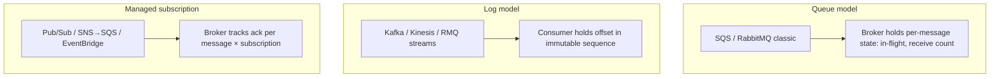
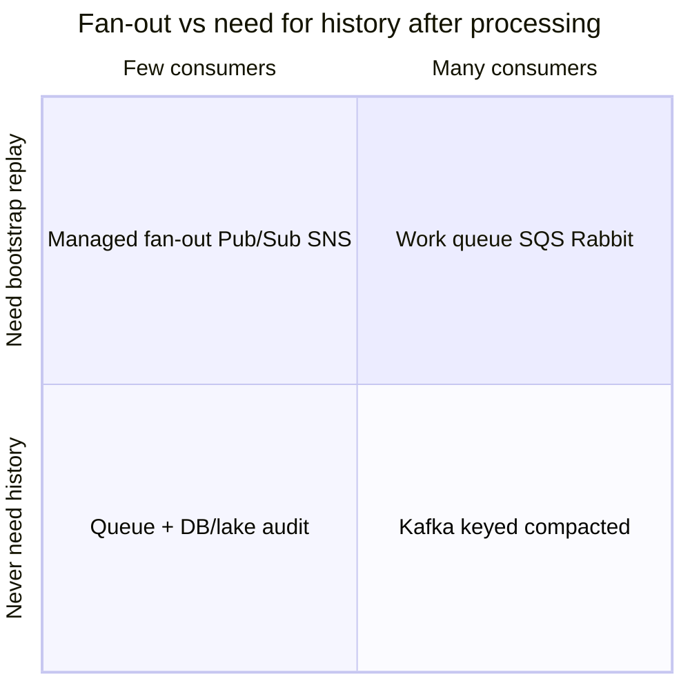
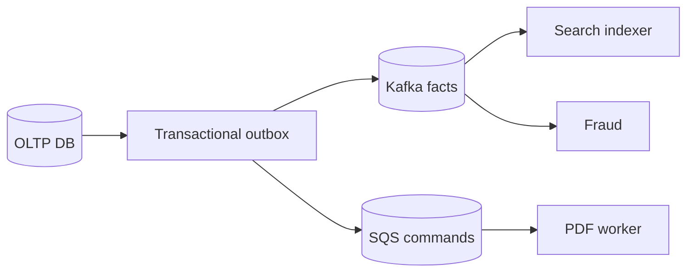
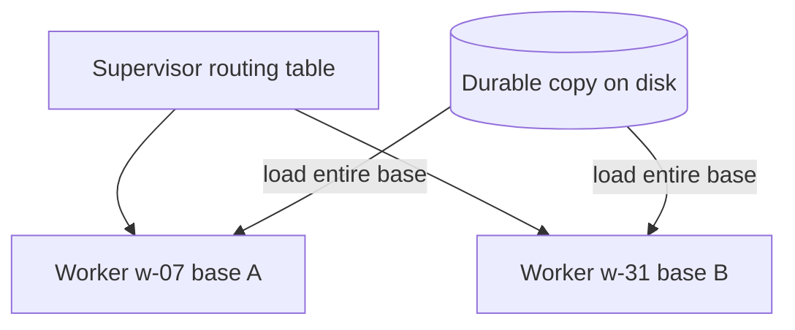
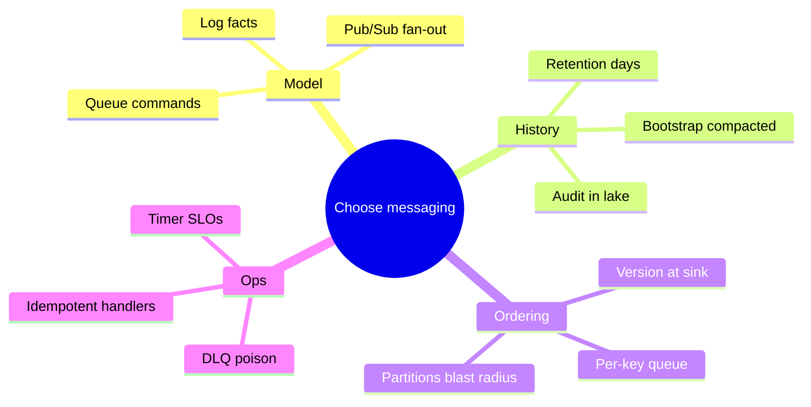
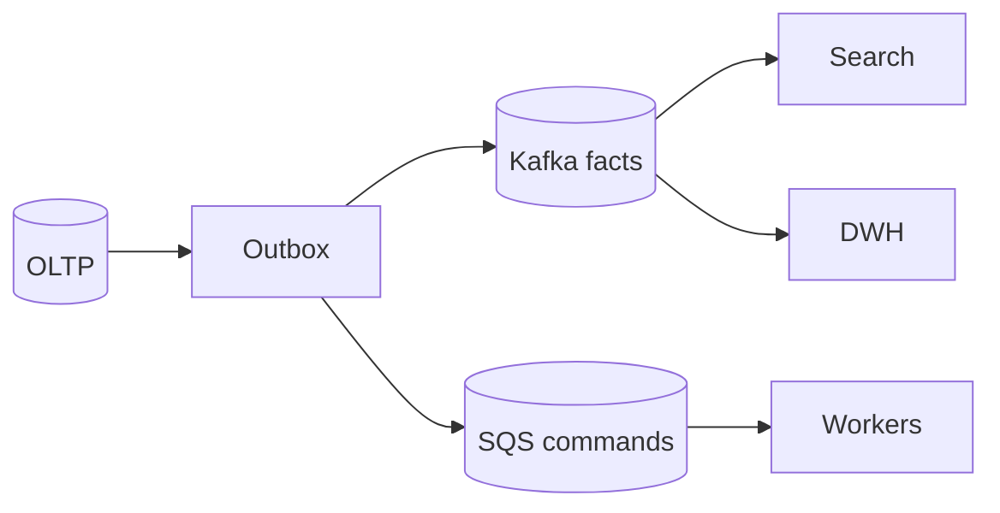

# Message Broker Selection & Flexible Data Models

A decision framework for **Kafka vs SQS vs RabbitMQ vs Pub/Sub**—based on who owns the cursor, fan-out, history, ordering, and delivery semantics—and a teardown of **how Airtable models a flexible database** (useful contrast: when *not* to use a broker at all).

> **Core insight:** Feature checklists lie. Each product added queue-ish or log-ish features at the **edge** of its design center. Pick the broker whose **center of gravity** matches the stream’s primary access pattern.

---

## Part 1 — Messaging: the real axis

### 1.1 The wrong question

“Which has replay / FIFO / exactly-once?” — **all of them tick boxes now.**

- SQS: FIFO + dedup  
- RabbitMQ: streams (offset, replay) since 3.9  
- Kafka: share groups (KIP-932) → more queue semantics  
- Pub/Sub: ordering keys, seek, exactly-once *mode*  

**Better first question:** Is this broker fundamentally a **queue**, a **log**, or **managed fan-out per subscription**?



---

### 1.2 Who owns the cursor?

| Model | Per-message state | Consumer N+1 cost | Replay | Poison message | Parallelism unit |
|-------|-------------------|-------------------|--------|----------------|------------------|
| **Queue** | Broker | Copy/route to new consumer; history before bind **gone** | None after ack | DLQ after N receives | Message (add workers) |
| **Log** | Consumer offset | **Zero** new consumer group | Any retained offset | **Blocks partition** until skipped | Partition |
| **Managed sub** | Broker × subscription | New subscription; history via seek within retention | Seek, bounded by retention | Isolated per ordering key | Message / ordering key |

**20M-message backlog:**

| System | Behavior |
|--------|----------|
| SQS | OK until retention (default 4d, max 14d) then **silent delete** |
| RabbitMQ | Resource alarm, **publishers blocked** |
| Kafka | Lag until exceeds **topic retention** |
| Pub/Sub | OK until subscription retention expires |

> **Center-of-design rule:** Use edge features for *secondary* needs only. Building your event backbone on RabbitMQ streams because “it has streams now” puts critical data on the least-traveled path.

---

### 1.3 Fan-out & history

**One question to rule them all:** *How many independent consumers will this exact fact have in two years?*

| Message kind | Example | Broker bias |
|--------------|---------|-------------|
| **Command** | “Render invoice 42 PDF” | Queue |
| **Fact** | “Order 42 paid” | Log or managed fan-out |

**History flavors:**

| Need | Horizon | Fit |
|------|---------|-----|
| Reprocess after bug | Days | Log retention |
| Bootstrap new service | Full history or snapshot+tail | Compacted topics, CDC, outbox |
| Audit 2 years ago | Years | **Lake / warehouse**, not broker |



**Pitfall — SNS fan-out that becomes a log:** queue → topic → S3 copy → bespoke backfill. You invented a log with **no single ordering, no offsets**, and racing backfill vs live feed. If a third consumer is plausible, **start with a log**.

**Replay caveats:**

1. Consumers that send email/charge cards are **not replay-safe** without idempotency / high-water marks.  
2. Thin events (`customer 7 changed`) force **callback on replay** → meaningless time travel. Prefer **event-carried state transfer** + schema evolution discipline.

---

### 1.4 Ordering & throughput per key

**Most “ordering” requirements are staleness requirements.**

Ask: what breaks if updates arrive out of order?  
Often: older overwrites newer → fix at **sink** with **version** from source of truth (row version, LSN)—**not** producer wall clock.

**True ordering** (non-commuting ops): ledger postings, state machines with side effects, matching engines.

**Cost of ordering:** no concurrency within key → ceiling ≈ `1 / handler_latency`.

| Handler latency | Per-key max throughput |
|-----------------|------------------------|
| 5 ms | ~200 msg/s |
| 40 ms | ~25 msg/s |

**Kafka surprise:** orders by **partition**, not key. Poison/slow message stalls **1/N of all keys** on that partition.

| Ordering unit | Blast radius when one message stuck |
|---------------|-------------------------------------|
| SQS standard | ~0% (redrive) |
| FIFO group / Pub/Sub key | One key |
| Kafka 48 partitions | ~2.1% of keys |
| Kafka 12 partitions | ~8.3% |
| Rabbit single active consumer | **100%** of queue |

**Partition sizing — Little’s Law:**

```text
required_slots ≈ arrival_rate × handler_latency

Example: 3,000 msg/s × 0.040 s = 120 slots
48 partitions × 25 msg/s = 1,200/s ceiling — OK

Same at 120 ms degraded latency → 360 slots needed
```

Size for **degraded latency × drain rate**, not broker peak ingress.

**Adding partitions later** remaps keys → transient ordering violations. Over-provision early or migrate topics with cut-over.

---

### 1.5 Delivery semantics

> Everything is **at-least-once** at the handler boundary. “Exactly-once” is scoped and rare.

| Broker | Redelivery trigger | Duplicate when slow |
|--------|-------------------|---------------------|
| SQS | Visibility timeout (default 30s) | 2nd worker concurrent |
| Kafka | `max.poll.interval.ms` | Rebalance → batch replay |
| RabbitMQ | Channel loss, consumer timeout | Prefetch window requeued |
| Pub/Sub | Ack deadline (10s default) | Another subscriber |

**Positive feedback loop:** downstream slow → p99 &gt; timer → redelivery → **2× load** on slow dependency.

**Defense:**

- Idempotent handlers + business keys  
- Extend visibility/ack deadline with **heartbeat**  
- Store processed offset/idempotency keys  
- DLQ + skip-and-park for poison messages  

```python
def handle_payment(event: dict, store) -> None:
    key = f"payment:{event['id']}"
    if store.seen(key):
        return  # duplicate delivery
    with store.transaction():
        charge(event)
        store.mark(key)
```

---

### 1.6 Operational ownership

| Choice | You own |
|--------|---------|
| Self-hosted Kafka/Rabbit | Brokers, upgrades, rack awareness, JVM/ Erlang tuning |
| SQS / Pub/Sub | Quotas, IAM, monitoring; not broker patches |
| MSK / Confluent Cloud | Middle ground |

Match ops maturity to blast radius of **message loss** or **ordering bugs**.

---

### 1.7 Decision worksheet

Answer before comparing vendors:

1. Command or fact? Fan-out in 24 months?  
2. Replay: reprocess, bootstrap, or audit?  
3. Ordering: real or version-at-sink?  
4. Per-key volume vs handler latency ceiling?  
5. Side effects replay-safe?  
6. Who runs the broker at 3 a.m.?  

**Composite placement examples:**

| Stream | Placement |
|--------|-----------|
| Thumbnail / PDF jobs | SQS / Rabbit work queue |
| Outbound webhooks | Queue + durable record in DB |
| `UserSignedUp` → 3 services today, 9 tomorrow | Pub/Sub or Kafka |
| `OrderPaid` → billing, search, warehouse | Kafka keyed topic |
| Nightly settlement + audit trail | Queue for work + **lake** for audit |



---

## Part 2 — Case study: Airtable’s flexible database (not a broker—but a sizing lesson)

Airtable is included in this guide as a **contrasting architecture**: extreme **single-tenant in-memory** design for collaborative spreadsheets—not a pattern for global event backbones, but a masterclass in **product-shaped storage**.

### 2.1 Base as the unit

- One **base** = bounded world: tables, fields, links, views defined at runtime  
- Schema is **user-authored**, stored and served as if always there  
- Contrast: traditional app DB with engineer-fixed schema upfront  

### 2.2 MemApp: whole base in RAM



- **Not** a cache in front of DB—the **in-memory base is the engine’s working set**  
- **Single-tenant isolation:** runaway base B does not starve base A  
- **Ceiling:** base must fit **one machine’s RAM** (~low hundreds of thousands of records)—**un-splittable hot shard**  

> **Lesson for messaging/system design:** When your unit of tenancy is a **single huge shard**, horizontal scale is **replicate small tenants**, not split one tenant. Kafka partition keys won’t help a single hot base.

### 2.3 CPU-bound, not I/O-bound

Typical backend: wait on network DB.  
Airtable: data already local → **filter 100k rows, recompute formulas, rollups** = pure CPU.

Scaling lever: **more cores**, not more connection poolers.

### 2.4 Every view is a live query (incremental maintenance)

Naive: re-run all views on every edit.  
Built: **one write → tailored delta per open view** (IVM-style).

Client mirror: browser holds **second in-memory copy**; server pushes **diffs**, not full pages.

### 2.5 Dependency graph

Formulas, rollups, lookups → **cell graph** across tables.  
Change walks graph in memory (pointer chasing acceptable when graph is local).

Pipeline: **store → recompute graph → push diffs**.

### 2.6 Spreadsheet-native primitives

| Feature | Why generic SQL DB struggles |
|---------|-------------------------------|
| **Fractional indexing** | Drag row between 2 and 3 → position `2.5`; O(1) row move |
| Lazy schema | New column appears without DDL table lock |
| Locale-aware sort | Human collation rules |

### 2.7 Whole-column rewrites

`NOW()` fields, type changes → batch rewrite as **first-class operation**, not per-row updates.

### 2.8 Rust rewrite (MVCC)

Node/JS: single-threaded hot path; worker threads need **separate copies** (impractical at GB scale).

**Rust MemApp:** one shared copy, **one writer thread**, pool of **readers**, MVCC—Discord-style move applied to DB engine.

### 2.9 Concurrency model

Writes serialized per base; readers on snapshots—collaboration without cell races.

### 2.10 Implications for architects

| Airtable choice | Trade-off |
|-----------------|-----------|
| In-memory per base | Instant UX, hard ceiling |
| Runtime schema | Flexibility, complex engine |
| No cross-base queries | Simple blast radius, siloed data |

**When this matters to broker selection:** High-churn **cell-level** collaboration is a **database + sync** problem (OT/CRDT/IVM), not “throw Kafka at it.” Domain **facts** (`OrderPaid`) still belong on a **log** for fan-out.

---

## Part 3 — Putting it together



| If you hear… | Think… |
|--------------|--------|
| “We need Kafka for everything” | Mixed command/fact streams? |
| “SQS is simpler” | Will you need consumer #3 with history? |
| “Ordering for all account events” | Staleness + version first |
| “Exactly-once” | Idempotent consumer + outbox |
| “Real-time spreadsheet” | In-memory tenant engine, not broker |

---

## Quick reference card

**Pick SQS / Rabbit queue when:** single consumer, command, no replay, maximize parallelism per message.

**Pick Pub/Sub / EventBridge when:** managed fan-out, moderate history via seek, gcp/aws native.

**Pick Kafka when:** many independent consumers, replay/reprocess, high-volume **facts**, event-carried state, ops to run it.

**Pick Postgres `SKIP LOCKED` when:** low volume internal jobs—**honest queue** without new infra.

**Study Airtable when:** designing **flexible schema, collaborative, low-latency** UX—and accepting **per-tenant RAM ceiling**.

> **Final word:** Classify each stream on the **cursor model** before the logo. Most organizations need **both** a queue and a log; the expensive mistake is forcing all traffic through whichever broker was adopted first.

---

*Sources consolidated from Algoroq Architecture Judgement: Kafka/SQS/RabbitMQ/Pub/Sub, and System Design Diagram: How Airtable Models a Flexible Database.*

---

## Senior Pitfalls

| Mistake | Impact | Fix |
|---------|--------|-----|
| Kafka for task queues with strict ordering per job | Wrong tool; partition stuck on poison message | SQS/Rabbit for work queues; Kafka for log fan-out |
| Single partition “for ordering” globally | Throughput ceiling of one broker core | Partition by entity key; accept partial order |
| No consumer lag alerting until disk full | Broker retention loss or hours of backlog | Lag SLOs per consumer group; autoscale consumers |
| Compacted topic without tombstone strategy | Stale keys resurrect; unbounded disk | Tombstone + retention policy; compaction monitoring |
| Pub/Sub without dead-letter discipline | Infinite redelivery loops | DLQ, max attempts, alerting on DLQ depth |
| Choosing broker before defining delivery semantics | “Exactly-once” promises product cannot keep | Document at-least-once + idempotent consumers |

---

## Production-grade Practice

1. **Build:** Same event through Kafka (compacted) and SQS; compare replay, ordering, and ops burden for a new consumer service.
2. **Debug:** Stall one partition with slow handler; measure blast radius vs queue with visibility timeout.
3. **Measure:** Consumer lag p99 and broker disk growth under 2× peak publish rate; set retention and partition count.
4. **Capacity plan:** Partitions = max(throughput target / per-partition MB/s, consumer parallelism); include cross-AZ egress cost.

---

## FAANG Interview Deep Dive

### Real-world FAANG examples

**LinkedIn (Kafka as nervous system)**  
LinkedIn pioneered operational **log-centric** integration: domain facts on Kafka with many independent consumers (search, analytics, security). Commands (send this email now) stay **queue-shaped** or idempotent consumers with careful replay policy. Interview depth: **compacted topics** for entity snapshots + tail for changes—bootstrap new services without rereading OLTP.

**Uber (dual messaging)**  
High-volume **dispatch and billing facts** on Kafka (ordering by trip/region keys); **task queues** for async jobs (PDF, notifications) on SQS-like or internal systems. They learned **poison messages on partitions** stall 1/N keys—size partitions for degraded handler latency, not peak ingress alone.

**Google (Pub/Sub + Dataflow)**  
GCP-native fan-out uses **Pub/Sub subscriptions** per consumer with seek for reprocessing within retention; **years of audit** land in BigQuery/GCS, not the broker. Meta/AWS analogs: Kinesis + S3, EventBridge + Firehose. Signal: **broker retention ≠ compliance archive**.



### Interview Q&A

### Q: Kafka vs SQS for `OrderPaid` consumed by billing, search, and fraud?
**A:** **Kafka or managed log** (Kinesis, Pub/Sub with multiple subs): one published fact, **N independent cursors**, replay for reindex after bug. SQS fan-out via SNS works for 2 consumers but becomes **ad-hoc log** without offsets when consumer #4 needs history. Trade-off: Kafka ops vs managed Pub/Sub; not “SQS is simpler” without 2-year fan-out forecast.

### Q: How do you choose partition count?
**A:** `required_partitions ≈ (peak_msg_per_sec × p99_handler_sec)` per key ordering needs, then add headroom for **slow consumer degradation**. Remember: poison message blocks **whole partition**. Interview math: 3000 msg/s × 40ms = 120 concurrent slots; 48 partitions ≈ 25 msg/s each ceiling.

### Q: “Exactly-once” in Kafka—believe it?
**A:** **Transactional producer + idempotent consumer** within Kafka ecosystem scope; at handler boundary it’s still **at-least-once** unless business idempotency keys. Charging cards on replay without idempotency is a **production incident**, not a broker feature.

### Q: When is RabbitMQ wrong for event backbone?
**A:** When you need **many new consumers with full history**, long retention replay, and **terabyte-scale** fact streams—classic queues drop history on ack. Rabbit **streams** help but center-of-gravity remains queue ops. Prefer Kafka when **log is product**.

### Q: How does Airtable relate to broker choice?
**A:** Real-time collaborative grids are **in-memory tenant + diff sync**, not Kafka. Use brokers for **cross-system facts** (`RowUpdated` to warehouse), not per-keystroke fan-out. Misapplying Kafka to cell-level churn is a **category error** interviewers probe.

```python
# Extend visibility while processing (SQS pattern)
def heartbeat_visibility(sqs, receipt_handle):
    while processing:
        sqs.change_message_visibility(QueueUrl=URL, ReceiptHandle=receipt_handle, VisibilityTimeout=60)
        time.sleep(30)
```

### Common mistakes candidates make

- **Kafka for all commands**—invoice PDF jobs don’t need 7-day replay on cluster you operate.
- **SQS for event sourcing**—consumer #3 arrives, history is gone.
- **Ordering without math**—declaring global order when only **per-entity version** at sink is needed.
- **Visibility timeout &lt; p99 handler**—duplicate processing amplifies outages.

### Decision framework

| Signal | Queue (SQS/Rabbit) | Log (Kafka/Kinesis) | Pub/Sub fan-out |
|--------|-------------------|---------------------|-----------------|
| **Message type** | Command, job | Durable fact | Managed multi-sub |
| **Consumers** | 1 (maybe 2) | Many independent | Moderate fan-out |
| **Replay** | No / DLQ only | Retention + offsets | Seek within retention |
| **Ordering** | Per FIFO group | Per partition | Per ordering key |
| **Ops** | Minimal | High (or Confluent Cloud) | Cloud-managed |
| **When NOT** | Need bootstrap history | Low volume internal cron | Need cross-cloud open standard only |
