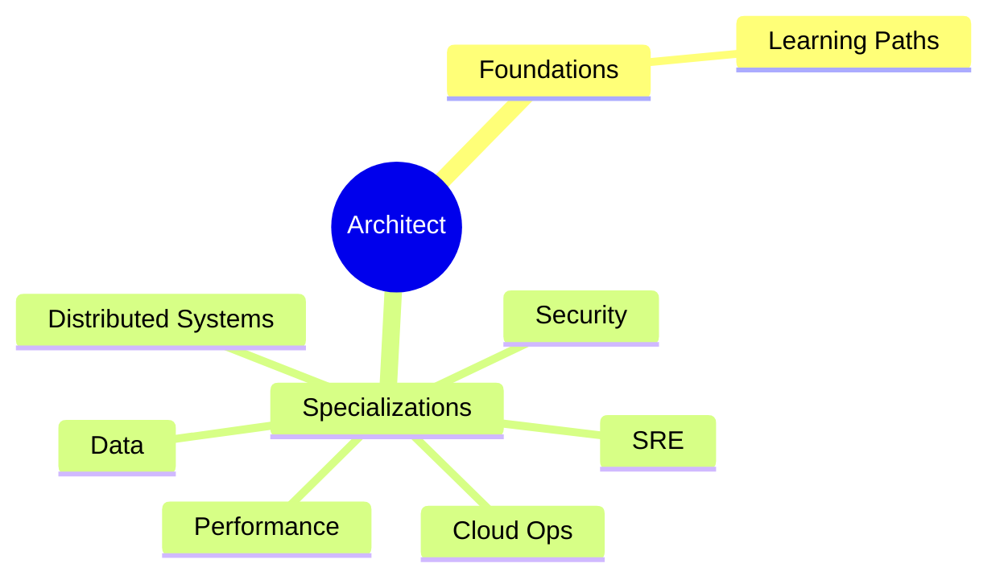
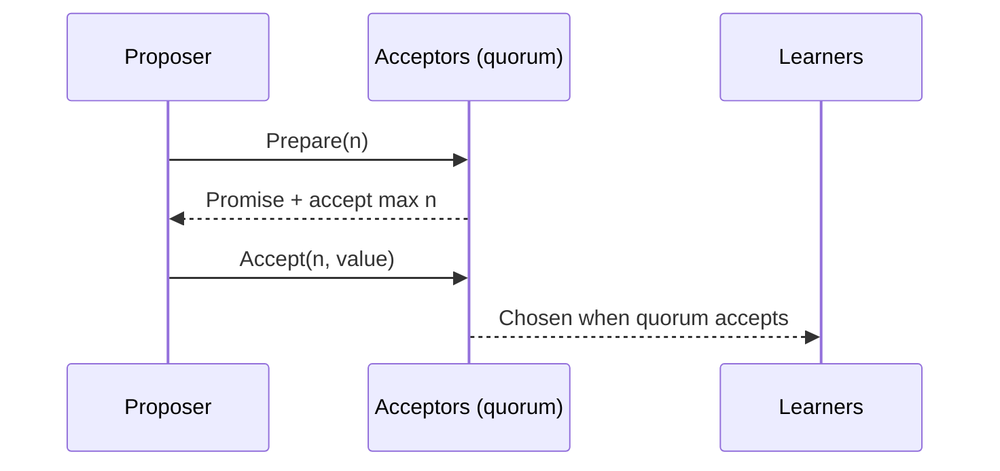
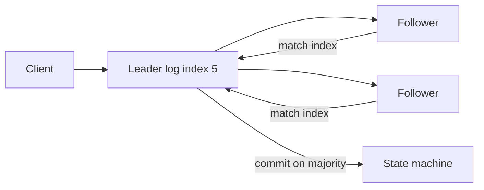
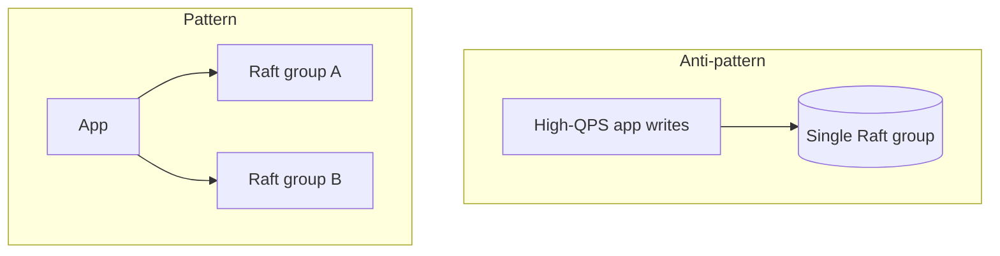

# Specialization Tracks & Consensus (Raft / Paxos)

> **What you'll learn:** How the Algoroq architect curriculum is organized into deep specialization tracks, and how consensus algorithms (Raft, Paxos) underpin etcd, Kubernetes, and every strongly consistent control plane—taught as mechanisms you can reason about, not buzzwords.

---

## Part 1 — Specialization tracks (curriculum map)

The core **Learning Paths** build fundamentals (system design, trade-offs, messaging, microservices). **Specialization tracks** go deeper—architect depth on topics that usually span multiple books.

### When to use specializations

| You are… | Start here |
|----------|------------|
| New to system design | Learning Paths first |
| Staff+/principal in one domain | Matching specialization track |
| Building platform / SRE / data plane | Cloud Ops + Performance + Distributed Systems |

### Track catalog

| Track | You will go deep on |
|-------|---------------------|
| **AI-Native Architecture** | RAG, LLM serving, vector DBs, agents, evals, cost/latency |
| **LLM Ops** | GPU scheduling, fine-tuning, guardrails, model observability |
| **Data Engineering** | OLTP vs OLAP, lakehouse, Kafka/Flink, CDC, CQRS |
| **Databases from the Inside** | B-trees/LSM, MVCC, WAL, planning, sharding, replication |
| **Distributed Systems Deep Dive** | **Consensus**, CAP/PACELC, CRDTs, sagas, exactly-once, clocks |
| **SRE / Reliability** | SLO/SLI, error budgets, incidents, chaos, circuit breakers |
| **Cloud Ops** | K8s, serverless, IaC, mesh, multi-region, **cost engineering** |
| **API & Integration Design** | REST/GraphQL/gRPC, versioning, idempotency, BFF |
| **Performance Engineering** | Queueing, tail latency, profiling, runtimes, capacity |
| **Large-Scale Migrations** | Online schema change, dual-write, backfills, cutover |
| **Security Architecture** | Threat modeling, zero trust, Zanzibar/OPA, supply chain |



### How tracks connect (example: Kubernetes)

From **Cloud Ops** you learn etcd quotas and apiserver LIST storms. From **Distributed Systems** you learn why etcd is a **single Raft group** with a write ceiling. From **Performance** you learn tail latency when controllers churn status. Tracks reinforce each other—pick the track that matches the bottleneck you own.

> **Study strategy:** One primary track aligned to your role; skim adjacent tracks for interfaces (platform eng ↔ SRE ↔ data).

---

## Part 2 — The consensus problem

### What consensus guarantees

For a set of nodes that can crash or lose messages, **consensus** picks one value such that:

| Property | Meaning |
|----------|---------|
| **Agreement** | All non-faulty nodes decide the same value |
| **Validity** | Decided value was proposed by someone |
| **Termination** | Non-faulty nodes eventually decide |

### Why it is hard (FLP)

In a fully **asynchronous** model, even one crash makes **deterministic consensus impossible** (Fischer–Lynch–Paterson). You cannot tell crashed from very slow.

**Practical algorithms** assume **partial synchrony**: messages eventually arrive within unknown bound → safety always, liveness when network is stable enough.

### CAP (related, not identical)

During a **partition**, choose:

- **Consistency** — all nodes agree (some unavailable), or
- **Availability** — all respond (may be stale)

Consensus systems choose **C** during partition (etcd, ZooKeeper, Spanner metadata).

---

## Part 3 — Paxos in one lesson

### Roles (single-decree Paxos)



- **Quorum:** any two quorums overlap → at most one value can win.
- **Multi-Paxos:** sequence of slots; **stable leader** optimizes to ~1 RTT per log entry.
- **Gap:** paper specifies single decree; production needs leader election, membership change, log compaction—implementations diverge (Chubby: "little resemblance to the paper").

**When Paxos still matters:** historical baseline, Google Chubby/Spanner lineage, understanding **why** Raft was designed.

---

## Part 4 — Raft: the teachable consensus

Raft decomposes into **leader election**, **log replication**, **safety**.

### States

```text
Follower ──(timeout, no leader)──► Candidate ──(majority votes)──► Leader
   ▲                                    │
   └────────────── loses term ──────────┘
```

### Leader election (intuition)

1. Follower waits **randomized election timeout** (e.g. 150–300ms).
2. Times out → increment **term**, vote for self, request votes.
3. **Majority** wins; others become followers of new term.
4. Randomization avoids split votes in most cases.

### Log replication

1. Client sends command to **leader**.
2. Leader appends to local log, replicates to followers.
3. Entry **committed** once replicated on **majority** (leader applies, responds).
4. Followers **append-only**; conflicting entries overwritten by leader's log (higher term wins).



### Safety rules (the ones to remember)

- Leader only commits entries from **current term** (or relies on entry already committed on majority from earlier logic in extended Raft).
- If two logs disagree at index *i*, truncate follower to match leader.
- **Election restriction:** voted-for candidate's log at least as up-to-date as voter's.

### Membership changes

Use **joint consensus** (old+new quorums overlap) — never switch cold turkey from 3→5 nodes in one step (risk two leaders).

---

## Part 5 — Raft vs Paxos (engineering view)

| | Paxos (Multi-) | Raft |
|--|----------------|------|
| Understandability | Notorious | Explicit sub-problems |
| Leader | Often implicit | Central to design |
| Log | Many single-decree instances | Single replicated log |
| Implementations | etcd uses Raft; Chubby Paxos | etcd, Cockroach, Consul |

> **Interview truth:** Raft is not "easier Paxos with different names"—it is a **decomposition choice** that makes correctness arguments and tests tractable.

---

## Part 6 — Where you already depend on consensus

### etcd (Kubernetes)

- One **Raft group** per cluster → **serialized writes**, hard write throughput cap.
- MVCC + compaction + defrag (see Cloud Ops Kubernetes guide).
- **Object churn** (status loops, events, leases) hurts etcd more than pod count.

### Other production uses

| System | Consensus |
|--------|-----------|
| **Consul** | Raft |
| **ZooKeeper** | ZAB (Raft-like) |
| **CockroachDB / TiKV** | Raft per range |
| **Spanner** | Paxos per tablet |

### Performance implications

- Minimum **2 RTTs** per commit (often 3) → don't put chatty transactional logic on global consensus if local DB suffices.
- **Leader hotspot** — scale by **sharding** control planes (many Raft groups), not bigger single group.

---

## Part 7 — Operations patterns on top of Raft

### Linearizable reads (etcd)

- Default: read through **leader** or use **read index** mechanism.
- Stale reads possible if follower serves without quorum confirmation—know your client flags.

### Fencing & leases

Distributed lock = **lease + fencing token** in storage layer. Promote standby DB only after **fence** old writer (multi-region tie-in).

### Observability

| Metric | Meaning |
|--------|---------|
| `etcd_disk_wal_fsync_duration` | Disk bound |
| `etcd_server_leader_changes_seen_total` | Instability |
| Proposal failures / NOSPACE | Quota / alarm |

---

## Part 8 — Byzantine fault tolerance (sketch)

**Crash fault** (CFT): nodes stop or omit messages—Raft/Paxos.

**Byzantine** (BFT): nodes can lie—needs **3f+1** nodes to tolerate *f* traitors; higher cost (blockchains, some aerospace). Most cloud systems assume CFT.

---

## Hands-on mental exercises

### Exercise 1 — Partition

3-node Raft, network splits {A,B} | {C}. Who can elect leader? (**Majority on one side only.**)

### Exercise 2 — Fan-out meets control plane

20k CRDs update status every 30s → write rate to etcd. Link to **compaction/defrag** runbook.

### Exercise 3 — Design choice

Config service: **etcd** vs **Postgres** vs **S3 + watch**.

| Need | Lean |
|------|------|
| Strong consistency, small KV, watch | etcd/Raft |
| Complex queries, large payloads | Postgres + care |
| Cheap, eventual | Object store + version |

---

## Further reading (within curriculum)

- **Cloud Ops** — Kubernetes control plane, platform GitOps
- **Distributed Systems Deep Dive** — full replication & PACELC treatment
- **Databases from the Inside** — WAL, replication vs consensus boundaries

---

## Note on source material

The bundled PDF named *Consensus: Raft & Paxos* in the performance folder may duplicate unrelated Architecture Judgement content in some distributions. This guide follows the **Distributed Systems Deep Dive** track intent and production patterns (etcd/Kubernetes) documented in the Cloud Ops chapters.

---

*Sources: Algoroq Specialization Tracks catalog; Distributed Systems / consensus interview frameworks; Kubernetes & etcd behavior from Cloud Ops Kubernetes in Production.*

---

## Senior Pitfalls

| Mistake | Impact | Fix |
|---------|--------|-----|
| One database for OLTP, search, and analytics | Everything performs poorly | Polyglot persistence with clear system of record |
| Consensus layer inside every microservice | Ops nightmare; election storms | Consensus for metadata only; OLTP via managed DB |
| Custom distributed cache before Redis/ElastiCache | Reinventing failure modes | Buy commodity; specialize on domain algorithms |
| Premature service extraction | Network tax exceeds monolith benefit | Extract on scaling or team boundaries with metrics |
| Ignoring operational specialization | Same on-call owns Kafka, K8s, and app | Platform team owns primitives; product owns domain |
| “We’ll use CRDTs” without merge semantics | Data corruption on conflict | Define invariants; OLTP where merge is undefined |

---

## Production-grade Practice

1. **Build:** Map one product feature to stores (OLTP, cache, search); draw data flow and single writer per fact.
2. **Debug:** Incident where wrong store was queried—add architecture decision record linking API to source of truth.
3. **Measure:** Compare p99 and cost of serving search from Postgres vs dedicated index at your query volume.
4. **Capacity plan:** When to add a specialist store (threshold QPS or query complexity); include migration and dual-read period.

---

## FAANG Interview Deep Dive

### Real-world FAANG examples

**Google (Chubby → Spanner metadata)**  
Google’s control planes historically relied on **Paxos-based Chubby** for locks and small consistent metadata; Spanner uses **Paxos per tablet** for replication with **TrueTime** for external consistency semantics. Interview depth: consensus is for **small, critical metadata**—not your shopping cart rows at QPS scale.

**Kubernetes / etcd (Raft everywhere)**  
Every K8s cluster runs a **3 or 5 node etcd Raft group**. Apiserver writes (pods, leases, events) hit a **single serialized write path**—why LIST storms and status churn hurt. Meta/Google internal schedulers face the same lesson: **don’t put high-churn data on global consensus**.

**CockroachDB / TiKV (sharded Raft)**  
Data plane scales by **many Raft groups** (ranges/regions), not one giant log. FAANG-style interview: compare **one etcd** vs **thousands of mini-Rafts**—leader hotspots move from global to per-shard.



### Interview Q&A

### Q: Explain Raft leader election in 60 seconds.
**A:** Followers wait random timeout; if no heartbeat from leader, become **candidate**, increment **term**, request votes. Majority grants vote if candidate’s log is **at least as up-to-date**. New leader sends heartbeats; writes append locally, replicate to majority, then **commit**. Split votes retry with new random timeouts—why terms monotonically increase.

### Q: Raft vs Paxos—what do you say at Google?
**A:** Paxos is minimal theory; Multi-Paxos optimizes with leader. Raft **packages** leader election + log replication for implementers. etcd chose Raft for **clarity and testability**, not because Paxos can’t work. Safety: both need **quorum overlap**; liveness needs **partial synchrony**.

### Q: Can etcd be your application database?
**A:** **No** for general OLTP—limited size (default 2GB quota warning), watch semantics, write throughput ~10k/s order of magnitude depending on hardware. Use for **cluster state, feature flags, service discovery**. Application data belongs in **sharded SQL/NoSQL** with consensus only where needed.

### Q: What happens during a network partition in 3-node Raft?
**A:** Majority side continues (1 node minority **cannot** elect leader or commit). Minority may see **stale reads** if served without linearizable guarantees. Clients must handle **leader redirects** and **failed proposals** on minority side.

### Q: How do specialization tracks help a staff interview?
**A:** Demonstrate **T-shaped depth**: own SRE track for etcd alarms while knowing **PACELC** from distributed systems. Interviewers want **mechanism + trade-off**, not catalog recitation—e.g., “I’d reduce apiserver churn before scaling etcd nodes.”

### Common mistakes candidates make

- Claiming Raft gives **linearizable reads from any follower** without qualification.
- Confusing **consensus** with **primary-replica async replication** (Postgres streaming).
- Ignoring **joint consensus** when changing cluster membership—risk of split brain.
- Memorizing Paxos phases without connecting to **Kubernetes incident** stories.

### Decision framework

| Signal | Use consensus (Raft/Paxos) | When NOT to use |
|--------|---------------------------|-----------------|
| **Data size** | Small KV, metadata | Large payloads, analytics |
| **Consistency** | Must agree on single order | Eventual OK |
| **Write rate** | Low, bursty control plane | High-QPS OLTP |
| **Reads** | Strong consistency required | Cacheable, stale OK |
| **Ops** | Team runs etcd/ZK | No 3am on-call capacity |
| **Learning** | Deep distributed track | Only CRUD APIs—learn foundations first |
