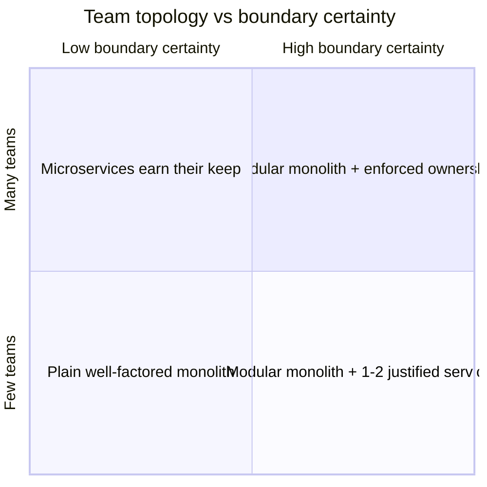
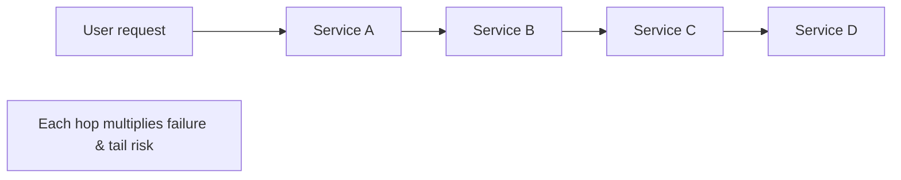
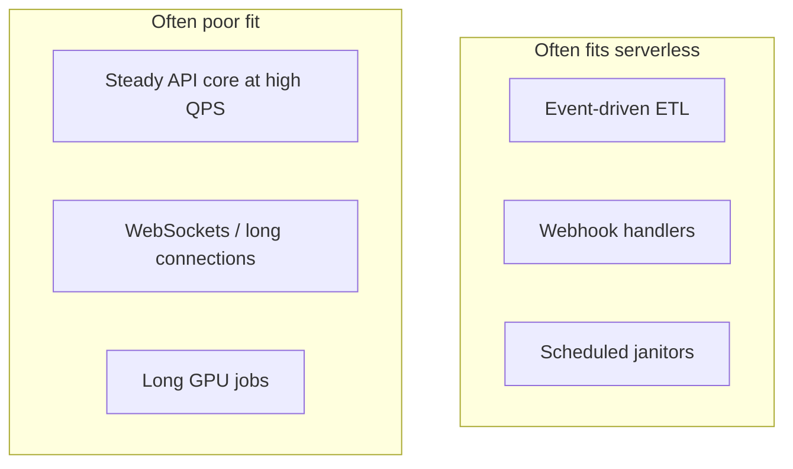
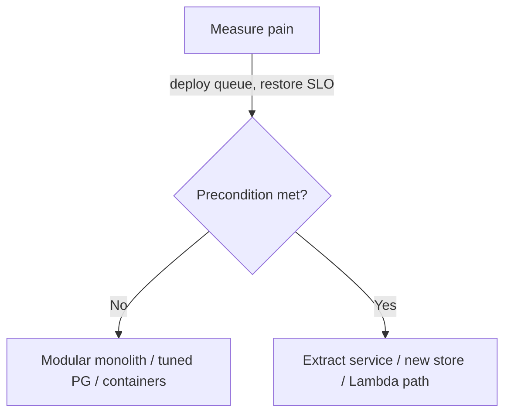

# When Not To: Microservices, Extra Databases & Serverless

Three “default answers” that often fail—microservices as org scaling, Postgres replacement, and serverless for every path—and how to decide with triggers, math, and reversibility.

> **Unifying frame:** Each pattern is **rent**. Pay it only when the precondition you can **measure** is true—not when the diagram looks modern.

---

## Part 1 — When microservices are the wrong choice

### 1.1 What you are buying (and preconditions)

A service boundary buys:

| Benefit | Precondition (often skipped) |
|---------|------------------------------|
| Independent deploy | Enough teams **contending** on one pipeline |
| Independent scale | Resource profiles differ **~10×** (not 20% RAM) |
| Fault isolation | Callers can **degrade** when dependency fails |
| Tech heterogeneity | You can afford **N runtimes** at 3 a.m. |

**Key variable:** confidence in **domain boundaries**. Boundaries are most wrong when you know least—exactly when greenfield teams draw boxes.



| Quadrant | Guidance |
|----------|----------|
| Unstable boundaries, few teams | **Monolith**—refactor in IDE, one deploy |
| Unstable boundaries, many teams | **Modular monolith** + module ownership; don’t freeze wrong cuts |
| Stable boundaries, few teams | Modular monolith + extract only special runtime/compliance needs |
| Stable boundaries, many teams | Services may pay for **independent shipping** |

> **Note:** “Start monolith, extract when it hurts” is right but needs **written triggers**—not fashion extractions.

---

### 1.2 The distributed monolith

Deployed as many services; must change, deploy, and fail as **one**.

**Diagnose with measurements (not diagrams):**

| Metric | Red flag |
|--------|----------|
| Coordinated deploy order | &gt; ~10% of releases |
| Tables written by &gt;1 service | Any |
| Sync depth on core path | Deep chains |
| Shared domain jar bumped in lockstep | Yes |

**Composition math:**

- 10 dependencies × 99.9% each ≈ **99.0%** availability before your code (~7.3 h/month)  
- Tail latency: 10 deps each slow 1% of time → **~9.6%** of requests hit a slow dependency  



---

### 1.3 Coupling that boundaries do not remove

- **Data coupling** — shared tables, dual writes  
- **Temporal coupling** — synchronous “chatty” graphs  
- **Semantic coupling** — shared models package  
- **Operational coupling** — one incident, many services paging  

Network boundaries **rename** coupling; they rarely remove it without async contracts and clear ownership.

---

### 1.4 Per-service tax (illustrative)

Each extracted service tends to add:

- Redundant pairs, LB, 3 environments  
- Dashboards, alerts, runbooks  
- CI/CD pipelines  
- Security review surface  

Rule of thumb from the source material: **~0.1–0.25 FTE per service** in mature orgs—before feature work.

| Services | Ops tax (0.25 FTE each) |
|----------|-------------------------|
| 6 | ~1.5 FTE |
| 15 | ~3.75 FTE |

Compare to cost of **modular monolith** + horizontal scale of one artifact.

---

### 1.5 Conway’s law—both directions

- Structure follows communication (classic)  
- **Also:** drawing services **creates** communication—teams form around boxes  

Premature services **freeze** org structure before you understand the domain.

---

### 1.6 Modular monolith as default

Techniques:

- **Modules/packages** with enforced dependency rules (ArchUnit, lint)  
- **Separate deployment roles** from same repo (web vs worker vs indexer) before full extraction  
- **Clear module owners** in CODEOWNERS  

---

### 1.7 Deciding and reversing extraction

Extract when **measurable**:

- Deploy queue contention (time-in-queue, failed merges)  
- Different scaling class (GPU, 30 GB RAM index)  
- Regulatory isolation boundary  
- Team ownership stable &gt; 1–2 reorg cycles  

**Reverse** (merge services) is painful but sometimes correct when distributed monolith signals dominate.

---

## Part 2 — When Postgres is enough

### 2.1 The real question

Not “Postgres vs Cassandra.” It is: **Have you exhausted the headroom of a well-operated primary** before adding a second system of record?

---

### 2.2 Headroom math (qualitative)

Postgres handles enormous workloads when:

- Indexes match queries  
- Connection pooling (PgBouncer)  
- Read replicas for analytics  
- Partitioning for retention  
- Appropriate hardware / managed tier  

**Second database** buys:

- Write shape mismatch (massive partition-key writes)  
- Multi-region active-active at huge scale  
- Specialized models (graph at scale, etc.)  

It costs: **two ops models**, consistency stories, hiring.

---

### 2.3 Absorb before you add

| Technique | Solves |
|-----------|--------|
| Read replicas | Read scaling |
| Materialized views | Heavy dashboards |
| Citus / sharding extensions | Horizontal scale inside PG ecosystem |
| JSONB + indexes | Semi-structured without document DB |
| LISTEN/NOTIFY, SKIP LOCKED | Light queue patterns |
| Timescale | Time-series inside PG |

---

### 2.4 Write path limits

Single primary has a ceiling (CPU, WAL, fsync). Signs you’re near it:

- Sustained write TPS at hardware limit  
- Vacuum / autovacuum cannot keep up  
- Index bloat on hot tables  
- Migration windows exceed business tolerance  

---

### 2.5 Limits from size

Very large tables affect:

- Backup/restore time  
- Index build duration  
- Replication lag  

**Tiering:** hot relational core + object storage / warehouse for history.

---

### 2.6 The ladder & context

```text
Postgres (tuned) → read replicas → partitioning →
specialized index (ES/OpenSearch for search) →
shard / regional split → alternate write model (Cassandra, Dynamo, etc.)
```

Climb one rung at a time with **tripwires**, not ambition.

---

### 2.7 Failing in both directions

| Mistake | Consequence |
|---------|-------------|
| Cassandra for 500 writes/s | Ops tax, consistency pain |
| Postgres past restore SLO | Existential incident risk |

---

### 2.8 Staying reversible

Keep **analytics** and **search** derived from OLTP via CDC/outbox where possible so OLTP remains source of truth.

---

## Part 3 — When serverless stops making sense

### 3.1 Shape of the decision

Serverless (functions + managed triggers) excels at **spiky, short, parallel** work. It struggles with **steady high QPS**, **long CPU**, **tight p99**, and **fine-grained control**.



---

### 3.2 Cost

Pricing dimensions: invocations, **GB-seconds**, egress, API Gateway.

| Pattern | Cost driver |
|---------|-------------|
| Always-on traffic | Per-invocation premium vs containers |
| Large payloads | Memory duration |
| Chatty micro-functions | Invocation tax |

**Break-even intuition:** plot monthly cost vs equivalent Fargate/ECS/K8s at **your** duty cycle—not vendor calculator defaults.

---

### 3.3 Latency

Cold starts (init + VPC attach), provisioned concurrency ($), and lack of persistent process state hurt interactive APIs.

Mitigations: provisioned concurrency, smaller artifacts, avoid VPC when possible, **keep warm** paths on containers.

---

### 3.4 Concurrency & limits

Account/region concurrency caps, burst behavior, and downstream DB **connection explosions** when each invocation opens a pool.

Pattern: **RDS Proxy** + limited pool, or move steady path to containers.

---

### 3.5 Lock-in

Tied to vendor event sources, IAM shapes, and deployment tooling. Acceptable when premium &lt; value; expensive when core product path is 100% functions.

---

### 3.6 Deciding per path

Split the system:

| Path | Likely home |
|------|-------------|
| Image resize on upload | Lambda |
| Checkout API | Containers / monolith module |
| Nightly billing batch | Step Functions + Lambda or container job |
| Stream processor | Kafka consumer on K8s / Flink |

---

### 3.7 Changing course cheaply

Keep **HTTP contract** stable; swap Lambda ↔ container behind load balancer. Avoid embedding vendor-specific request context in domain logic.

---

### 3.8 Against the grain

Sometimes serverless is chosen for **org politics** (no ops team). Name that trade honestly: you bought ops simplicity with latency/cost ceilings.

---

## Decision summary table

| Pattern | Pay rent when… | Default elsewhere |
|---------|----------------|-------------------|
| Microservices | Many teams, stable domains, measured deploy pain | Modular monolith |
| Second database | Proven write/restore/geo limits | Tuned Postgres + derivatives |
| Serverless | Spiky, event-driven, moderate QPS | Containers for core API |

---

## Staff-engineer questions to ask in reviews

1. What **measurement** triggers extraction or migration?  
2. What is **sync call depth** on the money path?  
3. Have we **priced** serverless at steady-state QPS?  
4. What is **backup/restore** time for Postgres at 2× data?  
5. Can we **roll back** without coordinated multi-service deploy?  

> **Remember:** The expensive mistake is adopting the fashionable shape **before the precondition exists**, then growing org and data around it until reversal is a multi-year programme.

---

*Sources consolidated from Algoroq Architecture Judgement: When Microservices Are the Wrong Choice, When Postgres Is Enough, When Serverless Stops Making Sense.*

---

## Senior Pitfalls

| Mistake | Impact | Fix |
|---------|--------|-----|
| Microservices for team of five | Most time on plumbing not features | Modular monolith until team or deploy pain justifies split |
| Event sourcing for CRUD admin | Replay complexity with no audit win | ES only when audit/time-travel is product requirement |
| Service mesh before second language/runtime | YAML tax with no mTLS benefit | Library-based resilience first |
| CQRS everywhere | Read models stale; ops burden 2× | CQRS on hot read paths or regulatory audit only |
| Blockchain for internal ledger | Slow, expensive, no trust problem solved | Postgres + append-only audit log |
| Kubernetes for single static site | Cluster ops > app value | Managed PaaS or serverless until multi-service |

---

## Production-grade Practice

1. **Build:** List three patterns you rejected last year; write “when we would adopt” criteria for each.
2. **Debug:** Find a production service with <100 RPS—evaluate if decomposition reduced or increased incident rate.
3. **Measure:** Engineering hours on platform vs feature ratio; set threshold to pause new infrastructure adoption.
4. **Capacity plan:** Simple TCO model: monolith on 2 VMs vs microservices minimum footprint (N services × base cost).

---

## FAANG Interview Deep Dive

### Real-world FAANG examples

**Amazon (two-pizza teams, but not day-one microservices)**  
Amazon’s service culture emerged when **organizational and domain boundaries** were clear enough to justify independent deployables. Early retail systems were **monoliths that modularized** before extraction. Interview trap: citing Amazon as “always microservices” without mentioning **years of boundary discovery** and operational tax.

**Instagram (Python monolith scale)**  
Instagram scaled a **Django monolith** with sharding and caching before selective service extraction. They extracted when **measurable** pain (deploy contention, distinct scaling) exceeded ops cost—counter-narrative to “rewrite as microservices at 1M users.”

**Stripe / early fintech (Postgres-first)**  
Stripe ran hard on **Postgres** with careful schema design, read paths, and later specialized stores for search/analytics via **derivatives**. Adding Cassandra/Dynamo for modest write rates is a classic **premature second system** failure mode they avoid in interviews by showing **tripwires** (restore time, WAL pressure).



### Interview Q&A

### Q: “We have 8 engineers—should we do microservices?”
**A:** **Default no** unless domains are stable and deploy contention is measured. Eight engineers × 6 services ≈ **1–2 FTE ops tax** before features. Prefer **modular monolith** with ArchUnit boundaries; extract when **one module** needs GPU, compliance isolation, or independent scale **10×** different from core.

### Q: When is a distributed monolith worse than a monolith?
**A:** When you pay **network failure modes** without independent deploy or data ownership—coordinated releases, shared tables, deep sync chains. Availability math: 10 × 99.9% dependencies ≈ 99% before your code. Interviewers want **sync depth** and **deploy coupling** metrics, not slogans.

### Q: Postgres at 10TB—when do you leave?
**A:** When **backup/restore exceeds business RTO**, vacuum/index build blocks SLOs, or write path is **saturated** after pooling, partitioning, and hardware. Not when “Mongo is cool.” Climb ladder: replicas → partitioning → specialized search → sharded write model.

### Q: Lambda for our REST API at 2k RPS steady?
**A:** Run the numbers: **GB-seconds + API Gateway + cold start p99** vs Fargate/K8s baseline. Steady high QPS with tight latency usually **loses** to containers; Lambda wins on **spiky ETL, webhooks, cron**. Mention **RDS Proxy** if you tried Lambda + DB pool explosion.

### Q: How do you write extraction triggers for staff reviews?
**A:** Document thresholds: e.g., “extract billing if **&gt;3 teams** block on same pipeline **&gt;2 weeks/quarter**” or “second DB if **restore &gt;4h** at 2× data growth.” Reversibility: can merge services if distributed monolith signals return.

### Common mistakes candidates make

- **Microservices for resume**—no measurement, unstable domain boundaries.
- **Second database** before exhausting Postgres (indexes, pool, replicas, partitions).
- **Serverless for core API** without steady-state cost and p99 modeling.
- Ignoring **Conway’s law**—drawing boxes creates teams before domain is understood.

### Decision framework

| Signal | Adopt pattern | When NOT to adopt |
|--------|---------------|-------------------|
| **Microservices** | Many teams, stable domains, deploy pain measured | &lt;2 teams, greenfield uncertainty |
| **Second DB** | Proven write/restore/geo limits | &lt;1k writes/s, fix Postgres first |
| **Serverless** | Spiky, event-driven, moderate QPS | Steady 1k+ RPS API, long CPU |
| **Modular monolith** | Default for most startups | Never enforce module boundaries |
| **Merge services** | Distributed monolith metrics red | “Fewer repos looks simpler” only |
| **Containers over Lambda** | Core product path, WebSockets | One-off S3 trigger resize |
