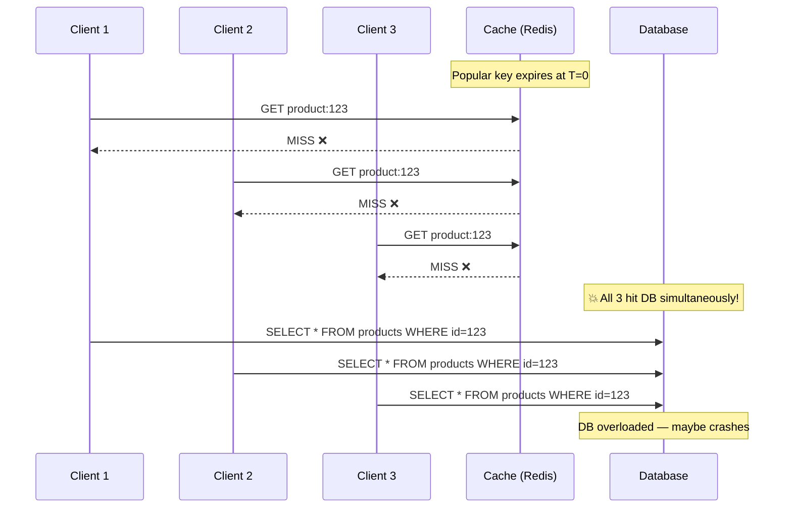
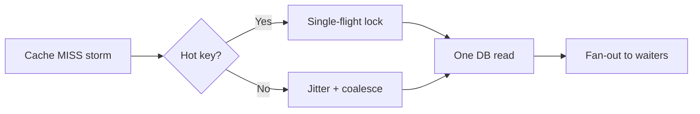

# Thundering Herd Problem

## What Is It?

Imagine a stadium gate opens and 50,000 people rush through a single door at the same time. The door (or the people) breaks.

> **The Thundering Herd** occurs when a large number of processes or requests simultaneously try to access the same resource — typically after a cache expires or a service restarts — overwhelming the backend.

---

## When Does It Happen?

### Scenario 1: Cache Expiration



In production, "3 clients" becomes **10,000 requests** hitting the database in the same millisecond.

### Scenario 2: Service Restart

All connections to a service drop, and when it comes back up, every client reconnects simultaneously.

### Scenario 3: Scheduled Job

A cron job runs at midnight, and every instance wakes up and queries the same resource.

---

## Solutions

### Solution 1: Cache Stampede Lock (Mutex)

Only **one** request fetches from the database; everyone else waits for the cache to be populated.

```python
import redis
import time

r = redis.Redis()

def get_product(product_id: str):
    cache_key = f"product:{product_id}"
    lock_key = f"lock:{cache_key}"
    
    # Try cache first
    cached = r.get(cache_key)
    if cached:
        return json.loads(cached)
    
    # Try to acquire lock (only one request wins)
    acquired = r.set(lock_key, "1", nx=True, ex=5)  # NX = only if not exists
    
    if acquired:
        # I won the lock — I'll fetch from DB
        try:
            product = db.query("SELECT * FROM products WHERE id = %s", product_id)
            r.setex(cache_key, 300, json.dumps(product))  # Cache for 5 min
            return product
        finally:
            r.delete(lock_key)  # Release lock
    else:
        # Someone else is fetching — wait and retry
        for _ in range(50):  # Wait up to 5 seconds
            time.sleep(0.1)
            cached = r.get(cache_key)
            if cached:
                return json.loads(cached)
        
        # Fallback: fetch from DB anyway (lock holder may have failed)
        return db.query("SELECT * FROM products WHERE id = %s", product_id)
```

```
Timeline with lock:
T=0  Client 1: MISS → acquires lock → queries DB
T=0  Client 2: MISS → lock exists → waits...
T=0  Client 3: MISS → lock exists → waits...
T=50ms Client 1: Got result → writes to cache → releases lock
T=50ms Client 2: Reads from cache ✅
T=50ms Client 3: Reads from cache ✅

Only 1 DB query instead of 10,000!
```

---

### Solution 2: Stale-While-Revalidate

Serve **stale (expired) data** while refreshing in the background.

```python
import redis
import threading

r = redis.Redis()

def get_product(product_id: str):
    cache_key = f"product:{product_id}"
    stale_key = f"stale:{cache_key}"
    
    # Check fresh cache
    cached = r.get(cache_key)
    if cached:
        return json.loads(cached)
    
    # Check stale cache (kept longer than fresh)
    stale = r.get(stale_key)
    if stale:
        # Return stale data immediately
        # Refresh in background
        threading.Thread(
            target=refresh_cache,
            args=(product_id, cache_key, stale_key)
        ).start()
        return json.loads(stale)
    
    # Nothing in cache at all — must fetch
    return refresh_cache(product_id, cache_key, stale_key)


def refresh_cache(product_id, cache_key, stale_key):
    product = db.query("SELECT * FROM products WHERE id = %s", product_id)
    data = json.dumps(product)
    
    r.setex(cache_key, 300, data)        # Fresh: 5 minutes
    r.setex(stale_key, 86400, data)      # Stale: 24 hours (backup)
    
    return product
```

```
Timeline with stale-while-revalidate:
T=0   Cache expires
T=0   Client 1: Fresh MISS → Stale HIT → returns stale data instantly
T=0   Client 1: (background) refreshing cache from DB
T=0   Client 2: Fresh MISS → Stale HIT → returns stale data instantly
T=50ms Background refresh complete → cache updated
T=50ms Client 3: Fresh HIT → returns fresh data

Zero latency impact! Users always get fast responses.
```

---

### Solution 3: Probabilistic Early Expiration (XFetch)

Each request has a **small random chance** of refreshing the cache before it expires, spreading the load.

```python
import redis
import math
import random
import time

r = redis.Redis()

def xfetch(key: str, ttl: int, beta: float = 1.0, fetch_fn=None):
    """
    XFetch algorithm: probabilistically refresh cache before expiry.
    
    beta: higher = more aggressive early refresh (1.0 is default)
    """
    cached = r.get(key)
    
    if cached:
        data = json.loads(cached)
        expiry = r.ttl(key)
        
        # Probabilistic early expiration
        # As TTL gets closer to 0, probability of refresh increases
        delta = ttl - expiry  # how long since last refresh
        random_value = random.random()
        threshold = delta * beta * math.log(random_value)
        
        if expiry + threshold <= 0:
            # "I volunteer to refresh early!"
            result = fetch_fn()
            r.setex(key, ttl, json.dumps(result))
            return result
        
        return data
    
    # Cache miss — fetch and store
    result = fetch_fn()
    r.setex(key, ttl, json.dumps(result))
    return result
```

```
Timeline with XFetch (TTL = 300s):
T=200s  Client A: TTL remaining = 100s → random says "don't refresh" → cache HIT
T=250s  Client B: TTL remaining = 50s → random says "refresh early!" → queries DB
T=250s  Cache refreshed with new TTL=300s
T=300s  Original TTL would have expired, but cache is already fresh!

No stampede because refresh happens before expiry.
```

---

### Solution 4: Request Coalescing (Collapse Forwarding)

Multiple identical requests are **collapsed into one** at the proxy level.

```nginx
# Nginx — proxy_cache_lock collapses duplicate requests
proxy_cache_path /tmp/cache keys_zone=my_cache:10m;

server {
    location /api/products/ {
        proxy_cache my_cache;
        proxy_cache_valid 200 5m;
        
        # Only ONE request goes to backend; others wait for cache
        proxy_cache_lock on;
        proxy_cache_lock_timeout 5s;
        
        # Serve stale while updating
        proxy_cache_use_stale updating;
        
        proxy_pass http://backend;
    }
}
```

```typescript
// Application-level request coalescing
class RequestCoalescer<T> {
  private inflight: Map<string, Promise<T>> = new Map();

  async fetch(key: string, fetchFn: () => Promise<T>): Promise<T> {
    // If a request for this key is already in flight, piggyback on it
    const existing = this.inflight.get(key);
    if (existing) {
      return existing; // Share the same promise
    }

    // First request — create the promise
    const promise = fetchFn().finally(() => {
      this.inflight.delete(key); // Clean up when done
    });

    this.inflight.set(key, promise);
    return promise;
  }
}

// Usage
const coalescer = new RequestCoalescer();

// Even if called 10,000 times simultaneously, only 1 DB query runs
async function getProduct(id: string) {
  return coalescer.fetch(`product:${id}`, () =>
    db.query("SELECT * FROM products WHERE id = $1", [id])
  );
}
```

---

### Solution 5: Jittered Expiration

Don't set the same TTL for all keys — add randomness.

```python
import random

def cache_with_jitter(key: str, value: str, base_ttl: int = 300):
    """
    Instead of all keys expiring at T=300s:
    Key A expires at 270s, Key B at 315s, Key C at 290s...
    """
    jitter = random.randint(-30, 30)  # ±30 seconds
    ttl = base_ttl + jitter
    r.setex(key, ttl, value)


# For service restarts, add jitter to reconnection:
import asyncio

async def reconnect_with_jitter():
    """Prevent thundering herd on service restart."""
    jitter = random.uniform(0, 5)  # 0-5 second random delay
    await asyncio.sleep(jitter)
    await connect_to_database()
```

---

## Solution Comparison

| Solution | Complexity | Stale Data? | Best For |
|---|---|---|---|
| **Mutex Lock** | Medium | No | Single popular keys |
| **Stale-While-Revalidate** | Medium | Yes (briefly) | Read-heavy APIs |
| **XFetch** | High | No | Mathematically-inclined teams |
| **Request Coalescing** | Low | No | Proxy/gateway level |
| **Jittered Expiration** | Low | No | Preventing scheduled stampedes |

---

## Key Takeaways

- The thundering herd is a **multiplicative failure** — one expired key becomes 10,000 DB queries
- **Combine solutions**: jittered TTLs + mutex lock + stale-while-revalidate is the gold standard
- **Request coalescing** at the proxy level is the cheapest win
- Always **monitor cache hit ratios** — a sudden drop signals a potential stampede
- Test with load testing tools (k6, Locust) that simulate cache expiration under load

### AWS service map

| Layer | Service | Pattern |
|-------|---------|---------|
| Edge | CloudFront | `proxy_cache_lock` / request coalescing on hot URLs; jittered TTL via origin headers |
| API | API Gateway caching | Per-stage cache; short TTL on dynamic paths only with care |
| App | ElastiCache Redis | Single-flight (`SET NX`), jittered TTL, negative cache sentinel |
| Origin protection | WAF rate limit | Cap 404 scanners that trigger miss storms |

---

## Senior Pitfalls

| Mistake | Impact | Fix |
|---------|--------|-----|
| Cache expiry aligned to the minute for hot keys | Simultaneous misses crush origin | Jitter TTL; stagger warmers |
| No single-flight on popular keys | N concurrent DB queries per miss | `SET NX` lock, request coalescing, or per-key semaphores |
| Negative cache missing on 404 storms | Origin hammered by scanners | Short-TTL sentinel for known misses |
| Cache-aside without stampede protection on deploy | Cold start after flush | Probabilistic early refresh or background recompute |
| Ignoring cache miss metrics | Discover herd only during outage | Alert on miss rate × origin latency product |

---

## Production-grade Practice

1. **Build:** Implement single-flight + jittered TTL for one high-QPS key; load-test expiry boundary.
2. **Debug:** Replay cache flush event; compare origin QPS with and without coalescing.
3. **Measure:** Track coalesced vs duplicate origin fetches; SLO on max origin concurrency per key.
4. **Capacity plan:** Size origin for worst-case herd (all clients miss once) vs cost of longer TTL and proactive warming.

---

## FAANG Interview Deep Dive

### Real-world FAANG examples

| Company | Pattern | Scale signal |
|---|---|---|
| **Netflix** | EVCache (memcached) + probabilistic early refresh on hot keys like title metadata | Peak **~15M concurrent** streams; a single title key can see **100K+ RPS** on premiere night |
| **Meta** | McDipper proxy uses **lease/get** semantics (mutex + coalescing) in front of Memcache for GraphQL/DataLoader fan-out | **Billions of cache ops/sec** cluster-wide; one logical key can fan out to **50+ sub-queries** |
| **Amazon** | Product detail pages combine **CDN edge lock** (`proxy_cache_lock`) + **jittered TTL** on DynamoDB-backed caches | Prime Day spikes **10–50×** normal QPS; stampedes on ASIN keys historically took down read replicas |

**Netflix detail:** For homepage rows, they avoid synchronized expiry by **staggering TTL** per shard and using **background refresh** before hard expiry on top-1% keys (similar to stale-while-revalidate + XFetch hybrid).

**Google detail:** Search serving layers use **request coalescing** in RPC stubs so duplicate key fetches collapse within a single process *and* across a small coalescing window—critical when **millions of QPS** hit the same index shard after a config push.



### Interview Q&A

### Q: A flash sale starts at noon. At 12:00:00 exactly, 50K clients request `product:999`. Redis shows 0% hit rate for 3 seconds, then DB CPU hits 100%. Design a fix without changing the DB.

**A:** Layer defenses: (1) **Jitter** TTL so keys don’t share expiry—spread ±10–30% of base TTL. (2) **Single-flight** in app (`SET lock NX EX 3`) or Redis `SET` + pub/sub notify waiters. (3) **Stale-while-revalidate**—keep a `stale:` key with 24h TTL; on fresh miss, return stale and refresh async. (4) **Nginx `proxy_cache_lock`** if traffic hits a gateway. Math: 50K concurrent misses × 1 DB query each = 50K queries; with single-flight, **1 query** + 49,999 cache hits after ~50–200ms refresh. Trade-off: SWR accepts **seconds** of stale price during sale—use **version checks** for checkout path only.

### Q: Your mutex lock works in staging but production still stampedes. What breaks at scale?

**A:** Common gaps: (1) **Lock too short**—holder dies or work exceeds `EX 5`, lock expires, second wave hits DB. Fix: **renewal** loop or TTL = p99(fetch) × 2. (2) **No lock on negative cache**—miss on “not found” still stampedes. Cache **empty sentinel** with short TTL. (3) **Per-process coalescing only**—10K pods = 10K DB queries. Need **distributed** lock or proxy coalescing. (4) **Thundering retry**—clients retry on 503, amplifying load. Add **exponential backoff + jitter** on clients.

### Q: Compare mutex vs XFetch vs stale-while-revalidate for a Staff-level system design.

**A:**

| Approach | DB load | Latency | Consistency | Ops complexity |
|---|---|---|---|---|
| Mutex | Minimal (1 fetch) | Waiters block 50–500ms | Strong after refresh | Medium |
| XFetch | Spread over time | No waiter blocking | Strong | High (tuning β) |
| SWR | Low (async refresh) | Always fast | Eventual | Medium |

**Staff answer:** Use **SWR at CDN**, **mutex at origin** for true misses, **XFetch** only on proven hot keys with metrics (`cache_stampede_lock_wait_ms`, `db_queries_per_key`).

### Q: How do you test for thundering herd before launch?

**A:** k6 scenario: warm cache → **flush one key** under **constant 5K RPS** for 60s. Success criteria: DB QPS for that key ≤ **2** (refresh + optional race), p99 app latency < SLO, no connection pool exhaustion. Chaos: kill lock holder mid-fetch—verify fallback doesn’t open floodgate (rate limit DB path).

### Q: When is “let them all hit the DB” acceptable?

**A:** When miss rate is **low cardinality** (many different keys), data is **cheap to read**, and DB has **headroom**. Never acceptable for **single hot key** at FAANG scale—one key can represent **>30%** of traffic (Netflix title, Amazon ASIN, Meta feed chunk).

### Common mistakes (interviewers flag these)

- Using **blocking sleep spin** without max wait → thread pool exhaustion under load.
- **Deleting lock without token check** after slow work—another instance’s lock gets deleted.
- **Same TTL** on millions of keys loaded from a nightly batch job (midnight stampede).
- **Cache aside** without coalescing on **read-through** popular keys only.
- Fixing stampede with **long TTL** on inventory/price without invalidation strategy.

### Back-of-envelope sizing

**Scenario:** Hot key, 20K RPS, 2 KB value, TTL 300s.

| Item | Calculation |
|---|---|
| Redis memory (one key) | 2 KB + ~100 B overhead ≈ **2.1 KB** |
| DB without coalescing | 20K QPS × 300s = **6M queries** per TTL window |
| DB with single-flight | **~1 query per TTL** + rare races ≈ **1–5 QPS** |
| Lock waiters | 20K × 100ms wait = need **async/non-blocking** wait (polling or pub/sub), not 20K blocked threads |

**Break-even:** If DB read costs **5ms** and pool size **100**, max sustainable uncached QPS ≈ 100 / 0.005 = **20K**—one synchronized miss can saturate the pool instantly.

```python
# Production pattern: single-flight + jittered TTL
def ttl_with_jitter(base: int = 300) -> int:
    return base + random.randint(-int(base * 0.1), int(base * 0.1))

async def get_with_singleflight(redis, key, fetch_fn):
    if val := await redis.get(key):
        return val
    if await redis.set(f"lock:{key}", "1", nx=True, ex=5):
        try:
            data = await fetch_fn()
            await redis.setex(key, ttl_with_jitter(), data)
            return data
        finally:
            await redis.delete(f"lock:{key}")
    # coalesce: subscribe or short poll
    for _ in range(30):
        await asyncio.sleep(0.05)
        if val := await redis.get(key):
            return val
    return await fetch_fn()  # guarded rate limit in prod
```
