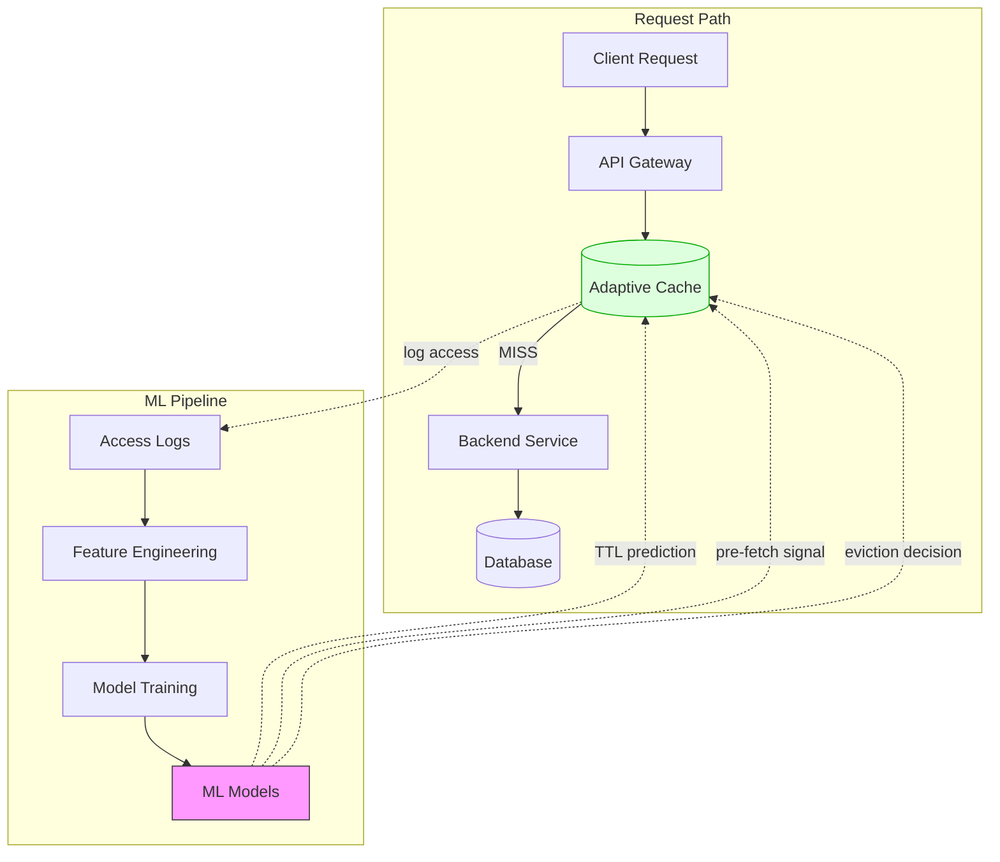
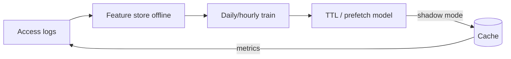

# Adaptive Caching with Machine Learning

## Why Traditional Caching Falls Short

Traditional caching uses **static rules**: "cache this for 5 minutes," "evict the Least Recently Used item." But real-world access patterns are dynamic:

- A product page gets 10x traffic during a flash sale
- News articles spike for 2 hours then die off
- Some API endpoints are popular on weekdays, others on weekends

> **Adaptive caching** uses Machine Learning to **predict** which items to cache, how long to cache them, and when to pre-fetch — dynamically adjusting to actual access patterns.

---

## Traditional vs Adaptive Caching

```
Traditional (Static):                   Adaptive (ML-Driven):
┌────────────────────────┐              ┌────────────────────────┐
│ TTL = 300s for ALL     │              │ TTL = 30s  (cold item) │
│                        │              │ TTL = 600s (hot item)  │
│ Eviction: LRU always   │              │ TTL = 10s  (volatile)  │
│                        │              │                        │
│ No pre-fetching        │              │ Eviction: ML-predicted │
│                        │              │                        │
│ Same strategy 24/7     │              │ Pre-fetch before spike │
│                        │              │                        │
│ One-size-fits-all      │              │ Adapts to patterns     │
└────────────────────────┘              └────────────────────────┘
```

---

## Core ML Techniques for Caching

### 1. Predictive TTL (Time-To-Live)

Instead of a fixed TTL, predict the optimal TTL for each cache entry.

```python
import numpy as np
from sklearn.ensemble import GradientBoostingRegressor
import redis
import time

class PredictiveTTLCache:
    def __init__(self):
        self.redis = redis.Redis()
        self.model = GradientBoostingRegressor()
        self.access_log = []  # Track access patterns
    
    def _extract_features(self, key: str) -> list:
        """Extract features for ML model."""
        now = time.time()
        history = self.get_access_history(key)
        
        return [
            len(history),                          # Total access count
            history[-1] - history[0] if len(history) > 1 else 0,  # Time span
            np.mean(np.diff(history)) if len(history) > 1 else 0, # Avg interval
            np.std(np.diff(history)) if len(history) > 2 else 0,  # Interval variance
            now % 86400,                           # Time of day (seconds)
            time.localtime(now).tm_wday,           # Day of week
            self._get_content_type(key),            # Type: product, user, etc.
            self._get_data_volatility(key),         # How often data changes
        ]
    
    def _predict_ttl(self, key: str) -> int:
        """Use ML model to predict optimal TTL."""
        features = self._extract_features(key)
        
        predicted_ttl = self.model.predict([features])[0]
        
        # Clamp to reasonable range
        return max(10, min(int(predicted_ttl), 3600))  # 10s to 1 hour
    
    def get(self, key: str):
        """Get with adaptive TTL on cache refresh."""
        # Log access
        self.access_log.append((key, time.time()))
        
        cached = self.redis.get(key)
        if cached:
            return json.loads(cached)
        
        # Cache miss — fetch from source
        value = self.fetch_from_source(key)
        
        # Use ML to determine TTL
        ttl = self._predict_ttl(key)
        self.redis.setex(key, ttl, json.dumps(value))
        
        print(f"Cached {key} with predicted TTL={ttl}s")
        return value
    
    def train(self):
        """Periodically retrain the model on access patterns."""
        X, y = self._prepare_training_data()
        self.model.fit(X, y)
        print(f"Model retrained on {len(X)} samples")
```

---

### 2. Predictive Pre-fetching

Predict what data will be needed **before** it's requested.

```python
from collections import defaultdict
import heapq

class PredictivePreFetcher:
    """
    Learns access sequences to predict and pre-fetch the next likely request.
    
    Example: Users who view product A often view product B next.
    → When someone views A, pre-fetch B into cache.
    """
    
    def __init__(self, cache, threshold=0.3):
        self.cache = cache
        self.threshold = threshold  # Minimum probability to trigger pre-fetch
        
        # Transition matrix: P(next_key | current_key)
        self.transitions = defaultdict(lambda: defaultdict(int))
        self.last_access = {}  # Last key accessed per user
    
    def record_access(self, user_id: str, key: str):
        """Record the access and update transition probabilities."""
        if user_id in self.last_access:
            prev_key = self.last_access[user_id]
            self.transitions[prev_key][key] += 1
        
        self.last_access[user_id] = key
    
    def get_predictions(self, current_key: str, top_n=3) -> list:
        """Predict the most likely next keys to be accessed."""
        if current_key not in self.transitions:
            return []
        
        counts = self.transitions[current_key]
        total = sum(counts.values())
        
        # Calculate probabilities and sort
        predictions = [
            (next_key, count / total)
            for next_key, count in counts.items()
        ]
        predictions.sort(key=lambda x: x[1], reverse=True)
        
        # Filter by threshold
        return [
            (key, prob) for key, prob in predictions[:top_n]
            if prob >= self.threshold
        ]
    
    def on_access(self, user_id: str, key: str):
        """Called on every cache access — records and pre-fetches."""
        self.record_access(user_id, key)
        
        # Predict next accesses
        predictions = self.get_predictions(key)
        
        for predicted_key, probability in predictions:
            if not self.cache.exists(predicted_key):
                print(f"Pre-fetching {predicted_key} (prob={probability:.2f})")
                # Async pre-fetch
                asyncio.create_task(self.cache.warm(predicted_key))


# Usage:
# User views product/123 → system pre-fetches product/456 (frequently viewed next)
# User views cart → system pre-fetches checkout page data
```

---

### 3. ML-Based Eviction (Replacing LRU)

LRU evicts the **least recently used** item. But that's often wrong — a rarely accessed item might be about to be accessed.

```python
class MLEvictionPolicy:
    """
    Learns which cached items are likely to be accessed again
    and evicts items with the lowest predicted future access probability.
    
    This replaces LRU/LFU with a learned policy.
    """
    
    def __init__(self, capacity: int):
        self.capacity = capacity
        self.cache = {}
        self.metadata = {}  # Stores features per key
        self.model = self._build_model()
    
    def _build_model(self):
        """Build a lightweight model for eviction decisions."""
        from sklearn.ensemble import RandomForestClassifier
        return RandomForestClassifier(n_estimators=50, max_depth=5)
    
    def _get_features(self, key: str) -> list:
        """Features for predicting if this item will be accessed again."""
        meta = self.metadata.get(key, {})
        now = time.time()
        
        return [
            meta.get("access_count", 0),           # How many times accessed
            now - meta.get("last_access", now),     # Recency
            now - meta.get("first_access", now),    # Age
            meta.get("avg_interval", 0),            # Average time between accesses
            meta.get("size_bytes", 0),              # Size of cached item
            meta.get("compute_cost_ms", 0),         # How expensive to recompute
        ]
    
    def evict(self):
        """Evict the item least likely to be accessed again."""
        if len(self.cache) < self.capacity:
            return
        
        # Score every item
        scores = []
        for key in self.cache:
            features = self._get_features(key)
            # Predict probability of future access
            prob = self.model.predict_proba([features])[0][1]
            
            # Also factor in cost: expensive-to-recompute items get a bonus
            cost = self.metadata[key].get("compute_cost_ms", 1)
            score = prob * cost  # Higher = more valuable to keep
            
            scores.append((key, score))
        
        # Evict lowest-scoring item
        scores.sort(key=lambda x: x[1])
        victim_key = scores[0][0]
        
        del self.cache[victim_key]
        print(f"Evicted {victim_key} (score={scores[0][1]:.3f})")
```

---

### 4. Anomaly Detection for Cache Invalidation

Detect when cached data is likely stale based on data change patterns.

```python
from sklearn.ensemble import IsolationForest

class SmartInvalidator:
    """
    Monitors data change patterns and proactively invalidates cache
    when it detects the underlying data has likely changed.
    """
    
    def __init__(self):
        self.change_history = defaultdict(list)  # key → [timestamps of changes]
        self.model = IsolationForest(contamination=0.1)
    
    def record_change(self, key: str):
        """Record when the source data for a key changes."""
        self.change_history[key].append(time.time())
    
    def should_invalidate(self, key: str) -> bool:
        """Predict if cached data is likely stale."""
        history = self.change_history[key]
        if len(history) < 5:
            return False
        
        # Features: time since last change, average change interval
        now = time.time()
        intervals = np.diff(history)
        
        features = [
            now - history[-1],       # Time since last known change
            np.mean(intervals),      # Average change interval
            np.std(intervals),       # Variance in change timing
        ]
        
        # If current "time since change" is an anomaly (much longer than usual),
        # the data probably changed and we missed it
        prediction = self.model.predict([features])[0]
        
        return prediction == -1  # -1 = anomaly = likely stale
```

---

## Architecture Overview



---

## Production Considerations

### Start Simple, Then Add ML

```
Level 0: Static TTL + LRU                     ← Start here
Level 1: Jittered TTL + stale-while-revalidate ← Most teams stop here
Level 2: Rule-based adaptive TTL               ← Significant improvement
Level 3: ML-predicted TTL + pre-fetching       ← Only if justified by scale
Level 4: Full ML eviction + anomaly detection  ← Netflix / Google scale
```

### Metrics to Track

```python
# Before and after ML caching — measure improvement
metrics = {
    "cache_hit_ratio":    0.85,     # Target: > 0.90
    "p99_latency_ms":     50,       # Target: < 30
    "db_load_qps":        5000,     # Target: < 2000
    "stale_data_rate":    0.02,     # Target: < 0.01
    "pre_fetch_accuracy": 0.65,     # Target: > 0.70
    "cost_savings":       "30%",    # From reduced DB queries
}
```

---

## Key Takeaways

- **Don't start with ML** — static caching with jitter solves 80% of problems
- ML caching shines when you have **diverse access patterns** and **high traffic**
- **Predictive TTL** is the easiest ML enhancement — replace fixed TTL with learned TTL
- **Pre-fetching** gives the biggest latency improvement but wastes resources if prediction accuracy is low
- **Always have a fallback** — if the ML model is wrong, fall back to static TTL
- Train models **offline** on access logs, not in the hot path
- Google's research paper on "[learned index structures](https://arxiv.org/abs/1712.01208)" is a great deep-dive

---

## Senior Pitfalls

| Mistake | Impact | Fix |
|---------|--------|-----|
| ML model in request path adding milliseconds | Latency regression worse than cache hit gain | Offline training; lightweight inference or precomputed admission policy |
| Training on biased logs (only cache hits logged) | Model never learns to cache cold keys | Log all requests with features at edge |
| No rollback when model drifts | Hit ratio collapses after catalog change | Shadow mode + automatic fallback to LRU |
| Overfitting to one traffic pattern (Black Friday) | Poor weekday performance | Retrain on stratified samples; monitor hit ratio by segment |
| Feature leakage using future labels | Inflated offline metrics | Strict time-based train/test splits on access logs |

---

## Production-grade Practice

1. **Build:** Train a simple classifier (cache vs skip) on historical logs offline; deploy policy table updated hourly, not per request.
2. **Debug:** Compare hit ratio and p99 latency A/B between LRU and ML policy over one week of production traffic replay.
3. **Measure:** Dashboard hit ratio, eviction rate, and model staleness; alert if hit ratio drops > 5% vs baseline.
4. **Capacity plan:** Estimate CPU for inference at peak RPS; choose between edge precomputation and centralized policy pushes.

---

## FAANG Interview Deep Dive

### Real-world FAANG examples

| Company | ML / adaptive caching | What they actually optimize |
|---|---|---|
| **Netflix** | EVCache + **popularity-aware** warming; offline models predict **viewing spikes** per title/region | **~270M** paid members; pre-warm top-N titles per PoP before regional prime time |
| **Google** | **Borg/Monarch**-style autoscaling informs cache footprint; **learned TTL** research for CDN edge | Search/ads: **exabytes** of edge cache; even **1% hit ratio** improvement saves **thousands of machines** |
| **Amazon** | **Dynamic TTL** on product caches tied to **inventory velocity** and **price change rate** | Prime Day: adaptive shrink TTL on high-churn ASINs (seconds) vs stable ASINs (minutes) |

**Meta angle:** News Feed ranking caches **partial feature vectors** per user segment (not per user in the hot path)—ML predicts **segment-level** reuse, keeping cardinality bounded while mimicking personalization.



### Interview Q&A

### Q: Your team proposes Gradient Boosting in the request path for TTL. Staff engineer pushback—what do you say?

**A:** **Never score in the hot path** at scale. Pattern: (1) Offline train on **aggregated key features** (key hash bucket, content type, hour-of-day). (2) Publish **lookup table** or **small linear model** to Redis sidecar updated every **5–15 min**. (3) **Shadow mode** for 2 weeks—compare predicted TTL vs static on `hit_ratio`, `stale_served`, `origin_qps`. (4) Fallback to static TTL if model version missing. Trade-off: **2–5% hit ratio gain** might justify **one ML engineer**; below that, use **rule-based** (flash sale → TTL=10s).

### Q: How do you measure pre-fetch accuracy without wasting origin capacity?

**A:** Track **pre_fetch_requests**, **pre_fetch_used** (access within Δt), **wasted_bytes**. Target **precision > 0.6** before enabling for all traffic. Start with **top 0.1%** keys by QPS. Math: 1M pre-fetches/hr × 10 KB × 40% waste = **4 GB/hr** useless origin bandwidth.

### Q: ML eviction vs LRU—which wins on a 64 GB Redis cluster at 1M RPS?

**A:** LRU wins on **simplicity and tail latency** unless you have **skewed reuse** (ML inference, embedding caches). Amazon/Netflix-style answer: use **cost-aware eviction**: `score = predicted_reuse × recompute_cost_ms`. Keep LRU as **baseline**; ML only for **object size > 100 KB** or **recompute > 50ms**. Interview gold: cite **Belady’s optimal** is unknowable online—ML approximates **frequency × cost**.

### Q: Design adaptive caching for a flash sale API without training data for the sale.

**A:** **Cold-start rules:** detect QPS derivative `dQ/dt > threshold` → clamp TTL to **5–15s**, enable **coalescing**, disable aggressive pre-fetch. Use **anomaly detection** on error rate + latency. After event, feed logs into model retrain. Human **kill switch** to static safe mode.

### Q: What features are safe vs leaky for a TTL model?

**A:** Safe: hour, DOW, key category, rolling access count, volatility score. **Leaky / bad:** raw `user_id` (overfits, privacy), **post-sale price** as feature without version. Use **aggregated** volatility per SKU, not per request.

### Common mistakes

- Training on **non-stationary** data (COVID traffic) without **recency weighting**.
- Pre-fetching **personalized** keys → cache pollution and **hit ratio drops**.
- No **circuit breaker** when model serves TTL=3600 on fast-changing inventory.
- Optimizing hit ratio while **p99 latency** rises (evicting small hot keys).
- **Feedback loop:** caching more makes access logs look colder—use **counterfactual logging** (sample uncached reads).

### Back-of-envelope sizing

**Cluster:** 1M RPS, 8 KB avg object, target hit ratio **0.92**.

| Metric | Math |
|---|---|
| Origin QPS if hit=0.92 | 1M × 0.08 = **80K QPS** |
| Origin QPS if hit=0.96 (ML +4%) | 1M × 0.04 = **40K QPS** → **50% DB cut** |
| Redis RAM (working set) | 10M keys × 8 KB ≈ **80 GB** (+25% overhead ≈ **100 GB**) |
| ML pipeline cost | 1 TB logs/day × $0.02/GB scan ≈ **$20/day** vs **$50K/day** DB savings at $0.001/query |

**ROI rule:** Adaptive ML must save **>10×** its compute + eng cost, or stay at Level 1–2 (jitter + rules).

```python
# Rule-based adaptive TTL (Level 2 — what most "ML" interviews expect first)
def adaptive_ttl(key_meta: dict) -> int:
    qps = key_meta.get("qps_5m", 0)
    churn = key_meta.get("updates_per_hour", 0)
    if churn > 60:
        return 10
    if qps > 5000:
        return 600
    if qps > 500:
        return 120
    return 300
```
