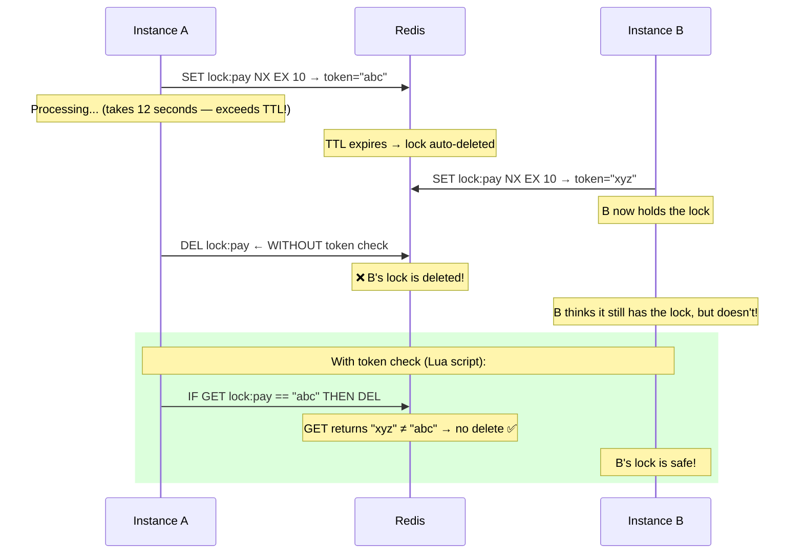
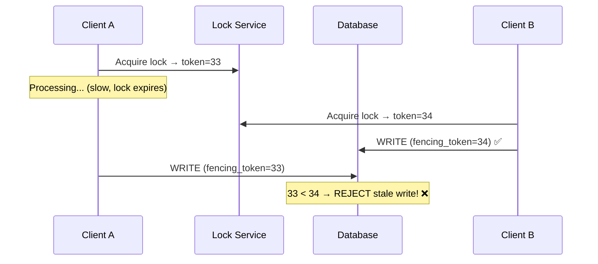
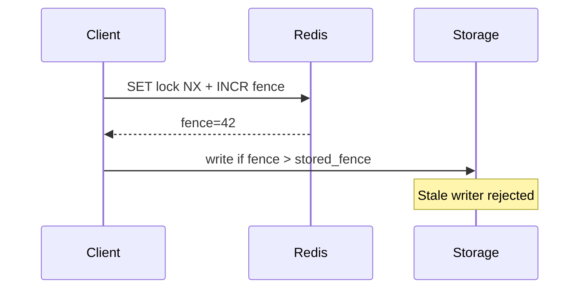

# Distributed Locks with Redis

## Why Do You Need Distributed Locks?

In a single-process app, you use a mutex or `synchronized` block. But in a distributed system with **multiple instances** of your service, in-memory locks don't work — each instance has its own memory.

> **A distributed lock** ensures that only **one process across your entire cluster** can execute a critical section at a time — even if you have 50 instances running.

---

## Common Use Cases

```
Without distributed lock:                 With distributed lock:
┌──────────┐  ┌──────────┐               ┌──────────┐  ┌──────────┐
│ Instance1 │  │ Instance2 │              │ Instance1 │  │ Instance2 │
│ Process   │  │ Process   │              │ LOCK ✅   │  │ WAIT ⏳   │
│ payment   │  │ payment   │              │ Process   │  │           │
│ for $100  │  │ for $100  │              │ payment   │  │           │
└─────┬─────┘  └─────┬─────┘              │ for $100  │  │           │
      │               │                   │ UNLOCK    │  │ LOCK ✅   │
      ▼               ▼                   └──────────┘  │ Process   │
   User charged $200! 😱                                │ payment   │
                                                        │ (sees $0) │
                                                        │ SKIP ✅   │
                                                        └──────────┘
                                             User charged $100 ✅
```

---

## Basic Redis Lock: SETNX

The simplest distributed lock uses Redis `SET NX` (Set if Not eXists):

```python
import redis
import uuid
import time

class SimpleRedisLock:
    def __init__(self, redis_client: redis.Redis):
        self.redis = redis_client
    
    def acquire(self, lock_name: str, ttl_seconds: int = 10) -> str | None:
        """
        Try to acquire a lock.
        Returns a unique token if successful, None if lock is held.
        """
        token = str(uuid.uuid4())  # Unique value to identify lock owner
        
        # SET lock_name token NX EX ttl
        # NX = only set if key doesn't exist
        # EX = auto-expire after ttl seconds (safety net)
        acquired = self.redis.set(
            f"lock:{lock_name}",
            token,
            nx=True,
            ex=ttl_seconds
        )
        
        return token if acquired else None
    
    def release(self, lock_name: str, token: str) -> bool:
        """
        Release a lock, but ONLY if we still own it.
        Uses Lua script for atomicity.
        """
        # ⚠️ This MUST be atomic (check + delete)
        lua_script = """
        if redis.call("GET", KEYS[1]) == ARGV[1] then
            return redis.call("DEL", KEYS[1])
        else
            return 0
        end
        """
        result = self.redis.eval(lua_script, 1, f"lock:{lock_name}", token)
        return result == 1


# Usage
r = redis.Redis()
lock = SimpleRedisLock(r)

token = lock.acquire("payment:user123", ttl_seconds=10)
if token:
    try:
        process_payment("user123", 100.00)
    finally:
        lock.release("payment:user123", token)
else:
    print("Could not acquire lock — another instance is processing")
```

### Why the Token Matters



---

## Production-Grade: Redlock Algorithm

A single Redis instance is a **single point of failure**. If it goes down, your locks disappear. **Redlock** uses multiple independent Redis instances for fault tolerance.

```
Redlock requires N Redis instances (typically 5).
To acquire a lock, you must get it on a MAJORITY (N/2 + 1 = 3).

┌─────────┐  ┌─────────┐  ┌─────────┐  ┌─────────┐  ┌─────────┐
│ Redis 1  │  │ Redis 2  │  │ Redis 3  │  │ Redis 4  │  │ Redis 5  │
│  ✅ YES  │  │  ✅ YES  │  │  ❌ DOWN │  │  ✅ YES  │  │  ❌ SLOW │
└─────────┘  └─────────┘  └─────────┘  └─────────┘  └─────────┘

3 out of 5 = majority → Lock acquired! ✅
```

```python
import redis
import uuid
import time

class Redlock:
    def __init__(self, redis_instances: list[redis.Redis]):
        self.instances = redis_instances
        self.quorum = len(redis_instances) // 2 + 1  # Majority
        self.clock_drift_factor = 0.01  # 1% clock drift tolerance
    
    def acquire(self, resource: str, ttl_ms: int = 10000) -> dict | None:
        """
        Acquire a distributed lock using the Redlock algorithm.
        
        Steps:
        1. Get current time
        2. Try to acquire lock on all N instances
        3. Calculate elapsed time
        4. Lock is acquired if majority succeeded AND elapsed < TTL
        """
        token = str(uuid.uuid4())
        start_time = time.monotonic()
        
        # Step 1: Try to acquire on all instances
        acquired_count = 0
        for instance in self.instances:
            try:
                result = instance.set(
                    f"lock:{resource}",
                    token,
                    nx=True,
                    px=ttl_ms  # PX = milliseconds
                )
                if result:
                    acquired_count += 1
            except redis.ConnectionError:
                continue  # Instance is down — skip
        
        # Step 2: Calculate elapsed time
        elapsed_ms = (time.monotonic() - start_time) * 1000
        drift = ttl_ms * self.clock_drift_factor + 2  # Clock drift tolerance
        
        # Step 3: Check if we got majority AND have time remaining
        remaining_ttl = ttl_ms - elapsed_ms - drift
        
        if acquired_count >= self.quorum and remaining_ttl > 0:
            return {
                "token": token,
                "resource": resource,
                "valid_for_ms": remaining_ttl,
            }
        else:
            # Failed — release any locks we did acquire
            self._release_all(resource, token)
            return None
    
    def release(self, lock_info: dict):
        """Release the lock on all instances."""
        self._release_all(lock_info["resource"], lock_info["token"])
    
    def _release_all(self, resource: str, token: str):
        lua_script = """
        if redis.call("GET", KEYS[1]) == ARGV[1] then
            return redis.call("DEL", KEYS[1])
        else
            return 0
        end
        """
        for instance in self.instances:
            try:
                instance.eval(lua_script, 1, f"lock:{resource}", token)
            except redis.ConnectionError:
                continue


# Usage
instances = [
    redis.Redis(host="redis1.internal", port=6379),
    redis.Redis(host="redis2.internal", port=6379),
    redis.Redis(host="redis3.internal", port=6379),
    redis.Redis(host="redis4.internal", port=6379),
    redis.Redis(host="redis5.internal", port=6379),
]

redlock = Redlock(instances)

lock = redlock.acquire("payment:user123", ttl_ms=10000)
if lock:
    try:
        print(f"Lock acquired! Valid for {lock['valid_for_ms']:.0f}ms")
        process_payment("user123", 100.00)
    finally:
        redlock.release(lock)
else:
    print("Could not acquire lock")
```

---

## Lock with Retry and Backoff

```python
import asyncio
import random

class RetryableRedisLock:
    def __init__(self, redis_client: redis.Redis):
        self.redis = redis_client
    
    async def acquire_with_retry(
        self,
        lock_name: str,
        ttl_seconds: int = 10,
        max_retries: int = 5,
        base_delay_ms: int = 100,
    ) -> str | None:
        """Acquire with exponential backoff + jitter."""
        
        for attempt in range(max_retries):
            token = str(uuid.uuid4())
            acquired = self.redis.set(
                f"lock:{lock_name}", token, nx=True, ex=ttl_seconds
            )
            
            if acquired:
                return token
            
            # Exponential backoff with jitter
            delay = base_delay_ms * (2 ** attempt)
            jitter = random.uniform(0, delay * 0.5)
            wait_ms = delay + jitter
            
            print(f"Lock busy, retry {attempt+1}/{max_retries} in {wait_ms:.0f}ms")
            await asyncio.sleep(wait_ms / 1000)
        
        return None  # All retries exhausted
```

---

## Context Manager Pattern (Pythonic)

```python
from contextlib import contextmanager

class DistributedLock:
    def __init__(self, redis_client: redis.Redis):
        self.redis = redis_client
    
    @contextmanager
    def lock(self, name: str, ttl: int = 10, blocking: bool = True):
        """
        Usage:
            with distributed_lock.lock("my-resource"):
                do_critical_work()
        """
        token = None
        try:
            if blocking:
                # Spin until acquired
                while True:
                    token = self._acquire(name, ttl)
                    if token:
                        break
                    time.sleep(0.1)
            else:
                token = self._acquire(name, ttl)
                if not token:
                    raise LockNotAcquiredError(f"Cannot lock {name}")
            
            yield token
        finally:
            if token:
                self._release(name, token)
    
    def _acquire(self, name, ttl):
        token = str(uuid.uuid4())
        if self.redis.set(f"lock:{name}", token, nx=True, ex=ttl):
            return token
        return None
    
    def _release(self, name, token):
        lua = """
        if redis.call("GET", KEYS[1]) == ARGV[1] then
            return redis.call("DEL", KEYS[1])
        end
        return 0
        """
        self.redis.eval(lua, 1, f"lock:{name}", token)


# Clean usage
dl = DistributedLock(redis.Redis())

with dl.lock("process-payment:user123", ttl=30):
    charge_credit_card()
    update_order_status()
    send_confirmation_email()
# Lock automatically released here, even if exception occurs
```

---

## Fencing Tokens: Preventing Stale Locks

Even with TTL, a process might continue working after its lock expires. **Fencing tokens** prevent this.



```python
class FencedLock:
    def __init__(self, redis_client):
        self.redis = redis_client
    
    def acquire(self, resource: str, ttl: int = 10) -> tuple[str, int] | None:
        token = str(uuid.uuid4())
        
        # Atomically: set lock + increment fencing counter
        lua = """
        if redis.call("SET", KEYS[1], ARGV[1], "NX", "EX", ARGV[2]) then
            local fence = redis.call("INCR", KEYS[2])
            return fence
        end
        return nil
        """
        fence_token = self.redis.eval(
            lua, 2,
            f"lock:{resource}", f"fence:{resource}",
            token, ttl
        )
        
        if fence_token:
            return (token, int(fence_token))
        return None

# Usage
lock_token, fence_token = fenced_lock.acquire("account:123")
# Pass fence_token to every downstream write
db.execute(
    "UPDATE accounts SET balance = %s WHERE id = %s AND fence_token < %s",
    [new_balance, "123", fence_token]
)
```

---

## Common Pitfalls

| Pitfall | Problem | Solution |
|---|---|---|
| **No TTL** | Process crashes → lock held forever | Always set TTL |
| **TTL too short** | Lock expires while working | Use lock extension (renewal) |
| **No token check** | Wrong process releases lock | Use Lua script for atomic check+delete |
| **Single Redis** | Redis goes down → no locks | Use Redlock (5 instances) |
| **Clock drift** | Locks expire at wrong time | Factor drift into Redlock |
| **No fencing** | Stale process writes after lock expires | Use monotonic fencing tokens |

---

## Key Takeaways

- **SETNX + TTL + Lua release** is the minimum viable distributed lock
- **Always use a unique token** — never just `DEL` the key
- **TTL is a safety net**, not a feature — if your work might exceed TTL, implement **lock renewal**
- **Redlock** for fault tolerance when a single Redis is unacceptable
- **Fencing tokens** for correctness when downstream systems need protection from stale locks
- Consider **Zookeeper** or **etcd** for CP (consistent) locks vs Redis's AP (available) locks

---

## Senior Pitfalls

| Mistake | Impact | Fix |
|---------|--------|-----|
| `SET key value` without expiry | Deadlock after client crash | `SET key NX PX ttl`; extend only with token check |
| Unlock with naive `DEL` | Deletes another holder's lock | Lua compare-and-del on unique token |
| Long TTL locks on slow jobs | Blocks all workers for minutes | Heartbeat renewals; fencing tokens downstream |
| Redis primary failover during lock hold | Two holders briefly | Redlock only where needed; prefer fencing + idempotent work |
| Using locks for throughput coordination | Redis becomes bottleneck | Partition work by shard; use DB advisory locks sparingly |

---

## Production-grade Practice

1. **Build:** Implement Redlock-style or single-node lock with token unlock and fencing token passed to downstream writes.
2. **Debug:** Kill lock holder mid-job; verify lock expires and no duplicate side effects without fencing.
3. **Measure:** Track lock wait time, hold time p99, and contention rate; alert on wait > SLO.
4. **Capacity plan:** Model Redis ops/sec for lock acquire/release at peak job concurrency; scale cluster or reduce lock granularity.

---

## FAANG Interview Deep Dive

### Real-world FAANG examples

| Company | Locking approach | Notes |
|---|---|---|
| **Amazon** | **DynamoDB conditional writes** + idempotency keys for payments; Redis locks for **non-critical** coordination | Prime checkout: prefer **database fencing** over pure Redis lock |
| **Uber** | **Redis Redlock** historically for dispatch dedup; migrated critical paths to **stronger stores** where needed | High **QPS dedup** on `trip_id`—TTL **30–60s** |
| **Meta** | **ZooKeeper / etcd** for leader election; Memcache/Redis for **best-effort** mutex on cache fill | Locks for **correctness** use CP systems |

**Google perspective:** Chubby (Paxos) provides **lease + sequence numbers**—the canonical **fencing token** pattern Martin Kleppmann advocates when Redis alone is insufficient.



### Interview Q&A

### Q: Is Redlock safe? Defend your answer for a Staff interview.

**A:** **Contested.** Kleppmann: clock drift + process pause → two holders possible. **Practical FAANG answer:** Redlock is OK for **cache stampede** (duplicate work wastes CPU, not money). **Not OK** for **financial invariants** without **fencing tokens** on the storage layer. Prefer **etcd lease** with **revision-based compare-and-swap** when correctness > availability. Redis lock + **DB check** `WHERE version = expected` is the hybrid Amazon often uses.

### Q: Design lock renewal for a job that runs 2–10 minutes.

**A:** Holder runs **watchdog** every `TTL/3`: Lua `if GET==token then EXPIRE`. Stop renewal on completion. **Max hold time** cap (15 min) prevents infinite renewal bug. If renewal fails, **abort work** (don't write). Metrics: `lock_renewal_failures`, `lock_hold_duration_p99`.

### Q: 500 instances compete for `lock:nightly-report`. Throughput is zero. Fix?

**A:** Wrong tool—locks **serialize**. Use **leader election** (one runner) or **sharded locks** `lock:report:shard-{i}`. Add **try-lock with skip** (`blocking=false`) so followers exit early. For cron, **Kubernetes Lease** or **SQS visibility** beats Redis spin.

### Q: How long should TTL be if p50 work=200ms, p99=8s?

**A:** TTL ≥ **p99 × 1.5** + network jitter ≈ **12–15s** minimum, or renew. Setting TTL=5s guarantees **false release** at p99 tail—classic production bug.

### Q: Compare Redis SET NX vs DynamoDB `UpdateItem` conditional.

**A:**

| | Redis SET NX | DynamoDB conditional |
|---|---|---|
| Consistency | Single primary; failover edge cases | Strong per-item |
| Latency | **<1ms** | **5–15ms** |
| Fencing | DIY | **Version attribute** built-in |
| Cost at 10K lock/s | Low | **$$$** (WCU) |

Use DynamoDB when **double-charge** cost >> lock latency cost.

### Common mistakes

- **No unique token** in lock value; `DEL lock` nukes another owner.
- **Blocking forever** on acquire—no deadlock detection.
- Using locks for **read scaling** instead of cache coalescing.
- **Redlock on 5 nodes** without measuring **clock sync** (NTP drift).
- Ignoring **GC pause** (Java) longer than TTL—always fence downstream writes.

### Back-of-envelope sizing

**Payment dedup lock:** 5K charges/sec, lock held **150ms** avg.

| Item | Calculation |
|---|---|
| Concurrent locks | 5000 × 0.15 = **750** keys in flight |
| Redis memory | 750 × ~200 B ≈ **150 KB** (negligible) |
| Acquire rate | 5K SET NX/s → **single Redis primary ~100K+ ops/s** OK |
| Contention on one key | **1 holder**; others must **fail fast** or queue—never 5K retries/sec to one key |

**Retry storm math:** 5K instances × 10 retries × 100ms = **5000 blocked threads**—use **jittered backoff** capped at 3 attempts for same `payment_id`.

```lua
-- Renew only if still owner (atomic)
if redis.call("GET", KEYS[1]) == ARGV[1] then
  return redis.call("PEXPIRE", KEYS[1], ARGV[2])
else
  return 0
end
```
