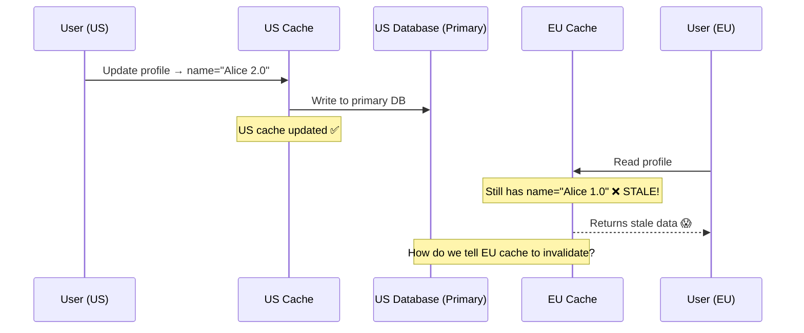
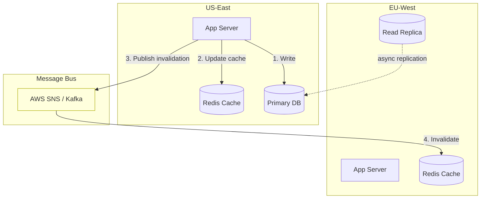
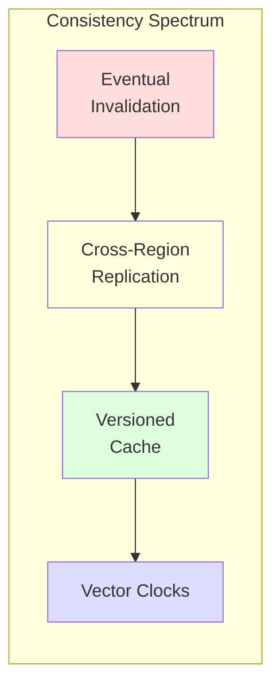
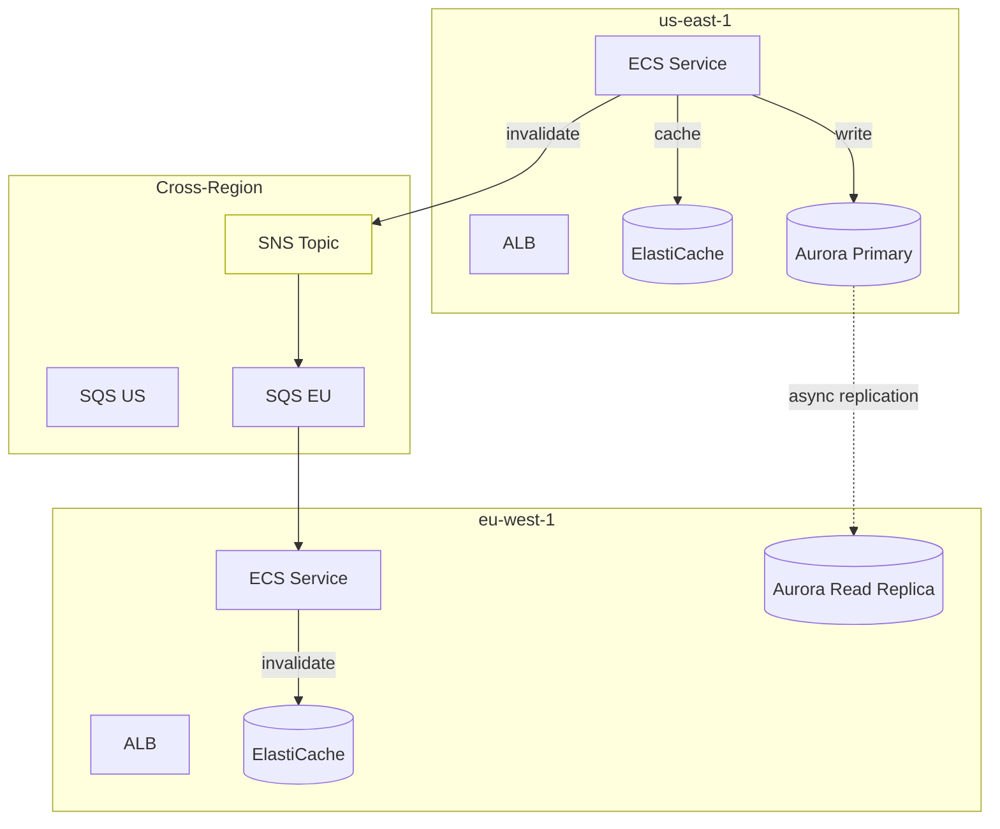
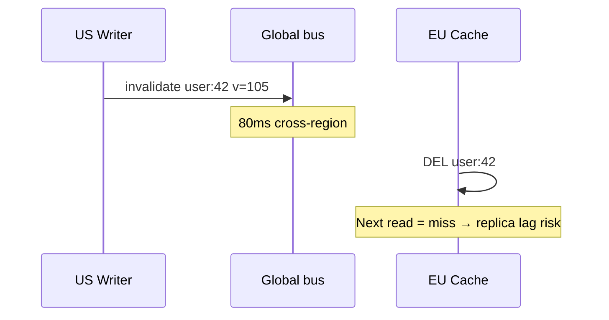

# Cache Coherence in Multi-Region Systems

## The Problem

You run your app in **US-East**, **EU-West**, and **Asia-Pacific**. Each region has its own cache (Redis cluster). A user in the US updates their profile. A user in Europe reads the same profile from the EU cache — and gets **stale data**.

> **Cache coherence** is the problem of keeping cached data **consistent across multiple regions** when the underlying data changes.

---

## Visualizing the Problem



---

## Cache Coherence Strategies

### Strategy 1: Write-Through with Cross-Region Invalidation

When data is written, **invalidate** the cache in all other regions.



```python
import json
import boto3

# Publisher (US Region)
class CacheWriter:
    def __init__(self, local_cache, db, sns_client, topic_arn):
        self.cache = local_cache
        self.db = db
        self.sns = sns_client
        self.topic_arn = topic_arn
    
    async def update(self, key: str, value: dict):
        # 1. Write to database
        await self.db.update(key, value)
        
        # 2. Update local cache
        self.cache.set(key, json.dumps(value), ex=300)
        
        # 3. Publish invalidation to other regions
        self.sns.publish(
            TopicArn=self.topic_arn,
            Message=json.dumps({
                "action": "invalidate",
                "key": key,
                "region": "us-east-1",
                "timestamp": time.time(),
            }),
        )

# Subscriber (EU Region)
class CacheInvalidationListener:
    def __init__(self, local_cache, local_region):
        self.cache = local_cache
        self.region = local_region
    
    def handle_message(self, message: dict):
        if message["region"] == self.region:
            return  # Ignore messages from our own region
        
        if message["action"] == "invalidate":
            self.cache.delete(message["key"])
            print(f"Invalidated {message['key']} (from {message['region']})")
```

**Pros:** Simple, low latency for reads after invalidation  
**Cons:** Brief window of stale data (during message propagation)

---

### Strategy 2: Write-Through with Cross-Region Replication

Instead of invalidating, **replicate** the new value to all regions.

```python
class CrossRegionReplicator:
    def __init__(self, local_cache, remote_caches: dict, db):
        self.local_cache = local_cache
        self.remote_caches = remote_caches  # {"eu": redis_eu, "apac": redis_apac}
        self.db = db
    
    async def update(self, key: str, value: dict):
        serialized = json.dumps(value)
        
        # 1. Write to database
        await self.db.update(key, value)
        
        # 2. Update local cache
        self.local_cache.set(key, serialized, ex=300)
        
        # 3. Replicate to all remote caches (async, fire-and-forget)
        tasks = []
        for region, cache in self.remote_caches.items():
            tasks.append(
                self._replicate_to_region(region, cache, key, serialized)
            )
        await asyncio.gather(*tasks, return_exceptions=True)
    
    async def _replicate_to_region(self, region, cache, key, value):
        try:
            cache.set(key, value, ex=300)
            print(f"Replicated {key} to {region}")
        except Exception as e:
            # Non-critical — region will fetch from DB on cache miss
            print(f"Replication to {region} failed: {e}")
```

**Pros:** Other regions get new data immediately (no cache miss)  
**Cons:** Higher bandwidth usage, more complex conflict handling

---

### Strategy 3: Versioned Cache with Conflict Detection

Each cache entry has a **version number**. Reads check if the version is current.

```python
class VersionedCache:
    """
    Each cached value includes a version. When reading, the version
    is compared against the source of truth to detect staleness.
    """
    
    def __init__(self, local_cache, version_store):
        self.cache = local_cache
        self.versions = version_store  # Global version counter (e.g., DynamoDB Global Table)
    
    async def write(self, key: str, value: dict):
        # Increment global version
        new_version = await self.versions.increment(key)
        
        # Store value with version
        entry = {"value": value, "version": new_version}
        self.cache.set(key, json.dumps(entry), ex=600)
        
        return new_version
    
    async def read(self, key: str):
        cached = self.cache.get(key)
        
        if cached:
            entry = json.loads(cached)
            # Check if our version is current
            current_version = await self.versions.get(key)
            
            if entry["version"] >= current_version:
                return entry["value"]  # Fresh ✅
            else:
                # Stale — fetch fresh data
                print(f"Stale version {entry['version']} < {current_version}")
                self.cache.delete(key)
        
        # Cache miss or stale — fetch from DB
        fresh = await self.db.fetch(key)
        current_version = await self.versions.get(key)
        self.cache.set(key, json.dumps({
            "value": fresh,
            "version": current_version,
        }), ex=600)
        return fresh
```

---

### Strategy 4: Last-Writer-Wins with Vector Clocks

For systems that allow **concurrent writes from different regions**:

```python
class VectorClock:
    """Track causal ordering of events across regions."""
    
    def __init__(self, regions: list[str]):
        self.clock = {region: 0 for region in regions}
    
    def increment(self, region: str):
        self.clock[region] += 1
    
    def merge(self, other: "VectorClock"):
        for region in self.clock:
            self.clock[region] = max(
                self.clock[region],
                other.clock.get(region, 0)
            )
    
    def happens_before(self, other: "VectorClock") -> bool:
        """Returns True if self happened before other."""
        return (
            all(self.clock[r] <= other.clock[r] for r in self.clock)
            and any(self.clock[r] < other.clock[r] for r in self.clock)
        )
    
    def concurrent_with(self, other: "VectorClock") -> bool:
        """Returns True if neither happened before the other (conflict!)."""
        return (
            not self.happens_before(other)
            and not other.happens_before(self)
        )


class MultiRegionCache:
    def __init__(self, region: str, all_regions: list[str]):
        self.region = region
        self.clock = VectorClock(all_regions)
    
    def write(self, key, value):
        self.clock.increment(self.region)
        entry = {
            "value": value,
            "clock": self.clock.clock.copy(),
            "region": self.region,
            "timestamp": time.time(),
        }
        self.cache.set(key, json.dumps(entry))
        self.replicate(key, entry)
    
    def on_remote_write(self, key, remote_entry):
        local = self.cache.get(key)
        if not local:
            self.cache.set(key, json.dumps(remote_entry))
            return
        
        local_entry = json.loads(local)
        local_clock = VectorClock.from_dict(local_entry["clock"])
        remote_clock = VectorClock.from_dict(remote_entry["clock"])
        
        if local_clock.happens_before(remote_clock):
            # Remote is newer → accept
            self.cache.set(key, json.dumps(remote_entry))
        elif remote_clock.happens_before(local_clock):
            # Local is newer → ignore
            pass
        else:
            # Concurrent! → conflict resolution
            resolved = self.resolve_conflict(local_entry, remote_entry)
            self.cache.set(key, json.dumps(resolved))
```

---

## Comparison of Strategies



| Strategy | Consistency | Latency | Complexity | Best For |
|---|---|---|---|---|
| **Invalidation** | Eventual (~100ms) | Low | Low | Most apps |
| **Replication** | Near-real-time (~50ms) | Low (warm cache) | Medium | Read-heavy |
| **Versioned** | Strong (verified) | Medium (version check) | Medium | Financial data |
| **Vector Clocks** | Causal | Medium | High | Multi-region writes |

---

## AWS Architecture Example



### AWS service map

| Concern | Service | Notes |
|---------|---------|--------|
| Regional cache | ElastiCache Redis | Cluster mode at scale; SG only from app tier |
| Invalidation fan-out | SNS → SQS per region | DLQ + backpressure; or EventBridge for many subscribers |
| Compute | ECS / EKS / Lambda | Invalidator consumes SQS, `DEL` or versioned eviction |
| Primary data | Aurora global / DynamoDB | Strong reads for money; replicas for read-heavy |
| Edge | CloudFront + origin shield | Tag/catalog epoch for bulk purge |
| Ops | CloudWatch, X-Ray | `cache_staleness_seconds`, poisoned refill counter |

Production pitfalls (invalidation lag, replica poison, in-process caches): see [`FAANG_INSIDER_KNOWLEDGE.md`](../FAANG_INSIDER_KNOWLEDGE.md).

---

## Key Takeaways

- **No perfect solution** — cache coherence involves tradeoffs between consistency, latency, and complexity
- **Start with invalidation** — it's simple and works for 90% of use cases
- **Stale windows are inevitable** — design your app to tolerate brief inconsistency
- **Use message ordering** (e.g., Kafka with key-based partitioning) to prevent out-of-order invalidations
- **Monitor staleness** — track how often users see stale data and whether it matters
- For truly critical data (balances, inventory counts), **don't cache across regions** — always read from the primary

---

## Senior Pitfalls

| Mistake | Impact | Fix |
|---------|--------|-----|
| Invalidate-by-broadcast on every write | Cross-region latency and lost messages | Version stamps, TTL + read-repair, or regional primary per key |
| Treating cache as source of truth | Stale inventory sold twice | Write-through primary DB; cache is hint only |
| No ordering on invalidation events | Newer value overwritten by old invalidation | Per-key version or event sequencing |
| Long TTL on user-specific data in all regions | GDPR delete not propagated | Short TTL + explicit purge channel per region |
| Ignoring replication lag in "read your writes" | User sees old profile after update | Route reads to home region or sticky versioning |

---

## Production-grade Practice

1. **Build:** Design invalidation for one entity across two regions: version field, pub/sub or CRDT-style merge, and staleness SLO.
2. **Debug:** Write in region A, read in region B under simulated 500ms replication lag; verify UX and metrics.
3. **Measure:** Track stale read rate and max observed version skew; customer-impact SLO for staleness-sensitive paths.
4. **Capacity plan:** Size inter-region invalidation fan-out bandwidth at peak write rate × subscriber regions.

---

## FAANG Interview Deep Dive

### Real-world FAANG examples

| Company | Multi-region cache pattern | Typical staleness |
|---|---|---|
| **Netflix** | **Regional caches** + async replication of **immutable blobs** (manifests, artwork); user state often **region-local** | Seconds for metadata; **minutes** acceptable for recommendations |
| **Amazon** | **DynamoDB Global Tables** + **SNS/SQS** cache invalidation on product updates | **100–500ms** invalidation lag common; **checkout reads primary** |
| **Google** | **Spanner** external consistency + **invalidation pub/sub** for read-through caches in serving | Strong for ads billing; **eventual** for search index segments |

**Meta:** Cross-region **cache purge** via Kafka with **key partitioning** so all invalidations for `user:123` are ordered—prevents **newer value deleted by older invalidation**.



### Interview Q&A

### Q: User updates avatar in US; EU friend still sees old avatar for 30s. Product says "fix it." What do you propose?

**A:** Triangulate **requirements vs cost**: (1) If 30s is unacceptable for **social UX**, use **cross-region replication** of the new value (not just DELETE) + **CDN purge** on URL. (2) If only **security-sensitive** fields matter, **version in cookie** or **ETag** force revalidate. (3) **Read-your-writes** for owner: route writer’s reads to **home region** or include `min_version` in token. Trade-off: replication costs **~2× write bandwidth** per region; invalidation-only saves bandwidth but causes **miss storm**.

### Q: Invalidation message arrives before DB replication reaches EU replica. What breaks?

**A:** EU cache miss → read replica returns **old row** → **re-cache stale data** ("cache poisoning"). Fixes: (1) Invalidate with **version/timestamp**; cache only if `row_version >= invalidation_version`. (2) **Tombstone** invalidation + short **negative cache** with version check against **primary** on miss for hot keys. (3) **Canary writes** don't invalidate until **replication lag < SLO** (SNS delay).

### Q: When would you choose vector clocks over simple invalidation?

**A:** **Multi-master writes** (Notes apps, collaborative docs, some cart merges). Invalidation alone loses **concurrent edits**. Vector clocks give **causal merge** or explicit **conflict UI**. Cost: **metadata per entry**, complex ops—Staff signal: "We don't need vector clocks if **single writer region** per entity."

### Q: Size the invalidation fan-out for 50M cached keys, 200 writes/sec global.

**A:** Writes/sec **200** → invalidation messages **200/s** (not 50M)—only changed keys. Kafka throughput: 200 × 500 B = **100 KB/s** trivial. Problem is **thundering miss** if each invalidation causes EU read: 200 × 8 KB miss × 3 regions = **4.8 MB/s** origin—manageable. **Spike risk:** bulk admin update **1M keys** → use **version bump** `global_catalog_v=17` instead of 1M messages.

### Q: Design cache coherence for wallet balance across 3 regions.

**A:** **Don't cache balance in remote regions** for debit/credit. Use **primary region read** or **linearizable store** (Spanner/DynamoDB with strong reads). Cache only **display snapshots** with "may be delayed" label. Interviewers want hearing **CAP** explicitly: you chose **CP** for money.

### Common mistakes

- **DELETE invalidation** without handling **in-flight reads** (still serve stale from app memory).
- **Unordered** invalidations reversing newer state.
- Caching **personalized** payloads globally (GDPR + coherence nightmare).
- Assuming **Redis Global Datastore** is instant—**seconds** of lag.
- No **metric** `cache_staleness_seconds` by region pair.

### Back-of-envelope sizing

**Service:** 3 regions, 40K RPS/read region, 4 KB avg cache entry, 80% hit ratio.

| Item | Calculation |
|---|---|
| Per-region cache RAM | 40K × 0.2 miss = 8K origin RPS; working set 5M keys × 4 KB ≈ **20 GB** |
| Invalidation lag budget | p99 user-facing staleness **<500ms** → bus latency **<100ms** + handler **<50ms** |
| Replication vs invalidate | Replicate 4 KB × 200 writes/s × 2 regions = **1.6 MB/s** bandwidth |

```python
# Versioned invalidation (avoid poisoned re-fill)
async def on_invalidate(msg):
    if msg["version"] <= await version_store.get(msg["key"]):
        return  # stale invalidation
    await cache.delete(msg["key"])
    await version_store.set(msg["key"], msg["version"])
```
