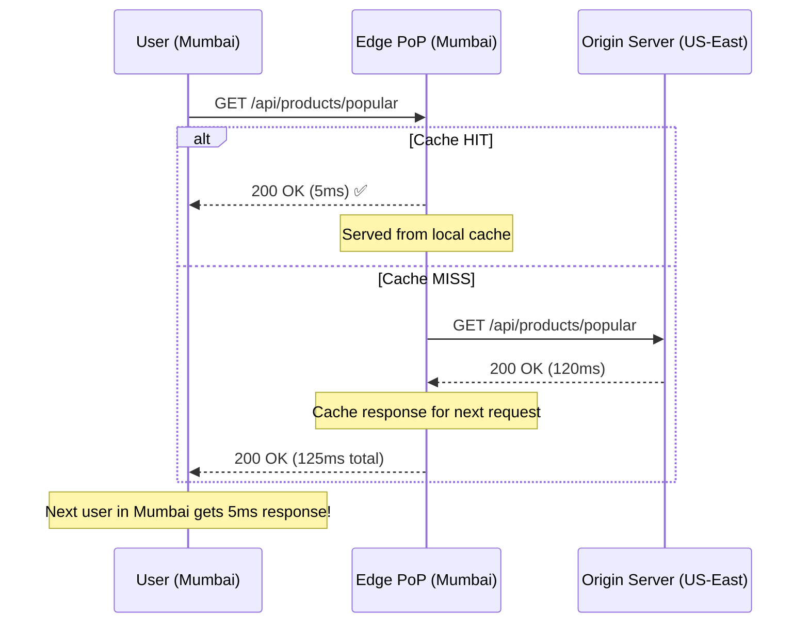
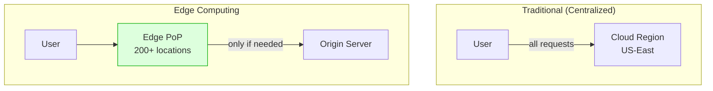
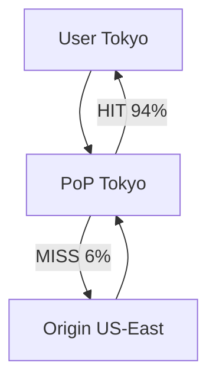

# Edge Computing and Edge Caching

## What Is "The Edge"?

The **edge** means running computation and storing data **physically close to the user** — in CDN PoPs (Points of Presence), cell towers, or local data centers — rather than in a centralized cloud region.

> **Edge Computing** = running code at the edge  
> **Edge Caching** = storing data at the edge  
> Both reduce latency by minimizing the physical distance data must travel.

---

## Why Does Distance Matter?

```
Speed of light in fiber optic: ~200,000 km/s
US East to US West: ~4,000 km → ~20ms one way → ~40ms round trip
US to Europe: ~6,000 km → ~30ms one way → ~60ms round trip  
US to Asia: ~12,000 km → ~60ms one way → ~120ms round trip

Every round trip adds latency!

┌────────┐                                         ┌────────────────┐
│  User  │ ─── 120ms round trip ──────────────────► │  Origin (Cloud)│
│ (Tokyo)│                                          │  (US-East)     │
└────────┘                                          └────────────────┘

┌────────┐          ┌─────────────┐
│  User  │ ── 5ms ─►│  Edge PoP   │  ← Response served locally!
│ (Tokyo)│          │  (Tokyo)    │
└────────┘          └─────────────┘
```

---

## Edge Caching

### How CDN Caching Works



### Cache-Control Headers

```python
from fastapi import FastAPI, Response

app = FastAPI()

@app.get("/api/products/popular")
async def get_popular_products(response: Response):
    products = await db.get_popular_products()
    
    # Tell CDN/edge to cache for 5 minutes
    # Browsers cache for 1 minute
    response.headers["Cache-Control"] = "public, max-age=60, s-maxage=300"
    
    # stale-while-revalidate: serve stale for 60s while fetching fresh
    response.headers["Cache-Control"] += ", stale-while-revalidate=60"
    
    # ETag for conditional requests
    response.headers["ETag"] = f'"{hash(str(products))}"'
    
    return products


@app.get("/api/user/profile")
async def get_user_profile(response: Response):
    # ⚠️ Private data — NEVER cache at edge!
    response.headers["Cache-Control"] = "private, no-store"
    return await get_current_user_profile()


@app.get("/api/products/{id}")
async def get_product(id: str, response: Response):
    product = await db.get_product(id)
    
    # Cache at edge, but validate with origin before serving stale
    response.headers["Cache-Control"] = "public, max-age=0, must-revalidate"
    response.headers["ETag"] = f'"{product.version}"'
    
    return product
```

### Cache-Control Cheat Sheet

```
Cache-Control directive        │ Meaning
───────────────────────────────│──────────────────────────────────────
public                         │ CDN/edge can cache this
private                        │ Only browser can cache (user-specific data)
no-store                       │ Don't cache at all
no-cache                       │ Cache but validate with origin before serving
max-age=300                    │ Browser cache for 300 seconds
s-maxage=600                   │ CDN/edge cache for 600 seconds
stale-while-revalidate=60     │ Serve stale for 60s while refreshing
stale-if-error=3600            │ Serve stale for 1h if origin is down
must-revalidate                │ Must check with origin when stale
```

---

## Edge Computing

### Running Code at the Edge



### Example: Cloudflare Worker (Edge Function)

```javascript
// Runs at 300+ edge locations worldwide
// Cold start: ~0ms (V8 isolate, not a container)

export default {
  async fetch(request, env) {
    const url = new URL(request.url);
    
    // --- A/B Testing at the edge ---
    if (url.pathname === "/") {
      const bucket = request.headers.get("cf-connecting-ip")?.charCodeAt(0) % 2;
      const variant = bucket === 0 ? "control" : "experiment";
      
      // Rewrite to different origin page based on variant
      const response = await fetch(`${url.origin}/${variant}/index.html`);
      return new Response(response.body, {
        headers: { "X-Variant": variant },
      });
    }
    
    // --- Geolocation-based routing ---
    if (url.pathname.startsWith("/api/")) {
      const country = request.cf?.country || "US";
      
      // Route to nearest backend
      const backends = {
        US: "https://api-us.example.com",
        GB: "https://api-eu.example.com",
        JP: "https://api-apac.example.com",
      };
      
      const region = country in backends ? country : "US";
      const backendUrl = backends[region] + url.pathname;
      
      return fetch(backendUrl, request);
    }
    
    // --- Edge-side API response transformation ---
    if (url.pathname === "/api/products") {
      const response = await fetch(request);
      const data = await response.json();
      
      // Transform at edge: add currency based on user's country
      const currency = getCurrencyForCountry(request.cf?.country);
      const transformed = data.map(product => ({
        ...product,
        price: convertCurrency(product.priceUSD, currency),
        currency: currency,
      }));
      
      return new Response(JSON.stringify(transformed), {
        headers: {
          "Content-Type": "application/json",
          "Cache-Control": "public, s-maxage=60",
        },
      });
    }
    
    return fetch(request);
  },
};
```

### Example: Edge-Side Authentication

```javascript
// Validate JWT at the edge — reject bad requests before they reach origin
export default {
  async fetch(request, env) {
    const authHeader = request.headers.get("Authorization");
    
    if (!authHeader?.startsWith("Bearer ")) {
      return new Response("Unauthorized", { status: 401 });
    }
    
    const token = authHeader.split(" ")[1];
    
    try {
      // Verify JWT at the edge using Web Crypto API
      const payload = await verifyJWT(token, env.JWT_PUBLIC_KEY);
      
      // Check expiration
      if (payload.exp < Date.now() / 1000) {
        return new Response("Token expired", { status: 401 });
      }
      
      // Add user info as headers for the origin
      const modifiedRequest = new Request(request, {
        headers: new Headers({
          ...Object.fromEntries(request.headers),
          "X-User-ID": payload.sub,
          "X-User-Role": payload.role,
        }),
      });
      
      return fetch(modifiedRequest);
    } catch (e) {
      return new Response("Invalid token", { status: 403 });
    }
  },
};
```

---

## Edge Data Stores

### Key-Value at the Edge (Cloudflare KV)

```javascript
// KV: Eventually consistent, read-optimized store at the edge
export default {
  async fetch(request, env) {
    const url = new URL(request.url);
    const key = url.pathname.slice(1);  // "/config/feature-flags" → "config/feature-flags"

    if (request.method === "GET") {
      // Read from edge KV — cached at PoP, ~1ms read
      const value = await env.MY_KV.get(key, { type: "json" });
      if (!value) return new Response("Not Found", { status: 404 });
      return new Response(JSON.stringify(value));
    }

    if (request.method === "PUT") {
      const body = await request.json();
      // Write propagates to all edge locations in ~60 seconds
      await env.MY_KV.put(key, JSON.stringify(body));
      return new Response("OK");
    }
  },
};
```

### Durable Objects (Strongly Consistent at Edge)

```javascript
// Durable Objects: Strongly consistent, single-point-of-coordination
// Perfect for: counters, rate limiters, real-time collaboration

export class RateLimiter {
  constructor(state, env) {
    this.state = state;
  }

  async fetch(request) {
    const ip = request.headers.get("CF-Connecting-IP");
    
    // Read current count (strongly consistent)
    let count = (await this.state.storage.get(`count:${ip}`)) || 0;
    
    if (count >= 100) {
      return new Response("Rate limited", { status: 429 });
    }
    
    // Increment (transactional, strongly consistent)
    await this.state.storage.put(`count:${ip}`, count + 1);
    
    // Forward to origin
    return fetch(request);
  }
}
```

---

## What Runs Where?

```
┌─────────────────────────────────────────────────────────────────┐
│                    What runs at the edge?                        │
├─────────────────────────┬───────────────────────────────────────┤
│ ✅ Good at the edge      │ ❌ Keep at origin                     │
├─────────────────────────┼───────────────────────────────────────┤
│ Static assets (images)  │ Complex database queries              │
│ API response caching    │ Transactions                          │
│ Authentication / JWT    │ Heavy computation                     │
│ A/B testing             │ Stateful business logic               │
│ Geo-routing             │ Large data processing                 │
│ Rate limiting           │ Writes to primary database            │
│ Request transformation  │ Real-time analytics ingestion         │
│ Bot detection           │ Machine learning inference (large)    │
│ Image resizing          │ Background jobs                       │
│ Feature flags           │                                       │
└─────────────────────────┴───────────────────────────────────────┘
```

---

## Edge Computing Platforms

| Platform | Runtime | Cold Start | KV Store | Durable Storage |
|---|---|---|---|---|
| **Cloudflare Workers** | V8 isolates | ~0ms | KV, R2 | Durable Objects, D1 |
| **AWS Lambda@Edge** | Node.js, Python | ~100-500ms | DynamoDB | — |
| **AWS CloudFront Functions** | JavaScript | ~0ms | — | — |
| **Vercel Edge Functions** | V8 (WinterCG) | ~0ms | Vercel KV | — |
| **Deno Deploy** | V8 (Deno) | ~0ms | Deno KV | — |
| **Fastly Compute** | Wasm | ~0ms | KV | — |

---

## Key Takeaways

- **Edge caching** is the easiest win — just set proper `Cache-Control` headers
- **Edge computing** is for logic that benefits from proximity: auth, routing, A/B tests
- **Don't put everything at the edge** — databases and complex business logic belong at origin
- **Eventually consistent** edge stores (KV) are great for config and read-heavy data
- **Strongly consistent** edge stores (Durable Objects) exist but have location constraints
- Measure with **Real User Monitoring (RUM)** to verify edge actually helps your users

---

## Senior Pitfalls

| Mistake | Impact | Fix |
|---------|--------|-----|
| Caching authenticated HTML at CDN | User A sees User B's page | `Cache-Control: private`, vary on cookies, or edge KV per session |
| Edge logic without origin auth validation | Bypass attacks on "hidden" APIs | Validate JWT at edge and origin; short-lived tokens |
| Ignoring cache key pollution | One bad query string busts entire cache | Normalize keys; strip tracking params |
| Deploying Workers without regional limits | Compliance violations | Geo-fence PII processing; residency tags on routes |
| Relying on CDN hit ratio alone | Misses mobile last-mile issues | RUM TTFB by country vs synthetic POP metrics |

---

## Production-grade Practice

1. **Build:** Move one read-heavy API to edge cache with correct cache keys and surrogate-key purge from origin.
2. **Debug:** Purge incident: measure time to consistent content globally after catalog update.
3. **Measure:** RUM vs CDN metrics for p95 TTFB by region; track origin offload percentage.
4. **Capacity plan:** Estimate Worker CPU ms × requests at peak; compare cost to origin scale-out for same latency target.

---

## FAANG Interview Deep Dive

### Real-world FAANG examples

| Company | Edge stack | Scale signal |
|---|---|---|
| **Netflix** | **Open Connect** CDN appliances in ISP networks; **95%+** video bytes from edge | **~1B+ hours/week** streamed; origin offload is existential cost control |
| **Meta** | **CDN + edge proxies** for static assets; **Live** low-latency via custom PoPs | **Billions** of photo/video requests/day; **TTFB** target **<100ms** globally |
| **Amazon** | **CloudFront** + **Lambda@Edge** for auth, redirects, A/B on **storefront** | Prime Video + retail: edge handles **millions RPS** during events |

**Cloudflare/Google angle:** Workers/V8 isolates achieve **0ms cold start** vs Lambda@Edge **100–500ms**—matters for **per-request** auth at **100K RPS** PoP.



### Interview Q&A

### Q: API returns JSON with user-specific prices. Can you cache at edge?

**A:** Only with **cache key segmentation**: `Vary: Cookie` or **edge key** = `route + geo + customer_segment` (low cardinality). **Never** cache `Authorization` responses as `public`. Pattern: **edge caches catalog base price**; worker applies **segment markup** from **KV** (60s consistency). Trade-off: **more edge CPU**, less origin load. Amazon-style: **personalized = private, no-store**; **list pages = s-maxage=60** with surrogate keys.

### Q: Origin is 120ms RTT from APAC; edge cache hit ratio 85%. What's effective p50 latency?

**A:** `0.85×5ms + 0.15×(5+120)ms` ≈ **4.25 + 18.75** ≈ **23ms** vs **120ms** without edge—**~5×** improvement. If miss includes **origin overload**, tail dominates—monitor **origin_miss_latency_p99**.

### Q: Design edge auth for JWT without hitting origin every request.

**A:** Worker validates **RS256** with **cached JWKS** (refresh every **15 min**), checks `exp`, strips token, forwards `X-User-Id`. **Revocation gap:** short access token TTL (**15 min**), or **opaque session** check on sensitive routes only. Meta/Google pattern: **fail closed** at edge for malformed; origin for **authorization**.

### Q: When does Lambda@Edge lose to regional API?

**A:** **CPU-heavy** JSON aggregation, **large ML models**, **multi-hop DB**, **WebSocket** state. Edge limits: **128MB–10GB** memory, **5–30s** timeout. Use edge for **O(1) per request** transforms.

### Q: How do you measure edge cache effectiveness?

**A:** CDN metrics: **`edge_hit_ratio`**, **`origin_offload`**, RUM **TTFB by country**. Success: APAC TTFB p50 **<50ms** for cacheable assets; origin QPS drops **>70%** for static/API cache tiers.

### Common mistakes

- `Cache-Control: public` on **PII** responses—compliance incident.
- Ignoring **`Vary`** → serving wrong language/currency.
- **Query string** cache busting (`?v=random`) → **0% hit ratio**.
- Edge **writes** to KV for rate limits without **Durable Objects** / strong store → under-counting.
- **Purging** one URL while **thousands of shard URLs** exist (image resizing).

### Back-of-envelope sizing

**Traffic:** 500K RPS global, 12 KB avg response, 90% edge hit.

| Item | Math |
|---|---|
| Origin RPS | 500K × 0.1 = **50K RPS** |
| Edge egress (if all miss) | 500K × 12 KB = **6 GB/s** (why hits matter) |
| With 90% hit | Origin **0.6 GB/s** equivalent—**$** savings on origin + transit |
| PoP count | 200 PoPs → **2.5K RPS/PoP** avg (flash crowds skew per PoP) |

**Cache storage per PoP:** Top 10K URLs × 12 KB ≈ **120 MB** hot set—fits easily; long tail needs **tiered TTL**.

```javascript
// Surrogate-Key purge (Fastly/Cloudflare pattern)
return new Response(body, {
  headers: {
    "Cache-Control": "public, s-maxage=300",
    "Surrogate-Key": `product ${productId} catalog`,
  },
});
```
