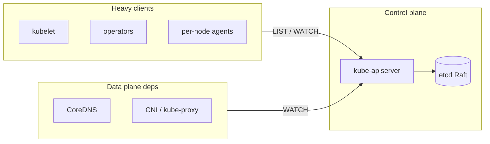
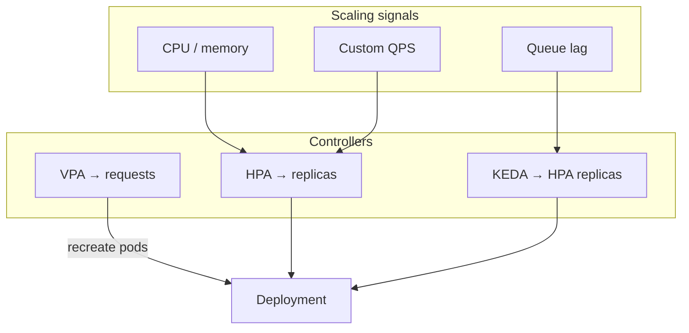

# Cloud Infrastructure: Kubernetes, IaC, Serverless & Platform Engineering

> **What you'll learn:** How production Kubernetes actually behaves under load, how to scale Infrastructure as Code without turning state into a queue, when serverless economics win or lose, and how internal platforms remove cognitive load—or accidentally add a ticket queue.

This guide synthesizes four Cloud Ops chapters into one learning path. Read it top to bottom for the story; jump to a section when you need depth on one topic.

---

## Part 1 — Kubernetes in production

### Mental model: not an orchestrator, a distributed database

Kubernetes is a **single Raft group (etcd)** plus many **control loops**. Serious incidents usually trace to one of three mismatches:

1. What the **scheduler believes** vs what the **kernel enforces**
2. What a **PodDisruptionBudget promises** vs what actually disrupts pods
3. What the **data plane needs** vs what it **silently depends on** (DNS, API, webhooks)



### etcd: the scaling dimension is churn, not node count

- Default backend quota is **2 GiB** (suggested max ~8 GiB).
- **MVCC:** every write creates a new revision; compaction frees pages **inside** the file; **defrag** shrinks the file the quota measures.
- **NOSPACE alarm:** etcd accepts only reads/deletes → no leases, no scheduling, no status updates.

| Symptom | Likely cause | What to watch |
|--------|----------------|---------------|
| Sudden cluster-wide write failures | etcd quota / NOSPACE | `apiserver_storage_objects`, write rate by resource |
| apiserver OOM → restart loop | LIST storm after watch break | Unscoped LISTs from DaemonSets/operators |
| "Cluster fine" but DNS dies | Control-plane overload | Per-node agents listing at cluster scope |

**LIST vs WATCH:** WATCH is cheap (watch cache). **LIST** assembles full results in memory. Illustrative: 2,000 nodes × unfiltered pod LIST × 60k pods ≈ **480 GB serialized** if all relist together after an apiserver restart—a **metastable loop**.

**Fix at the client:** field selectors (`spec.nodeName=$NODE`), pagination, never cluster-wide Secrets/Pods by default. **API Priority and Fairness (APF)** rations load but does not make O(cluster) × O(nodes) affordable.

> **Pitfall — webhook deadlock:** `failurePolicy: Fail` webhook whose pods run in the same cluster: lose those pods → nothing can be created, including webhook replacements. Exclude `kube-system` and the webhook namespace; short timeouts; runbook to delete webhook config first.

### Scheduling packs *requests*, not load

- **LeastAllocated** spreads; **MostAllocated** packs (enables scale-down, concentrates failure).
- Fleet utilization is capped by **honest requests**. Request 1 CPU, use 0.3 → "packed" cluster is ~30% utilized.
- **Stranded capacity:** node "full" when **any** dimension is full (CPU-heavy pods strand memory, etc.).
- **DaemonSet tax:** illustrative 10 DaemonSets × 100m CPU + 200 MiB each = **1 CPU + 2 GiB per node** before workloads.

**HPA interaction:** CPU autoscaling target `T` → requested CPU converges to **used ÷ T**. Halving inflated requests on CPU-scaled services **doubles replicas**; memory requests may not shrink → memory-stranded nodes.

```yaml
# Latency-sensitive default (conceptual)
resources:
  requests:
    cpu: "2"
    memory: "4Gi"
  limits:
    memory: "4Gi"
    # Omit CPU limit to avoid CFS throttling — see below
```

### CPU requests vs limits (CFS)

| Setting | Kernel meaning | Under idle node |
|---------|----------------|-----------------|
| **request** | cgroup **weight** (shares) | Costs nothing when idle |
| **limit** | **CFS bandwidth quota** (`cpu.max`) | Enforced even at 90% idle |

**The trap:** quota is **summed across threads**. Limit 1 CPU, 4 runnable threads → 100 ms quota spent in ~25 ms wall time → **75 ms throttled** per period. Dashboard shows ~100% of limit; truth is `throttled_periods / nr_periods`.

**Probe death spiral:** throttled pod → liveness fails → restart → cold JIT → load on siblings → more throttling.

**Rules:**
- **Liveness:** only "wedged beyond self-recovery"; no dependency checks; generous thresholds.
- **Readiness:** may check dependencies; sheds load.
- **startupProbe** for slow starters.
- Set **GOMAXPROCS** / **ActiveProcessorCount** from CPU **request** when limits are removed (runtime may see all host cores).

### QoS and eviction: three killers, one memory budget

| Mechanism | What triggers | Respects PDB? |
|-----------|---------------|---------------|
| Container memory **limit** | cgroup OOM instantly | n/a |
| **kubelet** node-pressure eviction | polls ~10s, ranks by priority/over-request | **No** |
| **Kernel** global OOM | `oom_score_adj` + memory share | **No** |

Burstable (no CPU limit) vs Guaranteed (limit=request for memory): trade throttling vs OOM protection. **Static CPU manager** for jitter-sensitive tier.

### PodDisruptionBudgets: one door only

PDB is consulted only by the **Eviction API** (drain, autoscaler scale-down). **Not:** kubelet eviction, zone loss, Deployment rollout, `DELETE`.

> Size PDBs against **peak capacity**, not replica count. Three replicas at 70% CPU + `maxUnavailable: 1` → two replicas at **105%** during drain.

**Node death timeline:** NotReady + EndpointSlice lag + **300s** default `notReady` toleration → replacement may start ~6+ minutes. Zone loss: rate-limited evictions (can be **>1 hour** for large zones).

### Upgrades: the treadmill is the product

~3 minor K8s releases/year; kubelets ≤3 minors behind apiserver. **In-place** vs **blue/green clusters:** only blue/green makes control-plane rollback realistic (requires traffic above cluster, no in-cluster state).

### What not to run on Kubernetes

| Workload | Verdict |
|----------|---------|
| Stateless APIs, many teams | **Fit** — tax amortizes |
| Queue workers, batch, CI | **Fit** — bin-packing, spot |
| Latency-critical / trading | **Conditional** — dedicated nodes, static CPU |
| Primary OLTP of record | **Default no** — stacked failure modes |
| DNS, IdP, CI/CD for the cluster | **Never on it** — recovery lockout |

**Decision:** Put workloads on shared K8s when (a) replaceable per instance, (b) honest requests maintained, (c) recovery does not require healthy cluster, (d) platform tax amortizes across enough services.

---

## Part 2 — Infrastructure as Code at scale

### State = blast radius + lock + cache

One Terraform state is:

1. **Blast radius** — one apply can touch everything in the state
2. **Serialization** — one lock; at ρ→0.8, wait time explodes (M/D/1 queue)
3. **Cache** — plan refresh ≈ one read per resource; 3k resources × parallelism 10 ≈ **90s+** before apply

> **Size states by:** one owning team, one change rate, plan finishes in ~2 minutes, lock utilization **<0.3**. State backend = **secret store** (passwords in plaintext).

### Four kinds of "drift"

| Type | Example | Response |
|------|---------|----------|
| Human | Console change in incident | `refresh-only` apply + codify or revert |
| System | Autoscaler owns `desired_count` | `ignore_changes` on that attribute only |
| Provider | Provider upgrade renormalizes | Pin versions; ring rollout; **signature subtraction** |
| Dependency | `latest` AMI lookup | Pin modules; lock file |

**Edge-triggered** (Terraform): reality updates on apply — incident fix can revert on unrelated apply.

**Level-triggered** (Crossplane/GitOps): continuous reconcile — incident fix reverted unless paused or merged to git.

### Stack layers (cut by rate of change)

| Layer | Contains | Change rate | Owner |
|-------|----------|-------------|--------|
| L0 | Orgs, SCPs, IdP | Monthly | Security |
| L1 | VPC, TGW, DNS | Weekly | Network platform |
| L2 | Shared clusters, KMS | Several/week | Platform |
| L3 | Per-service DB, IAM | Daily | Service team |
| L4 | Flags, DNS weights | Many/day | Service (often not IaC) |

**Contract edges:** Parameter Store keys, not `terraform_remote_state` (shared DB anti-pattern).

### Plan/apply pipeline

- Save **plan artifact**; apply **exactly** it (stale plan refused = good).
- Classify plan JSON: create / update / **replace** / destroy → route approvals.
- Apply is **not transactional** — half-applied state is normal; re-plan after.

### Policy: four layers

| Layer | Bypassed by |
|-------|-------------|
| pre-commit / IDE | `--no-verify` |
| plan-time (OPA/Sentinel) | console with cloud creds |
| org guardrails (SCP) | management account, SLRs |
| detective (Config) | ignored alerts |

### Engine choice (execution model, not syntax)

| | Terraform | CDK→CFN | Crossplane |
|--|-----------|---------|------------|
| Trigger | Human/pipeline | Stack update | Continuous poll |
| Failed mid-change | Partial state | Rollback (can fail) | Retries forever |
| Scale pain | State size, locks | Stack limits | API quota burn |

---

## Part 3 — Serverless execution & economics

### Lambda-style: one request, one microVM

- **Concurrency = arrival rate × duration** (Little's law).
- Environment **frozen** between invocations: memory persists; **vCPU not scheduled** → post-response work, keep-alives, pooled DB connections break silently.
- **Cloud Run / Flex:** many requests per instance — moves cost crossover dramatically.

### Cold starts

- Cluster at scale-out, deploys, recovery — cold rate **spikes when you are already stressed**.
- Fan-out: `P(≥1 cold) = 1 - (1-p)^N` — 10 functions at p=1% → **~9.5%** of requests.
- **Provisioned concurrency:** break-even ~**60%** utilization of provisioned envs (illustrative AWS x86 list).

### Concurrency limits

**Duration** exhausts account pool: 500 rps × 120ms = 60 envs; at 1.6s → **400 envs** → 429s for unrelated functions.

**Timeout ladders:** each hop's deadline must be **shorter** than caller's, or abandoned work keeps billing and holding connections.

### Cost crossover (I/O-bound API)

Pay **wall-clock** while waiting. Illustrative: steady I/O-bound API can cross **container + ALB** at **single-digit rps**; CPU-bound bursty work can favor FaaS longer.

**Duty cycle rule:** FaaS cheaper when `d < 1/R` (d = load/capacity, R = price ratio).

### Event-driven coupling

Retries multiply across SDK, trigger, queue, handler. **One layer owns backoff.** Structural guards: separate input/output buckets, hop-count headers, account budget alarms.

### Lock-in stack

Portable: handler logic. Expensive: trigger topology, IAM, Step Functions ASL, **operational envelope** (15 min, 1 req/env). **Target:** package as **container + HTTP shim** for exit to Cloud Run/Fargate/K8s.

---

## Part 4 — Platform engineering & internal platform

### Economics: remove cognitive load, not add a queue

40 teams × 15% infra glue ≈ 36 FTE duplicated. Platform of 10 removing half → **net ~8 FTE** **only if self-service**.

M/M/1: at ρ=0.9, turnaround ≈ **10×** hands-on time. Staffing platform to stay "busy" recreates the queue.

> **Design target:** golden path **to production and back out of an incident** — explain failures in tenant vocabulary.

### Golden paths vs guardrails

| | Golden path | Guardrail |
|--|-------------|-----------|
| Nature | Defaults + off-ramp | Invariant, no off-ramp |
| Enforced at | Template (wrong place) | Admission, org policy, SCP |

**Ladder:** rungs 1–2 platform owns upgrades; rung 4 eject = high exit cost. **Reference** CI/templates (fleet-wide risk) vs **scaffold** copy-once (snowflake by day 400).

### Tenancy

| Boundary | Isolates |
|----------|----------|
| Namespace | Names, RBAC, quotas — **not** kernel, etcd, cluster-scoped CRDs/webhooks |
| Virtual cluster | Per-tenant apiserver/CRDs |
| Cloud account | Quotas, IAM, billing |

**Cluster count tax:** upgrades ≈ **3 minors/year × clusters** — dominates EKS $73/mo control-plane fee.

### GitOps as control loop

- **Field ownership:** HPA owns `replicas` — omit from Git or use correct sync options.
- **Break-glass:** audited sync pause, auto-expire, page while active.
- **Prune on bad render:** cap deletions per sync; hydrated YAML in CI.
- **Monorepo:** every commit can invalidate **all** Application renders — use path scoping or hydrate in CI.

### Fleet management

- **Rings** reduce exposure only for defects found **within bake time**.
- Inventory **every** fleet mutator: OS updates, add-on auto-upgrade, vendor agents.
- **Blue/green clusters** when identity (IRSA trust policies) and disposable cattle matter.

### Measurement

- **Concept inventory** (nouns to ship + debug at 3am)
- **Time to first prod deploy** (new engineer)
- **Escape-hatch rate** by reason
- **Abstraction leak rate** (% on-call actions below platform vocabulary)

### Migration tax (Churn rule)

Platform should automate migrations past ~**34 services** (illustrative crossover) for breaking changes.

---

## Design review cheat sheet

**Kubernetes**
- Which DaemonSets do cluster-scoped LISTs?
- CPU throttle ratio at **p99** load?
- Strictest PDB → fleet rotation floor?
- Webhooks fail-closed — recovery path off-cluster?

**IaC**
- Largest destroy one apply can cause?
- Lock utilization ρ?
- Break-glass recovery without VPC/state dependency?

**Serverless**
- Measured **d** and **R** for this workload?
- Worst-case bill at concurrency cap?

**Platform**
- Merge-to-applied p95 vs break-glass pause expiry?
- Largest blast radius of one git commit?

---

*Sources: Algoroq Cloud Ops — Kubernetes in Production, Platform Engineering, Infrastructure as Code at Scale, Serverless Execution & Economics.*

---

## Production deep dives (extended)

### PodDisruptionBudget gotchas in the wild

PDBs look like a safety rail; in production they interact with **HPA min replicas**, **cluster autoscaler**, **zone topology**, and **rolling update `maxUnavailable`**.

| Gotcha | What happens | Mitigation |
|--------|----------------|------------|
| `minAvailable: 100%` on Deployment | **No voluntary evictions ever** — drains hang, node upgrades stall | Use `maxUnavailable` on PDB or allow 1 pod during maintenance windows |
| PDB sized to **nominal** replicas, not **peak load** replicas | Drain removes capacity you actually need at peak | Size against HPA **max** or peak-traffic replica count |
| Multiple controllers own same pods | PDB counts overlap oddly; one bad PDB blocks fleet | One PDB per **logical service**; document owner |
| `unhealthyPodEvictionPolicy: AlwaysAllow` (K8s 1.26+) | Unhealthy pods evicted despite PDB — good for stuck pods, bad if misconfigured probes | Fix probes first; use policy deliberately |
| Zone loss + `minAvailable: 2` with 3 replicas across 3 zones | After zone loss you have 2 pods — PDB may block **all** remaining voluntary disruption | Prefer **topology spread** + PDB math per zone |

```yaml
# PDB that matches a 3-replica API with HPA max 12 at peak
apiVersion: policy/v1
kind: PodDisruptionBudget
metadata:
  name: checkout-api
spec:
  minAvailable: 8   # never go below ~67% of max during drains
  selector:
    matchLabels:
      app: checkout-api
---
# ResourceQuota: cap blast radius per namespace (platform team pattern)
apiVersion: v1
kind: ResourceQuota
metadata:
  name: team-checkout
  namespace: checkout
spec:
  hard:
    requests.cpu: "200"
    requests.memory: 400Gi
    limits.memory: 400Gi
    pods: "500"
    persistentvolumeclaims: "20"
```

**Real incident pattern (e-commerce):** Black Friday scale-up to 40 replicas; PDB `minAvailable: 38` left only 2 pods evictable during a **mandatory node AMI rollout** — 6-hour fleet rotation. Fix: temporary PDB override via GitOps + maintenance window, or ring-based node pools.

### Resource quota strategies

| Strategy | When | Tradeoff |
|----------|------|----------|
| **Hard quota per namespace** | Many teams on shared cluster | Teams hit wall at growth — need quota increase process |
| **LimitRange defaults** | Prevent 1-pod namespace from requesting 64 CPU | Does not cap fleet total |
| **Cluster-wide oversubscription policy** | Platform sets request/limit ratios | Misleading utilization dashboards |
| **Quota + cluster autoscaler max** | Cost ceiling | Pending pods during spikes — need alerts on `kube_pod_status_phase=Pending` |

```hcl
# Terraform: EKS node group with explicit ceiling (illustrative)
resource "aws_eks_node_group" "workloads" {
  cluster_name    = aws_eks_cluster.main.name
  node_group_name = "workloads-2026q1"
  scaling_config {
    desired_size = 20
    max_size     = 80
    min_size     = 10
  }
  instance_types = ["m6i.xlarge"]
}
```

### HPA vs VPA vs KEDA — decision matrix

| Autoscaler | Scales | Best signal | Avoid when |
|------------|--------|-------------|------------|
| **HPA** | Pod **replica count** | CPU, memory, custom metrics (QPS, queue depth) | Workload needs **vertical** headroom per pod (JIT warm caches) |
| **VPA** | Pod **requests/limits** (and optionally recreate) | Right-sizing over days | Latency-sensitive + CPU limits cause throttling; use **Off** or **Initial** mode only |
| **KEDA** | HPA via **external scalers** | Kafka lag, SQS depth, Prometheus query, cron | Simple CPU-only APIs — extra moving parts |

```yaml
# HPA on custom metric (requests per second from Prometheus adapter)
apiVersion: autoscaling/v2
kind: HorizontalPodAutoscaler
metadata:
  name: api-hpa
spec:
  scaleTargetRef:
    apiVersion: apps/v1
    kind: Deployment
    name: api
  minReplicas: 3
  maxReplicas: 50
  metrics:
    - type: Pods
      pods:
        metric:
          name: http_requests_per_second
        target:
          type: AverageValue
          averageValue: "100"
---
# KEDA: scale on Redis list length (illustrative)
apiVersion: keda.sh/v1alpha1
kind: ScaledObject
metadata:
  name: worker-scaler
spec:
  scaleTargetRef:
    name: worker
  minReplicaCount: 0
  maxReplicaCount: 100
  triggers:
    - type: redis
      metadata:
        address: redis.queue.svc:6379
        listName: jobs
        listLength: "50"
```

**Production combo:** HPA on RPS for stateless APIs; VPA in **recommendation-only** mode for cost reports; KEDA for queue workers and **scale-to-zero** batch.



### Platform engineering: Terraform module boundary example

```hcl
# L2 platform module — service team consumes outputs via SSM, not remote_state
module "eks_baseline" {
  source = "git::https://github.com/org/terraform-eks-baseline.git?ref=v3.2.0"

  cluster_name = var.cluster_name
  vpc_id       = var.vpc_id
}

resource "aws_ssm_parameter" "cluster_oidc_issuer" {
  name  = "/platform/eks/${var.cluster_name}/oidc_issuer"
  type  = "String"
  value = module.eks_baseline.oidc_issuer_url
}
```

---

## Interview Q&A

### Q: Why can a PodDisruptionBudget block a node drain even when pods look healthy?

**A:** PDB only governs **voluntary** disruptions via the Eviction API. If `minAvailable` is set too high relative to **current** ready replicas (e.g., after scale-down, zone loss, or failed readiness), the eviction subsystem refuses drains. It does **not** protect against involuntary kubelet eviction or zone failure — operators sometimes confuse “PDB says 2 available” with “we can survive losing a zone.” Fix the math against **peak** replicas and per-zone spread, not steady-state counts.

### Q: Explain why removing CPU limits fixed latency but HPA suddenly doubled replicas.

**A:** HPA (CPU utilization mode) divides **used CPU** by **requested CPU**. Inflated requests made utilization look low, so HPA kept few replicas. After lowering requests to match real usage, the same absolute CPU usage produces a **higher utilization ratio**, so HPA adds replicas until utilization approaches the target. Memory requests unchanged can leave nodes **memory-stranded** while HPA adds more pods — always reconcile both dimensions after a rightsizing change.

### Q: When would you split Terraform state for a single application?

**A:** When plan time, lock contention, or blast radius exceed team tolerance: separate **foundational** (VPC, cluster) from **data plane** (RDS, Redis) from **app** (K8s manifests via a different tool). Split when one apply can destroy unrelated revenue paths, when ρ (lock utilization) consistently exceeds ~0.3, or when plan refresh exceeds ~2 minutes. Keep contract edges as **SSM/Parameter Store keys**, not `terraform_remote_state` chains.

### Q: Serverless vs Kubernetes for an internal admin API at 2 RPS?

**A:** At 2 RPS, **fixed cost** of a small always-on service (Fargate, Cloud Run min instances, or shared cluster amortization) often loses to Lambda **if** the workload is I/O-bound and cold starts are rare — but admin APIs with VPC ENI cold starts, 15-minute max duration, and connection pooling needs frequently land on **containers with min=1**. Measure **duty cycle** `d` and price ratio `R`; for bursty internal tools, a shared platform namespace is usually cheaper operationally than per-function IAM and trigger sprawl.

### Q: What is the difference between GitOps “sync” and Terraform “apply” for incident response?

**A:** Terraform apply is **edge-triggered**: a console hotfix persists until the next unrelated apply refreshes state and reverts it. GitOps (level-triggered reconcile) **reverts** console changes on the next sync unless you pause sync and merge the fix to git. Break-glass should be: pause with audit trail, fix production, merge to main within SLA, resume sync — not “fix in cluster only.”

### Q: How do you prevent webhook deadlock during cluster bootstrap?

**A:** Never run admission webhooks that `failurePolicy: Fail` on resources needed to schedule **the webhook itself** without exclusions. Exclude `kube-system` and the webhook namespace; use short timeouts; maintain an off-cluster runbook to delete `ValidatingWebhookConfiguration` / `MutatingWebhookConfiguration` if the cluster cannot schedule replacements. Some teams run critical webhooks on **separate management clusters** or as static VMs outside the data plane.

### Q: Name three signals that etcd is the real bottleneck, not worker nodes.

**A:** (1) `apiserver_storage_objects` growth with write storms from operators. (2) NOSPACE or rising db size with compaction lag. (3) Apiserver LIST latency spikes after watch breaks — especially from DaemonSets doing unscoped pod lists. Fix clients (field selectors, pagination), compact/defrag etcd on schedule, and enable API Priority and Fairness — but APF does not fix O(nodes × cluster_objects) algorithmic storms.

---

## Extended decision matrix: where workloads run

| Workload profile | K8s | Serverless | VMs / bare metal |
|------------------|-----|------------|------------------|
| Stateless HTTP, many teams | **Strong** | Good for low steady QPS | Rare unless compliance |
| GPU batch training | Good (Karpenter, queues) | Limited GPU SKUs | **Strong** for large jobs |
| Kafka consumers with lag scaling | **KEDA on K8s** | Awkward (15 min, per-invoke) | Good for fixed throughput |
| Primary Postgres | **No** (run managed RDS) | N/A | Managed service |
| Cron every 5 min | CronJob | EventBridge + Lambda | Either |
| WebSocket fan-out | **K8s + LB** | Poor fit | Good at scale |

---

## Senior Pitfalls

| Mistake | Impact | Fix |
|---------|--------|-----|
| Kubernetes CPU requests set far below actual usage | HPA never scales; nodes overcommitted; noisy neighbor tail latency | Right-size from production profiles; use VPA recommender in Off mode first |
| Terraform apply from laptops without drift detection | Snowflake resources and state mismatch; surprise deletes | Remote state, policy-as-code (OPA/Sentinel), scheduled drift scans |
| Serverless for steady 24/7 HTTP at high QPS | 5–20× cost vs containers; cold starts on scale events | Move sustained load to K8s/ECS; keep Lambda for spiky/async |
| Cluster autoscaler without pod disruption budgets on stateful sets | Voluntary evictions take down quorum (Kafka, etcd) | PDBs, zone spread, on-demand node pools for critical tiers |
| GitOps sync auto-prune on shared cluster | Deletes another team’s namespace objects | RBAC boundaries, app-of-apps per tenant, prune disabled on shared paths |
| Platform “golden path” without migration off legacy VMs | Two ops models forever; security patches missed on VMs | Sunset date, chargeback, block new VM deploys |

---

## Production-grade Practice

1. **HPA calibration:** Pick one deployment; graph CPU vs RPS/pod for a week; set requests/limits and HPA target so scale-out happens before P99 SLO breach at 1.5× load test.
2. **Terraform blast radius:** Introduce intentional drift in staging; run plan/apply from CI only; measure time to detect and revert; document required approvals for destructive changes.
3. **Karpenter vs ASG cost:** For a batch workload, compare node provisioning latency and $/job between cluster autoscaler and Karpenter (or equivalent); include interrupted spot behavior.
4. **Platform onboarding exercise:** Onboard a mock service through your internal platform (CI, deploy, secrets, observability). Time each step; file three friction fixes with owners.

---

## Extended decision matrix: autoscaling choice

| Signal available | Recommended | Notes |
|------------------|-------------|-------|
| CPU only, stateless | HPA v2 CPU | Set requests honestly first |
| Stable per-pod throughput | HPA custom metric (RPS/pod) | Needs metrics adapter |
| Queue backlog | **KEDA** | Can scale to zero |
| Batch nightly spike | KEDA cron + queue | Pre-warm before cron |
| JVM heap pressure | VPA memory (careful) or HPA on JVM metrics | Avoid VPA Auto on latency SLO tiers |
| Right-size reports only | VPA **Off** + recommender | No automatic pod churn |
