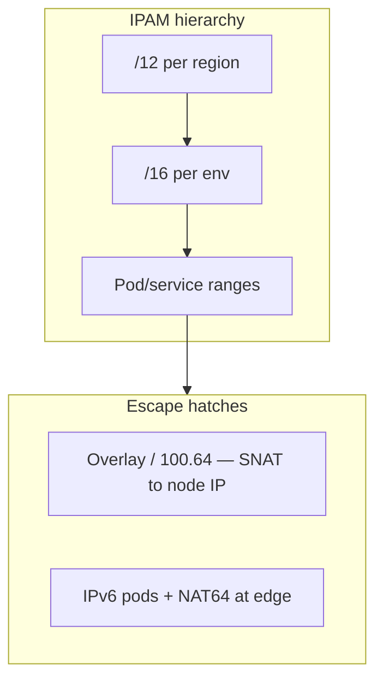
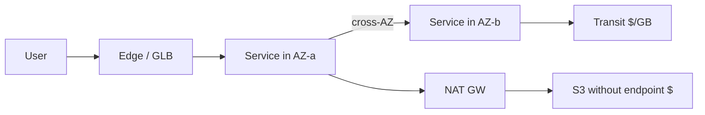
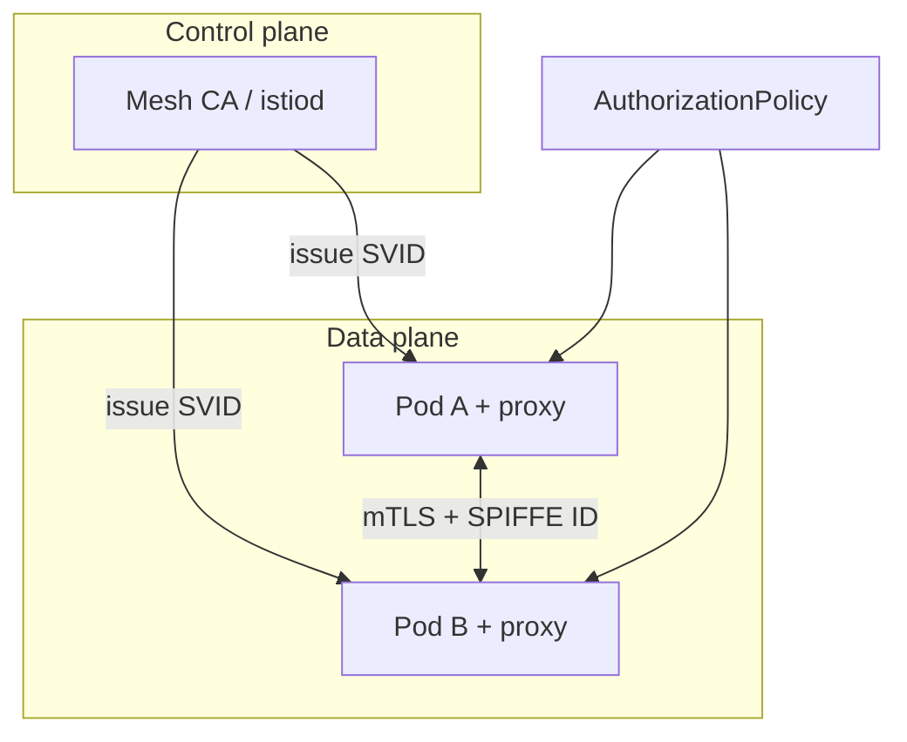
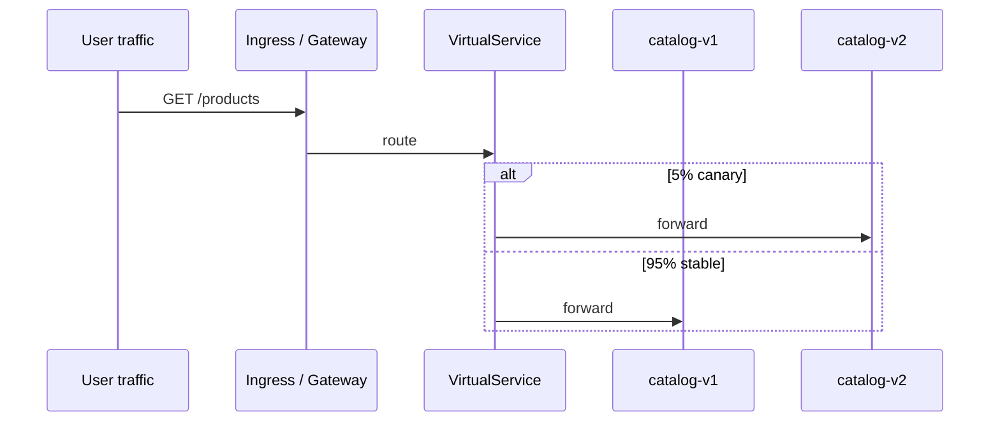
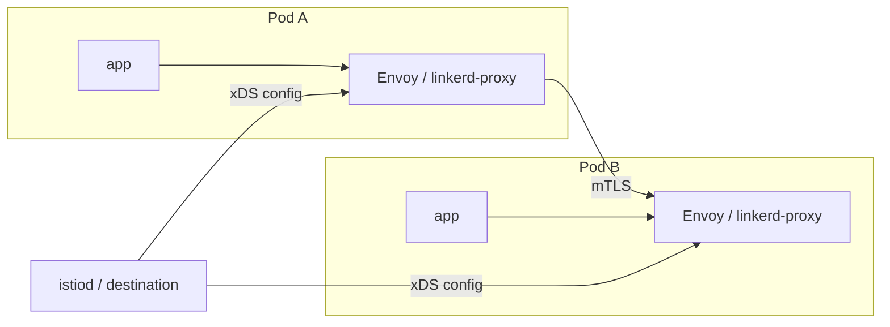

# Cloud Networking, Multi-Region & Cost Engineering

> **What you'll learn:** Why IP plans and NAT gateways are architecture decisions with dollar signs, when a service mesh earns its complexity, how multi-region failover actually fails, and how to treat cloud spend as an engineering signal—not a monthly surprise.

---

## Chapter A — Cloud networking & service mesh

### A.1 Address space: the decision you cannot refactor

RFC 1918 space is finite. **Acquisitions** with overlapping `10.0.0.0/16` → renumbering, not peering.

**Kubernetes consumption:**

| CNI model | 500-node cluster (illustrative) | % of one /16 |
|-----------|----------------------------------|--------------|
| Overlay (pods not VPC-routable) | ~500 node IPs | ~1% |
| EKS VPC CNI (secondary IPs) | ~22.5k addresses | ~34% |
| GKE VPC-native, 110 max pods/node | ~128k reserved | **~195%** (needs /15) |



> **Architect's note:** Size for **count of routable networks** you'll ever connect, not host count. Document **M&A reserved blocks**.

### A.2 NAT & egress: cost, zone, ports

**AWS NAT Gateway (us-east-1 illustrative):** ~$0.045/GB processed **including same-region S3/ECR** unless you use **gateway endpoints**.

| Destination | Path | $/GB (illustrative) |
|-------------|------|---------------------|
| S3 same region | Via NAT | ~$0.045 (+ cross-AZ) |
| S3 same region | **Gateway endpoint** | **$0** |
| Internet SaaS | NAT → internet | NAT + egress |
| Other VPC | Transit Gateway | ~$0.02 + cross-AZ |

**Three failure modes:**
1. **Per-GB tax** — image pulls through NAT
2. **Zonal dependency** — one NAT for 3 AZs → other AZs lose egress when NAT AZ fails
3. **SNAT port exhaustion** — ~64k ports per destination IP:port; new conn rate ≈ **ports ÷ reuse timer**

**NAT idle timeout (~350s on AWS):** client pools with longer idle → **first request after lull** hangs.

**Alerts:** `ErrorPortAllocation` (AWS), `OUT_OF_RESOURCES` (Cloud NAT).

### A.3 Private connectivity topology

| | Peering | Transit hub | PrivateLink |
|--|---------|-------------|-------------|
| Transitive | No | Yes | N/A (service) |
| Overlapping CIDRs | No | No | **Yes** |
| Blast radius | One pair | Shared route table | One service |
| Cost at scale | No processing fee | $/GB processed | Per-endpoint |

**Pattern:** TGW for backbone with **segmented route tables**; PrivateLink across trust boundaries; direct peering only for very high volume pairs.

> **DNS is the hard part:** split horizon, resolver loops, health-check coupling (Facebook 2021 — tooling depended on network being fixed).

### A.4 East-west traffic

- **~2/3 of LB hops cross-AZ** with round-robin → **$0.01/GB each way** adds up at microservice fan-out.
- **Zone-local routing** without spillover → survivors overloaded when zone partial failure (Envoy overprovisioning factor ~1.4).
- **kube-proxy balances connections**, not requests → gRPC/HTTP2 skew; mitigations: `MAX_CONNECTION_AGE`, headless + client LB.
- **conntrack:** occupancy ≈ Σ (flow rate × TIME_WAIT). Retry storms → table full → SYN drops → **misdiagnosed as "bad node"**.
- **DNS:** `ndots:5` multiplies lookups; NodeLocal DNSCache helps.

### A.5 Mesh data planes

| | Sidecar | Ambient (ztunnel + waypoint) | eBPF (Cilium) |
|--|---------|------------------------------|-----------------|
| L7 cost | Every pod | Waypoints only | Per-node Envoy for L7 |
| Upgrade | Restart all pods | DaemonSet roll | Kernel coupling |
| Failure domain | Per pod | **Per node** (ztunnel) | Per node agent |

**xDS staleness:** istiod debounce (100ms–10s) + fan-out → proxies route to dead endpoints. Size **preStop** > measured push convergence at max churn.

### A.6 mTLS & identity

- mTLS **encrypts**; **AuthorizationPolicy** enforces (SPIFFE IDs).
- Identity granularity = **service account hygiene**; anyone who can create pods in NS can mint that identity.
- **STRICT** mTLS is the deliverable, not PERMISSIVE forever.
- **Leaf cert lifetime** trades CA outage tolerance vs stolen key window; size CA for **restart storms** (20k pods in 10 min).

### A.7 When a mesh pays

Buy: workload identity + encryption, L7 retries/timeouts/splitting, central authz, uniform telemetry.

**Cheaper substitutes:** L4 identity (ztunnel/WireGuard), shared gRPC library, OpenTelemetry + eBPF flows.

Move to **full L7 mesh** when: many languages, per-route authz outside app code, progressive delivery at L7, **1–2 FTE** sustained ownership.

---

## Chapter B — Multi-region & multi-cloud

### B.1 What you are insuring

Two regions at 99.9% each ≠ six nines if **common-mode** downtime dominates:

`U ≈ ((1-c)·q)² + c·q`

With **c = 10%** common-mode, pair ≈ **four nines**, not six.

> **Rule 1:** Region #2 value bounded by **region-sequenced change** (bake time on global deploys, flags, schema).
>
> **Rule 2:** Set **RTO/RPO per capability**, not per monolith.

Before funding region #2: classify last 20 incidents — **zonal vs regional vs common-mode vs self-inflicted**.

### B.2 Topologies & capacity

**Active-active is a write property**, not a read property.

| Regions N | Compute at peak (survive 1 loss) | Replicated data |
|-----------|-----------------------------------|-----------------|
| 2 | ≤50% per region → **200%** total | **2×** copies |
| 3 | ≤67% → **150%** | **3×** |

**Standby decay:** passive region drifts (quotas, IAM, deps) — trust only if it carries **some prod traffic** or scheduled failover.

### B.3 Write ownership (per dataset)

| Model | Remote write latency | RPO on region loss | Fit |
|-------|----------------------|-------------------|-----|
| Single writer + async replica | 1 RTT for remote readers | Replication lag | Most honest default |
| Home region per entity | Local for homed tenants | Lag for homed partitions | SaaS multi-tenant |
| Multi-writer async merge | Local | **LWW may drop writes** | Carts, presence only |
| Cross-region consensus | Quorum RTT every commit | ~0 if committed | Ledgers, metadata |

**Partial failover trap:** DB in region B, app in region A → 12 serial queries × 65ms RTT → pool exhaustion (Little's law). **Failover unit = colocated stack.**

**Promote only after fence:** revoke old primary credentials / epoch at storage layer.

### B.4 Failover mechanics

| Mechanism | Moves | Sticky connections |
|-----------|-------|-------------------|
| DNS | New lookups | **No** — HTTP/2 pools ignore TTL |
| Anycast / GLB | Packets (new flows) | Partial |
| Health-checked LB | New connections | Better |

Bound tail at **client:** max connection age, outlier detection, reasonable idle timeouts.

### B.5 Multi-cloud (sober view)

Second cloud pays: **lowest-common-denominator abstractions**, dual runbooks, egress, identity. Justify for **regulatory**, **negotiation**, or **true independence**—not slide-deck resilience.

---

## Chapter C — Cost engineering & unit economics

### C.1 Unit economics

Good denominator:
- Tracks what customer pays for
- Low CV across tenants
- Measurable daily

**Total cost** ≈ `F/N + v + s(N)/N` — U-shape. **Alert on marginal slope** (regression on list-rate cost), not spend/revenue ratio.

| Question type | Use |
|---------------|-----|
| Pricing free tier | **Marginal** cost |
| Second region | **Fixed floor F** |

### C.2 Attribution = incentives

| Shared pool | Bad key | Good key |
|-------------|---------|----------|
| K8s | CPU usage only (requests free) | max(request, usage); idle → platform team |
| Kafka | Messages produced | Bytes in/out × retention |
| Observability | Flat per team | Active series × retention |

> **Showback first;** chargeback only where internal market helps.

### C.3 Per-tenant economics (whale curve)

Plot cumulative profit vs tenants sorted — top tier often carries **>100%** of profit; bottom decile destroys margin.

Before churning "unprofitable" tenant: split cost into **marginal / stepped / floor** — pooled tenant may still subsidize floor.

### C.4 Commitments (newsvendor)

Commit while `P(usage ≥ L) > 1 - d` (d = discount).

- **30% discount** → commit to level exceeded **70%** of hours
- **Ladder** monthly tranches vs one 3-year block before ARM/Fargate migration
- Track **coverage** vs **utilization** — 100% utilization = under-committed

### C.5 Spot

Interruptions **correlate within capacity pool** — diversify instance types/AZs; don't fill one pool.

### C.6 Data transfer as design force

Cross-AZ, NAT, TGW, cross-region replication belong in **architecture review** with bytes attached (ties to Chapter A).

---

## Cross-chapter diagram: request dollars



---

## Design review questions

**Networking**
- Who vends the next /16 for an acquisition?
- NAT GB/month — how much is own-cloud services?
- Peak conntrack % during largest rollout?
- preStop longer than istiod push p99 at max churn?

**Multi-region**
- % downtime from common-mode in last incidents?
- Per-dataset write ownership written?
- Failover moves **stack** or single component?
- Quotas at 100% in standby region?

**Cost**
- Marginal $/unit from 60-day regression?
- Allocation key for shared cluster — requests or usage?
- Commitment sized to **post-optimization** forecast?

---

*Sources: Algoroq Cloud Ops — Cloud Networking & Service Mesh, Multi-Region & Multi-Cloud Architecture, Cost Engineering & Unit Economics.*

---

## Production deep dives (extended)

### Istio vs Linkerd — operational comparison

| Dimension | **Istio** (ambient or sidecar) | **Linkerd** |
|-----------|-------------------------------|-------------|
| Data plane | Envoy (sidecar or ztunnel + waypoint) | Linkerd2-proxy (Rust) |
| Control plane | istiod (feature-rich, heavier) | Destination + identity (smaller) |
| mTLS default | Yes (permissive → strict migration) | Yes, on by default |
| L7 features | Rich: retries, fault injection, Wasm | Simpler L7; focuses on reliability + mTLS |
| Multi-cluster | First-class (multi-primary, etc.) | Supported, smaller community patterns |
| Ops cost | Often **1–2 FTE** at scale | Lower baseline; fewer knobs |
| Best fit | Many languages, complex traffic mgmt | K8s-native, gRPC/HTTP, want **minimal surprise** |

Neither replaces **good app timeouts** — mesh retries can amplify load during outages (retry budgets matter).

### mTLS setup sketch (SPIFFE-style identity)



```yaml
# Istio: STRICT peer authentication for namespace (illustrative)
apiVersion: security.istio.io/v1beta1
kind: PeerAuthentication
metadata:
  name: default
  namespace: payments
spec:
  mtls:
    mode: STRICT
---
apiVersion: security.istio.io/v1beta1
kind: AuthorizationPolicy
metadata:
  name: checkout-to-payments
  namespace: payments
spec:
  selector:
    matchLabels:
      app: payments-api
  action: ALLOW
  rules:
    - from:
        - source:
            principals: ["cluster.local/ns/checkout/sa/checkout-api"]
      to:
        - operation:
            methods: ["POST"]
            paths: ["/v1/charge"]
```

**Production checklist:** rotate leaf certs before lifetime exceeds **max pod restart storm** duration; ensure **service account per workload** (not `default`); audit who can `create pods` in a namespace (they mint that identity).

### Traffic splitting for canary (mesh-native)

```yaml
# Istio VirtualService: 95/5 weight + header override for internal testers
apiVersion: networking.istio.io/v1beta1
kind: VirtualService
metadata:
  name: catalog
spec:
  hosts:
    - catalog
  http:
    - match:
        - headers:
            x-canary:
              exact: "true"
      route:
        - destination:
            host: catalog
            subset: v2
    - route:
        - destination:
            host: catalog
            subset: v1
          weight: 95
        - destination:
            host: catalog
            subset: v2
          weight: 5
---
apiVersion: networking.istio.io/v1beta1
kind: DestinationRule
metadata:
  name: catalog
spec:
  host: catalog
  subsets:
    - name: v1
      labels:
        version: v1
    - name: v2
      labels:
        version: v2
```

**Linkerd equivalent:** `TrafficSplit` resource (SMI) with Service weights — same idea, fewer L7 matchers unless using policy CRDs.



### Service mesh data plane (sidecar model)



**xDS staleness lesson:** during rolling deploy of 500 pods, endpoint updates debounce — set **preStop sleep** longer than measured **p99 config push + drain** at max churn, or you will see 503s that look like “app bug.”

### Terraform: VPC endpoints to kill NAT tax

```hcl
resource "aws_vpc_endpoint" "s3" {
  vpc_id       = module.vpc.vpc_id
  service_name = "com.amazonaws.${var.region}.s3"
  route_table_ids = module.vpc.private_route_table_ids
}

resource "aws_vpc_endpoint" "ecr_api" {
  vpc_id              = module.vpc.vpc_id
  service_name        = "com.amazonaws.${var.region}.ecr.api"
  vpc_endpoint_type   = "Interface"
  subnet_ids          = module.vpc.private_subnets
  private_dns_enabled = true
}
```

### Multi-region cost: data transfer line items in architecture review

| Line item | Typical trigger | Design lever |
|-----------|-----------------|--------------|
| Cross-AZ | K8s service round-robin | Topology-aware routing, zone-local endpoints |
| NAT Gateway | ECR pull without interface endpoint | VPC endpoints |
| Cross-region replication | Active-active reads everywhere | Single writer + regional caches |
| Inter-cloud egress | Multi-cloud “portability” | Stay single cloud unless mandated |

---

## Interview Q&A

### Q: Why is DNS a poor failover mechanism for HTTP/2 APIs?

**A:** HTTP/2 **connection pooling** ignores DNS TTL for existing connections. Failover via DNS only affects **new** connections. You need **health-checked LBs**, **anycast/GLB**, or **client-side** max connection age + outlier detection. During partial region failure, DNS may still resolve to healthy IPs that are **overloaded** because sticky pools do not rebalance quickly.

### Q: Explain SNAT port exhaustion on NAT gateways.

**A:** Each unique `(NAT IP, destination IP, destination port)` tuple consumes a source port from a ~64k pool until idle timeout (~350s on AWS). High **new connection rate** to the same SaaS API (TLS handshakes, short-lived REST) exhausts ports before bandwidth does. Mitigations: **VPC endpoints** for AWS services, **NAT per AZ** (not one NAT for all AZs), **connection pooling** to external APIs, increase diversity of destination IPs (CDN), or **PrivateLink** to SaaS where offered.

### Q: When does a service mesh *not* pay for itself?

**A:** When you only need **L4 encryption** (WireGuard, Cilium, ztunnel-only ambient), or a **single language** with shared gRPC/HTTP client libraries enforcing timeouts, retries with budgets, and mTLS. Mesh tax dominates for **low fan-out** monoliths or teams without sustained ownership — you get config complexity without cross-cutting wins.

### Q: Active-active across two regions — what is the hidden capacity tax?

**A:** Surviving loss of one region at peak requires each remaining region to carry **100% of peak** (for true active-active), so you run ~**200%** compute at peak, plus **2×** replicated storage and **cross-region replication** bandwidth. Many “active-active” deployments are **active-passive for writes** with read replicas — honest about RPO/RTO per dataset.

### Q: How do you attribute Kubernetes cost fairly between teams?

**A:** Charge **max(request, usage)** for CPU/memory at pod level, roll up by namespace labels (`team`, `cost_center`). Idle node capacity belongs to **platform** unless you enforce quotas that trigger autoscaling. Do not allocate only on **usage** — teams inflate requests to game usage-based bills, or under-request and cause noisy neighbor. Showback first; chargeback when product owners can act on it.

### Q: What is the “partial failover trap”?

**A:** Failing over **only** the database to region B while app tiers stay in region A turns every query into **cross-region RTT** (e.g., 12 × 65ms), exhausting connection pools (Little’s law). Failover unit should be a **colocated stack** (app + cache + DB primary for that capability) or read-only degrade with explicit UX.

### Q: Compare Transit Gateway vs VPC peering for 50 VPCs.

**A:** Full mesh peering is **O(n²)** relationships and route table pain. TGW gives **hub** routing, segmentation via route tables, and transitive routing — at **$/GB processing** cost. Peering wins for **very high volume** between two VPCs with no transitive need. Overlapping CIDRs block peering/TGW routes — **PrivateLink** or **NAT + unique ranges** for acquisitions.

---

## Decision matrix: mesh vs alternatives

| Requirement | Full L7 mesh | Ambient / ztunnel only | Library + OTel | Cilium eBPF |
|-------------|--------------|------------------------|----------------|-------------|
| Uniform mTLS | Yes | Yes (L4) | If all langs supported | Yes |
| Per-route authz in mesh | **Yes** | Needs waypoint for L7 | App code | Limited |
| Progressive delivery | **Yes** | With waypoint | Custom | Growing |
| Lowest ops surface | No | Medium | **Yes** (if disciplined) | Medium |
| gRPC retry storms | Risk — configure budgets | Same at L7 | App-defined | N/A |

---

## Senior Pitfalls

| Mistake | Impact | Fix |
|---------|--------|-----|
| Service mesh enabled cluster-wide before L7 needs proven | Control plane outages affect all traffic; ops toil | Start with mTLS + metrics; add L7 features per route with waypoint pattern |
| Cross-region data path without measuring RTT on critical chains | P99 user latency dominated by chatty sync calls | Colocate writers with readers; async replication; edge caching |
| NAT gateway as default egress for all pods | Surprise $/GB bill; single-AZ NAT failure drops egress | VPC endpoints, egress gateway design, multi-AZ NAT or IPv6 egress paths |
| Global DNS failover without health check depth | Routes to “healthy” region that fails app-level checks | Synthetic canaries; RUM-based steering; avoid TTL-only failover |
| Multi-cloud networking via hairpin through on-prem | Adds 2× RTT and bandwidth choke | Cloud interconnect, regional hubs, minimize cross-cloud sync |
| Peering without route table hygiene | Asymmetric routing blackholes after CIDR expansion | IPAM discipline, automated route validation, change windows for CIDR adds |

---

## Production-grade Practice

1. **RTT budget map:** Trace one user request across regions (LB → API → DB). Allocate ms per hop; identify one cross-region call to remove or make async with measured user impact.
2. **Mesh incremental rollout:** Enable ambient/mTLS for one namespace; compare sidecar vs ztunnel CPU and P99; document abort criteria if control plane lag spikes.
3. **Egress cost audit:** Pull one month of NAT/processed bytes per service tag; propose VPC endpoints or regional caching for top three spenders; estimate savings.
4. **Failover game day:** Fail active region in staging with weighted DNS or global LB; measure RTO for login and write path; capture gaps in TLS cert and secret replication.

---

## Decision matrix: multi-region write models (expanded)

| Model | Cap ex | Ops complexity | Data loss risk on failover | Example |
|-------|--------|----------------|---------------------------|---------|
| Single writer + async replica | Low | Low | Replication lag window | Shopify-style regional read |
| Home region per tenant | Medium | Medium | Per-tenant lag | B2B SaaS |
| Multi-writer LWW | Medium | High | **Torn writes** | Shopping cart |
| Global consensus (Spanner) | High | Medium | Low if committed | Global inventory ledger |
