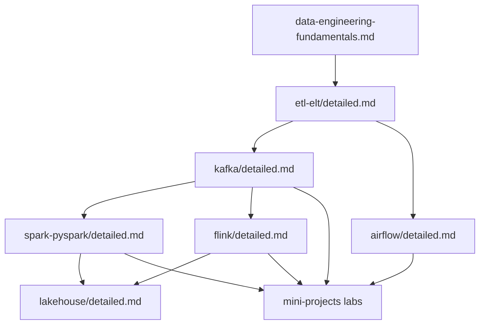

# Data Engineering — Concepts & Labs

Easy-language guides for the tools and patterns you see in **FAANG-scale** data platforms, plus **production-style Python labs** you can run locally (no Kafka cluster required for most).

## How to read each guide

Every topic folder has a **`detailed.md`** with the same spine:

| Section | What you get |
|---------|----------------|
| **Concepts** | Mental model in plain English |
| **Deep dive** | How it actually works under the hood |
| **Advanced** | State, correctness, joins, ops |
| **High scale** | Partitioning, skew, cost, SLOs |
| **FAANG insights** | What big teams optimize for (and common interview angles) |

## Topic guides

| Topic | Guide | Related existing doc |
|-------|--------|----------------------|
| Kafka & streaming logs | [kafka/detailed.md](./kafka/detailed.md) | [event-data-patterns.md](./event-data-patterns.md) |
| Apache Spark & PySpark | [spark-pyspark/detailed.md](./spark-pyspark/detailed.md) | [data-engineering-fundamentals.md](./data-engineering-fundamentals.md) |
| Apache Flink | [flink/detailed.md](./flink/detailed.md) | [event-data-patterns.md](./event-data-patterns.md) |
| Apache Airflow | [airflow/detailed.md](./airflow/detailed.md) | fundamentals (batch orchestration) |
| ETL / ELT / dbt-style transforms | [etl-elt/detailed.md](./etl-elt/detailed.md) | fundamentals |
| Lakehouse (Delta / Iceberg / Hudi) | [lakehouse/detailed.md](./lakehouse/detailed.md) | fundamentals |

## Hands-on labs

See **[LABS.md](./LABS.md)** and [`../mini-projects/README.md`](../mini-projects/README.md).

```bash
cd MD/mini-projects/kafka-log-lab && pip install -e ".[dev]" && pytest -q
```

## Suggested learning path


