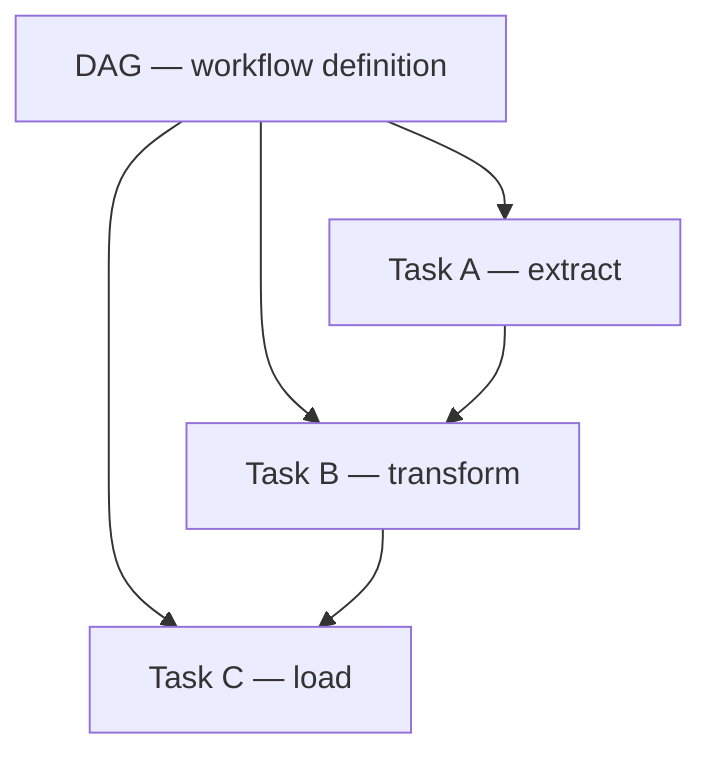

# Apache Airflow — Detailed Guide

> **One sentence:** Airflow is a **scheduler and orchestrator**—it runs your data jobs **in the right order**, **on a schedule**, with **retries and alerts**, but it does **not** process big data itself (Spark/Flink/dbt do the heavy lifting).

---

## Concepts

### What Airflow is (and is not)

| Airflow **is** | Airflow **is not** |
|----------------|-------------------|
| DAG of tasks with dependencies | A stream processor (use Flink) |
| Cron++ with observability | A data warehouse |
| Python-defined workflows | Real-time API server |

Think: **“When and in what order?”** not **“How to shuffle 10 TB?”**

### Core objects



| Term | Meaning |
|------|---------|
| **DAG** | Directed acyclic graph of tasks |
| **Task** | One unit of work (often one operator invocation) |
| **Operator** | Template: `BashOperator`, `PythonOperator`, `SparkSubmitOperator` |
| **DagRun** | One execution of the DAG for a logical date |
| **TaskInstance** | One task in one DagRun |
| **Scheduler** | Creates DagRuns, queues ready tasks |
| **Executor** | Runs tasks (local, Celery, Kubernetes) |

### Logical date vs run time

Airflow’s `execution_date` (logical date) is the **data interval** you’re processing—e.g. “nightly job for **yesterday**” runs **today** at 2am with logical date **yesterday**. This confuses everyone once; then it clicks.

---

## Deep dive

### Scheduling

- **Cron** or **timedelta** on DAG.
- `catchup=True` — backfill all missed intervals since `start_date`.
- `catchup=False` — only latest (common for new DAGs).

**Data-aware scheduling** (Airflow 2.4+ **datasets / data dependencies**): downstream DAG triggers when upstream **dataset** updates—not only wall clock.

### Task dependencies

```python
extract >> transform >> [load_warehouse, load_lake]
```

- **Bitshift** syntax for edges.
- **TaskGroups** for UI clarity.
- **Dynamic task mapping** — one task spawns N parallel copies (e.g. per partition).

### Executors (where tasks run)

| Executor | Fit |
|----------|-----|
| **Sequential** | Dev only |
| **Local** | Small teams |
| **Celery** | Worker pool on VMs |
| **Kubernetes** | Each task = pod (FAANG-style isolation) |

K8s executor: task OOM kills **one pod**, not the whole worker box.

### Sensors

Wait for external condition: file lands in S3, partition exists, upstream DAG success.

**Anti-pattern:** sensor **poking** every minute forever → use **deferrable operators** / **dataset** triggers / event-driven (Airflow 2.2+ deferrable).

### XComs

Small metadata passed task → task (e.g. row count). **Not** for big data—write to S3 and pass URI.

---

## Advanced

### Idempotency & backfill

Backfill **re-runs** historical DagRuns. Tasks must be **idempotent**:

- `INSERT` → `MERGE` / partition overwrite.
- Use **execution_date** in path: `s3://lake/dt={{ ds }}/`.

### SLAs & alerting

- **SLA** on task duration → email/Slack if transform exceeds 2h.
- **Callbacks** `on_failure_callback` → PagerDuty.

### Pools & priorities

**Pool** limits concurrent tasks (e.g. max 5 Spark submits to not thrash cluster). **Priority weight** for revenue-critical DAGs.

### Secrets & connections

Store credentials in Airflow **Connections** / secret backend (Vault, AWS SM)—never in DAG repo.

### Testing DAGs

- `pytest` with `DagBag` — import errors, cycle detection.
- **Staging** environment with same DAGs, smaller data.

### vs alternatives

| Tool | Sweet spot |
|------|------------|
| **Airflow** | Batch orchestration, complex DAGs |
| **Dagster** | Asset-centric, typing, local dev UX |
| **Prefect / Mage** | Lighter ops, hybrid cloud |
| **Step Functions** | AWS-native, serverless steps |

Many FAANG-adjacent companies still run **Airflow** or internal equivalents at huge scale.

---

## High scale

### Scheduler bottlenecks

Thousands of DAGs → tune **parallelism**, **max_active_runs_per_dag**, use **HA scheduler** (multiple schedulers with DB lock in Airflow 2+).

### Dag parsing

Heavy top-level DAG code slows scheduler. **Best practice:** factory functions, minimal imports at parse time.

### Observability

- **OpenLineage** / **Marquez** for cross-system lineage from Airflow runs.
- Correlate **DagRun id** in Spark app name for traceability.

### Multi-tenant

Separate **namespaces** (K8s), RBAC in Airflow UI, **per-team pools** so one team’s backfill doesn’t starve others.

---

## FAANG insights

1. **Thin DAGs, fat platforms** — DAG mostly wires **Spark/dbt/Flink** jobs maintained as versioned artifacts.
2. **Ownership** — Each DAG has **owner** email in default_args; on-call rotation per domain (Growth, Payments).
3. **Cost guards** — Tasks check **partition size** before full reprocess; **incremental** by default.
4. **Change management** — Prod DAG deploy via CI; **blue/green** or pause + deploy + unpause.
5. **Incident playbooks** — “Clear task instance & rerun” vs “full backfill from dt=X” documented per pipeline.

**Interview angles:**

- Difference orchestrator vs processing engine?
- How make backfill safe?
- What is logical date?
- Sensor pitfalls?

**Lab:** [airflow-dag-lab](../../mini-projects/airflow-dag-lab/) — DAG parse, topological run, retries, backfill simulation.

**Related:** [etl-elt/detailed.md](../etl-elt/detailed.md).
