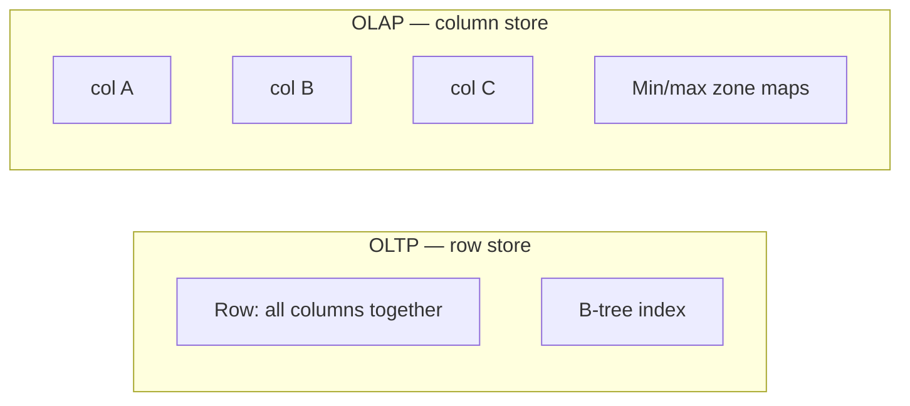
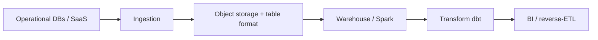
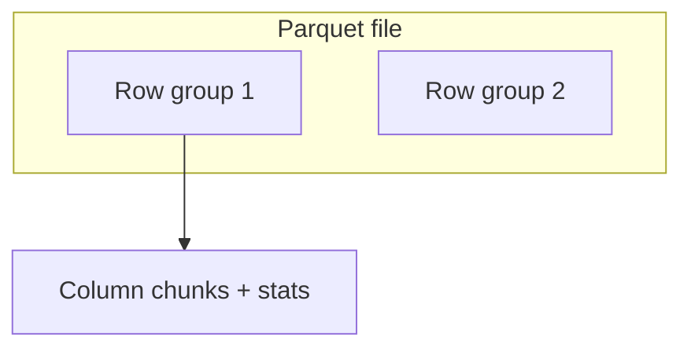
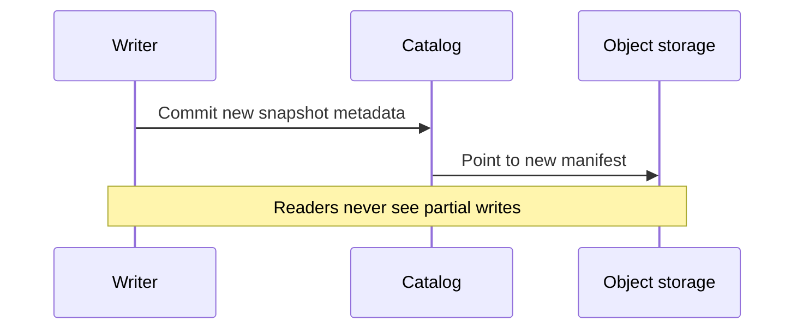
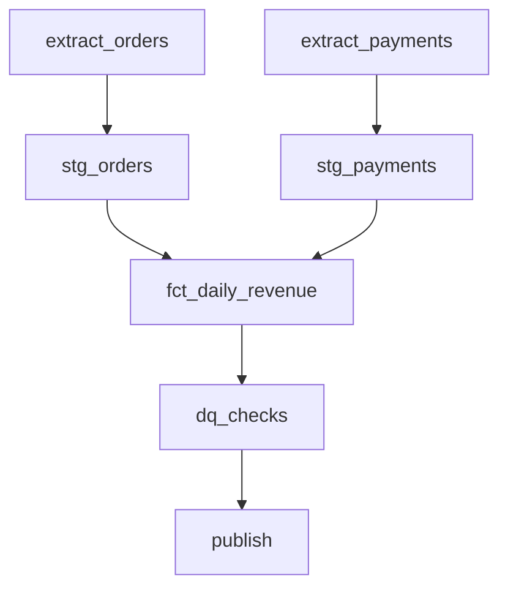
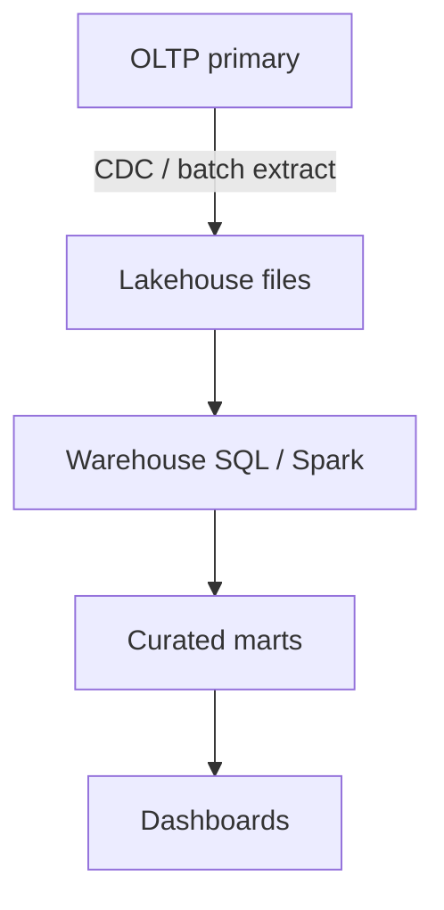
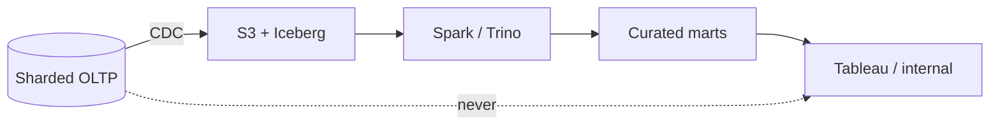
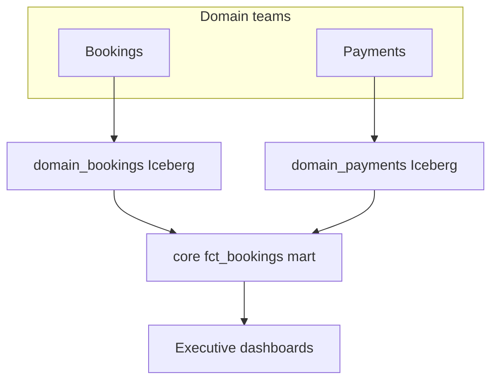

# Data Engineering Fundamentals

> **Hands-on labs:** [LABS.md](./LABS.md) → `MD/mini-projects/` (Kafka, ETL, Spark, Flink windows, Airflow DAGs).

> The database that runs your product is not the database that should answer every analytics question. This guide explains **OLTP vs OLAP**, **columnar storage & the lakehouse**, and **batch pipelines**—with the failure modes that actually bite in production. Sources: Algoroq Data Engineering track (Chapters 1–3).

---

## Part 1 — OLTP vs OLAP & the Modern Data Stack

### 1.1 Two workloads, one schema (opposite physics)

| Dimension | **OLTP** (runs the product) | **OLAP** (explains the business) |
|-----------|------------------------------|----------------------------------|
| Query shape | `WHERE id = 42`, single-row writes | `GROUP BY month`, `SUM(revenue)` |
| Rows touched | 1–100 per statement | 10⁶–10¹⁰ |
| Columns read | Most of the row | 3–5 of 80 |
| Concurrency | Thousands of tiny txns/sec | Few heavy queries |
| Latency budget | 1–10 ms p99 | Seconds to minutes OK |
| Data scope | **Current state** | Years of history |



**Why one engine fails at both:** OLTP wants row layout + hot working set in memory. OLAP wants column layout + compression + sequential scan bandwidth. A `SUM(net_revenue) GROUP BY month` on a row store reads **all 80 columns**; a column store reads **4**—on a 500 GB table that is ~500 GB vs ~25 GB raw (often **two orders of magnitude** before clever execution).

### 1.2 The forgotten quadrant: user-facing analytics

Plot workloads by **queries/sec × rows scanned**:

| Quadrant | Examples | Engine fit |
|----------|----------|------------|
| Low scan, high QPS | OLTP | Postgres, MySQL, DynamoDB |
| High scan, low QPS | Warehouse / lakehouse | Snowflake, BigQuery, Spark |
| **High scan, high QPS** | “Your sales this month” widget | **Not** default warehouse |
| Low everything | Internal admin | Replica often enough |

> Merchant dashboards on a warehouse hit **concurrency limits** (e.g. Snowflake default max concurrency per cluster ~8)—fix is multi-cluster **linear cost**, not “buy a bigger warehouse.”

This quadrant belongs in **real-time OLAP** (ClickHouse, Pinot, Druid) or **pre-aggregated tables** served from OLTP.

### 1.3 Read replicas: when they help, when they don’t

Replicas solve **read scaling** for OLTP-shaped queries—not arbitrary analytics scans.

| Failure mode | What happens |
|--------------|--------------|
| **Replica lag** | User sees stale reads |
| **Heavy scan on replica** | Still hurts I/O; can lag primary |
| **Cross-region replica** | Higher lag, compliance wins |

Replica is plenty for internal tools; not for **warehouse-class** questions.

### 1.4 The modern data stack (source → dashboard)



**ETL vs ELT:**

| | **ETL** | **ELT** |
|---|---------|---------|
| Transform where | Before warehouse | **Inside** warehouse |
| Typical today | Legacy enterprise | Cloud warehouses with cheap storage |

**Star schema (dimensional modeling):**

- **Fact table** — measurable events (orders, clicks) with foreign keys  
- **Dimension tables** — who/what/where (customer, product, date)  

> Classic mistakes: **fan traps**, **many-to-many** without bridge tables, **slowly changing dimensions** ignored → plausible wrong numbers.

### 1.5 Separation of storage and compute

Cloud warehouses **decouple** storage (cheap object store) from compute (clusters you spin up).

| Benefit | Cost |
|---------|------|
| Elastic compute | Bill surprises if clusters left on |
| Independent scale | More moving parts |
| Snapshot/time travel (some engines) | Storage growth |

### 1.6 When the “modern stack” is overhead

Below a certain size:

- Postgres + Metabase or replica + scheduled SQL may beat Airflow + Snowflake + dbt + Fivetran in **total cost and complexity**.
- Ask: *Which mechanism actually hurt the primary?* Often not the query you blamed.

### 1.7 Illustrative OLTP vs OLAP SQL

```sql
-- OLTP: index-friendly, tiny footprint
SELECT status, total_cents
FROM orders
WHERE id = $1;

-- OLAP: scan-heavy, few columns
SELECT date_trunc('month', created_at) AS month,
       sum(total_cents) AS revenue
FROM orders
WHERE created_at >= '2024-01-01'
GROUP BY 1;
```

---

## Part 2 — Columnar Storage & the Lakehouse

### 2.1 Row vs column layout

**Headline:** `AVG(price)` on 1B rows × 20 columns (~160 B/row):

| Layout | Data read (illustrative) |
|--------|--------------------------|
| Row store | ~160 GB |
| Column store (price only) | ~8 GB |
| + encoding (ZSTD, dictionary) | Often **another large cut** |

**What the headline hides:**

1. **Disk pages** — you still read whole pages; savings come from touching fewer columns.  
2. **Encoding fallbacks** — writers may fall back from optimal encodings on messy data.  
3. **Statistics** — min/max per row group skip nothing if data is **unclustered**.  
4. **Object storage** — **LIST/GET request counts** dominate small files.  
5. **Table format** — Iceberg/Delta/Hudi **commit protocols** and compaction decide month-3 performance.



### 2.2 Parquet mechanics

| Concept | Role |
|---------|------|
| **Row group** | Horizontal partition; unit of parallel read |
| **Column chunk** | Compressed values + **page** index |
| **Statistics** | Min/max/null count → **predicate pushdown** |
| **Encodings** | Dictionary, RLE, delta—per column |

**Predicate pushdown:** `WHERE country = 'DE'` skips row groups whose stats prove no match.

> If `country` is random in file order, stats rarely help—**physical clustering** (Z-order, sort on write) matters.

### 2.3 Lakehouse table formats

Turn “a pile of files in S3” into **ACID tables**:

| Format | Strengths |
|--------|-----------|
| **Apache Iceberg** | Open spec, hidden partitioning, snapshot isolation |
| **Delta Lake** | Databricks ecosystem, time travel |
| **Apache Hudi** | Incremental processing, upserts |



**Operational jobs:** compaction, expire snapshots, orphan file cleanup—skip them and queries slow while storage grows.

### 2.4 Small-file problem

Millions of tiny files → metadata overhead + S3 LIST costs. Target **128 MB–1 GB** files where possible; use **compaction** jobs.

### 2.5 Lakehouse query pattern

```sql
-- Iceberg-style: time travel / snapshot (syntax varies by engine)
SELECT *
FROM analytics.orders
FOR SYSTEM_VERSION AS OF 482910293847;
```

---

## Part 3 — Batch Pipelines & Orchestration

### 3.1 Pipelines as DAGs — partition is the unit

A daily pipeline is not “the revenue job”; it is:

> **Produce `dt=2026-03-03` of `fct_daily_revenue` correctly—any number of times.**



| Principle | Meaning |
|-----------|---------|
| **DAG edges** | Dependencies only |
| **Task boundary** | Rerun, retry, alert, **atomicity** boundary |
| **Failed node** | Blocks descendants—rerun **from failure** |

**Granularity rule:** One task per **durable, independently meaningful** output, written **atomically**. Too coarse → rerun expensive steps; too fine → scheduler overhead and junk intermediate tables.

> `retries=3` on a **non-idempotent** task does not add reliability—it adds **wrong up to four times**.

### 3.2 Idempotent partition overwrites

```sql
-- Pattern: overwrite one partition
INSERT OVERWRITE TABLE fct_daily_revenue
PARTITION (dt = '2026-03-03')
SELECT ...
FROM stg_orders o
JOIN stg_payments p ON ...
WHERE o.dt = '2026-03-03';
```

Every task should be a **pure function of its interval**—reruns, backfills, and disaster recovery are the same operation with different date ranges.

### 3.3 Spark shuffle (why skew ruins your night)

Wide transformations (`groupBy`, `join`) **shuffle** data across partitions.

| Problem | Symptom | Mitigation |
|---------|---------|------------|
| **Skewed key** | One task runs hours | Salting, broadcast small side, AQE |
| **Too many partitions** | Scheduler overhead | Tune `spark.sql.shuffle.partitions` |
| **Too few** | Spill, OOM | Increase partitions with data size |

```python
# Illustrative: broadcast join when one side is small
from pyspark.sql.functions import broadcast

facts.join(broadcast(dim_customers), "customer_id")
```

### 3.4 dbt models

- **Staging** — clean one source  
- **Intermediate** — reusable logic  
- **Marts** — business-facing tables  

Tests in dbt (`unique`, `not_null`, relationships) are **contracts**—run them **before** publish, not after the CFO sees the dashboard.

### 3.5 Airflow scheduling and SLAs

**Slack** = SLA deadline − **critical-path duration** (from when last upstream lands, not cron).

| Slack eater | Notes |
|-------------|-------|
| Late upstream | Largest, least controllable |
| Warehouse queue at 02:00 | Everyone’s jobs collide |
| Retries on **deterministic** failures | Burns slack without fixing |

### 3.6 Late data and lookback

If events arrive late:

- Widen **lookback window** on incremental models  
- **Reprocess** last N days on schedule  
- Document which downstream tables **must** move together—fixing one partition while leaving dependents stale **desynchronizes** metrics

### 3.7 Data quality gates

| Check | Catches |
|-------|---------|
| Row count vs yesterday | Missing extract |
| Null rate spikes | Broken upstream |
| Uniqueness on keys | Double-count from retries |
| Referential integrity | Bad joins |

```yaml
# Illustrative dbt test
models:
  - name: fct_daily_revenue
    tests:
      - dbt_utils.expression_is_true:
          expression: "revenue >= 0"
```

### 3.8 Backfill playbook

1. Identify date range and **all** downstream partitions  
2. Run tasks in DAG order with `catchup` or manual params  
3. Verify DQ on boundary dates  
4. Announce BI refresh—dashboards may cache  

---

## Cross-chapter mental model



| Layer | Optimized for |
|-------|----------------|
| OLTP | Correctness, low-latency row access |
| Lake files | Cheap durable storage, columnar scan |
| Batch DAG | Deterministic daily truth |
| BI | Human decisions |

---

## Checklist

- [ ] Analytics **off** primary unless truly OLTP-shaped  
- [ ] Columnar + **clustered** data for filter columns  
- [ ] Table format **maintenance** scheduled  
- [ ] Pipelines **partition-idempotent** with DQ before publish  
- [ ] SLAs computed on **critical path + slack**, not hope  

---

*Based on Algoroq Data Engineering chapters: OLTP vs OLAP & the Modern Data Stack, Columnar Storage & the Lakehouse, Batch Pipelines & Orchestration.*

---

## Senior Pitfalls

| Mistake | Impact | Fix |
|---------|--------|-----|
| Batch pipeline with no idempotent writes to the warehouse | Duplicate rows after retry; bad downstream KPIs | Merge keys, `MERGE`/`INSERT ON CONFLICT`, partition overwrite with deterministic job IDs |
| Landing raw data without schema contracts | Silent type coercion breaks ML and finance models | Schema registry or dbt tests; quarantine bad batches |
| Single massive Spark job with no stage retry isolation | One skewed key fails entire daily SLA | Salting, adaptive execution, split by business date, checkpoint stages |
| Orchestrator DAG with hidden external sensors | Missed SLAs when upstream slips with no owner | Explicit SLAs, data freshness metrics, alerting on landing time not just job green |
| PII copied to analytics lake without column-level controls | Compliance breach and audit failure | Tokenization at ingest; row/column ACLs; separate restricted zones |
| Backfill run at full cluster parallelism during peak | Starves online queries and raises cloud bill | Throttle concurrency; schedule backfills; use spot with checkpointing |

---

## Production-grade Practice

1. **End-to-end data SLA:** Pick one critical table. Define landing → curated latency SLO; instrument each hop; build a dashboard that burns budget when any hop exceeds threshold.
2. **Idempotent backfill:** Re-run yesterday’s partition load twice intentionally. Prove row counts and key metrics match; document the dedupe mechanism.
3. **Cost per pipeline:** Attribute Databricks/BigQuery spend to a single DAG (slot hours, bytes scanned). Propose one optimization (partition pruning, clustered table) and measure savings.
4. **Failure injection:** Kill an executor mid-write or simulate upstream file delay. Verify orchestrator retry, alerting, and downstream consumer behavior without manual heroics.

---

## FAANG Interview Deep Dive

### Real-world examples

| Company | Data platform choice | Architecture choices |
|---------|---------------------|----------------------|
| **Airbnb** | **Minerva** + lakehouse | Hive/Spark → **Iceberg**-style tables; metric layer for consistent definitions; separate OLTP (reservations) from analytics; dbt-like governance on marts. |
| **Netflix** | **Iceberg** + multi-engine | S3 object storage; **BDP** jobs; push heavy analytics off primary; user-facing metrics via specialized OLAP where needed. |
| **LinkedIn** | **Brooklin** + Kafka + Hadoop/Spark | Nearline ingestion to HDFS/OSS; OLTP not queried for company-wide SQL; strong **data contract** culture between product and DE. |



### Interview Q&A

### Q: Why not run CFO dashboard SQL on a Postgres read replica?
**A:** Full-table scans **steal buffer pool** from OLTP, replica lag grows, and **concurrency** doesn’t match warehouse (Snowflake **~8** concurrent queries per cluster without multi-cluster). Fix: ELT to columnar + **pre-aggregated marts**.

### Q: Explain small-file problem with real impact.
**A:** 10M files × **LIST** latency → job planning **minutes**; metadata in driver OOM. Target **128 MB–1 GB** Parquet files; compaction job nightly; **partition pruning** on `dt`.

### Q: How do you design SLAs for daily revenue mart?
**A:** Critical path: `extract_payments` → `stg_*` → `fct_revenue` → DQ → publish. Slack = deadline − **longest path** − upstream land time. Alert on **missing partition**, not just task failure.

### Q: Star schema vs wide one-big-table for lakehouse?
**A:** Facts + dims for **conformed dimensions** (one `dim_date`); wide tables for **ML feature stores** or Pinot ingest. Interview: fan-out joins in Spark need **broadcast** small dims or **skew** handling.

### Q: When is “modern stack” overkill?
**A:** **<1 TB** analytics, **<5** analysts, stable Postgres → Fivetran+Snowflake+Airflow may cost **$50k+/yr** vs replica+Metabase **<$5k**. Staff judgment: optimize for **mechanism that failed**, not fashion.

### Common mistakes candidates make

- **Non-idempotent** `INSERT INTO` daily jobs → 4× revenue on retries.
- Ignoring **slowly changing dimensions** → wrong historical attribution.
- **Z-order** on wrong column (low cardinality only).
- Leaving Airflow **catchup=true** after bug → warehouse bill spike.
- DQ **after** BI publish instead of gate on `PUB` task.

### Scale numbers

| Dimension | Illustrative FAANG-scale |
|-----------|-------------------------|
| Lake size | **10 PB–100 PB** object storage common at big tech |
| Daily batch | **1–50 TB** new data/day ingested |
| Spark shuffle | **10k–50k** shuffle partitions; skew key **1%** of rows → straggler hours |
| Warehouse | **p95 query 5–120 s** for ad-hoc; marts **<10 s** |
| File size target | **256 MB** Parquet per file (rule of thumb) |
| OLTP vs OLAP cost | Columnar scan **10–100×** less IO than row store for `SUM()` |

```sql
-- Idempotent daily partition (interview must-write)
DELETE FROM fct_daily_revenue WHERE dt = '2026-03-03';
INSERT INTO fct_daily_revenue SELECT ... WHERE dt = '2026-03-03';
-- or INSERT OVERWRITE PARTITION (engine-specific)
```

### Airbnb / Netflix platform patterns (naming for interviews)

| Concept | What to say in interview |
|---------|--------------------------|
| **Metric layer** (Airbnb Minerva) | One definition of `nights_booked`; BI cannot SQL their own variants |
| **Iceberg** (Netflix) | ACID on S3; time travel for “what did mart look like Tuesday?” |
| **CDC to lake** | OLTP remains source; lake is derived—never reverse |



### Additional interview Q&A

### Q: dbt test failed at 6am—ship or hold?
**A:** **Hold publish** task; downstream `PUB` depends on `dq_checks`. Revenue wrong by 2% → executive trust gone. Staff: separate **warning** vs **blocking** tests.

### Q: ClickHouse vs Snowflake for merchant dashboard?
**A:** Snowflake: ad-hoc analysts, **low QPS**. ClickHouse/Pinot: **thousands QPS** on pre-aggregated rollups. Putting merchant UI on Snowflake → concurrency tax.

### Batch incident playbook (table)

| Step | Action |
|------|--------|
| 1 | Identify **partition** `dt` affected |
| 2 | Rerun DAG from **lowest** bad task |
| 3 | Validate row counts vs source |
| 4 | Invalidate BI cache / announce |

### Storage math (interview rapid fire)

| Data | Rough size |
|------|------------|
| 1B rows × 200 B row | **200 GB** row store scan |
| Same, 5 columns Parquet | **~15–40 GB** with compression |
| Iceberg metadata overhead | **<1%** if file sizes healthy |
