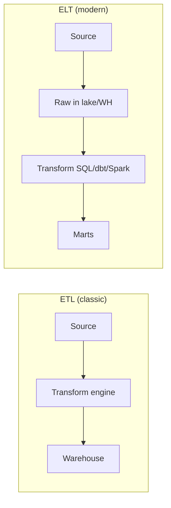

# ETL, ELT & Modern Pipelines — Detailed Guide

> **One sentence:** **ETL** transforms data **before** it lands in the warehouse; **ELT** loads **raw** first and transforms **inside** the warehouse or lake with SQL/dbt—today most cloud-native stacks prefer **ELT** for flexibility and cost.

---

## Concepts

### ETL vs ELT



| | **ETL** | **ELT** |
|---|---------|---------|
| Transform where | Spark/DataStage **before** WH | **In** Snowflake/BigQuery/Spark |
| Schema | Often rigid upfront | **Evolve** in staging |
| Best when | Legacy, strict compliance pre-filter | Cheap object storage + powerful SQL |

### Ingestion patterns

| Pattern | Description |
|---------|-------------|
| **Full dump** | Replace entire table nightly |
| **Incremental** | Only rows where `updated_at > last_run` |
| **CDC** | Binlog events → always current |
| **API pull** | Paginate SaaS (rate limits, idempotent) |

### Medallion architecture (bronze / silver / gold)

| Layer | Also called | Contents |
|-------|-------------|----------|
| **Bronze** | Raw | As landed, append-only, schema-on-read |
| **Silver** | Cleaned | Deduped, typed, conformed keys |
| **Gold** | Marts | Business metrics, star schema, aggregates |

This is the **default mental model** at Databricks, many Netflix/Uber-style lakes, and modern FAANG data meshes (names vary).

---

## Deep dive

### Data contracts

Producer and consumer agree on:

- Schema fields & types
- **SLA** (freshness by 6am)
- **Quality** (null rate &lt; 1% on `user_id`)

Breaking change → version bump (`orders_v2` topic) or **additive** columns only.

### Validation layers

| Stage | Checks |
|-------|--------|
| Ingest | File not empty, checksum |
| Bronze → Silver | Schema, PK uniqueness, referential |
| Silver → Gold | Business rules, reconciliation vs source |

Tools: Great Expectations, Soda, dbt tests, custom Spark asserts.

### Slowly changing dimensions (SCD)

Track dimension history (customer address changes):

- **SCD Type 1** — overwrite (no history)
- **SCD Type 2** — new row with `valid_from` / `valid_to`
- **SCD Type 3** — limited previous column

Warehouse SQL or Spark implements these; dbt has patterns/macros.

### Dedup & ordering

Event streams deliver **duplicates** and **out-of-order** updates.

Pattern: `ROW_NUMBER() OVER (PARTITION BY id ORDER BY event_time DESC) = 1` in silver.

### Incremental models (dbt mindset)

```sql

  WHERE updated_at > (SELECT MAX(updated_at) FROM {{ this }})

```

Merge into target table—**idempotent** per run.

---

## Advanced

### Reverse ETL

Gold metrics → **sync back** to Salesforce, Braze, ads platforms (Census, Hightouch). Closes loop: warehouse insights → **operations**.

### Feature stores

ML features computed in batch/stream → **online store** for serving. Shares ETL discipline (point-in-time correct joins—**no leakage**).

### Data mesh (organizational)

Domain teams own **data products** with contracts; central platform provides **Kafka, lake, IAM, Airflow**. Not a tool—a **governance** model.

### Privacy & compliance

- **PII tagging** at bronze.
- **Column masking** in warehouse.
- **Right to delete** propagates via **key** through all layers (hard problem—needs lineage).

### Cost-aware ETL

- **Partition pruning** — never scan all history for daily job.
- **Column pruning** — Parquet + selective columns.
- **Cluster right-sizing** — separate **interactive** from **ETL** warehouses.

---

## High scale

### File layout

- `s3://lake/bronze/orders/dt=2026-10-26/hour=14/part-000.parquet`
- Target **128MB–1GB** files (compaction jobs coalesce small files).

### Idempotent pipeline runs

Same `run_id` or `dt` partition → **overwrite** or **merge**—safe to retry Airflow task.

### Reconciliation

Daily job: `SUM(amount)` bronze vs source DB vs gold mart—alert on **&gt;0.1%** drift.

### Failure modes (3 a.m. specials)

| Symptom | Likely cause |
|---------|----------------|
| Row count 0 | Wrong partition filter |
| Duplicates in mart | Incremental key wrong |
| Schema error | Producer shipped new field |
| Job 10× slower | Skew, missing stats, tiny files |

---

## FAANG insights

1. **Source of truth hierarchy** — OLTP DB for **current** state; lake for **history**; never let dashboard SQL hit OLTP at scale (see fundamentals).
2. **Batch truth, stream speed** — Lambda: stream for alerts, batch for **audited** numbers.
3. **Ownership** — Pipeline owner on-call for **freshness SLAs**, not “data team generic.”
4. **PR-based analytics** — dbt in git, CI runs tests on PR, prod deploy scheduled.
5. **Delete events matter** — CDC must include **hard deletes** or tombstones or gold drifts forever.

**Interview angles:**

- Bronze/silver/gold?
- Incremental vs CDC?
- How ensure idempotent daily job?
- SCD Type 2 use case?

**Lab:** [etl-pipeline-lab](../../mini-projects/etl-pipeline-lab/) — medallion layers, validation, incremental merge.

**Related:** [data-engineering-fundamentals.md](../data-engineering-fundamentals.md), [spark-pyspark/detailed.md](../spark-pyspark/detailed.md), [airflow/detailed.md](../airflow/detailed.md).
