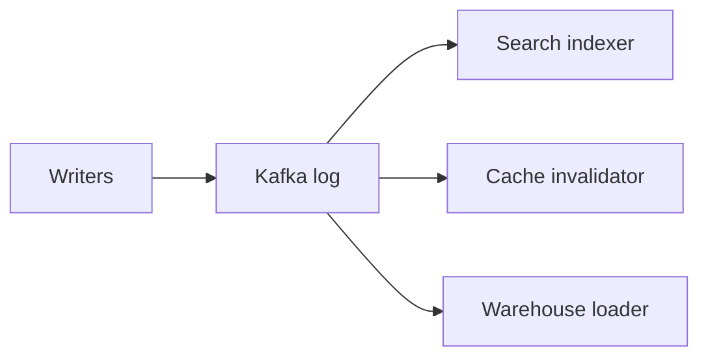
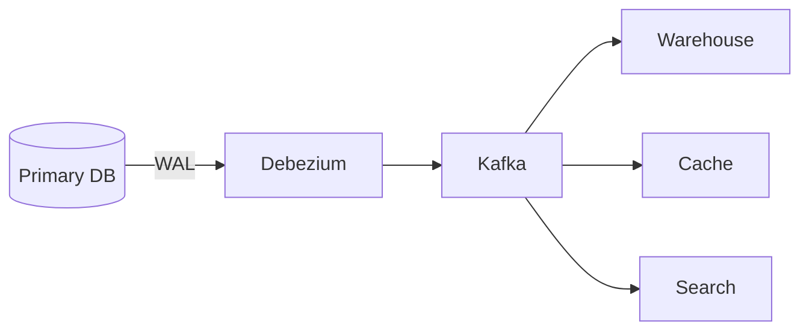
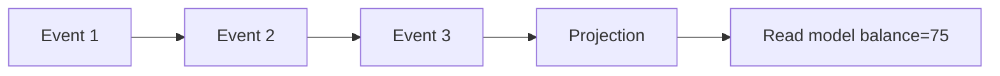
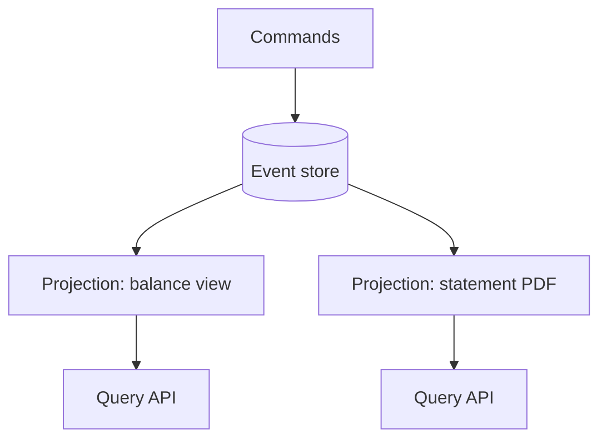
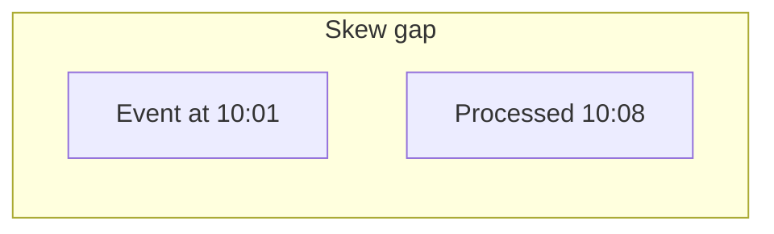
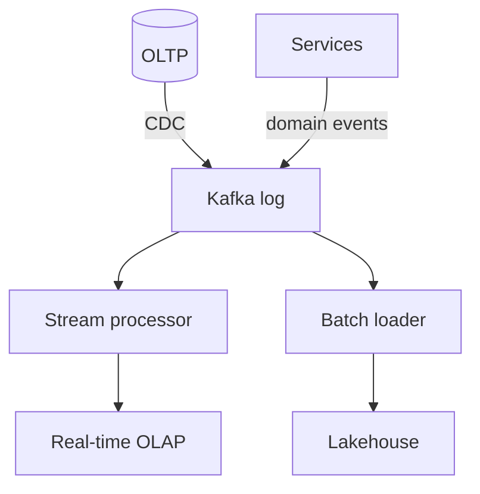
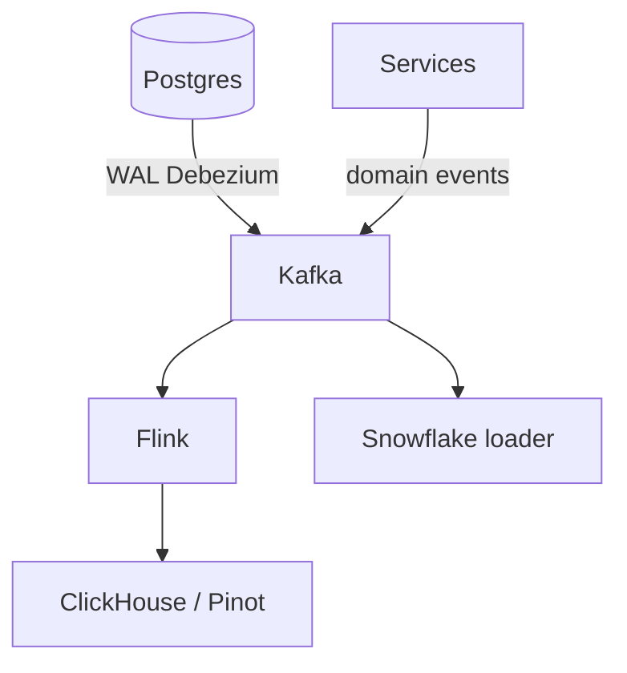
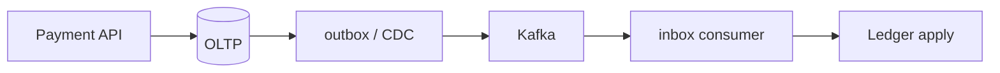

# Event Data Patterns

> The log is the backbone: Kafka for durable ordered history, CDC to escape dual-writes, event sourcing when **facts** are the truth, and stream processors for answers while data is still in flight. This guide focuses on **what breaks at 3 a.m.** Sources: Algoroq Data Engineering track (Chapters 4–7).

---

## Part 1 — Kafka & the Log

### 1.1 The log as shared order

An **append-only, offset-addressed log** is the same idea as a database WAL or Raft log—applied **between systems**:



**N×M point-to-point pipes** become **N writers + M independent readers**.

Each reader keeps its own **offset**—cheap to add consumers, rewind, replay.

### 1.2 Consistency: every reader is a lagging replica

Downstream views are **asynchronous replicas** with different lag:

| Consumer | Offset (example) |
|----------|------------------|
| Search | 10 (caught up) |
| Cache | 7 (3 behind) |
| Warehouse | 3 (7 behind) |

User sees **“paid” in search** and **“pending”** on a cache-backed page—**neither is wrong**; they are different prefixes of the same log.

**Read-your-writes fix:** Return `(partition, offset)` from write path; reader waits until consumed **past** that offset (or degrades explicitly).

> Consumers must be **pure functions of records**. Wall-clock, live API calls, or mutable DB joins → **different answer on replay**. Version external state or put it on the log.

### 1.3 Log vs queue

| | **Queue** (RabbitMQ, SQS) | **Log** (Kafka, Pulsar) |
|---|---------------------------|-------------------------|
| Message fate | **Deleted on ack** | **Retained**; cursor moves |
| History | Gone | **Replayable** |
| Consumers | Competing workers | **Consumer groups** share partitions |
| Ordering | Weak with scale | **Per-partition** order |
| Parallelism | High | **≤ partition count** |

**Head-of-line blocking:** One slow message (30s timeout) blocks **entire partition** (~20 msg/s if 50ms each)—partition count is a **throughput and isolation** knob.

### 1.4 Topics, partitions, keys

```text
topic: orders
├── partition 0  [k1, k4, k7, ...]
├── partition 1  [k2, k5, ...]
└── partition 2  [k3, k6, ...]
```

| Choice | Effect |
|--------|--------|
| **Key = order_id** | All events for one order ordered together |
| **More partitions** | More parallel consumers |
| **Hot key** | One partition overloaded |

### 1.5 Replication and ISR

- **`acks=all`** — leader waits for in-sync replicas (ISR)  
- **Does not** protect from **misconfigured producers** or **buggy consumers**  
- **Unclean leader election** risk if min ISR ignored—operational policy matters  

### 1.6 Retention and compaction

| Policy | Use |
|--------|-----|
| **Time/size retention** | Event streams, telemetry |
| **Compaction** | **Changelog** topics—keep latest record per key |

> **Compacted topic trap:** Tombstones + compaction timing can **resurrect** deleted keys if consumers only see latest value without understanding delete markers.

### 1.7 Delivery semantics

| Semantic | Meaning |
|----------|---------|
| **At-most-once** | May lose messages |
| **At-least-once** | May duplicate—need **idempotent** sinks |
| **Exactly-once** | Kafka transactions + idempotent producer + cooperative consumers—or **effectively-once** via dedup keys |

```python
# Illustrative consumer idempotency
def process(record, sink):
    if sink.seen(record.id):
        return
    sink.apply(record)
    sink.mark_seen(record.id)
```

---

## Part 2 — Change Data Capture (CDC)

### 2.1 The sync problem

**Dual-write:** `db.commit()` then `es.index()`—crash between → **lost index**. Worse: **two correct writers** can serialize differently → **permanently wrong index, no error**.

```mermaid
sequenceDiagram
  participant A as App A
  participant B as App B
  participant DB as Postgres
  participant ES as Elasticsearch
  A->>DB: price=10
  B->>DB: price=12
  B->>ES: 12
  A->>ES: 10
  Note over ES: Wrong final state; no error raised
```

**“Fixes” that move the bug:**

| Approach | Problem |
|----------|---------|
| Index first | Phantom index entries |
| Kafka inside DB txn | Events for rolled-back txns |
| Retry queue | No commit order |
| LISTEN/NOTIFY | Missed on disconnect |
| Nightly reconcile | SLA = “consistent by tomorrow” |

**Structural fix:** **One commit point**—derive everything from the DB’s WAL.

> Code review tell: network call to second system inside/after txn with log-and-continue. Ask: *“What if two requests for the same key run concurrently?”*

### 2.2 Query-based CDC vs log-based

| | **Polling `updated_at`** | **Log-based (Debezium)** |
|---|--------------------------|---------------------------|
| Deletes | Often **missed** | Captured |
| Ordering | **Stamp order ≠ commit order** | Commit order |
| Load | Repeated range scans | Reads WAL stream |
| Ops | Simpler | Replication slots, monitoring |

**Visibility vs stamp:** Row stamped 10:00:00.5 but commits 10:00:02—invisible to poll at 10:00:01 → **missed forever** with wrong HWM.

### 2.3 Debezium pattern



Watch **replication slot lag**—a stalled consumer can **fill disk on primary** and take down production.

### 2.4 Snapshot + streaming

Initial **consistent snapshot** (table scan or export) then **switch to WAL**—handoff must avoid **double apply** or **gaps**. Use signaling tables / offsets documented in connector version.

### 2.5 Schema evolution

CDC events carry **schema versions**. Consumers must handle **add column**, **widen type**, and **reject** unsafe breaks.

### 2.6 Transactional outbox

App writes **business row + outbox row** in **one DB transaction**; relay publishes outbox to Kafka.

```sql
BEGIN;
  UPDATE orders SET status = 'paid' WHERE id = $1;
  INSERT INTO outbox (aggregate_id, payload) VALUES ($1, '...');
COMMIT;
-- Separate relay process reads outbox → publishes → marks sent
```

Same commit point—no dual-write race.

---

## Part 3 — Event Sourcing & CQRS

### 3.1 Facts, not state

| State-oriented | Event-sourced |
|----------------|---------------|
| `balance = 75` (overwrite) | `WalletOpened`, `Deposited(100)`, `Withdrawn(30)`… |
| Past unknowable | `state = fold(apply, initial, events)` |



**Why choose it:** Answer questions you **did not model as columns**—intent (chargeback vs fee) not just final balance.

**Why not:** CDC + audit table gives **80%** of audit with less pain if you only care about **outcomes**.

### 3.2 CQRS

**Command side** — append events, enforce invariants  
**Query side** — **projections** optimized for reads (SQL, search, aggregates)



Writes and reads **scale independently**—at cost of **eventual consistency** between command acceptance and read model update.

### 3.3 Projections, replay, snapshots

| Mechanism | Purpose |
|-----------|---------|
| **Projection** | Materialized view from event stream |
| **Replay** | Rebuild after bug—same events, new code |
| **Snapshot** | Periodic state + replay from snapshot → faster cold start |

**Rebuild economics:** 1B events × 1ms = **11+ days** single-threaded—plan **parallel replay**, snapshots, and **retention**.

### 3.4 Versioning events

Events are a **permanent contract**. Use **upcasting** (v1→v2 in code) or explicit version fields—never silently change meaning of old types.

### 3.5 Hot streams and ordering

Per-aggregate streams avoid cross-key ordering fights; **global order** is expensive. Gaps in sequence numbers need **alerting**—may indicate lost messages.

### 3.6 Erasure and GDPR

Append-only vs **right to be forgotten**—crypto-shredding, tombstone events, compacted PII topics—design **before** legal asks.

### 3.7 When to walk away

| Signal | Prefer simpler pattern |
|--------|-------------------------|
| CRUD app, few reports | OLTP + CDC |
| Need audit only | Append-only audit log |
| Team small | Event sourcing ops burden |

---

## Part 4 — Stream Processing & Real-Time Analytics

### 4.1 Event time vs processing time



- **Event time** — when it happened (business truth)  
- **Processing time** — when job saw it (pipeline ops)  

**Reproducibility argument:** Event-time aggregates **replay the same** after bugfix or outage. Processing-time aggregates **change** when you rerun—correctness bug waiting to happen.

**Client timestamps:** Untrusted—clamp against ingest time; metric **how often** clamp fires.

### 4.2 Windows

| Window | State cost | Use |
|--------|------------|-----|
| **Tumbling** | Bounded per key | Fixed buckets (1 min) |
| **Hopping** | Overlapping state | Rolling averages |
| **Session** | Per gap timeout | User sessions |

### 4.3 Watermarks

Watermark = “we believe event time is now **≤ W**”—allows closing windows while tolerating lateness.

| Setting | Effect |
|---------|--------|
| Too aggressive | **Drop late events** |
| Too lenient | **High latency** to results |

```java
// Flink-style (illustrative)
stream
  .assignTimestampsAndWatermarks(
      WatermarkStrategy.<Event>forBoundedOutOfOrderness(Duration.ofMinutes(5))
        .withTimestampAssigner((e, ts) -> e.getEventTimeMs()))
  .keyBy(Event::getUserId)
  .window(TumblingEventTimeWindows.of(Time.minutes(1)))
  .sum("amount");
```

### 4.4 Stateful operators and checkpoints

Stateful transforms (aggregates, joins) need **durable state** + **checkpointing** to survive crashes.

**Exactly-once in Flink:** checkpoints align with Kafka offsets—on restore, rewind and replay with consistent state.

### 4.5 Stream–table join (replay hazard)

Joining stream to **mutable** DB table breaks replay. Prefer:

- **Broadcast** changelog stream (CDC) as table  
- **Temporal join** with versioned data  

### 4.6 Lambda vs Kappa

| Architecture | Idea |
|--------------|------|
| **Lambda** | Batch layer (correct) + speed layer (approx) + merge |
| **Kappa** | **One log**, reprocess for new logic |

Kappa wins when replay is cheap and logic changes often—**if** event-time processing is disciplined.

### 4.7 Serving layer: ClickHouse, Pinot, Druid

| Engine | Sweet spot |
|--------|------------|
| **ClickHouse** | Fast aggregations, SQL |
| **Pinot** | User-facing analytics at scale |
| **Druid** | Time-series OLAP, rollups |

Ingest from Kafka via connectors; tune **segment size**, **replication**, **query timeouts** for dashboards.

### 4.8 Operational alerts

| Metric | Meaning |
|--------|---------|
| **Consumer lag** | Falling behind |
| **Watermark lag** | Late data volume |
| **Checkpoint duration** | Risk of failure recovery gap |
| **Dropped late events** | Watermark too tight |

---

## End-to-end pattern map



| Pattern | Best for |
|---------|----------|
| **Kafka log** | Integrate many subscribers, replay |
| **CDC** | Sync DB truth to derivatives without dual-write |
| **Event sourcing** | Rich audit, temporal queries on **intent** |
| **Stream processing** | Low-latency aggregates with event-time correctness |

---

## Checklist

- [ ] Consumers **idempotent**; offsets committed after side effects  
- [ ] CDC **slot lag** monitored on primary  
- [ ] No dual-write without outbox or log  
- [ ] Stream jobs use **event time** + watermarks for business metrics  
- [ ] Compaction/tombstone semantics understood for changelog topics  

---

*Based on Algoroq Data Engineering chapters: Kafka & the Log, Change Data Capture, Event Sourcing & CQRS, Stream Processing & Real-Time Analytics.*

---

## Senior Pitfalls

| Mistake | Impact | Fix |
|---------|--------|-----|
| Committing Kafka offsets before side effects complete | Lost messages on crash after commit | Transactional consume-process-produce or store offsets with outcomes atomically |
| CDC slot on Postgres primary without disk/CPU headroom | Replication slot bloat freezes WAL; primary disk full | Monitor `pg_replication_slots`; dedicated replica for CDC; heartbeat and retention policy |
| Dual-write to DB and broker without outbox | Divergent state under partial failure | Transactional outbox + relay; single writer to truth |
| Stream job using processing time for session windows | Wrong aggregates after lag or replay | Event time, watermarks, allowed lateness; test with delayed events |
| Unbounded `keys()` state in Flink/Spark streaming | RocksDB OOM and checkpoint failure | TTL state, incremental aggregation, or move to batch for unbounded cardinality |
| Compacted topic treated as infinite changelog without tombstone policy | Consumers resurrect deleted keys | Document compaction lag; versioned tombstones; consumer handles nulls |

---

## Production-grade Practice

1. **Outbox relay load test:** Implement outbox for one entity; measure end-to-end lag from DB commit to consumer at 5k TPS; tune poll interval and batch size until P99 lag meets SLO.
2. **CDC lag incident:** Replay a primary CPU spike scenario; graph slot lag vs `wal_keep_size`; write runbook steps including when to pause consumers vs scale read replica.
3. **Replay safety:** Reconsume 24h of topic from offset 0 on a staging consumer group. Prove idempotency keys and dedupe store size; estimate storage for production replay window.
4. **Event-time correctness:** Inject 10% events with 30-minute skew into a sessionization job; compare processing-time vs event-time revenue metrics and fix watermark config.

---

## FAANG Interview Deep Dive

### Real-world examples

| Company | Pattern stack | Architecture choices |
|---------|--------------|----------------------|
| **Uber** | Kafka at extreme scale | **Trillions/day** messaging; partition by entity; **at-least-once** + idempotent sinks; Flink for trip aggregates; CDC from domain DBs to derivatives. |
| **Stripe** | Log + exactly-once semantics | Idempotent producers, dedup keys, ledger events; no dual-write to search from payment API—**async projection**. |
| **LinkedIn** | Kafka-native ingestion | Database changes → **Brooklin**/Kafka; consumers rebuild indexes; replay for new features—Kappa mindset on the log. |



### Interview Q&A

### Q: `acks=all`—what failures remain?
**A:** Producer retries can **duplicate** without idempotence; consumer crash after process before commit → **reprocess**; **buggy** serialization still “consistent.” EOS needs idempotent producer + transactions or **inbox dedup**.

### Q: Hot partition on `country=US` key—fix?
**A:** Change key to **`order_id`**; salt US into `US-0…US-15` with downstream merge; increase partitions; separate **topic** for bulk vs interactive traffic.

### Q: CDC replication slot lag—why is it a production killer?
**A:** Slot prevents WAL recycle; lag **100 GB** → **disk full** on primary → **outage**. Page on **oldest_slot_lag_bytes**; kill or fix stalled consumer before DB dies.

### Q: Event-time watermarks for revenue metrics?
**A:** **Tumbling event-time windows** + **5–15 min** lateness; metric late drops; never use `now()` in Flink aggregate for money. Stripe-class interviews expect **replay gives same answer**.

### Q: Compacted topic gotcha with deletes?
**A:** Tombstone + compaction delay → consumer starting at `latest` may **miss delete**; use **retention + compaction** policy aligned with consumer offset strategy.

### Common mistakes candidates make

- Committing Kafka offset **before** side effect durable.
- Joining stream to **mutable JDBC** table in Flink replay path.
- **Polling CDC** with `updated_at` for financial facts.
- **Global ordering** expectation across partitions.
- Compacted changelog without understanding **tombstone retention**.

### Scale numbers

| Dimension | Illustrative targets |
|-----------|---------------------|
| Throughput | **1–5 MB/s per partition** sustained; cluster **millions msg/s** |
| Partitions | **3k–12k** for large topics; consumers **≤ partitions** |
| Consumer lag | Online **<30 s** p99; warehouse **<15 min** |
| Retention | Events **7–30 d**; compacted changelog **infinite** with tombstone policy |
| CDC lag alert | **<10 GB** WAL behind; page at **50 GB** |
| Storage cost | Kafka **~$0.10–0.25/GB-mo** cloud managed; 7d × 100 TB = **$$$**—tier to S3 |

```python
# Read-your-writes after produce (interview pattern)
meta = producer.send(topic, key=k, value=v).get()
# API returns partition, offset; UI polls until consumer_offset > meta.offset
```

### End-to-end delivery stack (Stripe mental model)



| Hop | Guarantee |
|-----|-----------|
| API → DB | ACID |
| DB → Kafka | At-least-once |
| Kafka → consumer | At-least-once |
| Inbox + ledger | **Effectively once** |

### Additional interview Q&A

### Q: When to use log compaction vs retention?
**A:** **Compaction** for `user_id → latest profile` changelog; **retention** for immutable `OrderPlaced` history. Wrong choice → either unbounded growth or **lost history**.

### Q: Flink exactly-once into JDBC sink?
**A:** Prefer **idempotent upsert** + inbox; JDBC EOS is fragile. Interview answer: **align checkpoint with Kafka offset** inside Flink, sink uses **primary key dedup**.

### Uber Kafka scale reference table

| Metric | Order of magnitude (public sources) |
|--------|--------------------------------------|
| Messages/day | **Trillions** (fleet-wide) |
| Clusters | Multi-region, dedicated ops |
| Topics | Domain-separated; no single mega-topic |
| Lesson | **Partition design** is the interview—not broker brand |

### Stream processing SLAs

| Pipeline | Lag target | Engine |
|----------|------------|--------|
| Fraud score | **<500 ms** | Flink |
| Warehouse load | **<15 min** | Spark streaming / batch micro-batch |
| Search index | **<1 min** | Custom consumers |

### Checklist for staff loop

- [ ] Producer: `enable.idempotence=true`  
- [ ] Consumer: commit **after** side effect  
- [ ] CDC: slot lag alert  
- [ ] Stream: **event-time** for business KPIs  
