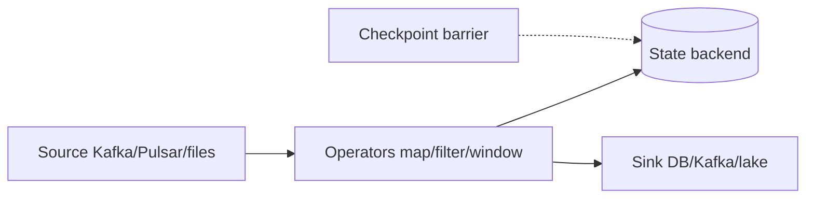

# Apache Flink — Detailed Guide

> **One sentence:** Flink is a **true streaming engine**—it treats **every event as it arrives** (or in small bursts) and keeps **state** in memory/RocksDB so you can do windows, joins, and aggregations **continuously**, not only in nightly batches.

---

## Concepts

### Batch vs stream (Flink’s worldview)

Flink says: **batch is a special case of stream** (finite stream). One API (`DataStream`) can do both:

| Mode | Mental model |
|------|----------------|
| **Streaming** | Unbounded events, low latency |
| **Batch** | Bounded source, high throughput |

Spark Structured Streaming is often **micro-batch**; Flink’s default pipeline is **event-at-a-time** (with checkpoint barriers).

### When Flink wins

- **Sub-second** aggregations (fraud, rate limits, live dashboards).
- **Complex event processing** — patterns over time.
- **Stateful** joins (stream ↔ stream, stream ↔ table).
- **Exactly-once** pipelines with **checkpointing** to Kafka, DB, or lake.

When **minutes** latency is fine, **Spark batch** or **warehouse SQL** is simpler and cheaper.

### Building blocks



- **Source** — with **offsets** stored in checkpoints.
- **Operator** — transforms; can be **parallel** (subtasks).
- **State** — keyed state per key (e.g. per `user_id`).
- **Sink** — often **two-phase commit** for exactly-once.

---

## Deep dive

### Event time vs processing time

| Time type | Definition | Risk |
|-----------|------------|------|
| **Processing time** | Wall clock on worker | Reorder on replay; wrong on lag |
| **Event time** | Timestamp **in the record** | Needs **watermarks** |
| **Ingestion time** | When source read it | Middle ground |

**Production analytics** almost always wants **event time** for correct totals.

### Watermarks

Watermark at time `T` means: “I believe no more events with timestamp &lt; T will arrive.”

- Watermark **too aggressive** → drop **late** data incorrectly.
- **Too slow** → windows close late → higher latency.

```text
Events:  ----e1----e2--------e3--(late e2')----
WM:      --------W1-----W2-----------W3--------
Window:  [   W1 closed   ][  W2  ]
```

### Windows

| Window | Use |
|--------|-----|
| **Tumbling** | Fixed buckets, no overlap (5-min counts) |
| **Sliding** | Overlapping (last 1h updated every 1m) |
| **Session** | Gap-based (user session ends after 30m idle) |
| **Global** | One window for everything (rare) |

**Triggers** decide when to emit; **allowed lateness** can update closed windows briefly.

### State backends

| Backend | Pros | Cons |
|---------|------|------|
| **HashMap** (heap) | Fast | Limited by RAM |
| **RocksDB** | Large state on disk | Serialization cost |
| **Forst** (newer) | Cloud-native direction | Ecosystem maturing |

Keyed state is **partitioned** with key → same subtask always handles that key (like Kafka partition affinity).

### Checkpointing & savepoints

- **Checkpoint** — automatic, periodic, **fault tolerance**.
- **Savepoint** — manual, **upgrade** / migrate job version.

On failure, Flink restores state + rewinds sources to checkpoint offsets → **exactly-once** within the pipeline (sink must participate).

---

## Advanced

### Stream-stream joins

Join two Kafka topics on key + **time bounds** (“orders within 1h of clicks”). State stores unmatched rows until window expires—**memory** grows with out-of-order skew.

### Stream-table (dynamic table) join

**CDC table** in Flink SQL as **versioned table**; stream events probe latest row—pattern for **enrichment** without dual cache.

### CEP (Complex Event Processing)

Detect sequences: “login fail × 3 within 5m then success from new country.” Powerful; **hard to test**—invest in simulators.

### Backpressure

Slow sink → operators buffer → **backpressure** propagates to source (Kafka consumer pauses). **Healthy** unless chronic—then scale sink or optimize operator.

### Flink SQL

SQL layer over streams and tables—**production teams use it heavily** for joins/windows without Java boilerplate.

---

## High scale

### Parallelism

- **Global parallelism** = max concurrent subtasks.
- Source/sink **parallelism** must align with Kafka **partitions**.
- **Rescale** vs **rebalance** — keyBy keeps key locality; rebalance spreads everything (breaks keyed state).

### Key skew

Same as Spark/Kafka: one hot key → one subtask at 100% CPU.

Mitigations: **custom key selector** with salt, **two-phase aggregation**, **async I/O** for external enrich (don’t block event loop).

### Large state

- TTL on state (drop inactive keys).
- **Incremental checkpoints** (RocksDB).
- Monitor **checkpoint duration** &gt; interval → cascading failure risk.

### Multi-region

Active-active streaming is **hard**; often **single active** writer per sink partition + **failover** with savepoint, or **merge** in downstream batch.

---

## FAANG insights

1. **Lambda vs Kappa** — Many orgs run **Flink for real-time** + **Spark/dbt for batch truth**; reconciliation jobs compare counts daily.
2. **“Streaming SQL” owners** — Platform team maintains connectors, checkpoint storage (S3/HDFS), and **Flink K8s operator**; product teams ship SQL JARs.
3. **Testing** — **Event time test harness** with controllable watermarks beats only integration tests.
4. **SLA honesty** — p99 **end-to-end latency** includes **source lag** and **sink commit**—not just Flink internal metrics.
5. **Idempotent sinks** — Even with exactly-once, **external systems** (HTTP, some DBs) need **upsert keys**.

**vs Spark Streaming:** Flink lower latency, richer native streaming state; Spark better if team already standardized on Spark batch and accepts seconds latency.

**Interview angles:**

- Event time vs processing time?
- What is a watermark?
- How does exactly-once checkpointing work?
- What breaks with hot keys?

**Lab:** [stream-window-lab](../../mini-projects/stream-window-lab/) — tumbling windows, watermarks, late events.

**Related:** [kafka/detailed.md](../kafka/detailed.md), [event-data-patterns.md](../event-data-patterns.md).
