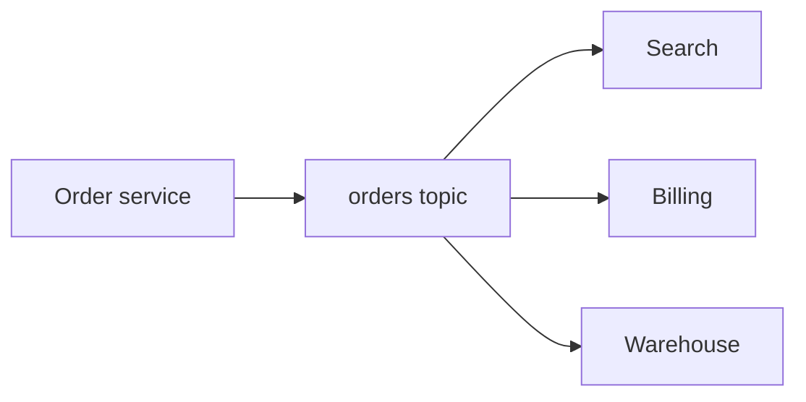

# Kafka — Detailed Guide

> **One sentence:** Kafka is a **durable, ordered log** that many apps can read at their own speed—like a shared timeline of facts, not a mailbox that deletes mail after one person reads it.

---

## Concepts (start here)

### What problem does Kafka solve?

Before Kafka, if **Search**, **Billing**, and **Analytics** all needed **Order** updates, you built **3 integrations** from the Order service. Add a fourth consumer → another integration. This is the **N×M integration nightmare**.

Kafka flips the model:

Writers append events. Readers **subscribe** and keep a **cursor** (offset). New readers can **replay history** from the beginning (within retention).

### Core vocabulary

| Term | Plain English |
|------|----------------|
| **Topic** | Named stream of events (e.g. `orders.created`) |
| **Partition** | Shard of the topic; **order is guaranteed only inside one partition** |
| **Offset** | Position in the partition log (0, 1, 2, …) |
| **Broker** | Server that stores partitions |
| **Producer** | Writes records with a **key** (optional) → decides partition |
| **Consumer group** | Team of consumers that **split partitions** among themselves |
| **Replication** | Each partition copied to multiple brokers for durability |

### Log vs queue (why interviews ask this)

| | **Queue** (SQS, Rabbit) | **Log** (Kafka) |
|---|-------------------------|-----------------|
| After read | Message often **gone** | Message **stays**; you move offset |
| Replay | Hard | **First-class** |
| Scale reads | Many competing workers | **Consumer groups** + partition count |

Use a **queue** when you want **work distribution** and don’t care about history. Use a **log** when **many systems** need the same facts, or you need **audit / replay**.

### Keys and ordering

- **Same key → same partition** → strict order for that key (e.g. all events for `user_id=42`).
- **No key** → round-robin across partitions → high throughput, **no per-entity order**.

---

## Deep dive

### Write path (producer)

1. Producer picks partition (key hash or sticky batching).
2. Record goes to **leader** replica of that partition.
3. Followers replicate; producer acks depend on `acks` setting:
   - `acks=0` — fire and forget (fast, risky).
   - `acks=1` — leader wrote (middle ground).
   - `acks=all` — all in-sync replicas (safest default for money paths).

**Idempotent producer** (enable once): Kafka assigns **sequence numbers** per partition so retries don’t create duplicates on the broker side.

### Read path (consumer)

Consumers poll batches. They **commit offsets** (auto or manual):

- **Auto-commit** — easy, can **lose** or **double-process** on crash.
- **Manual commit after side effects** — classic **at-least-once** if you commit **after** DB write.

**Exactly-once** (Kafka Streams / transactional consume-produce): transactions tie offset commit to output writes—powerful, heavier ops burden.

### Consumer groups

- One partition → **at most one consumer in the group** actively reading it.
- If consumers > partitions, extras sit idle.
- If consumers < partitions, one consumer handles multiple partitions.

**Rebalance** happens when members join/leave—during rebalance, processing pauses; design for **idempotent** handlers.

### Retention and compaction

- **Time/size retention** — old data deleted (default behavior).
- **Log compaction** — keep **latest record per key** (great for **changelog** topics like `user-profile`).

---

## Advanced

### Delivery semantics (memorize this triangle)

| Semantics | Meaning | Typical pattern |
|-----------|---------|-----------------|
| **At-most-once** | May lose messages | Commit offset **before** processing |
| **At-least-once** | May duplicate | Process, then commit; **idempotent** sink |
| **Exactly-once** | No dup/loss (within system) | Transactions + idempotent sinks |

In practice, **at-least-once + idempotent consumer** is the industry default outside Kafka Streams.

### Poison messages & DLQ

Bad JSON or business rule failure on one record shouldn’t block the partition forever:

1. Retry with cap + exponential backoff.
2. Route to **dead-letter topic (DLQ)** with original payload + error metadata.
3. Alert on DLQ growth; replay after fix.

### Schema evolution

Use **Schema Registry** (Avro/Protobuf/JSON Schema) so producers and consumers agree on fields. Rules:

- Prefer **additive** changes (new optional fields).
- Avoid renaming/removing without dual-write migration.

### CDC (Change Data Capture)

Database **binlog** → Kafka → warehouse/search. Avoids **dual write** (update DB + publish event separately). Tools: Debezium, Maxwell, native DB streams.

---

## High scale

### Partition count is your parallelism knob

- Max useful consumers in one group ≈ **partition count**.
- Too **few** partitions → bottleneck.
- Too **many** → more file handles, longer rebalances, metadata overhead.

**Rule of thumb:** start with `(expected_peak_throughput_MB/s / per_partition_throughput)` and revisit after load tests—not “10,000 partitions because we can.”

### Hot partitions (skew)

If partition key is `country` and 80% traffic is `US`, one partition burns while others idle.

**Fixes:**

- **Salted key**: `hash(user_id + salt)` for write spread, accept reordering cost.
- **Two-phase**: hot key → internal queue → re-partition by sub-key.
- **Custom partitioner** for known hot keys.

### Cross-datacenter

**MirrorMaker / cluster linking** replicates topics between regions. Consumers see **lag**; design for **active-active** carefully (conflict resolution, idempotency).

### Operational SLOs

| Metric | Why it matters |
|--------|----------------|
| **Consumer lag** | How far behind real time |
| **Under-replicated partitions** | Durability risk |
| **Request latency p99** | Producer/consumer pain |
| **Broker disk** | Retention × throughput |

---

## FAANG insights

What strong data/platform teams emphasize:

1. **The log is the integration point** — product DB is not the fan-out hub; **events** are. (Amazon’s early service SOA, LinkedIn’s Kafka origin story.)
2. **Consumers are lagging replicas** — UX that needs **read-your-writes** must pass **offset** or use **OLTP**, not “hope warehouse is fresh.”
3. **Pure functions of the log** — replay must reproduce state; no hidden `now()` or live API calls inside the processor without versioning.
4. **Ownership** — each consumer group has an **on-call owner**, lag alerts, and **replay runbooks**.
5. **Cost** — retention is a **budget line**; compacted changelog vs full history is a product decision.

**Interview prompts you should answer:**

- Why not use RabbitMQ for analytics fan-out?
- How do you get order per user?
- What happens on consumer crash after processing but before commit?
- How would you reprocess last 7 days safely?

**Lab:** [kafka-log-lab](../../mini-projects/kafka-log-lab/) — partitions, groups, idempotent handler.

**Related:** [event-data-patterns.md](../event-data-patterns.md), [transaction-outbox-lab](../../mini-projects/transaction-outbox-lab/).
