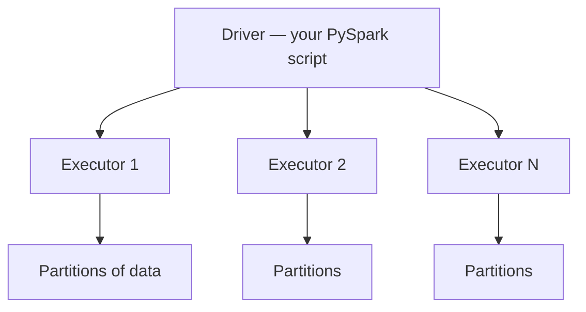

# Apache Spark & PySpark — Detailed Guide

> **One sentence:** Spark is a **distributed engine** that runs your data job in **parallel chunks** across a cluster, with a **lazy plan** it optimizes before doing the expensive work (especially **shuffles**).

---

## Concepts

### When to use Spark

| Good fit | Poor fit |
|----------|----------|
| TB-scale **batch** transforms | Single-row OLTP |
| ETL on data lake / warehouse exports | Low-latency **millisecond** APIs |
| ML feature prep at scale | Tiny tables (&lt; few GB) on laptop—use SQL/duckdb |

Spark does **not** replace your database. It **processes files and tables** in bulk.

### The cluster picture



- **Driver** — builds the job plan, coordinates.
- **Executor** — JVM worker holding **memory + CPU** for tasks.
- **Partition** — slice of data (e.g. one Parquet file block); **one task** processes one partition at a time per slot.

### PySpark specifically

Your Python code talks to the **JVM** via Py4J. **UDFs** (user-defined functions) in Python are **slow**—prefer **Spark SQL** / built-in expressions so work stays in the JVM.

```python
# Prefer (columnar, optimized)
df.groupBy("country").agg(F.sum("amount"))

# Avoid hot path
df.rdd.map(lambda row: heavy_python(row))  # serializes rows to Python
```

### Lazy evaluation

Transformations (`filter`, `join`, `groupBy`) build a **DAG**. Nothing runs until an **action** (`count`, `write`, `collect`).

**Why it matters:** Spark can **fuse** steps, **push filters** to files, and **skip** unused columns.

---

## Deep dive

### Narrow vs wide transformations

| Type | Moves data between machines? | Examples |
|------|------------------------------|----------|
| **Narrow** | No (map within partition) | `filter`, `select`, `map` |
| **Wide** | **Yes — shuffle** | `groupBy`, `join`, `repartition`, `distinct` |

**Shuffle** = all-to-all network + disk spill. It dominates cost at scale.

### Stages and tasks

Spark cuts the DAG at **shuffle boundaries** → **stages**. Each partition in a stage = **task**.

Slow job? Check UI:

- One task taking 10× longer → **skew**.
- Huge shuffle read → too many keys or wide rows.

### Spark SQL & Catalyst

`spark.sql("...")` and DataFrame API share the **Catalyst optimizer**:

- Predicate pushdown to Parquet/ORC.
- Column pruning.
- Join reordering (with stats).

**Always** prefer DataFrame/SQL over raw RDD for new code.

### File formats

| Format | Use |
|--------|-----|
| **Parquet** | Default columnar for lake |
| **ORC** | Hive ecosystems |
| **JSON/CSV** | Ingest only; convert for analytics |
| **Delta/Iceberg** | Table ACID + time travel (see lakehouse guide) |

### Caching

`df.cache()` / `persist()` keeps partitions in memory (or disk) **after first action**. Use when the same DataFrame is reused in a loop—not “cache everything.”

---

## Advanced

### Join strategies

- **Broadcast hash join** — small table fits in memory → sent to all executors. `broadcast(small_df)`.
- **Sort-merge join** — large-large; needs shuffle both sides.
- **Skew join** (Spark 3+) — split hot keys automatically (config + hints).

### Handling skew manually

1. **Salting** — duplicate hot key with random salt 0..N-1, join, aggregate back.
2. **Isolate hot keys** — separate branch for top 10 keys.
3. **AQE** (Adaptive Query Execution) — runtime shuffle partition coalescing, skew handling—**enable** on modern Spark.

### UDF vs pandas UDF (vectorized)

- **Python UDF** — row-by-row, slow.
- **Pandas UDF (scalar/grouped/map)** — Arrow batches, much better for ML-ish transforms.

### Structured Streaming (micro-batch)

Spark Streaming is **micro-batch** (default) or **continuous** (niche). Treat it as **near real-time batch** (seconds), not Flink-class millisecond stateful streaming.

Watermark + `groupBy` window for lateness—similar mental model to Flink but **latency floor** is higher.

### Resource tuning (production)

| Knob | Intuition |
|------|-----------|
| `spark.executor.memory` | Heap per executor |
| `spark.sql.shuffle.partitions` | Default 200—often **wrong** for your data; tune |
| `spark.speculation` | Retry straggler tasks |
| Dynamic allocation | Scale executors with load (K8s/YARN) |

---

## High scale

### Partition count vs `shuffle.partitions`

Input files might be 10,000 partitions; shuffle might collapse to 200. **Mismatch** causes tiny tasks or huge ones.

**Target:** ~100–500 MB per task after shuffle (ballpark—measure).

### Driver OOM traps

- `collect()` on big DataFrame → **driver memory explosion**.
- `toPandas()` on billions of rows → same.
- Huge broadcast → driver/executor OOM.

Use `write` to lake, or aggregate first.

### FAANG-scale patterns

- **Medallion** bronze/silver/gold tables (see ETL guide).
- **Partition columns** (`dt=2026-10-26`) for prune.
- **Z-order / sort** on Delta for file skipping.
- **Separate** interactive BI (warehouse) from **heavy** Spark (scheduled jobs).

### Cost on cloud

You pay for **vCPU-hours + shuffle egress + storage**. Optimizing shuffle often beats “add 2× nodes.”

---

## FAANG insights

1. **Spark is the hammer, not the architecture** — orchestration (Airflow), metadata (Hive/Glue), table format (Iceberg), and **SLAs** matter as much as the job code.
2. **Python at the edges, SQL in the middle** — PySpark for glue; **business logic in SQL** or Scala for hot paths.
3. **Data quality gates** — jobs fail if row counts drop 40% vs yesterday (anomaly), not only on exceptions.
4. **Lineage** — column-level lineage for GDPR deletes and debugging “why is this metric wrong?”
5. **Test on samples** — unit tests on local `spark.session` with tiny fixtures; integration tests on staging lake partition.

**Interview angles:**

- Explain shuffle. How reduce `groupBy` cost?
- Narrow vs wide?
- Why is `collect()` dangerous?
- Broadcast join prerequisites?

**Lab:** [spark-batch-lab](../../mini-projects/spark-batch-lab/) — DAG, shuffle simulation, skew salt.

**Related:** [data-engineering-fundamentals.md](../data-engineering-fundamentals.md), [lakehouse/detailed.md](../lakehouse/detailed.md).
