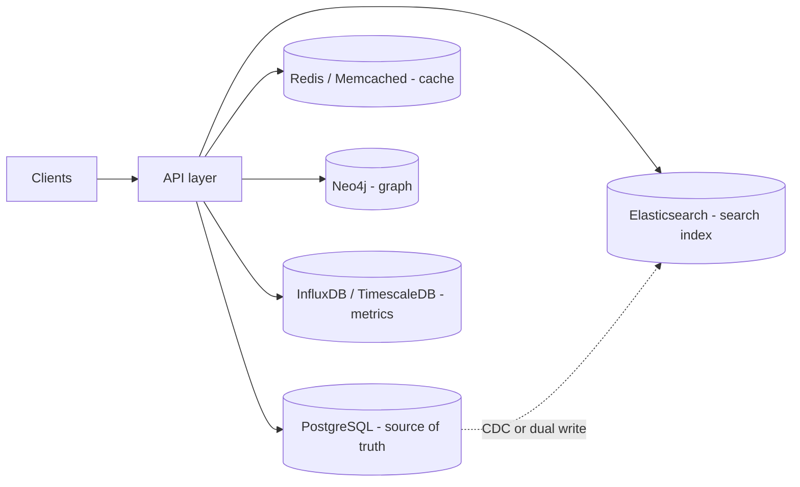
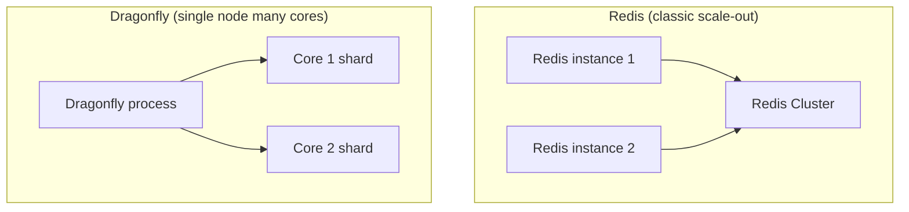
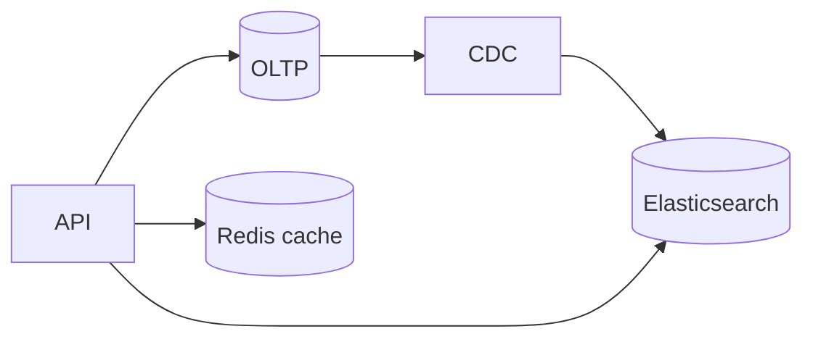

# Cache, Search, Graph & Time-Series Compared

This guide compares **Redis**, **Memcached**, **Dragonfly**, **Elasticsearch**, **Apache Solr**, **Neo4j**, **PostgreSQL** (for search/graph contrast), **InfluxDB**, and **TimescaleDB**—specialized layers that sit beside your primary database.

> **Key insight:** These tools are usually **not** your system of record. They optimize one job—speed (cache), relevance (search), traversal (graph), or time-ordered data (metrics)—and you accept extra sync complexity or dual writes.

---

## Role in a Typical Architecture



| Layer | Primary question it answers |
|-------|----------------------------|
| Cache | “Can I serve this in sub-ms without hitting the DB?” |
| Search | “Find relevant text across millions of docs?” |
| Graph | “Walk relationships many hops deep fast?” |
| Time-series | “Ingest and query metrics/events by time?” |

---

## In-Memory Cache: Redis vs Memcached vs Dragonfly

### Redis

Single-threaded command loop (plus I/O threads in recent versions). **Rich types:** strings, hashes, lists, sets, sorted sets, streams, bitmaps, HyperLogLog. Optional **RDB/AOF** persistence. **Redis Cluster** for sharding/failover.

**Used by:** Twitter (timelines), GitHub (queues), Pinterest (analytics).

### Memcached

Multi-threaded, **string-only** values (default 1 MB). Pure cache—restart = cold cache. **Client-side consistent hashing** for distribution.

**Used by:** Facebook-scale caching, Wikipedia.

### Dragonfly

Redis-compatible, **multi-threaded shared-nothing** per core; high throughput on large machines; **non-blocking snapshots** (no fork memory spike). Fewer modules/ecosystem than Redis.

**Used by:** Teams replacing large Redis Cluster footprints.



### Cache comparison table

| Feature | Memcached | Redis | Dragonfly |
|---------|-----------|-------|-----------|
| Threading | Multi-threaded | Mostly single-threaded | Multi-threaded |
| Data structures | Strings only | Many | Redis-compatible |
| Persistence | No | RDB / AOF | Yes (non-blocking snap) |
| Clustering | Client-side hash | Redis Cluster | Often single beefy node |
| Leaderboards / queues | No | Sorted sets, streams | Compatible |
| Memory efficiency (uniform values) | Slab allocator | Higher per-key overhead | ~30% less than Redis (claimed) |
| Ecosystem | Mature | **Largest** | Growing |

### Cache code examples

```python
# Redis - cache-aside + TTL
import redis
r = redis.Redis(host="localhost", port=6379, decode_responses=True)

def get_user(user_id: str):
    key = f"user:{user_id}"
    cached = r.get(key)
    if cached:
        return cached
    user = load_from_postgres(user_id)
    r.setex(key, 300, user)  # 5 min TTL
    return user
```

```python
# Redis - leaderboard (sorted set)
r.zadd("leaderboard", {"player_a": 1200, "player_b": 980})
top10 = r.zrevrange("leaderboard", 0, 9, withscores=True)
```

```python
# Memcached - simple get/set
from pymemcache.client.base import Client
client = Client(("localhost", 11211))
client.set("session:abc", session_blob, expire=3600)
```

```bash
# Dragonfly - often drop-in Redis CLI
redis-cli -p 6379 SET cache:key "value" EX 60
```

---

## Search: Elasticsearch vs Solr vs PostgreSQL

### Elasticsearch

Distributed from day one; **Lucene** inverted indexes; BM25, fuzzy search, nested aggregations; default ~1s NRT refresh. **ELK** stack for logs/observability. License: SSPL / Elastic License (OpenSearch fork on AWS).

### Solr

Also **Lucene**; **SolrCloud** uses ZooKeeper; more manual control. Strong search; aggregations less flexible than Elasticsearch for nested analytics. **Apache 2.0** license.

### PostgreSQL full-text search

`tsvector` / `tsquery` + **GIN** indexes—no extra cluster. Good for moderate corpora and SQL consistency.

> **Interview pattern:** PostgreSQL = source of truth; Elasticsearch = search index via **CDC** or application dual writes—with eventual consistency lag.

### Search comparison table

| Feature | PostgreSQL FTS | Solr | Elasticsearch |
|---------|----------------|------|-----------------|
| Setup complexity | Lowest | Medium | Medium–high |
| Relevance / fuzzy @ scale | Moderate | Strong | **Strongest** |
| Nested analytics | SQL | Faceting | **Aggregations** |
| Ops | With Postgres | Cluster + ZK | Cluster |
| Licensing | Open | Apache 2.0 | SSPL / Elastic |
| Log analytics stack | DIY | DIY | **ELK native** |

### Search code examples

```sql
-- PostgreSQL full-text search
ALTER TABLE articles ADD COLUMN search_vector tsvector
  GENERATED ALWAYS AS (to_tsvector('english', coalesce(title,'') || ' ' || coalesce(body,''))) STORED;

CREATE INDEX articles_search_idx ON articles USING GIN (search_vector);

SELECT id, title
FROM articles
WHERE search_vector @@ to_tsquery('english', 'database & design')
ORDER BY ts_rank(search_vector, to_tsquery('english', 'database & design')) DESC
LIMIT 20;
```

```json
// Elasticsearch - index + match query (REST)
PUT /articles/_doc/1
{ "title": "System design", "body": "cache invalidation patterns" }

GET /articles/_search
{
  "query": {
    "multi_match": {
      "query": "cache design",
      "fields": ["title^2", "body"]
    }
  }
}
```

---

## Graph: Neo4j vs PostgreSQL

### Neo4j

**Index-free adjacency**—neighbors are pointer hops. **Cypher** queries; Graph Data Science (PageRank, communities, shortest path).

### PostgreSQL

Relationships as foreign keys; **recursive CTEs** for traversals—each hop ≈ more join work.

| Query type | Neo4j | PostgreSQL |
|------------|-------|------------|
| Deep traversal (6+ hops) | Milliseconds | Seconds / timeout risk |
| Filter by attributes | Good | **Often better** |
| Ops | Second database typical | One database |

### Graph code examples

```cypher
// Neo4j - friends of friends
MATCH (u:User {id: $userId})-[:FOLLOWS*1..3]->(fof:User)
WHERE u <> fof
RETURN DISTINCT fof.id, fof.name
LIMIT 50;
```

```sql
-- PostgreSQL - recursive CTE (shallow graphs OK)
WITH RECURSIVE reach AS (
  SELECT follower_id, followee_id, 1 AS depth
  FROM follows WHERE follower_id = $userId
  UNION ALL
  SELECT r.follower_id, f.followee_id, r.depth + 1
  FROM reach r
  JOIN follows f ON r.followee_id = f.follower_id
  WHERE r.depth < 3
)
SELECT DISTINCT followee_id FROM reach;
```

**Neo4j at:** eBay recommendations, NASA knowledge graphs, Walmart supply chain.

---

## Time-Series: InfluxDB vs TimescaleDB

### InfluxDB 3.x

Purpose-built TSDB; columnar **Arrow / Parquet** storage; line protocol ingestion; optimized for high-cardinality writes and time-range scans.

### TimescaleDB

**PostgreSQL extension**—**hypertables** chunk by time; full SQL + joins to relational tables; strong compression (up to ~90–95%).

| Feature | InfluxDB | TimescaleDB |
|---------|----------|-------------|
| Query language | SQL (3.0 direction; Flux/InfluxQL history) | **Standard SQL** |
| Joins with relational data | External / denormalize | **Native JOIN** |
| Ingestion focus | **Very high** | High with PG tuning |
| Ops familiarity | TS-specific | **Postgres ops** |

### Time-series code examples

```python
# InfluxDB line protocol (conceptual)
# measurement,tag=value field=value timestamp
"""
sensor_readings,device=thermo-1 temperature=22.5,humidity=41 1710000000000000000
"""
```

```sql
-- TimescaleDB hypertable
CREATE TABLE metrics (
  time        TIMESTAMPTZ NOT NULL,
  device_id   TEXT NOT NULL,
  temperature DOUBLE PRECISION
);

SELECT create_hypertable('metrics', 'time');

SELECT time_bucket('5 minutes', time) AS bucket, avg(temperature)
FROM metrics
WHERE device_id = 'thermo-1' AND time > now() - interval '24 hours'
GROUP BY bucket
ORDER BY bucket;
```

---

## Cross-Category Performance Summary

| Tool | Latency profile | Throughput | Best fit |
|------|-----------------|------------|----------|
| Memcached | Sub-ms simple GET/SET | Very high simple ops | Pure cache, uniform values |
| Redis | Sub-ms + server-side logic | High; cluster for scale | Cache, queues, leaderboards, streams |
| Dragonfly | Sub-ms at high core count | Very high per node | Redis replacement on big iron |
| Elasticsearch | Search ms–s | High parallel query | Search + log analytics |
| Solr | Similar Lucene | High | Apache-licensed search |
| Neo4j | Ms traversals | Graph-bound | Social, fraud, knowledge graphs |
| InfluxDB | Optimized writes | High ingest | Metrics / IoT pure TS |
| TimescaleDB | PG range queries | High with chunks | Metrics + relational metadata |

---

## Decision Matrix (1 = poor fit, 5 = excellent)

| Criterion | Memcached | Redis | Dragonfly | ES | Solr | Neo4j | InfluxDB | TimescaleDB |
|-----------|:---------:|:-----:|:---------:|:--:|:----:|:-----:|:--------:|:-----------:|
| Simple cache | 5 | 5 | 5 | 1 | 1 | 1 | 1 | 1 |
| Data structures / queues | 1 | 5 | 4 | 1 | 1 | 1 | 1 | 1 |
| Full-text @ huge scale | 1 | 2 | 2 | 5 | 4 | 1 | 1 | 2 |
| Multi-hop relationships | 1 | 1 | 1 | 2 | 1 | 5 | 1 | 2 |
| Metrics ingest | 1 | 3 | 3 | 3 | 1 | 1 | 5 | 4 |
| SQL joins with OLTP | 1 | 1 | 1 | 1 | 1 | 2 | 1 | 5 |

---

## When to Use What

| Choose | When |
|--------|------|
| **Memcached** | Largest simple cache, multi-threaded GET/SET, no persistence needed |
| **Redis** | Cache plus structures (sorted sets, streams), persistence, pub/sub, mature managed offerings |
| **Dragonfly** | Redis API but need more cores/RAM per box and simpler cluster footprint |
| **PostgreSQL FTS** | Moderate search, want one database, avoid sync lag |
| **Elasticsearch** | Heavy search/relevance, nested aggs, ELK observability |
| **Solr** | Lucene search with Apache license and fine-grained control |
| **Neo4j** | Relationship traversal is the product (recommendations, fraud, knowledge graph) |
| **InfluxDB** | Dedicated metrics/IoT pipeline, columnar TS optimization |
| **TimescaleDB** | Time-series **and** relational data in one SQL database |

---

*Sources: Algoroq comparisons for Redis/Memcached/Dragonfly, Elasticsearch/PostgreSQL/Solr, Neo4j/PostgreSQL, and InfluxDB/TimescaleDB.*

---

## Senior Pitfalls

| Mistake | Impact | Fix |
|---------|--------|-----|
| Using Redis as the only source of truth without AOF/RDB and failover drills | Silent data loss on node crash; cache warm-up storm on restart | Define TTL + rebuild path; enable persistence or accept loss; rehearse failover with realistic key cardinality |
| `KEYS *` or unbounded `SCAN` in production | Redis blocks the event loop; P99 spikes cluster-wide | Namespace keys; maintain indexes in structures (sets/hash); never pattern-scan hot instances |
| Elasticsearch with default 5 shards per index on small daily logs | Shard explosion, heap pressure, slow cluster state updates | Target 20–50 GB/shard; use ILM rollover; shrink shard count at index creation |
| Full-text in PostgreSQL without `GIN` maintenance plan | Bloat and vacuum IO crush OLTP during peak | Partial indexes, `autovacuum` tuning, or offload heavy search to a dedicated engine |
| Memcached for session storage without sticky sessions or external store | Random logouts when a node evicts or dies | Sticky LB + replication layer, or move sessions to Redis with explicit TTL |
| Neo4j traversals without relationship index / degree limits | Supernode queries time out and pin heap | Model hot paths with constraints; cap depth; precompute aggregates for celebrity nodes |

---

## Production-grade Practice

1. **Cache stampede drill:** Model a 10M-key catalog with 95% hit rate; simulate TTL expiry aligned to the minute. Measure DB QPS and P99 with and without singleflight/probabilistic early refresh; document the break-even TTL jitter.
2. **Search relevance bake-off:** Index the same 500k documents in PostgreSQL FTS and Elasticsearch. Compare query latency (p50/p99), recall@10 on a labeled set, and reindex time during a schema change—produce a one-page decision for your product’s query mix.
3. **Redis memory capacity plan:** From production `INFO memory`, sample key sizes and TTL distribution. Project RAM at 2× traffic with `maxmemory-policy=allkeys-lru`; define eviction SLO and alert thresholds before OOM.
4. **Time-series retention economics:** Influx vs Timescale for your metrics cardinality (series count, scrape interval). Calculate storage and query cost at 90-day retention; validate compaction and downsampling jobs under backfill load.

---

## FAANG Interview Deep Dive

### Real-world examples

**Twitter Redis timelines**  
Twitter historically used **Redis** for **timeline cache** and **real-time counters**—sub-ms reads at **hundreds of thousands of QPS** aggregate. **Cache stampede** on celebrity tweets required **probabilistic early expiration** and **request coalescing**—not bigger Redis alone.

**Facebook Memcached**  
Facebook’s **multi-tier Memcached** fleet ( **thousands of servers** ) holds **trillions of items**; **client-side consistent hashing** and **UDP where safe** maximize throughput. Pure **string values**—no sorted sets—by design for **simplicity at scale**.

**GitHub Elasticsearch**  
GitHub indexes **code search** and **issues** in **Elasticsearch** clusters separate from **MySQL** source of truth. **CDC/debezium-style sync** lag of **seconds** is acceptable with **stale search** UX; **dual-write** without verification caused historical incidents—interviewers want **outbox/CDC** narrative.



### Interview Q&A

### Q: Redis vs Memcached for a new cache layer?
**A:** **Memcached** for **simple GET/SET**, **multi-threaded** scale, **largest RAM/cache** efficiency. **Redis** when you need **data structures** (sorted sets for leaderboards), **pub/sub**, **persistence**, **Lua**, or **managed Redis** ecosystem. At **>500GB** per cluster, evaluate **Dragonfly** for **thread-per-core** efficiency.

### Q: When is PostgreSQL FTS enough vs Elasticsearch?
**A:** **PG FTS** for **< tens of millions** docs, **same DB** consistency, moderate relevance. **Elasticsearch** for **heavy relevance tuning**, **aggregations**, **ELK observability**, **nested objects**. Cost: **sync lag**, **cluster ops**, **reindex** discipline.

### Q: Neo4j vs relational for “friends of friends”?
**A:** **2-hop** friends often fine in SQL with indexes. **Neo4j** wins at **variable-depth traversal** (fraud rings, knowledge graphs) where SQL **recursive CTEs** degrade. Storage: **graph-native** pointer chasing vs **join explosion**.

### Q: InfluxDB vs TimescaleDB for metrics?
**A:** **Influx** for **dedicated metrics pipeline**, cardinality controls, **downsampling**. **Timescale** when **SQL joins** to business data matter—**one Postgres** for app + metrics hypertables.

### Q: How do you prevent cache thundering herd?
**A:** **Jittered TTL**, **single-flight** (one backend fill per key), **stale-while-revalidate**, **probabilistic early refresh**. Lock in Redis (`SETNX`) with short TTL for **mutex** around rebuild.

### Common mistakes candidates make

- Using Redis as **source of truth** without **AOF/RDB** strategy and **failover** plan.
- **Elasticsearch** as primary store—loses update semantics without careful versioning.
- **Unbounded ES aggregations** on high-cardinality fields—OOM clusters.
- **Cache aside** without **TTL + invalidation** on writes—long stale reads.
- **Neo4j** for shallow joins—over-engineering.

### Decision framework

| Need | Pick |
|------|------|
| Pure L1 cache at max QPS | Memcached |
| Structures + streams | Redis |
| Redis API, fewer nodes | Dragonfly |
| Full-text at scale | Elasticsearch |
| Graph traversal product | Neo4j |
| Metrics only | InfluxDB |
| Metrics + SQL | TimescaleDB |

**Cache hit ratio math:** If DB cost is **$X per 1M queries** and cache hit **h=0.95**, DB load drops **95%**—but **miss storm** at deploy needs **coalescing** or **5%** still spikes at **20×** if TTL aligns.

### Sync pattern pick

| Pattern | Consistency | Complexity |
|---------|-------------|------------|
| Cache-aside | TTL stale | Low |
| Write-through | Tighter | Medium |
| CDC → ES | Seconds lag | High |
| Dual write | Risky | Deceptively low |

```python
# Single-flight cache fill (sketch)
def get(key):
    if val := cache.get(key): return val
    if cache.setnx(f"lock:{key}", 1, ex=5):
        val = db.load(key)
        cache.set(key, val, ttl=300)
        cache.delete(f"lock:{key}")
        return val
    return wait_or_retry(key)
```

**Staff signal:** Twitter/GitHub examples—cite **separate clusters** for search vs OLTP and **lag SLO** for index freshness, not “we use Elasticsearch.”
