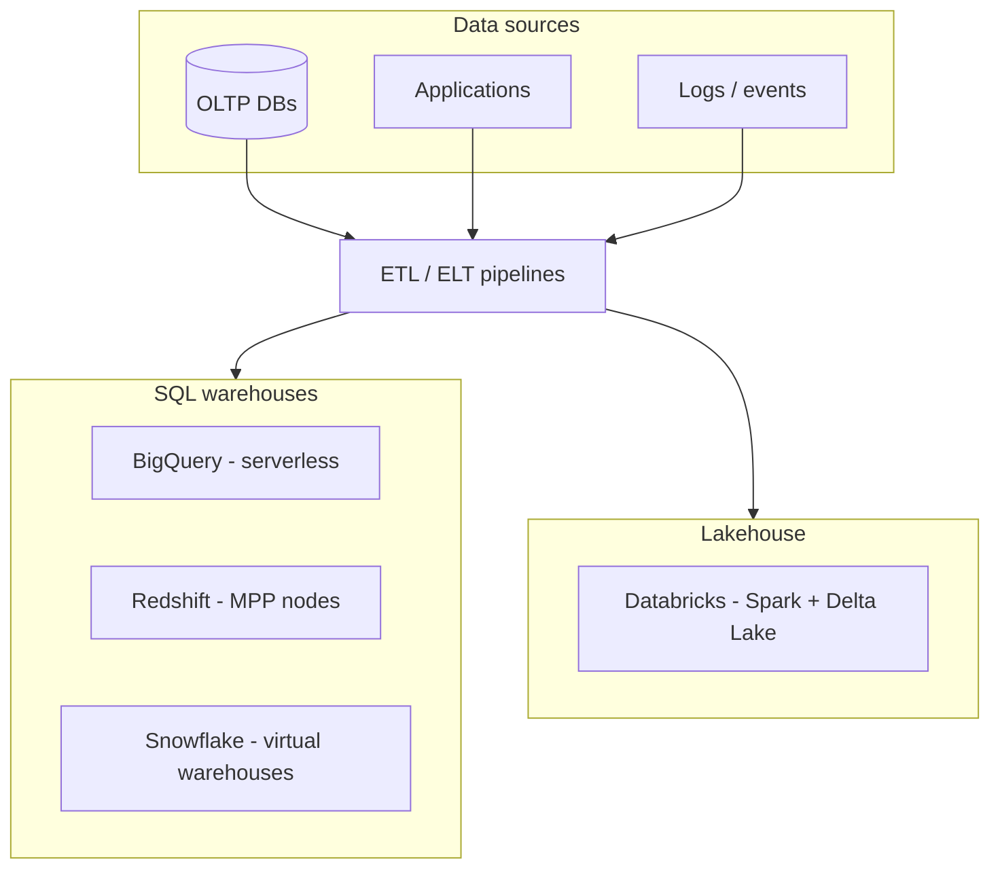
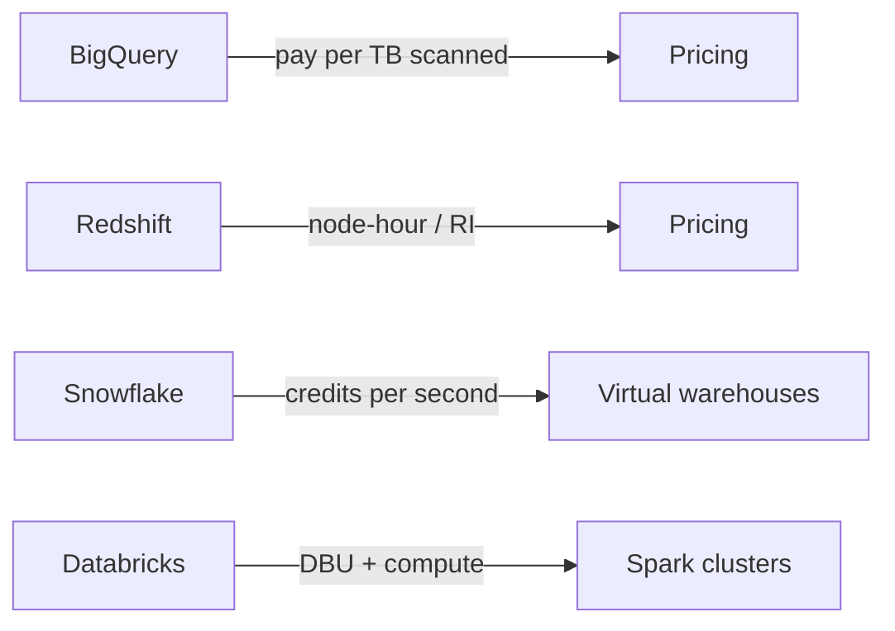
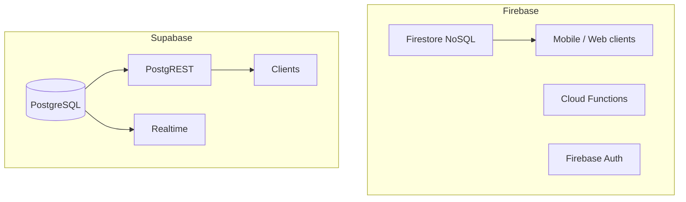
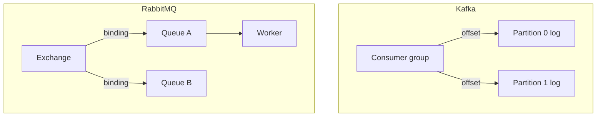
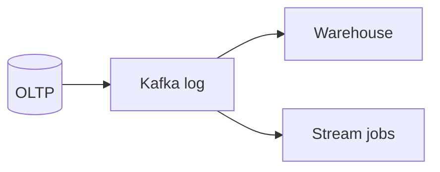
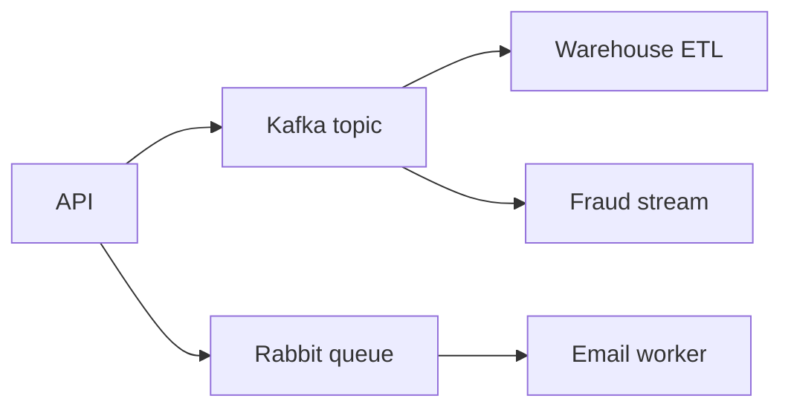

# Cloud Data Services Compared: Warehouses, BaaS & Messaging

This guide compares **Google BigQuery**, **Amazon Redshift**, **Snowflake**, **Databricks**, **Firebase**, **Supabase**, **Apache Kafka**, and **RabbitMQ**—analytics platforms, backend-as-a-service stacks, and message brokers for system design.

> **Key insight:** Pick **cloud data warehouses** by pricing model (scan vs node-hour vs credit) and **messaging** by whether you need a **durable replayable log** (Kafka) or a **routed task queue** (RabbitMQ)—they are not drop-in substitutes.

---

## Analytics & Warehousing Landscape



| Service | Model | Cloud |
|---------|--------|-------|
| BigQuery | Serverless SQL analytics | GCP |
| Redshift | Columnar MPP warehouse | AWS |
| Snowflake | Separated storage/compute warehouses | AWS, Azure, GCP |
| Databricks | Spark lakehouse (Delta Lake, Photon) | Multi-cloud |

---

## BigQuery

Google’s **serverless** warehouse. **Dremel** execution engine; **Capacitor** columnar storage on **Colossus**. No clusters to size—compute scales per query.

**Performance:** Auto-optimized layouts; less manual tuning than Redshift. **BigLake / external tables** query Cloud Storage without full load.

**Pricing:** On-demand **per TB scanned** or **reserved slots** (flat-rate). Favors sporadic/ad-hoc queries; heavy steady scans need cost modeling.

**Users:** Twitter, UPS, Spotify.

---

## Amazon Redshift

**MPP** architecture: leader node + compute nodes; **distribution keys** and **sort keys** for tuning. **Redshift Spectrum** queries S3 (lakehouse-style). **Redshift Serverless** reduces cluster ops but keeps MPP engine.

**Performance:** Strong for structured SQL BI when tuned; result cache and WLM.

**Pricing:** **Per node-hour**; reserved instances up to ~75% savings—good for predictable workloads.

**Users:** Netflix, Nasdaq, McDonald’s.

---

## Snowflake

Three layers: **storage** (cloud object store), **compute** (elastic virtual warehouses XS–6XL), **cloud services**. **Micro-partitions** + automatic optimization.

**Differentiators:** **Multi-cloud** (AWS/Azure/GCP); **data sharing** and Marketplace without copying data.

**Pricing:** Per-second **compute credits**—rewards right-sized warehouses; can beat BigQuery on heavy steady workloads.

**Users:** Capital One, NBC Universal, DoorDash.

---

## Databricks

**Apache Spark** platform with **Delta Lake** (ACID on Parquet in object storage). **Photon** C++ engine accelerates SQL. One platform for **ETL, SQL analytics, streaming, ML** on the same data.

**vs Redshift:** Redshift often lower latency for pure SQL BI on structured data; Databricks wins **unified lakehouse**, semi-structured data, and multi-cloud Spark workflows.

**Pricing:** **DBUs** + cluster uptime; spot/auto-scale help bursty jobs; always-on clusters can spike cost.

---

## Warehouse & Lakehouse Comparison Table

| Dimension | BigQuery | Redshift | Snowflake | Databricks |
|-----------|----------|----------|-----------|------------|
| Primary interface | SQL | SQL | SQL | SQL + Spark (Python/SQL/R) |
| Ops model | Serverless | Provisioned / serverless option | Virtual warehouses | Clusters / serverless SQL |
| Storage | Managed columnar | Managed + Spectrum to S3 | Cloud object + micro-partitions | Delta on object storage |
| Tuning knobs | Fewer | Distribution/sort keys | Warehouse sizing | Cluster + Delta tuning |
| Multi-cloud | GCP only | AWS | **AWS, Azure, GCP** | **Multi-cloud** |
| Best for | Ad-hoc on GCP, variable load | AWS BI, reserved cost | Cross-cloud sharing, enterprise DW | ETL + ML + lakehouse |
| Cost sweet spot | Variable / ad-hoc | Steady reserved nodes | Optimized warehouse usage | Bursty Spark, spot |



### Warehouse SQL example (portable pattern)

```sql
-- Typical analytical pattern (dialect tweaks per engine)
SELECT
  date_trunc('day', order_ts) AS day,
  region,
  COUNT(*) AS orders,
  SUM(amount) AS revenue
FROM orders_fact
WHERE order_ts >= DATE '2026-01-01'
GROUP BY 1, 2
ORDER BY day, region;
```

---

## Firebase vs Supabase (Backend-as-a-Service)

Both ship **auth, storage, functions, and real-time**—but the database philosophy differs.

### Firebase

Google **BaaS**: **Firestore** (NoSQL documents), Cloud Functions, Auth, Storage, Hosting. Real-time listeners are deeply integrated; strong **mobile SDKs** and offline persistence.

### Supabase

Open-source BaaS on **PostgreSQL**: PostgREST (REST), GoTrue (auth), Realtime (logical replication + WebSockets), Edge Functions (Deno), Storage.



### BaaS comparison table

| Feature | Firebase | Supabase |
|---------|----------|----------|
| Database | Firestore (document) | **PostgreSQL (relational)** |
| Complex queries / joins | Limited; denormalize | **Full SQL** |
| Real-time | Very low latency native | WebSockets + replication |
| Mobile offline | **Mature** | Improving |
| Vendor lock-in | **High** (Google stack) | **Low** (open source, self-host) |
| Auth | Firebase Auth | GoTrue + RLS in Postgres |

### BaaS code examples

```javascript
// Firebase Firestore - real-time listener
import { getFirestore, doc, onSnapshot } from "firebase/firestore";

const db = getFirestore();
onSnapshot(doc(db, "rooms", "lobby"), (snap) => {
  console.log(snap.data());
});
```

```javascript
// Supabase - query + subscribe
import { createClient } from "@supabase/supabase-js";

const supabase = createClient(SUPABASE_URL, SUPABASE_KEY);

const { data } = await supabase
  .from("messages")
  .select("id, body, created_at")
  .eq("room_id", "lobby")
  .order("created_at", { ascending: false })
  .limit(50);

supabase
  .channel("room:lobby")
  .on("postgres_changes", { event: "INSERT", schema: "public", table: "messages" }, (payload) => {
    console.log(payload.new);
  })
  .subscribe();
```

---

## Kafka vs RabbitMQ (Messaging)

Not databases—but central to **data pipelines** and **async system design**.

### Apache Kafka

**Append-only log** partitioned by topic. Consumers track **offsets**; messages retained by time/size—**replay** anytime. Pull-based consumption.

**Strengths:** Millions of msgs/sec, event sourcing, stream processing, horizontal scale.

### RabbitMQ

Classic **broker**: producers → **exchanges** → **queues** → consumers (push). Acknowledged messages are **removed**.

**Strengths:** Complex routing, request-reply, low-latency task distribution.



### Messaging comparison table

| Dimension | Kafka | RabbitMQ |
|-----------|-------|----------|
| Model | Distributed log | Message broker |
| Throughput | **Very high** | Tens of thousands / node |
| Latency | Pull polling (tunable) | **Push - lower single-msg** |
| Ordering | Per partition | Per queue |
| Replay | **Yes** | No (after ack) |
| Routing | Topic/partition | **Exchanges + bindings** |
| Durability | Replicated log default | Durable queues optional |
| Typical use | Event backbone, analytics | Tasks, RPC-style workflows |

### Messaging code examples

```python
# Kafka producer (confluent-kafka)
from confluent_kafka import Producer

p = Producer({"bootstrap.servers": "localhost:9092"})
p.produce("orders", key="order-1", value='{"status":"placed"}')
p.flush()
```

```python
# RabbitMQ - publish to exchange (pika)
import pika

connection = pika.BlockingConnection(pika.ConnectionParameters("localhost"))
channel = connection.channel()
channel.exchange_declare(exchange="tasks", exchange_type="direct", durable=True)
channel.basic_publish(exchange="tasks", routing_key="email", body="send welcome email")
connection.close()
```

> **Hybrid pattern:** Kafka for high-volume order events (replay, audit); RabbitMQ for email/SMS workers with routing keys.

---

## Performance & Cost Summary

| Service | Scaling knob | Cost risk |
|---------|--------------|-----------|
| BigQuery | Automatic | Large table scans without partitioning |
| Redshift | Node count / Serverless | Under-provisioned = slow; over = $$$ |
| Snowflake | Warehouse size/time | Idle warehouses left running |
| Databricks | Cluster size / DBUs | Always-on clusters |
| Firebase | Google scale | Firestore read/write units at scale |
| Supabase | Postgres instance | DB size + egress |
| Kafka | Partitions, brokers | Retention storage |
| RabbitMQ | Queues, consumers | Cluster ops + memory |

---

## Decision Matrix

| Criterion (1–5) | BigQuery | Redshift | Snowflake | Databricks | Firebase | Supabase | Kafka | RabbitMQ |
|-----------------|:--------:|:--------:|:---------:|:----------:|:--------:|:--------:|:-----:|:--------:|
| Serverless analytics | 5 | 3 | 4 | 3 | — | — | — | — |
| AWS-native BI | 2 | 5 | 4 | 4 | — | — | — | — |
| Multi-cloud DW | 1 | 2 | 5 | 5 | — | — | — | — |
| ML + ETL unified | 3 | 3 | 3 | 5 | — | — | 4 | 2 |
| Mobile BaaS | — | — | — | — | 5 | 3 | — | — |
| SQL-first BaaS | — | — | — | — | 2 | 5 | — | — |
| Event replay / stream | — | — | — | 4 | — | — | 5 | 2 |
| Task routing / RPC | — | — | — | — | — | — | 2 | 5 |

---

## When to Use What

| Choose | When |
|--------|------|
| **BigQuery** | You are on GCP; want zero cluster ops; ad-hoc or variable analytics |
| **Redshift** | AWS-centric BI; predictable SQL workloads; reserved instances for cost |
| **Snowflake** | Multi-cloud warehouse, data sharing, marketplace integrations |
| **Databricks** | Lakehouse, Spark ETL, streaming + ML on same Delta tables |
| **Firebase** | Mobile-first, Firestore real-time, Google ecosystem, fastest path for simple apps |
| **Supabase** | Postgres, SQL, RLS, open source/self-host, lower lock-in |
| **Kafka** | Durable event log, replay, stream processing, high throughput |
| **RabbitMQ** | Work queues, complex routing, request-reply, lower volume |

### Interview one-liners

- **Warehouse:** Match **pricing model** to workload shape (scan vs node-hour vs credit).
- **BaaS:** Firestore = speed to mobile; Supabase = relational power and portability.
- **Messaging:** Kafka = **log**; RabbitMQ = **queue**—often both in large systems.

---

*Sources: Algoroq comparisons for BigQuery/Redshift/Snowflake, Redshift/Databricks, Firebase/Supabase, and Kafka/RabbitMQ.*

---

## Senior Pitfalls

| Mistake | Impact | Fix |
|---------|--------|-----|
| DynamoDB on-demand with bursty, unbounded scans | Bill shock and throttling on hot partitions | Model access patterns first; on-demand for unknown traffic, provisioned + auto-scaling for steady; avoid `Scan` in user paths |
| Aurora Serverless v2 scaled to min ACU far below peak | Connection storms after scale-up lag; login timeouts | Set min capacity to sustained baseline; pool at app layer; load-test cold-start after idle |
| Cross-region read replica promoted without RPO verification | Data loss window longer than compliance allows | Monitor replication lag SLA; block failover automation above RPO; run game-day promote + app cutover |
| RDS with `max_connections` default and one connection per Lambda | Connection exhaustion and cascading 503s | RDS Proxy or PgBouncer; right-size pool; cap concurrent Lambdas per proxy |
| Snowflake/BigQuery warehouse left “always on” for dashboards | 3–10× warehouse cost with no user benefit | Auto-suspend; separate warehouses for ETL vs ad hoc; cache BI extracts |
| Managed Redis without multi-AZ and backup tested | Regional outage = total session/cache loss | Enable Multi-AZ; restore drill to new cluster; document rebuild time for warm cache |

---

## Production-grade Practice

1. **DynamoDB key design review:** Take one high-traffic entity (orders by user). Prototype partition key choices; load-test with realistic skew (power users); report throttled requests and hot partition metrics before launch.
2. **Failover RTO measurement:** In a staging account, trigger Aurora failover or RDS Multi-AZ switch. Time DNS/app recovery, connection pool churn, and error budget burn—compare to runbook claims.
3. **Warehouse cost attribution:** Tag queries by team/job in your cloud DW; produce a weekly unit cost per TB scanned and per dashboard refresh; propose one concrete savings change with measured impact.
4. **Cross-service latency budget:** Map app → RDS Proxy → Aurora → optional DAX/Elasticache. Allocate P99 ms per hop from traces; identify the single largest contributor and a mitigation with before/after profiles.

---

## FAANG Interview Deep Dive

### Real-world examples

**Spotify + Google BigQuery**  
Spotify analyzed **billions of events/day** on **BigQuery**—serverless **slot** or on-demand **TB scanned** pricing. Interview point: a **full table scan** of **10TB** at on-demand **~$5/TB** is **$50/query** if unpartitioned—**partition pruning** and **clustering** are cost defenses, not optimizations.

**Netflix Keystone pipeline (Kafka)**  
Netflix’s **Keystone** streams **trillions of events/day** through **Kafka** for **real-time** and **batch** consumers. **Retention days × throughput** sizes disk; **consumer lag** is the operational SLO—not broker uptime alone.

**Stripe-scale messaging patterns**  
High-volume **payment events** favor **durable logs (Kafka)** for **replay** and **audit**; **task queues (Rabbit/SQS)** for **work distribution** with **competing consumers**. Staff answer: **Kafka is not a queue**—use **consumer groups** and **idempotent handlers**.

| Workload | Kafka | RabbitMQ |
|----------|-------|----------|
| Replay 7 days | Native | Poor fit |
| Task routing fanout | Possible | Strong |
| 1M msg/s ingest | Proven | Harder |

### Interview Q&A

### Q: BigQuery vs Snowflake vs Redshift—how do you choose?
**A:** **BigQuery**: GCP, **zero cluster ops**, pay per **scan** or slots. **Snowflake**: **multi-cloud**, **virtual warehouses**, **data sharing**. **Redshift**: AWS-native **MPP**, **reserved nodes** for steady BI. Model **workload shape**: ad-hoc analysts vs **24/7 dashboards** vs **ETL-heavy**.

### Q: Databricks vs warehouse-only?
**A:** **Databricks** when **Spark ETL**, **Delta Lake**, **ML features**, and **streaming + batch** unify on **lakehouse**. Warehouse when **SQL BI** dominates and **Spark ops** unwanted.

### Q: Firebase vs Supabase for a startup?
**A:** **Firebase**: fastest **mobile**, **realtime Firestore**, Google auth/analytics—**NoSQL** limits complex queries. **Supabase**: **Postgres**, **SQL**, **RLS**, self-host path—better **relational** and **portability**.

### Q: Kafka partition count—how many?
**A:** **Throughput / consumer parallelism** bound: max **useful consumers ≤ partitions**. Rule of thumb: start **partitions = peak consumer count**, revisit when **single partition > ~10MB/s** or **hot key**. **Too many partitions** hurts **ZooKeeper/KRaft** metadata and **rebalance** time.

### Q: When RabbitMQ instead of Kafka?
**A:** **Lower volume work queues**, **complex routing** (topic/direct), **per-message ack** and **TTL** for tasks. **Not** for **event sourcing replay** at **petabyte** scale.

### Common mistakes candidates make

- **Unpartitioned** BigQuery tables on **PB** datasets—runaway bills.
- **Kafka as job queue** without **idempotency**—duplicate processing on rebalance.
- **Snowflake warehouse** left **XL** running 24/7—credit burn.
- **Firestore** for **heavy relational reporting** without export pipeline.
- **Single Rabbit queue** as **system of record**—messages lost on broker failure without **durable** config.

### Decision framework & capacity math



**Kafka retention disk:** `bytes ≈ ingest_rate × retention_seconds × replication_factor`. **1 GB/s × 7 days × RF3** → **~1.8 PB** raw—plan **tiered storage** or **compaction** for keyed topics.

**Warehouse cost:** Compare **$/TB scanned** (BQ on-demand) vs **$/credit-hour** (Snowflake) using **30-day query log**—steady heavy SQL often favors **reserved** capacity.

### Event vs task (both in large systems)



| Question | If yes → |
|----------|----------|
| Need replay 7d? | Kafka |
| Competing consumers on tasks? | Rabbit/SQS |
| Multiple independent readers? | Kafka |
| Per-message TTL / DLQ? | Queue |

**Staff signal:** Spotify/UPS on BigQuery—always mention **partition filter** in every analyst query or **$50 accidental scans** become a finance incident.
