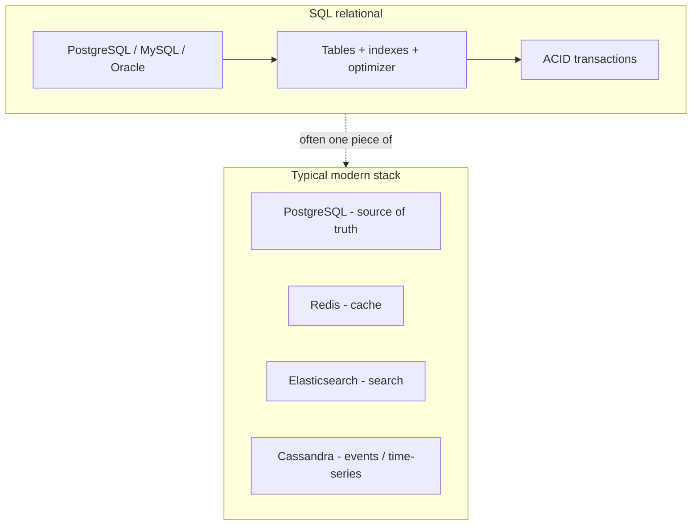
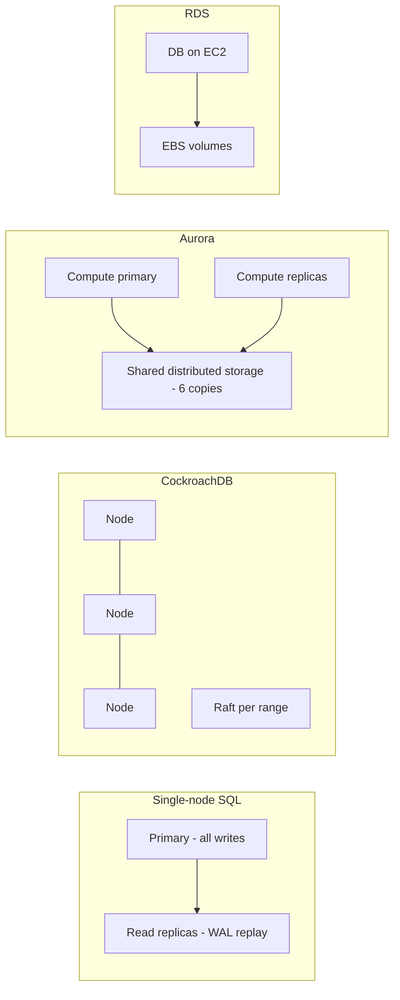
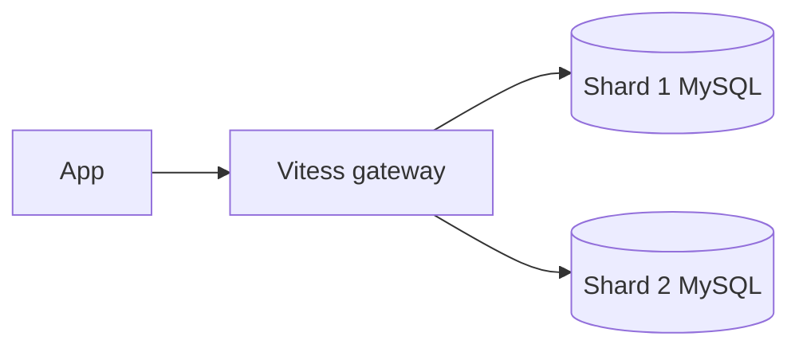

# Relational Databases Compared: A System Design Guide

This guide synthesizes comparisons of **SQL vs NoSQL**, **PostgreSQL**, **MySQL**, **Oracle**, **SQLite**, **CockroachDB**, **Amazon Aurora**, and **Amazon RDS**—so you can pick the right relational (or relational-adjacent) store for interviews and real architectures.

> **Key insight:** The SQL vs NoSQL choice is rarely binary. Modern systems use **polyglot persistence**: PostgreSQL for transactions, Redis for cache, Elasticsearch for search, Cassandra for time-series. Performance depends on matching your **data model to access patterns**, not on the category label alone.

---

## How to Think About Relational vs NoSQL

| Dimension | SQL (relational) | NoSQL |
|-----------|------------------|-------|
| Data model | Tables, fixed schema, foreign keys | Documents, key-value, wide-column, graph |
| Strength | Joins, aggregations, ACID transactions | Key lookups, predictable partitions, scale-out writes |
| Consistency (CAP) | Often **CP** (consistency + partition tolerance) | Often tunable **AP** ↔ **CP** |
| Transactions | Full **ACID** across rows/tables | Usually single-document or single-partition atomicity |
| Scaling writes | Vertical + read replicas; sharding needs extra tooling | Native sharding in many engines |



**Real-world polyglot examples (from the source material):**

- **Uber:** MySQL (trips), Cassandra (real-time analytics), Redis (cache)
- **Netflix:** Cassandra (activity), PostgreSQL (billing), Elasticsearch (search)

---

## Database Overviews

### PostgreSQL

Open-source **client-server** RDBMS. Process-per-connection, strong **MVCC**, advanced query planner (hash/merge joins, cost-based optimization). Rich extensions: PostGIS, pg_vector, TimescaleDB.

**Best for:** Complex SQL, analytics on relational data, JSONB semi-structured fields, geospatial, financial and SaaS backends.

### MySQL (InnoDB)

Open-source RDBMS with **thread-per-connection** and undo in rollback segments. Simpler operations; strong for basic CRUD and read-heavy web apps.

**Best for:** Simple primary-key workloads, read-heavy LAMP-style apps (e.g. WordPress-style patterns). GitHub, Airbnb (with tuning).

### Oracle Database

Commercial enterprise RDBMS. **Shared-disk RAC** (multiple instances, one storage), undo in tablespaces (less bloat than in-place row versions). Deep optimizer, in-memory column store, Data Guard, Flashback.

**Best for:** Large enterprises already on Oracle, workloads needing RAC and mature DR tooling—if license cost is acceptable.

### SQLite

**Embedded** library: one file, no server, zero network hop. Single-writer; WAL mode for strong read concurrency.

**Best for:** Mobile, desktop, edge, tests, single-tenant apps. Ecosystem: Litestream, LiteFS, Turso (libSQL).

### CockroachDB

**Distributed SQL** with PostgreSQL wire protocol. Range-based sharding, **Raft** replication, any node can read/write its ranges. Geo-partitioning for compliance/latency.

**Best for:** Global transactional workloads needing horizontal writes and automatic failover (DoorDash, Bose)—at the cost of ~1–5 ms consensus overhead vs single-node Postgres.

### Amazon Aurora (PostgreSQL / MySQL compatible)

AWS-managed engine with **decoupled compute and storage**: six copies across three AZs; replicas share storage volume; mostly **WAL** over the network (not full page copies).

**Best for:** AWS-native HA, many read replicas (up to 15), fast failover, bursty workloads (Serverless v2).

### Amazon RDS

Standard engines (PostgreSQL, MySQL, MariaDB, Oracle, SQL Server) on **EC2 + EBS** with engine-native replication.

**Best for:** Managed DB without Aurora premium; Oracle/SQL Server on AWS; modest workloads where RDS performance is enough.

---

## Architecture Comparison



| System | Write scaling | HA model | Ops complexity |
|--------|---------------|----------|----------------|
| PostgreSQL / MySQL | Single primary | Replication + manual failover | Medium |
| Oracle RAC | Multi-instance shared disk | Cluster + storage | High |
| SQLite | Single writer | File copy / edge sync tools | Low |
| CockroachDB | Horizontal | Automatic Raft failover | Medium–high |
| Aurora | Vertical + read scale-out | Storage-layer redundancy | Low (managed) |
| RDS | Same as engine | Engine replication | Low (managed) |

---

## Feature Comparison Table

| Feature | PostgreSQL | MySQL | Oracle | SQLite | CockroachDB | Aurora | RDS |
|---------|------------|-------|--------|--------|-------------|--------|-----|
| License | Open source | Open source | Commercial | Public domain | Source available | AWS proprietary | Managed service |
| Deployment | Self / cloud | Self / cloud | Self / cloud | Embedded | Self / cloud | AWS only | AWS only |
| SQL depth | Excellent | Good | Excellent | Good subset | PG-compatible subset | PG/MySQL compat | Engine-dependent |
| JSON documents | JSONB | JSON type | JSON | Limited | Supported | PG/MySQL | Engine-dependent |
| Horizontal writes | Citus / external | Sharding external | RAC | No | Native | No (scale reads) | No |
| Typical latency | Lowest on one node | Low for simple CRUD | Low (tuned) | Lowest local | +1–5 ms (distributed) | Low on AWS | Same as engine on EBS |
| Vendor lock-in | Low | Low | Medium | None | Medium | High (AWS) | High (AWS) |

---

## Performance Characteristics

| Workload | Winner / notes |
|----------|----------------|
| Simple PK lookups | **MySQL** often edges Postgres on overhead |
| Complex joins, CTEs, windows | **PostgreSQL** (and **Oracle** at enterprise scale) |
| Local embedded reads | **SQLite** (no network) |
| Multi-user concurrent writes | **PostgreSQL** / **MySQL** / **Oracle**—not SQLite |
| Massive distributed writes | **CockroachDB** |
| Read-heavy on AWS with many replicas | **Aurora** (shared storage, low replica lag) |
| I/O-bound on AWS | **Aurora** (claims ~3× Postgres, ~5× MySQL vs RDS) |

> **PostgreSQL vs MySQL:** MySQL is easier to start; PostgreSQL wins advanced SQL and extensibility. Instagram, Reddit, Apple use Postgres; Facebook (modified MySQL), GitHub use MySQL.

> **PostgreSQL vs Oracle:** Oracle’s optimizer and RAC are mature; **TCO** often drives migrations to Postgres (e.g. large-scale AWS migrations, UK GDS).

> **Aurora vs RDS:** Aurora costs **~20–50% more** but offers more replicas (15 vs 5), faster failover (~30s vs 60s+), and higher throughput when I/O-bound.

---

## Code Examples

### PostgreSQL — relational + JSONB

```sql
CREATE TABLE orders (
  id         BIGSERIAL PRIMARY KEY,
  user_id    BIGINT NOT NULL REFERENCES users(id),
  metadata   JSONB NOT NULL DEFAULT '{}',
  created_at TIMESTAMPTZ DEFAULT now()
);

CREATE INDEX idx_orders_metadata ON orders USING GIN (metadata);

SELECT id, metadata->>'source' AS source
FROM orders
WHERE metadata @> '{"campaign": "summer"}';
```

### MySQL — InnoDB CRUD

```sql
CREATE TABLE products (
  id    BIGINT PRIMARY KEY AUTO_INCREMENT,
  sku   VARCHAR(64) NOT NULL UNIQUE,
  price DECIMAL(10,2) NOT NULL
) ENGINE=InnoDB;

SELECT * FROM products WHERE sku = 'ABC-123';
```

### SQLite — embedded app database

```python
import sqlite3

conn = sqlite3.connect("app.db")
conn.execute("PRAGMA journal_mode=WAL")
conn.execute("""
  CREATE TABLE IF NOT EXISTS settings (key TEXT PRIMARY KEY, value TEXT)
""")
conn.execute("INSERT OR REPLACE INTO settings VALUES (?, ?)", ("theme", "dark"))
conn.commit()
```

### CockroachDB — same wire protocol as Postgres

```sql
-- Often works like PostgreSQL
CREATE TABLE inventory (
  region STRING,
  sku    STRING,
  qty    INT,
  PRIMARY KEY (region, sku)
);

-- Geo-partitioning (conceptual pattern for compliance)
-- ALTER TABLE ... PARTITION BY LIST (region) ...
```

### Connecting to Aurora / RDS

```python
# Same drivers as PostgreSQL on RDS/Aurora PostgreSQL
import psycopg2

conn = psycopg2.connect(
    host="my-cluster.cluster-xxxx.us-east-1.rds.amazonaws.com",
    database="app",
    user="app_user",
    password="***",
    sslmode="require",
)
```

---

## Use-Case Recommendations

| Scenario | Recommendation |
|----------|----------------|
| Default open-source OLTP | **PostgreSQL** |
| Simple web app, ops team prefers MySQL | **MySQL** |
| Enterprise on Oracle with RAC/Flashback | **Oracle** (or plan Postgres migration) |
| Mobile / desktop / edge / tests | **SQLite** |
| Global writes + survivable regions | **CockroachDB** |
| AWS + HA + read scale + Postgres compat | **Aurora PostgreSQL** |
| AWS + cost-sensitive + Oracle/SQL Server | **RDS** |
| Interview: “SQL vs NoSQL” | Explain **polyglot** + access patterns |

---

## Decision Matrix

Score each factor 1–5 for your project (5 = critical fit).

| Criterion | PostgreSQL | MySQL | Oracle | SQLite | CockroachDB | Aurora | RDS |
|-----------|:----------:|:-----:|:------:|:------:|:-------------:|:------:|:---:|
| Advanced SQL / analytics | 5 | 3 | 5 | 2 | 3 | 4 | 4 |
| Simple ops / embedded | 3 | 4 | 2 | 5 | 2 | 4 | 4 |
| Horizontal write scale | 2 | 2 | 4 | 1 | 5 | 2 | 2 |
| Low TCO | 5 | 5 | 1 | 5 | 3 | 2 | 4 |
| AWS managed HA | 3 | 3 | 3 | 1 | 3 | 5 | 4 |
| Multi-cloud / portable | 5 | 5 | 4 | 5 | 4 | 1 | 1 |

---

## When to Use What

| Choose | When |
|--------|------|
| **PostgreSQL** | You need strong SQL, JSONB, extensions, and one primary database for most business logic |
| **MySQL** | Read-heavy CRUD, familiar ops, and team already standardized on MySQL |
| **Oracle** | Existing Oracle estate, RAC, and budget for licenses and specialized DR |
| **SQLite** | Embedded, single-tenant, edge, or local-first; not for many concurrent writers |
| **CockroachDB** | Multi-region OLTP, horizontal writes, Postgres-like API with distributed resilience |
| **Aurora** | AWS commitment, I/O limits on RDS, many replicas, fast failover, Serverless bursts |
| **RDS** | Managed standard engine, lower cost than Aurora, or need Oracle/SQL Server on AWS |
| **SQL + NoSQL together** | Different access patterns (transactions vs search vs cache vs events)—not one database for everything |

---

*Sources: Algoroq tech comparison articles on SQL vs NoSQL, PostgreSQL vs MySQL/Oracle/SQLite/CockroachDB/Aurora, and Aurora vs RDS.*

---

## Senior Pitfalls

| Mistake | Impact | Fix |
|---------|--------|-----|
| Long-running migrations with `ACCESS EXCLUSIVE` on hot tables | Hours of write outage during `ALTER` | Online schema tools (pg-osc, gh-ost); expand-contract; split DDL across phases |
| Missing index on foreign keys used in joins | Sequential scans at scale; lock pile-ups on parent deletes | Index FK columns; validate with `EXPLAIN (ANALYZE, BUFFERS)` on production-like data |
| Connection pool sized to `max_connections` on the database | One bad deploy exhausts DB; no headroom for admin | Pool ≤ 70% of max; separate roles for migrations; use proxy tier |
| Read replica used for “real-time” reporting without lag monitoring | Finance dashboards show pre-cutover numbers | Route analytics to replica with max lag SLO; cancel reports when lag > threshold |
| PostgreSQL autovacuum too aggressive on huge tables during peak | IO saturation and query tail latency | Tune cost limits; schedule manual `VACUUM` off-peak; partition large tables |
| MySQL GTID failover without checking errant transactions | Split-brain or lost writes after promote | Orchestrator/MHA with errant GTID detection; rehearse promote in staging |

---

## Production-grade Practice

1. **Index proof on production query:** Capture top 5 slow queries from logs. For each, run `EXPLAIN ANALYZE` on a restored snapshot; add one index or rewrite; quantify rows read and execution time delta.
2. **Replica lag drill:** Generate write load at 2× normal; plot replication lag vs CPU on primary and replica. Define alert threshold and app behavior (degrade reads vs fail closed).
3. **Connection storm debug:** Simulate deploy that doubles app instances without pool change. Observe `too many connections` and recovery time; document pool formula (instances × pool size × safety factor).
4. **HA cutover tabletop:** Walk primary failure for your chosen engine (Patroni, RDS Multi-AZ). List DNS, secrets, sequence gaps, and ORM reconnect behavior; time each step in staging.

---

## FAANG Interview Deep Dive

### Real-world examples

**GitHub MySQL → Vitess migration**  
GitHub scaled **MySQL** to **thousands of queries/s** on monolithic primaries by moving to **Vitess** for **horizontal sharding** while keeping **MySQL protocol**. Migration took **years** of dual-write and **application-aware shard keys**—interview lesson: **relational semantics** preserved, **ops model** changed to distributed SQL router.

**Uber polyglot persistence**  
Uber uses **MySQL** (core trips), **PostgreSQL** in places, **Schemaless** on MySQL for some payloads—**not one RDBMS**. Staff designs explain **which invariants need ACID** on one shard vs **eventual** analytics paths.

**Amazon Aurora**  
Aurora decouples **storage (6-way replication across AZs)** from compute; failover often **< 30s** to replica. Storage auto-scales in **10GB chunks**; good for **AWS-native** OLTP with **high replica count**—trade-off **vendor lock-in** and **I/O pricing model** vs vanilla RDS.



### Interview Q&A

### Q: PostgreSQL vs MySQL for a new SaaS—default pick?
**A:** **PostgreSQL** for richer SQL, **JSONB**, extensions (pg_vector, PostGIS), and **MVCC** behavior on complex queries. **MySQL** when team expertise, **simple read-heavy CRUD**, or **existing Vitess** path dominates. Both scale reads with replicas; **write scale** needs sharding (Vitess, Citus, Cockroach).

### Q: When pay for Oracle vs Postgres?
**A:** **Oracle** when **RAC**, mature **Flashback/Data Guard**, and **decades of DBA tooling** justify license **$ millions/year**. Greenfield rarely starts Oracle—interviewers probe **exit cost** and **cloud lift**.

### Q: CockroachDB vs Aurora for multi-region OLTP?
**A:** **Cockroach**: **survivable replicas**, **serializable** distributed transactions, **higher write latency** cross-region. **Aurora Global**: **one primary region** writes, **read replicas** elsewhere—simpler, **RPO** depends on replication mode. Pick by **RPO/RTO** and **SQL portability**.

### Q: SQLite in production—ever?
**A:** **Edge, mobile, embedded agents**, single-writer workloads—not **multi-tenant cloud API** backing store. Litestream/replication for **HA** is possible but niche.

### Q: SQL vs NoSQL in one sentence for interviews?
**A:** **SQL** when **joins, transactions, ad-hoc queries** on normalized data; **NoSQL slice** when **access pattern fixed**, **massive partitionable writes**, or **managed scale** beats ops. **Polyglot** is normal.

### Common mistakes candidates make

- **One database for everything**—cache, search, events need different stores.
- Choosing MySQL for **heavy analytics** without **OLAP** plan.
- **Sharding too late**—migrations hurt more at **10TB+**.
- Ignoring **connection pool math** (Postgres **~few k** connections vs app pods).
- **Aurora** assuming infinite write scale—**single writer** still limits hot rows.

### Decision framework

| Workload | Strong fit |
|----------|------------|
| Complex OLTP + JSON | PostgreSQL |
| Sharded MySQL at scale | Vitess + MySQL |
| AWS HA + many readers | Aurora |
| Multi-region serializable | CockroachDB |
| Embedded / edge | SQLite |

**Connection capacity:** If **10k app pods** each want **10 conns** → **100k** DB connections—need **PgBouncer/RDS Proxy** or **~100×** connection pooling factor.

### Interview comparison matrix

| Engine | Write scaling | Multi-region story |
|--------|---------------|-------------------|
| PostgreSQL | Vertical + Citus | Logical replication |
| MySQL + Vitess | Sharded horizontal | Per-shard failover |
| Aurora | Single writer, many readers | Global Database |
| CockroachDB | Distributed writes | Surviving replicas |
| SQLite | Single writer | Replication add-ons |

```sql
-- Vitess-style: app must include shard key in PK lookups
SELECT * FROM orders WHERE user_id = ? AND order_id = ?;
-- Missing user_id → scatter gather (interview fail)
```

**Staff signal:** GitHub’s lesson—**protocol-compatible sharding** (Vitess) beats **rewrite to NoSQL** when **transactions on shard** still matter.
