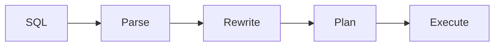
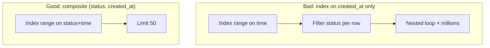
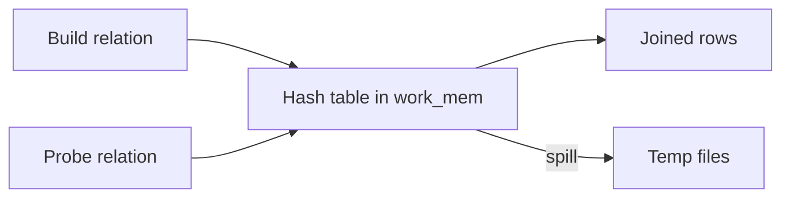

# Query Planning, Transactions & MVCC: A Teaching Guide

How SQL becomes a physical plan—and how concurrent transactions stay correct without stopping the world. This merges **query planning & execution** with **transactions, isolation & MVCC**.

> **Planner insight:** Bad plans are usually wrong **cardinality estimates**, not missing indexes. **Isolation insight:** The label on the isolation level is not the semantics—verify per engine (Postgres RR ≠ InnoDB RR).

---

## Part 1: Query pipeline



| Stage | What it hides |
|-------|----------------|
| **Rewrite** | CTE fences, view expansion—limits join reordering |
| **Plan** | 0.1–10+ ms; cached plans fit **first** parameters |
| **Execute** | Never second-guesses the plan |

**Pooler trap:** Transaction pooling without prepared statements → replan every call → CPU on planning, not execution.

---

## Part 2: Statistics & estimates

Postgres-style estimator:

- **MCV list** — known frequent values.
- **Histogram** — uniform within buckets.
- Unknown values share leftover probability → **multi-tenant underestimate** (tenant just below MCV cutoff estimated 330× low).

**Staleness:** Auto-analyze at 10% change on 1B-row table → weeks between samples. **Bulk load then query** without `ANALYZE` → melt.

**Independence assumption:** `country='DE' AND city='Berlin'` → multiply selectivities; true selectivity much higher → errors **multiply up the join tree**.

```sql
-- After bulk load, before heavy joins:
ANALYZE staging_orders;

-- Correlated columns:
CREATE STATISTICS stats_country_city ON country, city FROM users;
```

---

## Part 3: Join algorithms (error profiles)

| Algorithm | Wins when | Fails how |
|-----------|-----------|-----------|
| **Nested loop** | Small outer (indexed inner) | Unbounded if outer huge |
| **Hash join** | Large equality join | Memory spill, skew batches |
| **Merge join** | Pre-sorted inputs | Hidden random heap I/O |

**Crossover (illustrative):** 10M-row inner, 20 µs probe warm → nested loop beats hash until ~75k outer rows; cold cache ~7.5k.

**NOT IN vs NOT EXISTS:** Nullable subquery makes `NOT IN` not anti-joinable → quadratic SubPlan. Use `NOT EXISTS`.

**work_mem:** Per operator × parallel workers × concurrent queries—not per query.

---

## Part 4: Plan tree & LIMIT

- **Startup vs total cost** — `LIMIT 20` discounts pipelined plans; blocking sorts pay full cost.
- **ORDER BY … LIMIT** on wrong index order → millions of probes (same as indexing chapter).

**JIT:** Triggered by estimated cost—can add ms to fast OLTP if stats inflate cost.

**Parallel:** `Workers Planned: 4, Launched: 0` under pool exhaustion.

---

## Part 5: Reading EXPLAIN ANALYZE

1. Find **lowest node** where `actual rows` ≫ `estimated rows`.
2. Multiply inner nested-loop **rows × loops**.
3. Use `BUFFERS` — `shared read` = real I/O.
4. `Heap Fetches` on index-only → visibility map / vacuum.
5. `EXPLAIN ANALYZE` runs the query (use rollback for DML).

**Production:** `auto_explain` above p99; `pg_stat_statements` does **not** store plans.

---

## Part 6: Plan stability

| Trigger | Effect |
|---------|--------|
| Auto-analyze | Histogram changes → plan flip at crossover |
| Generic plan (Postgres) | After 5 custom plans, caches average-cost plan |
| Parameter sniffing (SQL Server) | Plan fitted to first parameter |

**Mitigations:** `force_custom_plan`, pin baselines, **split the whale tenant**, statement timeout < pool acquire timeout.

---

## Part 7: ACID & isolation ladder

| Level | Dirty read | Lost update | Non-repeatable | Phantom | Write skew |
|-------|------------|-------------|----------------|---------|------------|
| Read Committed | ✓ prevented | ✗ allowed | ✗ | ✗ | ✗ |
| Snapshot / RR (Postgres) | ✓ | ✓* | ✓ | ✓ reads | ✗ |
| Serializable | ✓ | ✓ | ✓ | ✓ | ✓ |

\* Postgres RR aborts conflicting writers (`40001`); InnoDB RR **still allows lost updates** on `UPDATE` (reads latest row).

**Lost update fix (portable):**

```sql
UPDATE inventory
SET qty = qty - 1
WHERE sku = $1 AND qty >= 1;
-- check ROW_COUNT = 1
```

---

## Part 8: MVCC mechanics

Each row version has **xmin** / **xmax** (txids). Reader picks visible version from snapshot `{xmin, xmax, in-progress}`.

| | Postgres | InnoDB |
|--|----------|--------|
| Old versions | Heap dead tuples | Undo log chain |
| Index on update | All indexes unless **HOT** | Secondaries if indexed cols change |

**HOT ratio:** `n_tup_hot_upd / n_tup_upd` — indexing `updated_at` kills HOT.

**Horizon:** Oldest snapshot (idle txn, replication slot, `hot_standby_feedback`) blocks vacuum → bloat, index-only regression, txid wraparound risk.

```sql
-- Policy knobs
SET idle_in_transaction_session_timeout = '5min';
SET statement_timeout = '30s';
```

---

## Part 9: Locking vs MVCC

Row reads don’t block row writes—but **DDL** takes `ACCESS EXCLUSIVE` vs `ACCESS SHARE` on every query → migration queues all SELECTs.

```sql
SET lock_timeout = '2s';  -- on every DDL session
```

**Postgres `FOR UPDATE`:** Writes txid to tuple → WAL per locked row.

**Work queues:**

```sql
SELECT * FROM jobs
WHERE status = 'pending'
ORDER BY id
FOR UPDATE SKIP LOCKED
LIMIT 1;
```

---

## Part 10: Write skew & fixes

**Doctors on-call:** Two transactions each read “2 on call”, each sets one off → zero on call under SI.

| Fix | When |
|-----|------|
| `SELECT … FOR UPDATE` | Rows exist |
| `EXCLUDE`, UNIQUE constraints | Absent rows / ranges |
| `SERIALIZABLE` + retry | Low contention |
| Sharded counters | Hot aggregate |

**Retry cliff:** High abort rate → retries increase overlap → metastable abort storm; cap retries with jitter.

---

## Symptom → fix table (planner)

| EXPLAIN shows | Mechanism | Fix |
|---------------|-----------|-----|
| est ≪ actual at leaf | Stats / correlation | Extended stats, composite index |
| est = 1 on time range | Ascending key tail | Frequent analyze, composite (time, …) |
| loops huge | NL vs hash crossover | Better estimate or hash-friendly shape |
| external merge sort | work_mem | Per-role work_mem, smaller build |

---

## Design review questions

1. Which parameterized queries span >100× selectivity—plan policy?
2. Does ORM autocommit cap commit rate at 1/fsync?
3. Which invariants span rows—constraint vs lock vs SERIALIZABLE?
4. Longest allowed transaction age—alert on `oldest xmin`?
5. Every DDL with `lock_timeout`?

*Source: Algoroq “Databases from the Inside” — Query Planning, Transactions & MVCC.*

---

## Deep dive: EXPLAIN output analysis (worked example)

Postgres `EXPLAIN (ANALYZE, BUFFERS, VERBOSE)` — how to read a bad plan.

```sql
EXPLAIN (ANALYZE, BUFFERS, FORMAT TEXT)
SELECT o.id, c.name
FROM orders o
JOIN customers c ON c.id = o.customer_id
WHERE o.status = 'shipped'
  AND o.created_at >= '2026-01-01'
ORDER BY o.created_at DESC
LIMIT 50;
```

**Hypothetical output fragment:**

```text
Limit  (actual time=842.1..842.3 rows=50 loops=1)
  Buffers: shared hit=1203 read=98421
  ->  Nested Loop  (actual time=0.5..841.9 rows=50 loops=1)
        Buffers: shared read=98400
        ->  Index Scan using orders_created_at_idx on orders o
              (actual time=0.2..800.1 rows=1200000 loops=1)
              Filter: (status = 'shipped')
              Rows Removed by Filter: 8800000
        ->  Index Scan using customers_pkey on customers c
              (actual time=0.01..0.02 rows=1 loops=1200000)
```

| Node | Diagnosis |
|------|-----------|
| `rows=1200000` on time index | Wrong index order—walked `created_at` before `status` |
| `Rows Removed by Filter: 8.8M` | Predicate not leading in index |
| `loops=1200000` nested loop | Inner executed per surviving outer row |
| `read=98421` | Cold cache or random I/O storm |

**Fix shape:** `CREATE INDEX ON orders (status, created_at DESC) WHERE status = 'shipped'` or composite `(status, created_at DESC)`.



---

## Deep dive: index selection heuristics

The cost-based optimizer picks access paths by **estimated cost**, not “has index”.

| Heuristic (Postgres-style) | Effect |
|----------------------------|--------|
| `seq_page_cost` vs `random_page_cost` | Index wins only if few pages touched |
| Correlation (`pg_stats.correlation`) | Index scan + sort may beat seq if highly correlated |
| `enable_seqscan=on` | Large fraction of table → seq scan cheaper |
| Partial index match | Smaller index → lower startup cost |
| Index-only scan | Needs visibility map + covering columns |

**Index selection pseudo-logic:**

```python
def choose_access_path(table, predicates, order_by):
    seq_cost = table.pages * seq_page_cost
    for index in candidate_indexes(predicates, order_by):
        pages = estimate_index_pages(index, predicates)
        idx_cost = index.tree_depth * random_page_cost + pages * random_page_cost
        if index.is_covering:
            idx_cost += heap_fetches * random_page_cost  # visibility dependent
        if idx_cost < seq_cost:
            return index
    return "Seq Scan"
```

**Join index selection:** Build side of hash join benefits from hash-friendly equality keys; nested loop needs **index on inner join key** with selective outer.

---

## Deep dive: join algorithms in detail

### Nested loop

```text
for row r in outer:
    for row s in inner where join(r,s):
        emit (r,s)
```

- **Indexed inner:** `O(outer_rows × log inner)` — ideal for `LIMIT` + selective outer.
- **Materialize inner:** Without index → `O(outer × inner)` disaster.

### Hash join



1. **Build** smaller relation into hash table (in `work_mem`).
2. **Probe** larger relation; match buckets.
3. **Skew:** One hot key → giant bucket → recursive hash or batch split.
4. **Spill:** `work_mem` exceeded → `external merge` on disk (sort also spills).

### Merge join

Requires both inputs sorted on join key.

```text
merge(outer_sorted, inner_sorted):
  while both have rows:
    if outer.key == inner.key: emit; advance both
    elif outer.key < inner.key: advance outer
    else: advance inner
```

**Hidden cost:** If sort not satisfied by index, both sides pay `O(n log n)` sort + possible spill. **Merge join win:** Pre-sorted inputs from index range scans on both FK/PK.

| Rows (illustrative) | Best join | Why |
|-------------------|-----------|-----|
| 50 outer, indexed inner | Nested loop | Low startup |
| 5M = 5M, equi-join | Hash | No sort needed |
| 5M = 5M, both sorted on key | Merge | No hash memory |

---

## Deep dive: MVCC vacuum and purge internals

### Postgres VACUUM (heap)

1. **Scan heap** (or index vacuum cycles) find dead tuples (`xmax` committed, no active snapshot needs them).
2. **Prune** line pointers; **freeze** old xmin to prevent txid wraparound.
3. **Truncate** empty pages at end (optional `VACUUM FULL` rewrites whole table—locks).
4. Update **visibility map** and **free space map**.

**Autovacuum trigger:** `threshold + scale_factor × reltuples` — on 100M-row table, 10% ≈ 10M dead tuples before vacuum—**weeks** of bloat if many small updates.

```sql
SELECT relname, n_dead_tup, last_autovacuum, autovacuum_count
FROM pg_stat_user_tables
ORDER BY n_dead_tup DESC;
```

### InnoDB purge

Undo logs form a **history list**; purge threads reclaim undo and remove old row versions when no read view needs them. Long `READ VIEW` (consistent read in long txn) blocks purge → **undo bloat** → tablespace growth.

| Engine | Blocker | Symptom |
|--------|---------|---------|
| Postgres | `xmin` horizon (idle txn, slot) | Dead tuples, index bloat |
| InnoDB | Active read view | Undo history length ↑ |

---

## Deep dive: transaction ID wraparound

Postgres uses 32-bit transaction IDs with **epoch** in visibility rules.

- **Freeze:** Mark tuples as `frozen` so xmin no longer consumes txid space.
- **`autovacuum_freeze_max_age`:** Forced vacuum before wrap.
- **Emergency:** Database refuses writes if wraparound imminent (`pg_database.datfrozenxid`).

```sql
SELECT datname, age(datfrozenxid) AS frozen_xid_age
FROM pg_database
ORDER BY age(datfrozenxid) DESC;
```

**Rule of thumb:** Alert when `age > 200M` on busy systems; investigate anti-wraparound vacuum lag.

**Incident:** ORM left connection in `idle in transaction` for days → xmin pinned → autovacuum cannot freeze → **multi-hour outage window** unless manual `VACUUM FREEZE` on critical tables during maintenance.

---

## Deep dive: snapshot isolation anomalies — write skew

**Write skew** is legal under snapshot isolation (SSI in Postgres adds detection; plain SI does not).

### Doctors on-call (classic)

```sql
-- Table: on_call(doctor_id, on_call boolean)
-- Rule: at least one doctor must be on call

-- T1 and T2 both run under Snapshot Isolation
-- T1: SELECT count(*) WHERE on_call → 2
-- T2: SELECT count(*) WHERE on_call → 2
-- T1: UPDATE on_call=false WHERE doctor_id=1  -- sees 2 on call, OK
-- T2: UPDATE on_call=false WHERE doctor_id=2  -- sees 2 on call, OK
-- COMMIT both → 0 on call
```

### Ticket pool (range predicate)

Two transactions each read “tickets available > 0”, each sells one ticket when only one remains—both succeed if neither locks the **count invariant**.

| Fix | Mechanism |
|-----|-----------|
| `SELECT ... FOR UPDATE` | Locks rows you read |
| `SERIALIZABLE` | Serialization failure on dangerous interleaving |
| Constraint | `CHECK` / trigger on aggregate (hard for count) |
| Materialized counter | Single row `UPDATE qty WHERE qty > 0` |

```sql
-- Serializable in Postgres
BEGIN ISOLATION LEVEL SERIALIZABLE;
SELECT count(*) FROM on_call WHERE on_call;
-- if count would go below 1, abort or lock all rows
UPDATE on_call SET on_call = false WHERE doctor_id = $1;
COMMIT;  -- may get SQLSTATE 40001, retry
```

---

## Production scenarios

### Plan flip after ANALYZE

Tenant moved onto platform; MCV list updated; join order switched hash → nested loop; p99 50ms → 40s. **Fix:** extended statistics, `pg_stat_statements` + `auto_explain`, plan pinning only after root-cause.

### Replication slot + long query on replica

`hot_standby_feedback` prevents cancel on replica but **pins xmin on primary** → vacuum cannot prune → primary bloat + index-only regression. **Fix:** `max_standby_streaming_delay`, route long reports to delayed replica or warehouse.

### Hash join spill during batch window

Nightly job runs 20 concurrent heavy joins; each uses `work_mem` × workers → RAM exhausted → temp file I/O saturates disk → OLTP slows. **Fix:** role-based `work_mem`, job concurrency cap, `statement_timeout` on batch role.

### Serializable abort storm

Flash sale with `SERIALIZABLE` on inventory; 30% abort rate; retries multiply contention. **Fix:** pessimistic `UPDATE ... WHERE sku AND qty` or partition inventory per SKU shard.

---

---

## Senior Pitfalls

| Mistake | Impact | Fix |
|---------|--------|-----|
| Deploying without `ANALYZE` after bulk load | Seq scans on million-row tables; overnight latency spike | Auto-analyze thresholds; manual ANALYZE in migration runbooks |
| Parameter sniffing on skewed data | Plan flips between nested loop and hash join | `OPTIMIZE FOR`, plan guides, or forced plan stability |
| `SELECT *` on wide rows through ORM | 10× I/O vs covering index; buffer pool churn | Project columns; composite indexes matching WHERE + ORDER BY |
| Serializable isolation “for safety” everywhere | Deadlocks and throughput collapse | Match isolation to anomaly (RR + constraints for write skew) |
| Ignoring autovacuum bloat on hot tables | Index-only scans degrade; disk growth | Tune autovacuum per table; monitor `n_dead_tup` |
| Long transactions holding xmin | Wraparound emergencies; vacuum blocked | Short transactions; statement_timeout; break batch jobs into commits |

---

## Production-grade Practice

1. **Build:** Take a slow query from staging; rewrite with covering index and compare `EXPLAIN (ANALYZE, BUFFERS)`—shared hits, execution time, rows removed by filter.
2. **Debug:** Reproduce write skew on a two-row inventory demo under READ COMMITTED; fix with `SELECT FOR UPDATE` or exclusion constraint and prove with concurrent load test.
3. **Measure:** Track plan regression after stats refresh—alert when estimated rows diverge 10× from actual for top 20 queries.
4. **Capacity plan:** Estimate WAL and connection count for peak checkout TPS; size `max_connections` vs pooler (PgBouncer) and justify transaction length targets.

## Interview Q&A

### Q: Why does `EXPLAIN` without `ANALYZE` sometimes lie badly?

**A:** It shows **estimated** rows and costs from statistics, not runtime behavior. Stale stats, missing correlation, default `ndistinct` for multi-column predicates, and **generic plans** after prepared statement caching can all diverge 1000× from reality. `EXPLAIN ANALYZE` executes the query (side effects on DML) and shows actual loops, rows, and timing—always compare `actual` vs `estimated` at the worst node.

### Q: When does the optimizer prefer a sequential scan over an index?

**A:** When the fraction of heap pages the index would touch × `random_page_cost` exceeds sequential read of the whole table × `seq_page_cost`, modulo parallel seq scan and partial indexes. Low-selectivity predicates (`status = 'active'` on 80% of rows) almost always seq scan unless partial index matches the 20%.

### Q: Explain MVCC read path for a single SELECT in Postgres.

**A:** Transaction takes snapshot `(xmin, xmax, xip_list)`. For each tuple version, compare `xmin`/`xmax` against snapshot and commit status in clog/subtrans. First visible version wins; no locks on row for plain SELECT. Writes create new row version with new `xmin`; old version dead until vacuum.

### Q: What is the difference between `READ COMMITTED` and `REPEATABLE READ` in Postgres?

**A:** RC takes new snapshot **each statement**—non-repeatable reads possible within one transaction. RR holds snapshot from **first statement** in txn—stable reads; phantoms prevented for reads but **write skew** still possible unless SERIALIZABLE (SSI). InnoDB RR differs (next-key locks, different phantom behavior).

### Q: How does `FOR UPDATE SKIP LOCKED` implement a job queue?

**A:** `SELECT ... FOR UPDATE SKIP LOCKED LIMIT 1` locks one pending row and skips rows locked by other workers—no blocking wait. Requires stable `ORDER BY` (often `id`) and index on `(status, id)`; otherwise seq scan + lock storm. Failed workers must rollback to release lock or use `UPDATE ... RETURNING` in single statement.

### Q: Why can `work_mem` “multiply” across a cluster?

**A:** Each **sort/hash node** per query per **parallel worker** may allocate up to `work_mem` before spill. Ten concurrent queries × 4 workers × 2 nodes × 256MB = theoretical multi-GB—OS OOM or temp I/O death. Cap per-role `work_mem` and concurrency.

### Q: What causes transaction ID wraparound emergencies?

**A:** Long-lived `xmin` blockers prevent freezing old tuples—replication slots, idle transactions, standby feedback. XIDs age; autovacuum cannot advance `datfrozenxid`; eventually Postgres stops writes to protect cluster. Remediation: kill blockers, aggressive vacuum/freeze, reduce `autovacuum_freeze_min_age` temporarily after fixing root cause.
