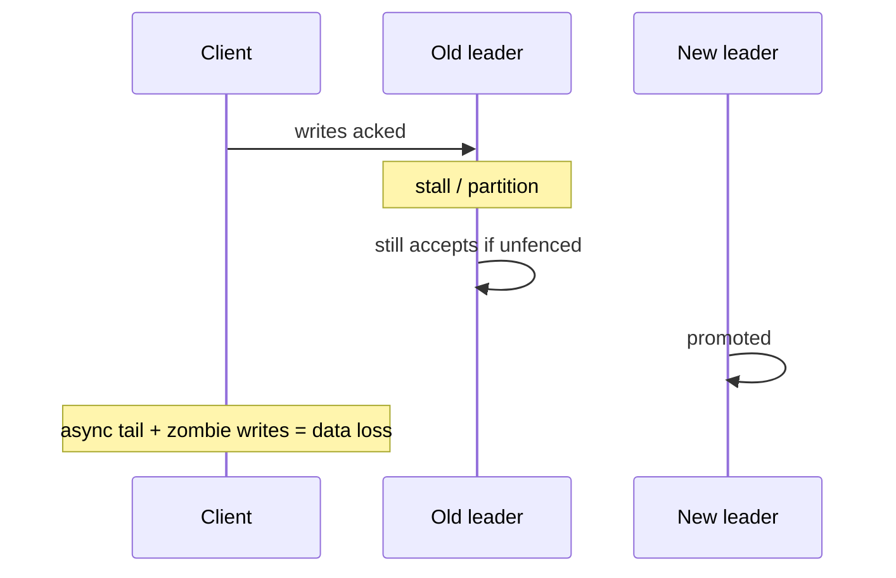
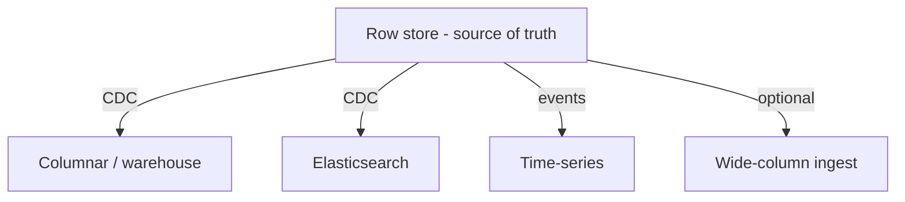
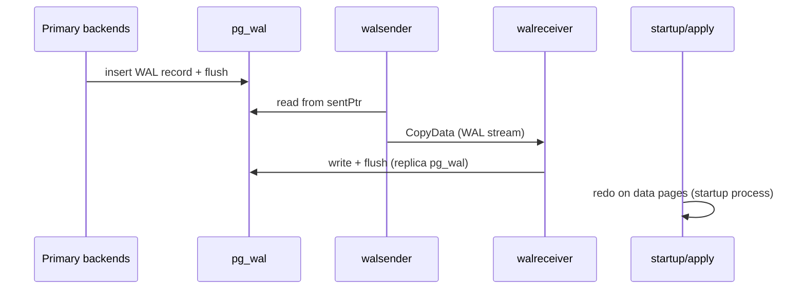
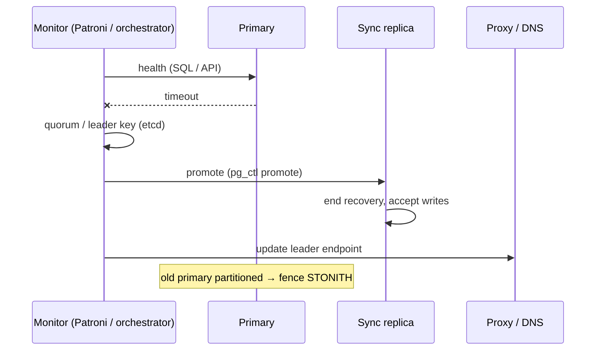

# Replication, Sharding & Beyond Relational: A Teaching Guide

Scaling one database: copies for availability, partitions for size, and specialist stores for access patterns that fight the row store.

> **Unifying idea:** Replication ships the **WAL** (or logical row changes). Sharding adds **network fan-out** and often gives up global constraints. Polyglot persistence adds **seams**—lag, rebuild, divergence—not just another engine.

---

## Part 1: Replication

### Physical vs logical

| | Physical (WAL stream) | Logical (row images) |
|--|----------------------|----------------------|
| Replica | Byte-identical | Subset, indexes, version upgrade |
| DDL | Replicated | Often manual on subscriber |
| CDC | Hard | Natural fit |
| Risk | Corruption replicates | Slots pin WAL on primary |

### Single-leader

One serialization point for writes. Failover = **detect + elect + repoint + fence**.



**RPO (transactions)** ≈ `commit_rate × lag_at_failure`. At 5k commits/s and 200 ms lag → ~1k lost acked txns.

**Sync spectrum (Postgres):** `remote_write` vs `on` vs `remote_apply`—only last gives RYW on standby.

**One sync standby:** Its death blocks all commits—use `ANY 1 (s1,s2)` quorum.

### Replication lag

| Anomaly | Fix |
|---------|-----|
| Read-your-writes | Primary, or LSN/GTID token on replica |
| Monotonic reads | Session pin to one replica |
| Queue worker reads replica | **Broken** without token—duplicates |

Lag is **throughput race:** `backlog_growth = WAL_rate - apply_rate`. Replica smaller than primary → falls behind first.

**hot_standby_feedback:** Saves cancel, bloats primary vacuum horizon.

**Slots:** Abandoned slot → WAL fills disk → write outage.

### Failover RTO

Detection + election + **client rediscovery** (DNS, pools). Often dominated by 5s client timeout, not 1s election.

---

## Part 2: Sharding

### Partition key

Choose from **transaction boundary** (tenant, user). >few% cross-shard txns → distributed commit tax.

| Scheme | Pros | Cons |
|--------|------|------|
| Hash | Even spread | No range scans |
| Range | Local scans | Hot last shard |
| Compound `(tenant, time)` | Local tenant history | Global scans expensive |

**Hash spreads keys, not load**—celebrity tenant still one shard.

### Secondary indexes

| | Local index | Global index |
|--|-------------|--------------|
| Write | One shard | 2+ shards or async stale |
| Read by non-PK | All shards | Targeted |

**Uniqueness** on non-shard key → lookup table sharded by that key, or app-level reconciliation.

### Resharding

`hash mod N` → ~91% keys move when adding node. **Consistent hashing + vnodes** → ~1/(N+1). **Logical partitions** (Citus, Kafka) → move whole partitions.

Online move: snapshot → catch-up → **write freeze** → route flip with **epoch** → drain old copy.

---

## Part 3: Distributed queries & 2PC

Scatter-gather latency ≈ **max(shard latencies)**; P(slow) ≈ `1 - (1-p)^N`.

**2PC:** Locks held through prepare + coordinator decision—~4 ms same-AZ illustrative vs ~1 ms local; cross-region ~142 ms → **~7 updates/s** on one hot row.

**Orphan PREPARE** (Postgres) → locks + vacuum horizon—need janitor.

**Alternative:** Sagas, outbox—visible intermediate states.

**No global snapshot** on scatter-gather reads; restore per shard ≠ consistent cut without coordinated point.

---

## Part 4: NewSQL (consensus per shard)

Raft/Paxos per range: commit on **majority** → CP under partition, WAN RTT on writes.

Cross-range txn still **2PC over consensus groups**—latency does not disappear.

**When worth it:** Real cross-shard writes, multi-region RPO=0, can’t staff failover/reshard ops.

**When weak:** Clean tenant partition, need <2 ms p99, heavy engine features.

---

## Part 5: Beyond relational (specialists)



| Pattern | Reach for | Seam cost |
|---------|-----------|-----------|
| Columnar OLAP | Few columns, huge scans | Sort key, merge parts, stale CDC |
| Time-series | Append now, range recent | **Active series** cardinality |
| Wide-column | Known queries, huge writes | LWW, tombstones, repair |
| Graph | Variable-depth traversal, fits RAM | Supernodes, hard to shard |
| Search | BM25 ranking | Reindex hours/days, not source of truth |

### Columnar

Zone maps + sort key skip data—not just column projection. Tiny inserts → too many parts (ClickHouse).

### Time-series

**Series count** = product of label cardinalities—never put unbounded `user_id` on metrics.

### Wide-column (Cassandra)

Query-first tables; `(user_id, day)` buckets; no queue-on-LSM; repair < `gc_grace_seconds`.

### Document / search

Embed bounded data; search cluster = derived model with **reindex capacity** at 2× disk.

> **Polyglot rule:** Prefer one source of truth + read models. Stalled CDC slot can **take down the primary**—cap `max_slot_wal_keep_size`, alert on retained bytes.

---

## SRE track tie-in (reliability map)

From the **SRE & Reliability** specialization overview:

| Chapter | Theme |
|---------|--------|
| SLO engineering | Burn-rate alerts, serial dependency math |
| Observability economics | Label cardinality → bill |
| How systems fail | Metastability, retry multiplication |
| Resilience patterns | Queueing knee, retry budgets |
| Incident command | Mitigate first (reversible levers) |
| Verification & chaos | Measured RTO/RPO, not promised |
| Blast radius | Cells, shuffle sharding, safe deploy |

Database ops connect directly: **replay rate vs WAL generation**, **failover fencing**, **reshard at 60–70% util**.

---

## Decision framework

1. **Replication first** for HA + read scale.
2. **Shard** when writes/working set exceed one node you’ll run—and **before** schema is huge.
3. **Specialist** only when measured gap on primary after indexing/partitioning—and price the **seam**.

### Review questions

- RPO in **transactions** at peak—who signed?
- What **fences** old primary?
- % queries with partition key from prod logs?
- Cross-shard writes: 2PC, saga, or forbidden?
- CDC stall for 48h—primary disk?

*Source: Algoroq — Replication & Sharding, Beyond Relational, SRE track map.*

---

## Deep dive: WAL shipping internals (physical replication)

Postgres streaming replication ships **WAL records** from primary `pg_wal` to replica apply process.



| Piece | Responsibility |
|-------|----------------|
| **walsender** | Primary connection per replica; honors `synchronous_commit` wait |
| **walreceiver** | Writes incoming WAL; updates `received_lsn` |
| **startup process** | Replays WAL into buffer pool; `last_applied_lsn` |
| **Replication slot** | Primary retains WAL until consumer confirms `confirmed_flush_lsn` |

**Lag components:**

```text
flush_lag   = primary_flush_lsn - replica_received_lsn  (network/disk on replica WAL)
replay_lag  = replica_received_lsn - replica_apply_lsn   (CPU/IO applying)
```

**Hot standby conflicts:** Replica query pins row versions → apply waits → lag grows. `max_standby_streaming_delay` cancels query or breaks apply.

---

## Deep dive: logical replication setup (Postgres)

Logical decoding turns WAL into **row change streams** (tables in publication).

```sql
-- Primary
CREATE PUBLICATION orders_pub FOR TABLE orders, order_items;

-- Subscriber (often different major version or subset)
CREATE SUBSCRIPTION orders_sub
  CONNECTION 'host=primary dbname=app user=repl'
  PUBLICATION orders_pub
  WITH (copy_data = true, create_slot = true);

-- Monitor
SELECT subname, received_lsn, latest_end_lsn, last_msg_receipt_time
FROM pg_stat_subscription;
```


| Concern | Detail |
|---------|--------|
| **Replica identity** | `FULL` or index for `UPDATE`/`DELETE` keys |
| **DDL** | Not replicated—manual migration choreography |
| **Sequences** | Not synced—use `pg_dump --data-only` or app allocates |
| **Slot on primary** | Dropped subscriber without `DROP SUBSCRIPTION` → WAL bloat |

**CDC pattern:** Publication → Kafka (Debezium) → search index / warehouse. Same slot discipline: monitor `pg_replication_slots.retained_bytes`.

---

## Deep dive: failover detection and promotion



**Detection signals (layered):**

| Signal | False positive risk |
|--------|---------------------|
| TCP connect | Process up, DB hung |
| `SELECT 1` | Storage degraded but responds |
| Replication lag + write probe | Slower but safer |
| **Leader lease** in consensus | Best for split-brain prevention |

**Promotion checklist:**

1. Confirm primary truly dead (quorum of monitors).
2. Choose replica: highest `received_lsn`, sync standbys preferred.
3. `pg_promote()` / Patroni `switchover`.
4. **Fence** old primary (STONITH, revoke IAM, isolate SG).
5. Rewind or rebuild old primary (`pg_rewind`) before rejoin.

**RTO reality:** Client pool `connectionTimeout=5s` × DNS TTL × app retry backoff often dominates sub-second DB election.

---

## Deep dive: hash ring and vnode implementation

```python
import hashlib
import bisect

class HashRing:
    def __init__(self, nodes: list[str], vnodes_per_node: int = 128):
        self.ring: list[tuple[int, str]] = []
        for node in nodes:
            for v in range(vnodes_per_node):
                h = self._hash(f"{node}:{v}")
                self.ring.append((h, node))
        self.ring.sort(key=lambda x: x[0])

    def _hash(self, key: str) -> int:
        return int(hashlib.md5(key.encode()).hexdigest(), 16)

    def node_for_key(self, key: str) -> str:
        h = self._hash(key)
        i = bisect.bisect(self.ring, (h, ""))
        if i == len(self.ring):
            i = 0
        return self.ring[i][1]

    def nodes_for_replication(self, key: str, rf: int) -> list[str]:
        h = self._hash(key)
        i = bisect.bisect(self.ring, (h, ""))
        seen = []
        for j in range(len(self.ring)):
            node = self.ring[(i + j) % len(self.ring)][1]
            if node not in seen:
                seen.append(node)
            if len(seen) == rf:
                break
        return seen
```

**Adding a node:** Only keys between predecessor vnode and new vnode migrate—~`1/(N+1)` with enough vnodes.

---

## Deep dive: range partition rebalancing

**Problem:** Range on `created_at` → latest shard hot; empty old shards.

**Split shard:**

```text
Shard C: [2026-01-01, 2026-07-01)  →  C1: [Jan-Mar), C2: [Mar-Jul)
```

**Steps:**

1. Create C1, C2; dual-write or freeze writes briefly.
2. Copy `[Jan-Mar)` to C1, `[Mar-Jul)` to C2 (snapshot + catch-up).
3. Flip routing table epoch; drain C.

**Merge cold shards:** Opposite when traffic ages out—reduces metadata overhead.

| Strategy | Hot spot | Rebalance cost |
|----------|----------|----------------|
| Range time | Latest range | Split boundary |
| Hash | Celebrity key | Cannot split key—salt |
| Compound `(tenant, time)` | Big tenant | Move whole tenant partitions |

---

## Production scenarios

### Replication lag spike during checkpoint

Primary emits **full-page images** in WAL after checkpoint; replica apply doubles I/O; `replay_lag` jumps 30–120s while OLTP on primary looks healthy. **Mitigate:** tune `checkpoint_timeout`, replica disk class, `wal_compression`, dedicated apply NIC.

### Abandoned logical replication slot

Engineering dropped subscriber DB; slot remained → 400 GB WAL retained → primary disk 100% → **writes stop**. **Mitigate:** `max_slot_wal_keep_size`, alerts on `pg_replication_slots`, runbook `pg_drop_replication_slot`.

### Failover without fencing

Old primary in AZ partition still accepts writes from stale apps; split brain merges manually. **Mitigate:** Patroni + etcd, `primary_conninfo` invalidation, storage-level fence token.

### Hot partition on Cassandra

Single `user_id` drives all activity; hash ring evenly spreads **keys** not **load**. **Mitigate:** write-behind queue per user, separate counter table, rate limit at API.

### CDC to Elasticsearch falls behind

Bulk indexing slower than OLTP; Kafka lag 6h; search shows stale prices. **Mitigate:** scale consumers, increase shards, backpressure on publish, don’t block OLTP—monitor slot lag on source DB.

---

---

## Senior Pitfalls

| Mistake | Impact | Fix |
|---------|--------|-----|
| Failover without replication lag gate | Promoted replica missing last minutes of writes | Automated promotion only under LSN/lag threshold; sync replicas for RPO=0 |
| Logical replication for DDL-heavy schema | Broken replication slots; disk fill on primary | Migration pipeline on publisher first; or physical + cutover |
| Hash sharding without rebalancing story | One node at 90% while peers idle | Consistent hash with vnodes; plan resharding at 60% capacity |
| Cross-shard joins in application hot path | N+1 shard queries; latency multiplies | Denormalize, CQRS, or query coordinator with strict budgets |
| Treating NewSQL as “Postgres unlimited” | Hot range on one Raft group still serializes | Partition key design + scatter-gather limits |
| Read replica for “scaling writes” | Write load unchanged; replication lag grows | Shard or split write path; replicas for read scale only |

---

## Production-grade Practice

1. **Build:** Configure streaming replication with one sync and one async replica; fail primary and measure data loss window on async vs sync clients.
2. **Debug:** Fill a replication slot on a forgotten consumer; observe WAL retention growth on primary and document cleanup + monitoring alert.
3. **Measure:** Plot p99 read latency on replica vs primary at 0, 5s, 30s lag; define max lag for analytics tier.
4. **Capacity plan:** Shard count given 500GB cap per node and 3-year retention; include failover doubling load on remaining shards.

## Interview Q&A

### Q: Physical vs logical replication — when is logical worth the complexity?

**A:** Logical when you need **subset of tables**, **cross-version upgrade**, **different indexes** on subscriber, or **CDC to external systems**. Physical when you want byte-identical standby, simplest failover, and lowest apply CPU—at cost of all-or-nothing database copy.

### Q: How does synchronous replication affect commit latency?

**A:** Commit returns only after required standbys persist WAL (level-dependent: `remote_write` vs `remote_apply`). Latency adds WAN RTT + replica flush. One slow sync standby blocks all commits unless you use quorum `ANY n (name...)`. Async removes wait but loses acked transactions on failover.

### Q: What is the difference between `received_lsn` and `replay_lsn`?

**A:** `received_lsn` is how much WAL the replica has **written to its pg_wal**; `replay_lsn` is how much has been **applied to data files**. Gap indicates apply-bound replica (long queries, slow disk, weak CPU). Read-your-writes on standby needs `replay_lsn` ≥ client’s last write LSN.

### Q: Why do replication slots pin WAL on the primary?

**A:** Logical decoding and some physical consumers must read WAL sequentially; if primary recycled a segment the consumer still needs, data would be lost. Slot stores `confirmed_flush_lsn`; primary retains WAL from min slot LSN. Consumer death without slot cleanup is a **primary outage** risk.

### Q: Explain consistent hashing vs `hash % N` for resharding.

**A:** `mod N` remaps ~`(N-1)/N` keys when N changes—91% at N=11→12. Consistent hashing with vnodes moves ~`1/(N+1)` keys when adding one node. Operational cost: routing metadata, handoff of key ranges, epoch to reject stale writes.

### Q: What breaks when you shard a table with a global UNIQUE on email?

**A:** Uniqueness is not local to one shard—insert on shard A and B can both succeed. Fixes: **lookup table** sharded by email, global index service (2PC/async), or accept eventual reconciliation. Most systems redesign uniqueness around partition key.

### Q: How do you choose RPO in “transactions” not seconds?

**A:** `lost_txns ≈ commit_rate × replication_lag_at_failure`. At 3k TPS and 500ms async lag, failover loses ~1,500 acknowledged transactions on average. Product/legal sign-off on that number drives sync vs async and whether to use **group commit** batching (increases burst loss window).
