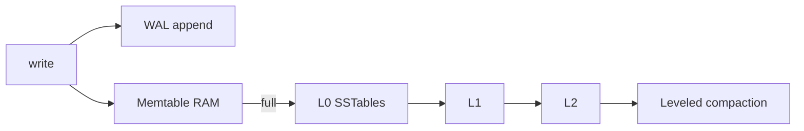
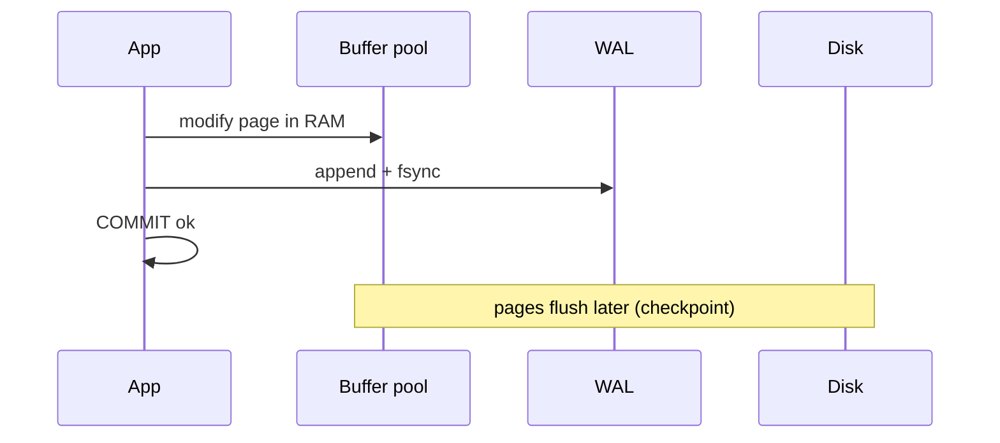
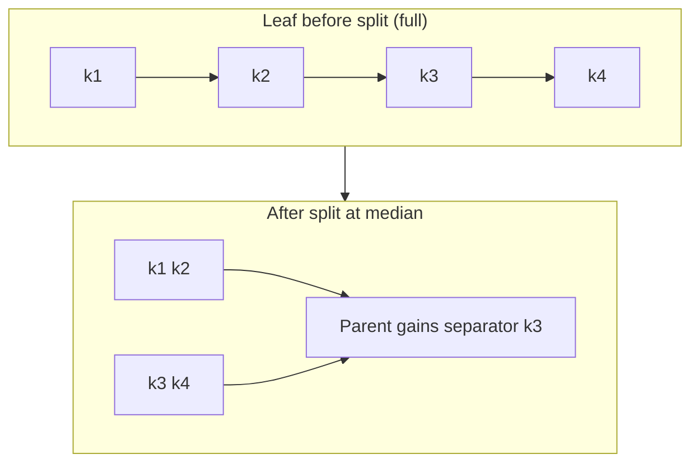
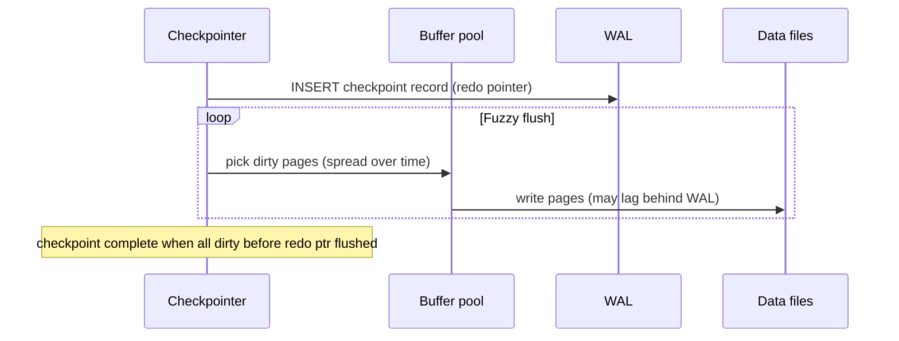
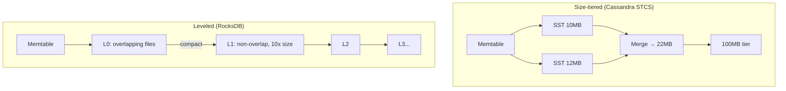
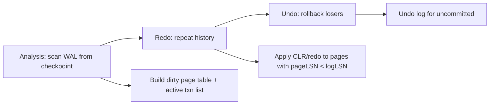

# Storage, WAL & Indexing: A Teaching Guide

This guide explains how databases turn rows into bytes on disk, how they survive crashes, and how indexes find pages without scanning every row. It synthesizes **storage engines (B-tree vs LSM)**, **write-ahead logging**, and **indexing** from first principles.

> **Core idea:** The storage engine owns pages on disk; the WAL makes commits durable; indexes are a second sorted copy you pay for on every write. Performance incidents usually come from *which amplification* you chose (read, write, space) and *whether your working set fits in memory*.

---

## Part 1: Storage Engines — Pages, B-Trees, and LSM-Trees

### The page is the atom

Everything builds on fixed-size **pages** (blocks):

| Engine | Default page size |
|--------|-------------------|
| PostgreSQL | 8 KB |
| InnoDB (MySQL) | 16 KB |
| SQLite | 4 KB |

Applications change **rows** (tens–hundreds of bytes). The engine moves **pages** (thousands of bytes). Flash moves **erase blocks** (megabytes). Each size mismatch is **write amplification**.


**Slotted pages** store rows at `page_id + slot`, not byte offsets. That lets Postgres do **heap-only tuple (HOT)** updates when a new row version fits on the same page—indexes can skip maintenance until the row moves.

**Design lever:** Doubling page size increases fan-out (fewer B-tree levels) but doubles I/O per isolated row update. InnoDB’s 16 KB default vs Postgres 8 KB matters at high random-update rates.

---

### B-tree (update in place)

**Used by:** InnoDB clustered tables, SQLite, Postgres **indexes** (heap is separate).

| Property | Implication |
|----------|-------------|
| All leaves same depth | Point read ≈ O(log n) **page** reads |
| High fan-out (~400 keys/page) | Inner levels tiny; often cached |
| Update in place | Small logical change → whole dirty page |

**Clustered vs heap (Postgres):**

- **InnoDB:** Table is a B+tree on PK; secondaries store PK → extra tree descent.
- **Postgres:** Heap is unordered; indexes point at `ctid` (6 bytes) → one index + one heap read.

**Random-key cliff (UUIDv4):**

When the index exceeds RAM, each insert hits a random leaf (~1 synchronous read per insert). Sequential keys keep the **right edge** hot.

```sql
-- Prefer time-ordered IDs for high insert rates
-- UUIDv7, ULID, snowflake — not UUIDv4 for PK on huge tables
```

| Key style | Leaf fill (steady) | Insert locality |
|-----------|-------------------|-----------------|
| Monotonic (BIGINT, UUIDv7) | ~full on right edge | Hot few pages |
| Random (UUIDv4) | ~69% (ln 2) | Whole index is working set |

**Write amplification** on B-trees is a **locality curve**, not a constant: many updates coalesced on one page before flush → low amp; random keys with cold cache → ~page_size/row_size per update.

---

### LSM-tree (never overwrite on write)

**Used by:** RocksDB, Cassandra, many analytics/ingest engines.



1. Write = append to WAL + insert memtable (no read-before-write).
2. Flush memtable → immutable **SSTable**.
3. **Compaction** merges runs, drops tombstones, controls read amp.

| Policy | Write amp (typical) | Read probes | Space |
|--------|---------------------|-------------|-------|
| Leveled (RocksDB default) | ~10–30× | Few runs + blooms | ~1.1× |
| Tiered (Cassandra STCS) | ~4–8× | More overlapping runs | Up to ~2× during merge |
| Time-window (TWCS) | ~1× after window | Great for TTL/time order | Breaks on out-of-order writes |

**Reads:** Check memtable + SSTables newest-first; **Bloom filters** bound absent-key lookups.

**Production traps:**

- Compaction debt → L0 backlog → write stalls → client retries (metastable loop).
- Queue workloads on LSM → tombstone scans.
- Deletes in Cassandra → `gc_grace_seconds` vs repair (zombie resurrection).

**Device amp compounds:** `NAND bytes ≈ logical × engine_WA × device_WA`. Sequential LSM + TRIM often beats random B-tree on worn SSDs.

---

### Choosing an engine (signals)

| Signal | Lean B-tree | Lean LSM |
|--------|-------------|----------|
| Key order | Monotonic | Random or huge ingest |
| Working set vs RAM | Fits | Index ≫ RAM |
| Read shape | Point + short ranges | Write-heavy, key lookups |
| Deletes / TTL | Rare | Bulk, time-ordered |
| p99 predictability | Hard SLO on background compaction | |

---

## Part 2: The WAL & Durability

### The WAL rule

1. **Never** flush a dirty data page before the log record describing it is durable.
2. **Never** ack `COMMIT` before the commit record is durable.

Enforced by **LSN** (log sequence number) vs **pageLSN** on each page.



### Buffer policies (why steal/no-force wins)

| Policy | Log needs | Commit cost |
|--------|-----------|-------------|
| Steal + no-force (Postgres, InnoDB) | Redo (+ undo where needed) | One sequential log flush |
| Steal + force | Undo only | Random page write per dirty page |

### Durability stack

`write()` → OS page cache (**not durable**) → `fsync()` → device cache → media.

| Setting | You lose on power cut | Corruption? |
|---------|----------------------|-------------|
| `synchronous_commit=on` / `flush_log_at_trx_commit=1` | Nothing (if stack honest) | No |
| `synchronous_commit=off` | Bounded recent commits | No |
| `fsync=off` | Unbounded | **Yes** |

> **fsync failure:** On Linux, retry after EIO can “succeed” with nothing written—treat data-file fsync errors as **PANIC** and recover from WAL.

### Group commit

Throughput ≈ `N concurrent committers / fsync_latency`. Single-threaded autocommit inserts cap at ~1/fsync per second—batch rows or relax durability per session for backfills.

**Sync replica** adds RTT to every commit; cross-region sync can cap hot-row updates at ~1/RTT per second.

### Checkpoints

Fuzzy checkpoint spreads dirty-page flush; bounds recovery time vs **full-page images (FPIs)** in WAL.

- Short checkpoint interval → more FPI WAL, replica lag.
- Long interval → long crash recovery / RTO.

**Pinning WAL:** Replication slots, lagging replicas, broken archive → disk full → primary stops writes.

### Crash recovery (ARIES shape)

1. **Analysis** — dirty pages, in-flight txns from checkpoint.
2. **Redo** — replay all logged changes (“repeat history”).
3. **Undo** — roll back uncommitted (InnoDB); Postgres relies on MVCC + vacuum instead.

---

## Part 3: Indexing

### Why indexes exist

An index is a **second copy**, sorted differently, kept in sync on every write.

**Fan-out math (illustrative, 8 KB pages):**

| Key width | ~entries/leaf | 1B rows: leaf size |
|-----------|---------------|-------------------|
| 8-byte BIGINT | ~400 | ~20 GB |
| 64-byte email | ~100 | ~80 GB |

Cold point lookup ≈ **one leaf read + one heap read** (inner levels cached).

### Selectivity crossover

With `seq_page_cost=1`, `random_page_cost=4`, ~100M rows:

- Seq scan cost ~ pages.
- Uncorrelated index scan ~ `4 × matching_rows`.
- Crossover ~ **0.25%** of table—indexes on low-selectivity columns often lose.

**ORDER BY … LIMIT trap:** Index on `created_at` + filter on `status` can walk millions of rows if failed rows cluster in time—use `(status, created_at)` or partial index.

### Clustered vs non-clustered

| | Clustered (InnoDB PK) | Heap + indexes (Postgres) |
|--|----------------------|---------------------------|
| Range on PK | Sequential | Random unless clustered |
| Secondary lookup | Index → PK → row | Index → ctid → heap |
| Wide PK | Bloats every secondary | 6-byte ctid |

### Covering indexes

`INCLUDE (col)` (Postgres 11+) widens **leaves only**. Wins when query returns many rows; skip for single-row lookups.

**Index-only scan** needs **visibility map** (Postgres) or trustable page MVCC (InnoDB)—watch **Heap Fetches** in `EXPLAIN ANALYZE`.

### Composite indexes

**Rule:** Equality columns first, then **one** range/sort column, then `INCLUDE`.

Leftmost prefix: `(a,b,c)` serves `WHERE a=? AND b>?` but reads all matching `c` in range.

### When indexes hurt

| Class | Cost |
|-------|------|
| Random-key index | Random leaf read + page write-back |
| UNIQUE | Read-before-write; no change buffer (InnoDB) |
| GIN on JSON/arrays | Many entries per row |
| `updated_at` on hot table | Kills HOT in Postgres |

**Queue table:** `ORDER BY id LIMIT 10` + delete-from-left → dead entries at head; partial index on status or partitioning.

---

## Design review checklist

**Storage**

- Where are we on the B-tree locality curve at 10× data size?
- `ingest × write_amp` vs device DWPD and sustained bandwidth?
- L0 count / pending compaction bytes alerting?

**WAL**

- Measured single-thread fsync latency? PLP on NVMe?
- RTO vs `max redo tail ÷ replay rate`?
- What pins WAL (slots, archive, replicas)?

**Indexes**

- Match fraction on hot queries? Insert monotonic vs random?
- Index size vs buffer pool at 24 months?
- Build plan: `CONCURRENTLY` vs invalid index cleanup?

---

## Further reading map

| Topic | Next chapter in track |
|-------|------------------------|
| MVCC & isolation | Transactions |
| Query plans | Query planning |
| Replicas & shards | Replication & sharding |

*Source: Algoroq “Databases from the Inside” — Storage Engines, WAL & Durability, Indexing.*

---

## Deep dive: B-tree page splits

When an insert (or update that grows a tuple) exceeds free space on a leaf, the engine **splits** the page. Postgres and InnoDB differ in details, but the algorithm shape is the same.



**Split steps (conceptual):**

1. Choose split point (often ~50% fill so both halves balance).
2. Allocate new leaf page; move upper half of keys/tuples.
3. Insert separator key into parent (or split parent recursively → **root split** doubles tree height).
4. Update sibling pointers (linked-list leaves for range scans).
5. Log the operation in WAL **before** considering the split durable on data pages.

**Right-edge vs random insert:** Monotonic keys only split the rightmost leaf repeatedly—parent updates are cheap and cached. Random keys split arbitrary leaves → parent random I/O + possible cascade to root.

```python
# Simplified B+tree leaf split (teaching sketch)
def split_leaf(leaf: Page, new_key, new_value) -> tuple[Page, Page, Key]:
    entries = leaf.sorted_entries()
    entries.append((new_key, new_value))
    entries.sort(key=lambda e: e[0])
    mid = len(entries) // 2
    left = Page(entries[:mid])
    right = Page(entries[mid:])
    separator = right.min_key()  # first key on right page (B+tree: not duplicated on left)
    return left, right, separator
```

| Split type | Cost driver | When it hurts |
|------------|-------------|---------------|
| Leaf only | 1 new page + parent insert | Steady ingest |
| Internal split | Multiple levels dirty | Burst after idle |
| Root split | New level; all future reads +1 hop | Rare but permanent |

---

## Deep dive: buffer pool management

The **buffer pool** (shared_buffers in Postgres, InnoDB buffer pool) is a hash table of `page_id → frame` plus replacement policy.

| Component | Role |
|-----------|------|
| **Pin count** | In-use pages cannot be evicted (scan holds pin per page) |
| **Dirty bit** | Frame differs from disk; must flush or WAL-redo on crash |
| **Clock / LRU** | Evict unpinned, clean frames first |
| **Victim selection** | Steal dirty page → write back or rely on WAL redo |

**Steal policy:** A query may evict another transaction’s dirty page; correctness comes from WAL (pageLSN ≤ flushed LSN before reuse is safe only after checkpoint rules).

```python
class BufferPool:
    def __init__(self, capacity: int):
        self.frames: dict[int, Frame] = {}
        self.clock_hand = 0

    def get_page(self, page_id: int) -> Frame:
        if page_id in self.frames:
            self.frames[page_id].ref_bit = True
            return self.frames[page_id]
        while len(self.frames) >= self.capacity:
            self._evict_one()
        frame = self._read_from_disk(page_id)
        self.frames[page_id] = frame
        return frame

    def _evict_one(self):
        # Clock: scan ref_bit; clear once; evict on second pass if unpinned
        ...
```

**Production signals:**

| Metric | Meaning |
|--------|---------|
| `buffer cache hit ratio` | Misleading alone—high hit + slow queries = wrong pages cached |
| `evictions` / `backend writes` | Working set > RAM → read amp on every cold query |
| `checkpoint` spikes | Many dirty pages flushed together |

**Incident:** After a major version upgrade, `shared_buffers` doubled but workload unchanged—hit ratio rose while p99 worsened: larger pool delayed eviction of scan-polluted pages, starving hot index roots.

---

## Deep dive: checkpoint mechanics

A **checkpoint** records a redo starting point and encourages dirty-page flush so crash recovery replays less WAL.



**Postgres fuzzy checkpoint (simplified algorithm):**

1. Compute `redo` LSN where recovery should begin.
2. Write checkpoint WAL record containing `redo`, `checkpoint_time`, snapshot of in-progress txns.
3. Incrementally flush dirty buffers until redo horizon is clean (not necessarily all dirty pages globally—**fuzzy**).
4. Update control file with minimum recovery LSN.

**Trade-off table:**

| `checkpoint_timeout` / `max_wal_size` | Recovery time | Steady-state I/O |
|---------------------------------------|---------------|------------------|
| Aggressive (small WAL) | Short RTO | More FPI + flush churn |
| Lazy (large WAL) | Long crash recovery | Smoother writes, replica lag risk |

---

## Deep dive: LSM compaction — size-tiered vs leveled



| Strategy | Compaction trigger | Write amplification | Read amplification | Space |
|----------|-------------------|---------------------|--------------------|-------|
| **Size-tiered** | N similar-size runs in a tier | Lower (~4–8×) | Higher (many runs to probe) | Up to ~2× during merge |
| **Leveled** | L0 file count / size budget | Higher (~10–30×) | Low (1 file per level typical) | ~1.1× |
| **FIFO / TTL** | Age | Minimal | Good for time-range | Tombstones must expire |

**Leveled invariant (idealized):** Level L has keys partitioned into non-overlapping files; each key appears in at most one file per level below L0. Compaction moves data from Li → Li+1, rewriting ~10× bytes per byte ingested at steady state.

**Size-tiered trap:** Two SSTables with overlapping key ranges merge into one giant run—read path must check every overlapping file in every tier.

---

## Deep dive: Bloom filter sizing

Each SSTable (and sometimes each memtable) may carry a Bloom filter for **absent-key** shortcuts.

**Parameters:**

- `n` = expected keys in file  
- `p` = desired false-positive rate  
- Bits per key: `m/n ≈ -ln(p) / (ln 2)²`  
- Hash functions: `k ≈ (m/n) × ln 2`

| Target FP rate `p` | Bits/key | `k` hashes |
|--------------------|----------|------------|
| 1% | ~9.6 | 7 |
| 0.1% | ~14.4 | 10 |
| 0.01% | ~19.2 | 13 |

```python
import math

def bloom_bits_per_key(false_positive_rate: float) -> float:
    return -math.log(false_positive_rate) / (math.log(2) ** 2)

def bloom_hash_count(bits_per_key: float) -> int:
    return max(1, round(bits_per_key * math.log(2)))

# Example: 1M keys, p=0.01 → ~9.6 Mbits ≈ 1.2 MB per SSTable filter
n = 1_000_000
p = 0.01
bpk = bloom_bits_per_key(p)
print(f"bits/key={bpk:.1f}, total_bits={n * bpk / 8 / 1024:.0f} KB")
```

**False positive cost:** One extra SSTable read (not a wrong answer). **False negative:** impossible if key was inserted—never skip a file that might contain the key.

**Production:** After widening key space (longer composite keys), same bit budget → higher `p` → read amp creeps up before L0 explodes.

---

## Deep dive: WAL crash recovery sequence

ARIES-style recovery (InnoDB, SQL Server family); Postgres is redo-heavy with MVCC for undo.



**Ordered steps at startup:**

1. **Find last checkpoint** — read checkpoint record; obtain `redo` LSN.
2. **Analysis phase** — scan forward from checkpoint: record first dirty page LSNs; mark txns COMMIT/ABORT in log.
3. **Redo phase** — from min dirty LSN, re-apply all logged changes (even for committed txns—**repeat history**).
4. **Undo phase** — for txns without commit record, apply compensating records (InnoDB); Postgres uses clog + vacuum for tuple visibility instead of physical undo of committed data.

**Checkpoint record must capture:** `redo` pointer, active transaction IDs, tablespace metadata—so analysis does not replay from genesis.

```text
# Recovery time budgeting
RTO_redo ≈ (wal_bytes_since_checkpoint) / (replay_MB_per_s)
# If replay is 500 MB/s and 50 GB WAL retained → ~100s redo-only
```

---

## Production scenarios: what breaks

### Vacuum falling behind (Postgres heap bloat — ties to HOT/index)

Not vacuum itself in this chapter, but **index bloat** and **visibility map** gaps block index-only scans → sudden heap fetch storms. Symptom: `EXPLAIN` shows `Index Only Scan` with millions of `Heap Fetches`. Root cause often correlates with long snapshots pinning old tuple versions on data pages indexes still reference.

### Compaction debt (RocksDB / Cassandra)

**Signal:** `pending_compaction_bytes`, L0 file count > threshold, `stall` counters increasing.

**Timeline:** Traffic spike → memtable flushes → L0 overlap → reads slow → user timeouts → retries → more writes → **write stall** (stop accepts until compaction catches up).

**Mitigation:** Rate-limit ingest, increase compaction threads (temporary), widen level base, fix tombstone-heavy delete pattern, ensure disk bandwidth headroom.

### Replication lag as WAL generation race (storage angle)

Primary generates WAL faster than replica replays—often because replica has **smaller buffer pool** or shares disk with analytical queries. Checkpoint bursts on primary send **full-page writes** to replicas → apply lag spike unrelated to query count.

### Hot partition on B-tree (right-edge myth)

Celebrity key on **secondary unique index** (email) still randomizes leaf placement. Only **clustered monotonic PK** gets right-edge locality.

### `fsync` latency spike after storage failover

Array moves to degraded mode: `commit_latency` jumps 10×; group commit no longer batches—OLTP TPS collapses while CPU idle.

---

---

## Senior Pitfalls

| Mistake | Impact | Fix |
|---------|--------|-----|
| LSM with size-tiered compaction under heavy updates | Read amplification spikes; p99 read 10× | Leveled compaction or tune `level0` triggers; cap concurrent compactions |
| B-tree index on low-cardinality column alone | Planner ignores index; seq scan anyway | Composite indexes; partial indexes; statistics on correlated columns |
| Disabling WAL for “speed” on bulk load | Unrecoverable corruption after crash | `UNLOGGED` only when acceptable; WAL for durability paths |
| Bloom filter false sense—zero false negatives | Still read SSTables on absent keys | Size blooms per level; monitor useless read rate |
| Checkpoint tuning only for write throughput | Checkpoint I/O stalls user queries | Spread checkpoint; tune `checkpoint_completion_target` |
| Huge rows + wide secondary indexes | Page splits and vacuum cost explode | Normalize hot columns; index-only what queries need |

---

## Production-grade Practice

1. **Build:** Load 50M rows into Postgres and an LSM store; compare insert TPS and p99 point-read after compactions.
2. **Debug:** Force a page split storm with random UUID PK inserts; capture `pg_stat_user_tables` bloat and mitigations (uuid v7, fillfactor).
3. **Measure:** WAL bytes per business transaction for your top three write patterns; use for DR bandwidth and replica sizing.
4. **Capacity plan:** Disk growth model for LSM (ingest × amplification × retention) vs B-tree steady state; pick engine per access pattern.

## Interview Q&A

### Q: Why do databases use fixed-size pages instead of storing rows as variable-length files?

**A:** The storage layer amortizes metadata and I/O: one latch per page, one checksum, one WAL record covering many tuples. Variable per-row files would fragment disks, explode inode/metadata cost, and prevent **slotted page** in-place updates. The mismatch between row size and page size is intentional—you trade some write amplification for simpler concurrency and caching (entire hot pages in buffer pool).

### Q: Walk through what happens when a B-tree leaf splits during a committed insert.

**A:** The transaction appends WAL records describing new tuple + structural change (new page, parent separator). Log records must reach disk before dirty pages are considered durable. In memory: allocate sibling page, redistribute keys, insert pointer in parent (possibly splitting parent up to root). Concurrent readers use tree latches/crabbing; some engines use optimistic splits with retry. After crash, redo replays the split even if partially flushed—ARIES links CLR/redo to make pages consistent.

### Q: When would you choose leveled compaction over size-tiered?

**A:** Leveled when **read latency and predictability** matter: point lookups must touch few SSTables, Bloom filters stay effective, space amplification must stay ~1×. Choose size-tiered when **write rate** dominates and you can tolerate read amp (analytics ingest, Cassandra with careful `tombstone_compaction_interval`, time-window compaction). Hybrid: RocksDB **universal** compaction for some workloads; Cassandra **STCS → LCS** when reads hurt.

### Q: Explain the WAL rule “data page before log” vs “log before data” — which direction?

**A:** **Log before data** for durability: never write a dirty data page until the WAL record describing that change is durable (so crash can redo). **Never acknowledge commit** until commit record is durable. The opposite order (data before log) risks torn pages with no redo story. Steal/no-force means data pages may lag log indefinitely while still being correct after recovery.

### Q: How do Bloom filters interact with deletes and tombstones in an LSM?

**A:** Bloom filters usually track **keys present** in the SSTable at build time. Tombstones live in SSTables until compaction removes them; filters do not help “key deleted” — you must still read down the stack until you hit a tombstone or key. Heavy delete workloads without compaction → filters still say “maybe present” → full stack probes (**tombstone stall** in Cassandra if repair lags).

### Q: What is write amplification vs device write amplification?

**A:** **Engine WA:** logical bytes written to storage layer / logical user bytes (e.g., compaction rewrites). **Device WA:** NAND pages programmed / host bytes (FTL garbage collection, over-provisioning). They multiply: small random B-tree updates on a full SSD can show host 2× and device 10×. Sequential LSM compaction often lowers both.

### Q: How do you size `shared_buffers` vs OS page cache?

**A:** Postgres often recommends 25% RAM on dedicated OLTP (not a law). Double-counting with OS cache helps **single-process** read paths but can hide eviction policy conflicts. InnoDB explicitly owns buffer pool. Measure: if `shared read` dominates in `EXPLAIN (BUFFERS)` after raising buffers, working set still exceeds RAM—need more memory, partition data, or fix cache-unfriendly scans—not infinite buffer growth.
