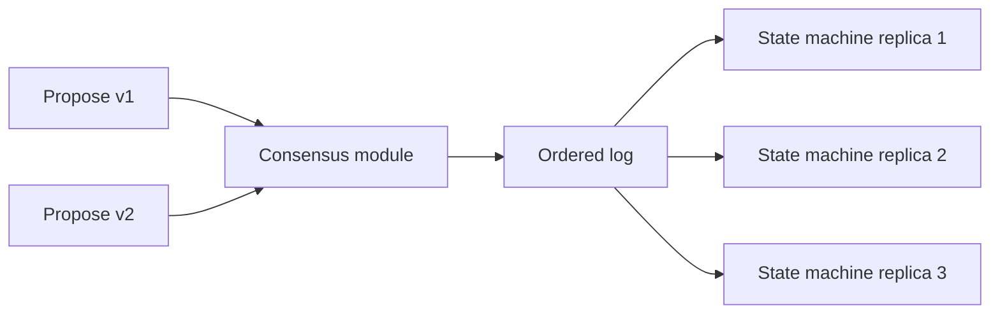
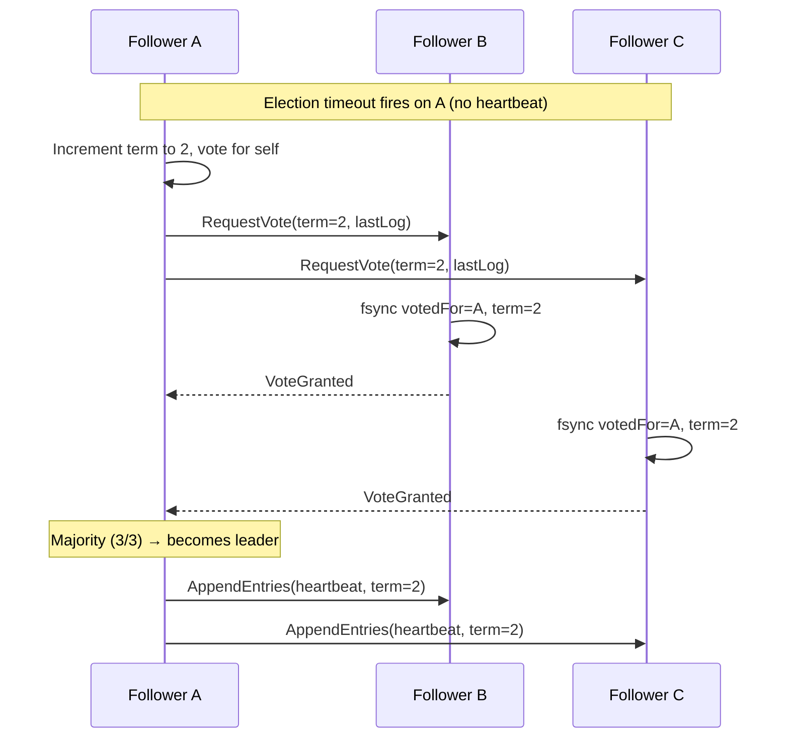
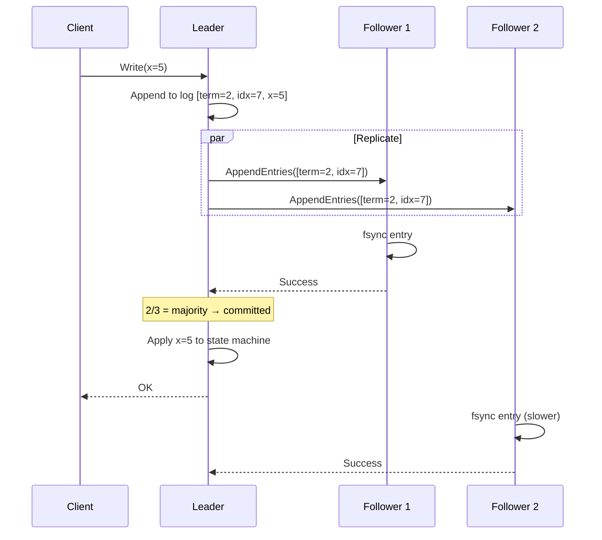
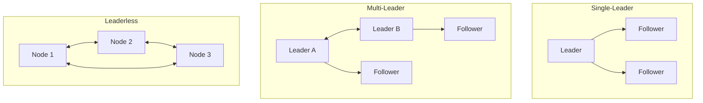
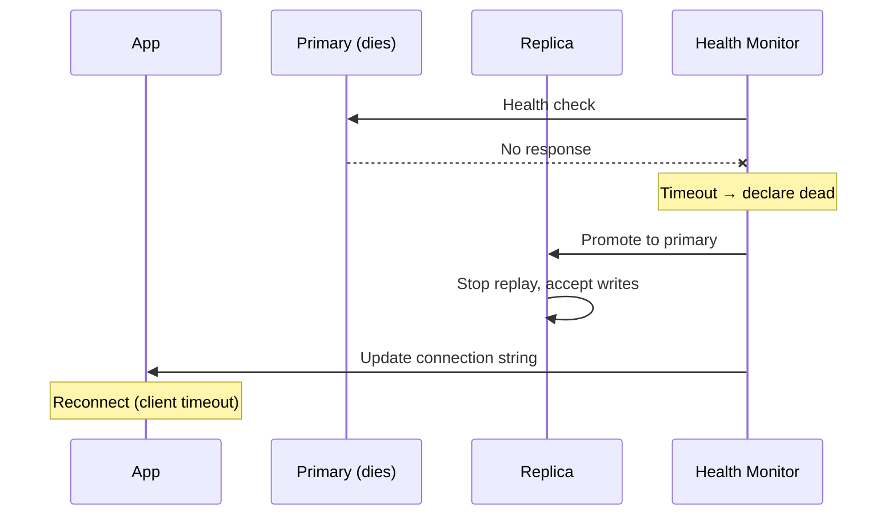

# Consensus & Replication: A Teaching Guide

How groups agree on one value—and how copies of data behave when the network lies.

> **Why this matters:** Every replicated database, distributed lock, and configuration store depends on consensus underneath. Understanding Raft/Paxos and replication trade-offs is the difference between "it works in dev" and "it survives production."

---

## Part 1: Consensus

### The agreement problem

For N nodes proposing values, consensus guarantees:

| Property | Meaning |
|----------|---------|
| **Agreement** | No two decide differently |
| **Validity** | Only proposed values chosen |
| **Termination** | Non-faulty nodes eventually decide (liveness—not unconditional per FLP) |

**FLP impossibility:** No deterministic algorithm can guarantee consensus in an asynchronous system where even one process may crash. Real systems bypass FLP with **randomized timeouts** (Raft) or **partial synchrony** assumptions.

**Replicated state machine:** Same initial state + same ordered log → identical replicas. This is the foundation of etcd, ZooKeeper, CockroachDB, TiKV.



### Why not just use a database?

Consensus solves a narrower, harder problem: **agreement on order** when the network can delay, reorder, or lose messages. A replicated DB uses consensus internally (or avoids it and accepts weaker guarantees).

---

## Part 2: Raft (the dominant consensus algorithm)

### Mental model

Raft factors consensus into three subproblems: **leader election**, **log replication**, and **safety**. Only the leader accepts writes—simplifying reasoning vs Paxos.

### Leader election step-by-step



Key invariants:
- **Terms** monotonic; higher term forces step down immediately.
- **Vote** at most once per term—must **fsync** `votedFor` before reply (crash safety).
- Majority of N wins; split vote → random timeout retry.
- **Election restriction:** Candidate's log must be at least as up-to-date as voter's (prevents stale leader).

**Failover time** ≈ detection + election + no-op commit + **client rediscovery** (often timeout-dominated).

**Cross-region:** Randomization window must be >> WAN RTT or perpetual split votes.

### Log replication



1. Leader appends entry (term, index, command).
2. `AppendEntries` RPC to all followers in **parallel**.
3. **Committed** when majority have persisted to disk.
4. Leader applies to state machine, responds to client.
5. Followers learn commit index via next heartbeat.

**Critical rule:** Leader commits **current-term** entries directly; old-term entries commit only via a later current-term entry (no-op after election). This prevents the "figure 8" scenario where a committed entry could be overwritten.

**Parallel fsync** on leader vs serial: major latency win. Best systems fsync in parallel with sending `AppendEntries`.

**Catch-up:** Conflict term/index in rejection → skip whole terms, not one entry per RTT.

### Raft log structure (conceptual)

```
Index:  1     2     3     4     5     6     7
Term:  [1]   [1]   [1]   [2]   [3]   [3]   [3]
Cmd:   x=1   y=2   x=3   y=7   x=5   z=1   x=9
                                ↑
                           commit index
```

```python
class RaftLogEntry:
    def __init__(self, term: int, index: int, command: bytes):
        self.term = term
        self.index = index
        self.command = command

class RaftNode:
    def __init__(self, node_id: int, peers: list):
        self.current_term = 0
        self.voted_for = None
        self.log = []
        self.commit_index = 0
        self.state = "follower"

    def on_request_vote(self, candidate_term, candidate_id, last_log_index, last_log_term):
        if candidate_term < self.current_term:
            return False
        if candidate_term > self.current_term:
            self.current_term = candidate_term
            self.state = "follower"
            self.voted_for = None
        if self.voted_for is None or self.voted_for == candidate_id:
            if self._candidate_log_is_up_to_date(last_log_index, last_log_term):
                self.voted_for = candidate_id
                self._fsync_state()  # MUST persist before replying
                return True
        return False

    def _candidate_log_is_up_to_date(self, last_idx, last_term):
        my_last_term = self.log[-1].term if self.log else 0
        my_last_idx = self.log[-1].index if self.log else 0
        if last_term != my_last_term:
            return last_term > my_last_term
        return last_idx >= my_last_idx
```

### Quorum intersection

Any two majorities overlap ≥1 node → committed entries survive elections.

| N | Majority | Crashes survived | Notes |
|---|----------|------------------|-------|
| 3 | 2 | 1 | Minimum useful cluster |
| 5 | 3 | 2 | Standard production |
| 4 | 3 | 1 | **Worse than 3** — same fault tolerance, more nodes |
| 7 | 4 | 3 | Rare; cross-region |

**Flexible Paxos:** `|Q_elect| + |Q_repl| > N`—cheaper commits, fragile elections.

### Paxos vs Raft

| | Multi-Paxos | Raft |
|--|-------------|------|
| Mental model | Ballots per decision | Strong leader + factored subproblems |
| Common path | Stable leader skips Prepare | AppendEntries heartbeats |
| Leader | Any proposer | Single elected leader |
| Log gaps | Allowed | Prohibited (contiguous) |
| Understandability | Notoriously hard | Designed for clarity |
| Bottom line | Majority RTT per decision | Same |

**Multi-Raft:** One group per shard—throughput scales; **quiescence** vs election storm tradeoff. Used by TiKV, CockroachDB.

---

## Part 3: Replication topologies

### Overview



### Single-leader

Ordered log; leader reads linearizable; followers scale reads until **apply** bound.

| Log format | Upgrade path | CDC | Used by |
|------------|--------------|-----|---------|
| Statement | Fragile (non-deterministic) | Poor | MySQL (legacy) |
| Physical WAL | Same version only | No | Postgres streaming |
| Logical rows | Cross-version | Yes | Postgres logical, MySQL row-based |

**Failover sequence:**



**Failover risks:**
- Async tail = **observed** lost writes (IDs, emails sent). **Fence** with term/token.
- Split-brain: old primary comes back, thinks it's still leader. Use fencing tokens at storage layer.
- **Bootstrap slot:** Retained WAL while snapshot copies for hours → disk full.

### Sync vs async

| | Sync | Async |
|--|------|--------|
| RPO | 0 (with quorum) | Lag × commit rate |
| Latency | +RTT + replica fsync | Minimal |
| Availability | Slow/dead sync peer blocks writes | Leader continues alone |
| Data loss risk | None (if quorum) | Replication lag window |

**Semi-sync timeout fallback** → durability silently degrades to async—alert on mode change.

**Postgres sync levels:**

```sql
-- Strongest: waits for replay on replica
SET synchronous_commit = 'remote_apply';

-- Mid: waits for WAL write on replica (not replayed)
SET synchronous_commit = 'remote_write';

-- Weakest sync: just waits for WAL receipt
SET synchronous_commit = 'on';
```

### Multi-leader

Per-region leaders; conflicts → **LWW** on timestamps—silent data loss. Only safe when data is **naturally partitioned by region** (e.g., EU users always write to EU leader).

**Conflict resolution strategies:**

| Strategy | Pros | Cons |
|----------|------|------|
| LWW (last writer wins) | Simple | Silent data loss under clock skew |
| Custom merge function | Correct for domain | Complex to implement |
| CRDTs | Automatic merge | Limited data types |
| Conflict-free by design | No conflicts | Restricts write patterns |

### Leaderless (Dynamo-style)

`R + W > N` overlap for read/write quorums—**not** linearizable without careful implementation. Sloppy quorum (hinted handoff to non-home nodes) breaks the overlap guarantee.

```python
# Quorum examples (N=3)
# Strong: R=2, W=2 → always overlap
# Read-heavy: R=1, W=3 → fast reads, slow writes
# Write-heavy: R=3, W=1 → fast writes, slow reads (and stale reads possible during failures)
```

**Read repair**, **hinted handoff**, **anti-entropy** (merkle trees)—high operational complexity. Used by: Cassandra, Riak, DynamoDB.

---

## Part 4: Session guarantees & lag

| Problem | What happens | Mitigation |
|---------|-------------|------------|
| RYW violation | User writes, reads from stale replica, doesn't see own write | Read from primary or wait for LSN |
| Monotonic reads | User sees new data, then older data on next request | Sticky replica or version token |
| Causal order | Comment appears before the post it replies to | Version vector / causal token |

**Lag math:** `d(backlog)/dt = wal_in - apply_out`. Size replica for **peak WAL + read load**.

```python
# Read-your-writes with LSN tracking
class SessionConsistency:
    def __init__(self):
        self.last_write_lsn = 0

    def after_write(self, lsn: int):
        self.last_write_lsn = max(self.last_write_lsn, lsn)

    def choose_replica(self, replicas):
        for r in replicas:
            if r.applied_lsn >= self.last_write_lsn:
                return r
        return self.primary  # fallback
```

**Gray failure:** Replica passes health check but applies WAL slowly—real queries see stale data. LB can't detect this without application-level health.

---

## Part 5: Read path pricing (consensus stores)

Illustrative multi-region (70ms RTT):

| Path | Latency | Assumption | Example |
|------|---------|------------|---------|
| Stale follower | ~1ms | Unbounded staleness | Analytics dashboards |
| Bounded staleness | ~2ms | Data ≤ δ seconds old | Product catalog |
| Lease read on leader | ~70ms | Clock + pause bounded | Spanner's TrueTime |
| ReadIndex | ~140ms | No clock trust, 1 RTT to leader | etcd default |
| Read through log | ~150ms | Strongest, committed read | etcd linearizable |

> **100:1 read:write ratio → fleet latency dominated by read consistency choice, not write path.**

### Linearizable reads without going through the log

```
Leader receives read request
  → Records current commit index as "read index"
  → Sends heartbeat to confirm it's still leader
  → Waits until state machine has applied up to read index
  → Serves the read
```

This avoids appending a log entry per read (expensive) while still guaranteeing linearizability.

---

## Part 6: Operations & zombie prevention

### etcd operations

```bash
# Linearizable vs serializable reads
etcdctl get key --consistency=linearizable   # strongest, higher latency
etcdctl get key --consistency=serializable   # stale OK, faster

# Check cluster health
etcdctl endpoint health --cluster
etcdctl endpoint status --cluster -w table

# Defrag (reclaim space from compacted revisions)
etcdctl defrag --cluster
```

### Zombie leader prevention (fencing)

A leader that is partitioned but doesn't know it can still accept writes → **split brain**.

```python
class FencedStorage:
    """Storage that rejects writes from stale leaders."""

    def __init__(self):
        self.current_fence_token = 0

    def write(self, key: str, value: str, fence_token: int):
        if fence_token < self.current_fence_token:
            raise StaleLeaderError(f"Token {fence_token} < {self.current_fence_token}")
        self.current_fence_token = fence_token
        self._do_write(key, value)
```

**Test zombie scenarios:** `SIGSTOP` the leader process (simulates GC pause / network partition), verify new leader is elected and old leader's writes are rejected when it resumes.

---

## Design review checklist

1. Is coordinator decision **replicated** (internal 2PC) or external XA?
2. `votedFor` / term persisted before vote ack? (crash safety)
3. Promotion excludes replica with lag > RTO budget?
4. RPO computed at **burst lag**, not average?
5. What stops zombie leader writes—tested with SIGSTOP?
6. Read consistency level documented per query path?
7. Client retry on leader change uses **exponential backoff**?
8. Quorum size odd? (Even N = same fault tolerance as N-1, more cost)

*Source: Algoroq — Consensus: Raft & Paxos, Replication (DS track).*

---

---

## Senior Pitfalls

| Mistake | Impact | Fix |
|---------|--------|-----|
| Treating `R + W > N` as linearizability | Stale reads after “successful” writes; finance and inventory bugs | Use leader reads, version checks, or explicit linearizable API mode |
| Skipping fencing tokens on lease-based locks | Zombie leader resumes writes after partition heals | Require monotonic epoch/fence on every storage mutation |
| Odd-sized clusters with even quorum math | Pay for N nodes but tolerate only N/2−1 failures | Use odd N; document W/R per operation class |
| Promoting async replica without lag check | Minutes of lost commits after failover | `pg_wal_lsn` / heartbeat lag gates; sync quorum for critical paths |
| Linearizable reads on every key lookup | 2× RTT and leader load; tail latency SLO breach | Serializable/local reads for cache; linearizable only for coordination |
| Ignoring joint consensus during membership change | Two leaders in overlapping configurations | Run joint-config phase; automate with operator runbooks |

---

## Production-grade Practice

1. **Build:** Stand up a 3-node Raft cluster (etcd or toy implementation) and implement a client that retries on `leader changed`; measure p99 read latency for linearizable vs serializable modes under 50% write load.
2. **Debug:** Inject a 30s GC pause on the leader during steady traffic; capture whether followers elect, whether stale leader writes succeed, and whether fencing rejects them—document the timeline.
3. **Measure:** Graph replication lag (bytes and seconds) for sync vs async replicas at fixed write TPS; define the maximum lag your RPO allows and test failover at 2× that lag.
4. **Capacity plan:** Model quorum read/write cost for N=3,5,7 at your target OPS; include cross-AZ RTT and fsync latency to justify shard count vs larger Raft groups.

## Interview Q&A

### Q: Why must a Raft node persist `votedFor` and `currentTerm` before sending a vote?

**A:** If the node crashes after granting a vote but before persisting, it could restart and grant a second vote in the same term to another candidate—breaking the “at most one leader per term” safety argument. The disk fsync before reply is part of the **election safety** proof, not an optimization.

### Q: Explain the Raft rule that entries from a prior term cannot be committed by counting replicas alone.

**A:** A leader might replicate an old-term entry to a majority without that entry being safe—only entries from the **leader’s current term** commit directly when replicated to a majority. Older entries commit indirectly when a **current-term** entry at a higher index is committed (the “leader completeness” property). This prevents overwriting a supposedly committed entry after a series of elections.

### Q: When is Multi-Raft preferable to one big Raft group?

**A:** When a single log’s throughput or storage size is the bottleneck—**shard by key range** with one Raft group per range (TiKV, Cockroach). Tradeoffs: cross-range transactions need 2PC across groups; more groups → more election/heartbeat overhead unless **quiescent** groups are optimized.

### Q: How does `R + W > N` relate to linearizability in Dynamo-style systems?

**A:** Quorum overlap ensures a read and write share at least one node—**necessary but not sufficient** for linearizability. Without version checks or leader coordination, sloppy quorums, and concurrent writers, reads can still return stale or merged siblings. Dynamo uses version vectors and read repair; DynamoDB strong reads use additional coordination.

### Q: What is the difference between etcd’s linearizable and serializable read modes?

**A:** **Linearizable** confirms leadership (ReadIndex / quorum) so the read reflects all committed writes up to that point cluster-wide. **Serializable** (local) reads from the node’s state without that confirmation—faster but can be stale relative to the current leader. Use linearizable for coordination; serializable for best-effort cache-like reads.

### Q: Why can a paused leader still cause split brain without fencing?

**A:** The leader’s lease may expire and a new leader elected, but the old leader process resumes and accepts client writes—it does not know it was replaced. **Fencing tokens** (or epoch numbers on storage) reject writes from stale leaders; without them, two leaders can diverge until manual merge.

### Q: How do you choose between sync replication and consensus for a new service?

**A:** **Single-leader DB sync replica** fits when one engine is source of truth and you accept failover complexity. **Embedded consensus (Raft)** fits when the service itself is the replicated state machine (config, locks, metadata) and you need automatic leader election with clear client semantics. Consensus adds operational cost (odd-member clusters, version upgrades) but removes “promote replica” as a separate product.
