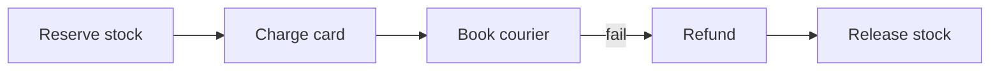
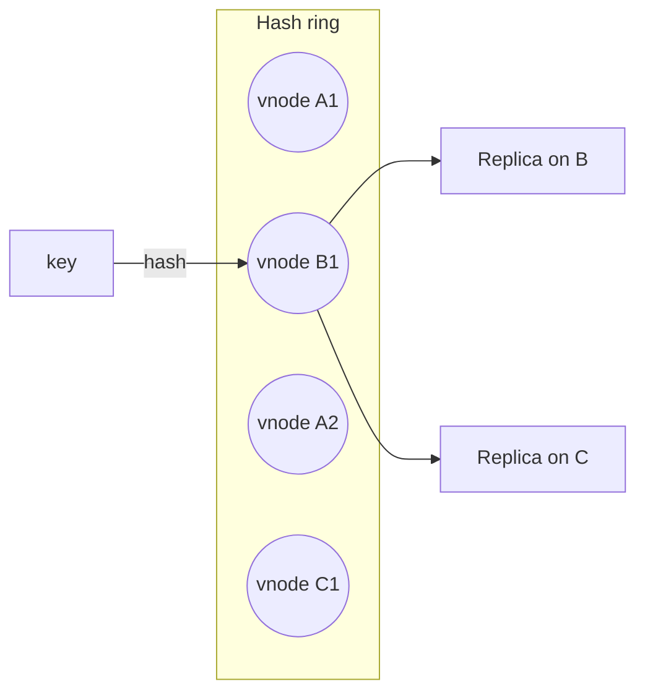
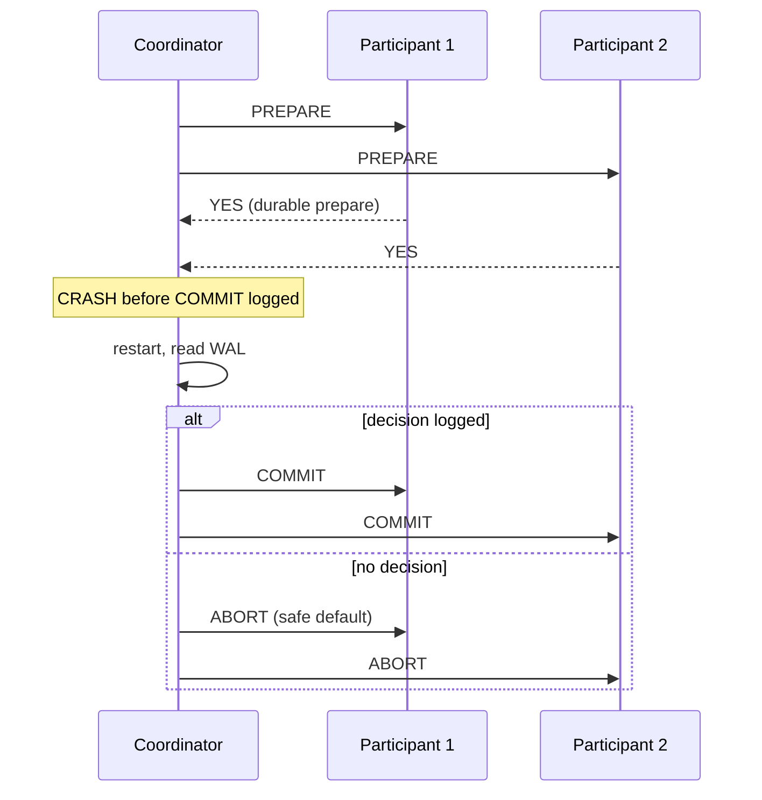
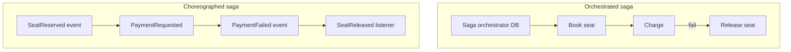

# Partitioning, CRDTs & Distributed Transactions: A Teaching Guide

Scaling data across machines—and coordinating writes when there is no single commit record.

---

## Part 1: Partitioning strategies

### Hash vs range vs compound

| Strategy | Spread | Range query |
|----------|--------|-------------|
| Hash | Even | Fan-out all shards |
| Range | Skew on hot range | Local |
| `(hash(tenant), time)` | Per-tenant local time | Cross-tenant = analytics |

**Fan-out tail:** `P(slow query) ≈ 1 - (1-p)^F`. At F=64, p=1% → ~52% slow.

### Secondary indexes

- **Local:** Write 1 shard; read by email → all P shards.
- **Global:** Read targeted; write touches base + index shard (2PC or async lag).

Rule: high-read, low-write lookup attributes → global can pay off.

### Hot keys

| Symptom | Fix | Cost |
|---------|-----|------|
| Read-heavy celebrity | Cache / read replicas | Staleness |
| Write-heavy commutative | Salt sub-keys | S-way read merge |
| Non-commutative hot key | Single-writer queue | Latency |
| Monotonic time PK | Bucket prefix hash | Multi-partition reads |

**Splitting** fixes hot **range**, not single key exceeding node capacity.

### Consistent hashing

Ring + **virtual nodes** for even load. **Replica placement** must be topology-aware (AZ/rack)—small zone carries more data.

Adding node moves ~1/(N+1) keys (vnodes)—vs ~91% for `mod N`.

### Rebalancing

1. Snapshot copy (hours for TB).
2. Log catch-up (must converge).
3. Write freeze (ms–s).
4. **Epoch route flip** (source rejects old epoch).
5. Drain delete.

Start resharding at **60–70%** util—not 95%.

---

## Part 2: CRDTs & conflict-free merge

When replicas write independently, merge function must be:

- **Commutative** (order-free)
- **Associative**
- **Idempotent**

### State-based vs op-based

| | State-based | Op-based |
|--|-------------|----------|
| Ship | Full state | Operations |
| Bandwidth | Heavy | Light if ops small |
| Requires | Merge function | Reliable broadcast |

### Examples (intuition)

| CRDT | Use |
|------|-----|
| G-Counter | Per-node increments, sum merge |
| PN-Counter | Inc/dec per actor |
| LWW-Register | **Dangerous** with clock skew |
| OR-Set | Add/remove with unique tags |

**CRDTs don’t remove conflicts**—they **relocate** them to merge semantics users must accept.

### Anti-entropy & gossip

Replicas diverge → **read repair**, **merkle trees**, background sync.

Repair cadence must beat tombstone grace in LSM stores (Cassandra).

---

## Part 3: Distributed transactions

### Dual-write problem

```text
DB commit ✓  →  crash  →  publish event ✗
```

No ordering of two independent commits is atomic.

### Two-phase commit (2PC)

1. **Prepare:** vote yes, hold locks, durable prepared record.
2. **Commit/abort:** coordinator decision fsynced, then notify.

**Blocks** if coordinator dies after prepare—locks until recovery (or heuristic commit = **breaks atomicity**).

**Hot row ceiling** ≈ `1 / lock_hold_time`:

| Scenario | Hold time | ~Ceiling |
|----------|-----------|----------|
| Local txn | ~1 ms | ~1000/s |
| 2PC same AZ | ~4 ms | ~250/s |
| 2PC cross-region | ~142 ms | ~7/s |

**When 2PC is OK:** Coordinator decision in **consensus** (Spanner, Cockroach internal)—not heterogeneous XA across DB + broker + SaaS.

### Sagas

Forward: `T1, T2, …, Tn` each local commit.  
Backward on failure: `C_{k-1}, …, C1` compensations.



**Pivot transaction:** Irreversible step (capture payment) after compensatable steps.

| Style | Pros | Cons |
|-------|------|------|
| Orchestration | Clear control | Coordinator SPOF |
| Choreography | Decoupled | Hard to debug |

Intermediate states **visible**—UI and ops must tolerate.

### Outbox pattern

```sql
BEGIN;
  INSERT INTO orders (...) VALUES (...);
  INSERT INTO outbox (event_type, payload) VALUES ('OrderPlaced', ...);
COMMIT;
-- separate poller publishes from outbox, marks sent
```

Same WAL → atomic with row.

### Delivery semantics

| Claim | Reality |
|-------|---------|
| At-most-once | Fire-and-forget |
| At-least-once | Retry + idempotency |
| Exactly-once | **End-to-end** idempotent consumers + dedupe |

---

## Part 4: Idempotency & exactly-once illusion

```go
// Check-then-act race — wrong
if !cache.Has(key) { db.Insert(...); cache.Set(key) }

// Right: unique constraint in same transaction
INSERT INTO payments (idempotency_key, ...) VALUES ($1, ...)
ON CONFLICT (idempotency_key) DO NOTHING RETURNING *;
```

---

## Part 5: Composition

`P partitions × RF replicas` = operational groups. Partitioning without replication = no AZ story; replication without key design = hotspots.

---

## Review questions

1. Scatter width F on OLTP queries—per-shard p99.9 target?
2. Global index: sync or async—what does login see after email change?
3. Cross-service flow: outbox, saga, or 2PC—and is coordinator replicated?
4. Compensations defined for every irreversible step?
5. Repair interval < `gc_grace_seconds`?

*Source: Algoroq — Partitioning & CRDTs, Distributed Transactions & Sagas.*

---

## Deep dive: consistent hash ring (full sketch)

See replication chapter for Python `HashRing`; operational extras:

| Parameter | Guidance |
|-----------|----------|
| `vnodes_per_node` | 64–256 for even spread |
| **Rack awareness** | Place replicas on different failure domains |
| **Handoff** | During migration, dual-route with versioned routing table |



**Hot key mitigation (salt):**

```text
physical_key = f"{user_id}#{shard_id}"  where shard_id in 0..S-1
read: merge S partial aggregates
write: round-robin or hash(user_id, event_id)
```

---

## Deep dive: range partition rebalancing (operational)

**Detect skew:**

```sql
-- Illustrative: per-shard QPS from metrics
shard_qps / avg(shard_qps) > 3  → investigate
```

**Split without downtime:**

1. **Dual-write** phase: router writes to old + new shard (or use change-data-capture).
2. **Backfill** historical range to new shard.
3. **Verify** checksum / row counts per range.
4. **Epoch flip:** reject writes with old routing generation.
5. **Drain** read traffic; delete old range.

**Merge:** When tail shards are cold (archival data), merge into neighbor to reduce connection fan-out.

---

## Deep dive: G-Counter implementation

Each node increments only its own slot; merge takes **per-index max**; value is **sum** of slots.

```python
from dataclasses import dataclass, field
from typing import Dict

@dataclass
class GCounter:
    """Grow-only counter CRDT — one slot per replica id."""
    counts: Dict[str, int] = field(default_factory=dict)

    def increment(self, node_id: str, delta: int = 1) -> None:
        self.counts[node_id] = self.counts.get(node_id, 0) + delta

    def value(self) -> int:
        return sum(self.counts.values())

    def merge(self, other: "GCounter") -> "GCounter":
        keys = set(self.counts) | set(other.counts)
        merged = {k: max(self.counts.get(k, 0), other.counts.get(k, 0)) for k in keys}
        return GCounter(merged)

# Usage across replicas
a = GCounter({"node1": 5})
b = GCounter({"node2": 3})
c = a.merge(b)  # {"node1": 5, "node2": 3} → total 8
```

**PN-Counter extension:** Pair of G-Counters `(P, N)` for increment/decrement; value = sum(P) - sum(N).

---

## Deep dive: OR-Set implementation

**Observed-Remove Set:** each `add(e)` tags element with unique tag; `remove(e)` tombstones all **observed** tags.

```python
import uuid
from dataclasses import dataclass, field
from typing import Dict, Set, FrozenSet

@dataclass
class ORSet:
    # element -> set of add-tags still alive
    elements: Dict[str, Set[str]] = field(default_factory=dict)
    # tombstoned tags (from remove operations)
    tombstones: Set[str] = field(default_factory=set)

    def add(self, element: str) -> str:
        tag = str(uuid.uuid4())
        self.elements.setdefault(element, set()).add(tag)
        return tag

    def remove(self, element: str) -> None:
        if element not in self.elements:
            return
        for tag in self.elements[element]:
            self.tombstones.add(tag)
        self.elements[element] = set()

    def contains(self, element: str) -> bool:
        tags = self.elements.get(element, set()) - self.tombstones
        return len(tags) > 0

    def read(self) -> Set[str]:
        return {e for e in self.elements if self.contains(e)}

    def merge(self, other: "ORSet") -> "ORSet":
        out = ORSet()
        all_elems = set(self.elements) | set(other.elements)
        for e in all_elems:
            tags = (self.elements.get(e, set()) | other.elements.get(e, set()))
            out.elements[e] = set(tags)
        out.tombstones = self.tombstones | other.tombstones
        # prune tags that are tombstoned on either side
        for e in list(out.elements):
            out.elements[e] -= out.tombstones
            if not out.elements[e]:
                del out.elements[e]
        return out
```

**User-visible semantics:** Remove beats concurrent add only if remove observed the add’s tag; concurrent add+remove without sync → **both may appear** until merge—product must accept “resurrected” items briefly or use session routing.

---

## Deep dive: 2PC coordinator recovery



**Three coordinator states after crash:**

| Log state | Recovery action |
|-----------|-----------------|
| No prepare logged | Abort all (nothing committed) |
| Prepare logged, no decision | **Blocked** — participants hold locks; heuristic commit forbidden |
| Commit/abort logged | Replay decision to all participants |

**Spanner / Cockroach:** Coordinator state is **replicated via Raft**—no single-node coordinator WAL; 2PC **decision record** is itself consensus-backed.

```python
# Coordinator recovery sketch
def recover(txn_id: str, log: TransactionLog):
    record = log.get(txn_id)
    if record.decision == "COMMIT":
        send_commit_to_all(record.participants)
    elif record.decision == "ABORT":
        send_abort_to_all(record.participants)
    else:
        # Indeterminate — participants wait or timeout to abort
        raise IndeterminateTransaction(txn_id)
```

**Postgres XA:** Orphan `PREPARE TRANSACTION` holds row locks until `ROLLBACK PREPARED`—runbook janitor required.

---

## Deep dive: Saga compensation patterns

| Pattern | Description | Risk |
|---------|-------------|------|
| **Backward recovery** | Run compensations Cₙ₋₁…C₁ | Compensation must be idempotent |
| **Forward recovery** | Retry failed step with alternate path | Needs deterministic failure detection |
| **Pivot transaction** | Irreversible step last (capture payment) | Minimize compensations after money moves |
| **Semantic lock** | Mark resource “pending” in UI | Users see intermediate state |



**Compensation example (idempotent):**

```python
def compensate_charge(payment_id: str) -> None:
    # Must succeed even if refund already issued
    provider.refund(payment_id, idempotency_key=f"refund-{payment_id}")
```

**vs 2PC:** Saga trades **isolation** for **availability**—no locks held across services; readers see `PENDING_PAYMENT` states.

---

## Production scenarios

### Hot partition detection

Metrics: `max(shard_write_qps) / p50(shard_write_qps) > 5` sustained; single Kafka partition lag; one Redis slot memory maxed. **Response:** salt keys, async aggregate, move celebrity tenant to dedicated shard.

### Global secondary index lag

User changes email; login on global index shard still has old email 30s → duplicate account attempt or auth failure. **Response:** read-after-write from primary for auth path, or sync 2PC on index (latency cost).

### 2PC across DB + message broker

Coordinator commits DB then crashes before publish → **dual-write** gap. **Response:** outbox in same DB transaction, never XA to Kafka.

### CRDT cart merge surprise

Two devices add same SKU offline; OR-Set keeps both lines; user sees quantity 1+1=2 in UI but expected max. **Response:** use PN-Counter per SKU or server-side merge policy.

### Reshard at 95% disk

Copy takes 48h; traffic keeps growing; flip window never safe. **Response:** start at 60–70%, pre-provision target shards, throttle ingest during handoff.

---

---

## Senior Pitfalls

| Mistake | Impact | Fix |
|---------|--------|-----|
| Dual-writing OLTP and search index | Divergent rows; unreproducible search results | Transactional outbox + single consumer ordering per key |
| Hot partition key (user id, tenant id) | Single shard at 100% CPU; SLO collapse | Salt keys, shuffle sharding, or dedicated hot-key pipeline |
| 2PC across many microservices | Coordinator failure blocks all participants | Saga with compensations; 2PC only inside one DB boundary |
| CRDTs for financial balances | Merge semantics violate accounting invariants | OLTP ledger + idempotent commands; CRDTs for presence/counters only |
| Resharding at 95% disk | Copy never finishes; emergency read-only | Start migration at 60–70% capacity with throttled backfill |
| Idempotency keys shorter than retry window | Duplicate charges after broker redelivery | TTL ≥ max(client, workflow, broker); store in same txn as effect |

---

## Production-grade Practice

1. **Build:** Implement consistent-hash ring with virtual nodes; add/remove two nodes and measure key movement fraction vs naive modulo hashing.
2. **Debug:** Reproduce dual-write drift by killing the indexer mid-batch; compare row counts and use outbox replay to converge—time to full consistency.
3. **Measure:** Load-test one partition key at 10× fair share; record p99 latency and error rate; validate mitigation (salting) restores flat distribution.
4. **Capacity plan:** Given daily ingest TB and retention, size partition count so no shard exceeds 70% disk in 12 months; include rebalancing bandwidth in the plan.

## Interview Q&A

### Q: When is a global secondary index worth 2PC?

**A:** When **read path** must see index consistent with base row immediately (auth by email, fraud checks) and you cannot route those reads to primary. Otherwise async index with **eventual** consistency + client tolerance is cheaper. 2PC doubles write latency and failure modes.

### Q: Explain the dual-write problem and the outbox fix.

**A:** Writing DB then message broker (or vice versa) has no atomic commit across systems—crash between steps leaves divergence. **Transactional outbox** writes business row + outbox row in one DB transaction; separate relay publishes and marks sent—same WAL fate.

### Q: How does an OR-Set differ from a simple set with LWW?

**A:** OR-Set tracks unique **tags** per add; remove tombstones observed tags only, so concurrent add on another replica survives unless that tag was seen. LWW picks one writer by timestamp—loses concurrent adds under skew.

### Q: What happens when 2PC coordinator dies after all PREPARE yes votes?

**A:** Participants hold locks and wait for COMMIT/ABORT. Without replicated coordinator log, recovery is **indeterminate**—blocking until timeout/heuristic abort (unsafe) or human ops. This is why production 2PC puts decision in **consensus**.

### Q: Compare orchestration vs choreography for sagas.

**A:** **Orchestration:** central state machine, easier debug/trace, coordinator must be HA. **Choreography:** events only, looser coupling, hard to answer “where is this saga?”—need distributed tracing and correlation IDs.

### Q: Why can't you fix hot keys with consistent hashing alone?

**A:** Hashing spreads **distinct keys** evenly; one key’s write rate can exceed single-node CPU/disk. You need **key splitting** (salts), **queue serialization**, or **materialized sharded counters**.

### Q: What merge properties must a CRDT satisfy?

**A:** State merge must be **commutative**, **associative**, and **idempotent** so replicas converge regardless of message order or duplicates. Without these, anti-entropy cannot guarantee convergence.
