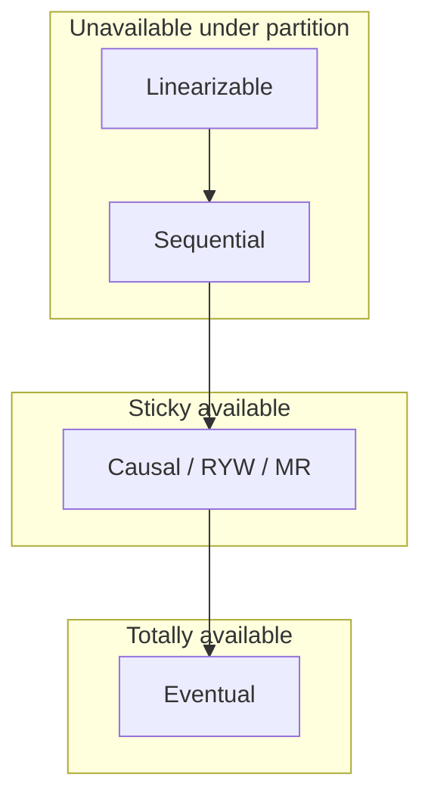
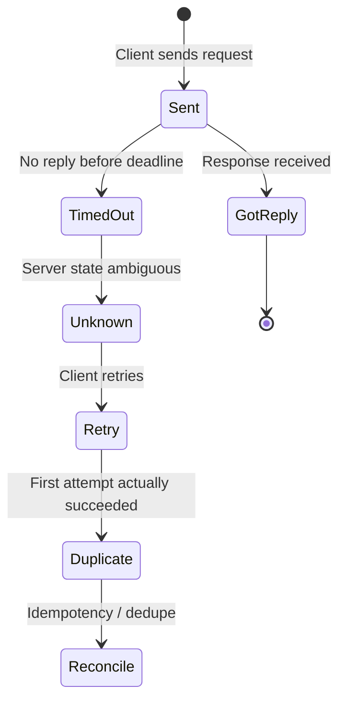
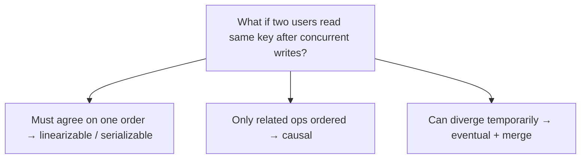
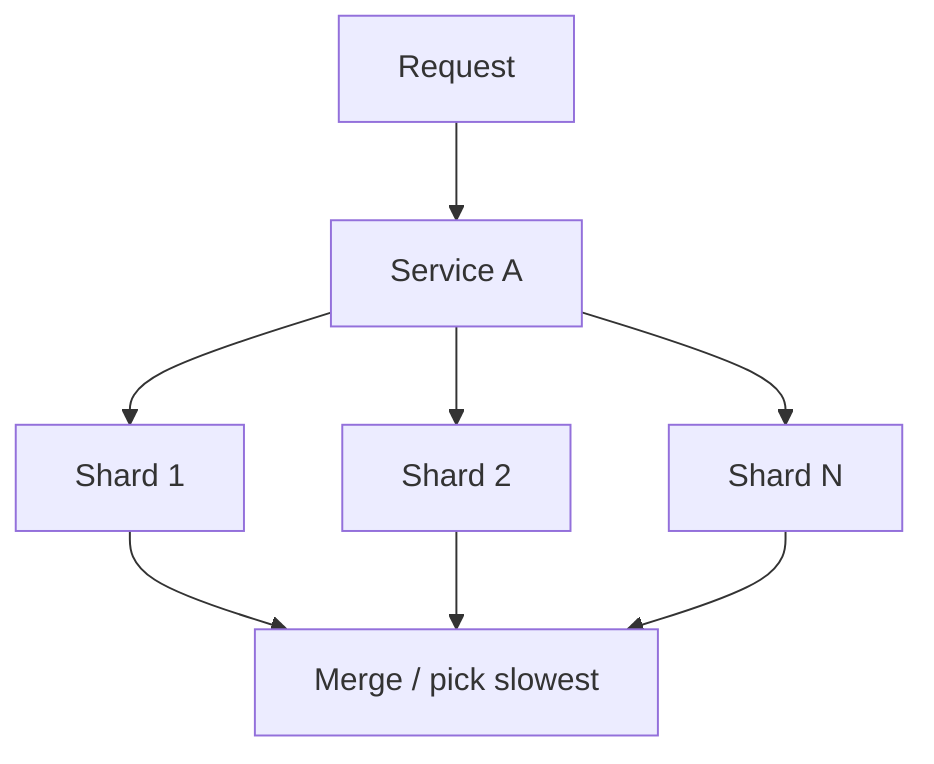

# Distributed Fundamentals: Why It's Hard, Time & Consistency

Why one machine’s intuitions break across a network—and how to reason about **order** and **promises** without a global clock.

> **Two roots of pain:** (1) you cannot tell *what happened* when a reply is lost; (2) you cannot sort events by wall clock across machines.

---

## 1. Why distributed is hard

### Fallacies (modern stack)

| Fallacy | Hides in | Signal |
|---------|----------|--------|
| Latency is zero | Fan-out / depth | Caller p99 vs leaf p99.9 × N |
| Bandwidth infinite | Cross-AZ replication | Egress $ / GB |
| Topology stable | Pinned connections | Conn age vs deploy cadence |
| Transport free | Shuffles, logs | Invoice line item |

**Fan-out:** `P(≥1 slow leaf) = 1 - (1-p)^N`. At N=100 and p=1%, ~63% of requests wait on a slow leaf.

**Serial depth:** Ten hops at 1% slow each → ~9.6% slow end-to-end; latency **sums** tails.

**Hedging:** Backup request after p95—~5% duplicate load if independent replica; **budget** hedges in brownouts.

### Partial failure

Client sees **timeout**—cannot distinguish:

1. Server did work, reply lost → retry **doubles** non-idempotent ops.
2. Server never got request.
3. Server crashed mid-apply.

**Three resolutions:** idempotency key, status query, async reconciliation.

**FLP:** No deterministic consensus in async crash model in bounded time.

**Shared fate:** Three “independent” 0.1% replicas on one ToR → ~0.05% group failure, not 10⁻⁹.

### Unreliable network

Delay is **unbounded** → duplicates, reordering, late arrivals.

**Dedupe window:** `TTL > max(client_retry_horizon, broker_redelivery)`.

At 20k rps × 24h → ~1.7B keys—prefer **unique constraint in same DB** as effect.

### No global clock (preview)

Wall clock **cannot** order cross-machine events; leases fail on **pause** not drift—use **fencing tokens** at storage.

---

## 2. Time, clocks & ordering

### Physical clocks

- Drift tens–hundreds of µs/s; NTP steps backward possible.
- **LWW** under skew: causally later write discarded silently on hot keys.
- **Rate × skew** exposure: 20 writes/s/key, δ=40ms → ~0.8 conflicting writes per write.

Use **monotonic clocks** for durations (`CLOCK_MONOTONIC`), not wall clock subtraction.

### Happens-before (→)

Rules: same process order; send before receive; transitive.

- **a ∥ b** concurrent → no justified order.
- Hidden channels (user, message bus) without tokens → **causal leaks**.

**Sequencer** (Raft log, Kafka partition) = total order when you can centralize; clocks when you cannot.

### Lamport timestamps

`L = max(local, msg) + 1` on receive.

- `a → b` ⇒ `L(a) < L(b)` ✓
- `L(a) < L(b)` ⇏ `a → b` ✗

Used in: Raft terms, fencing tokens, ZK zxids.

**Total-order broadcast** waits for quietest peer → latency ~ heartbeat interval × N.

### Vector clocks

Per-actor counters; detect **true concurrency** for merge.

- Actor = client → unbounded metadata.
- Actor = replica → small vectors; client-actor confusion → siblings.

### Hybrid logical clocks (HLC)

Used in Cockroach/Spanner-style systems—wall time + logical counter for bounded uncertainty.

---

## 3. Consistency models (ladder)

A **read is a contract**: given overlapping operation intervals, which return values are legal?

### Two axes

1. **Single-object:** linearizable → sequential → causal → eventual.
2. **Multi-object transactions:** strict serializable → serializable → snapshot → read committed.

CAP: only **minority partition** choice—strong models block or error; eventual serves locally.



### Linearizability

One copy illusion; ops at a point between call and return; **real-time** order.

- **Cost:** Quorum/consensus on write; read path often expensive.
- **Raft reads:** Through log (~150ms multi-region illustrative) vs lease read (~70ms) vs stale follower (~1ms).

**Lease failure:** Paused leader serves stale read after new leader committed—**fencing** for locks; for reads use ReadIndex or conditional writes.

> Linearizable ≠ serializable. Money needs **strict serializable** (both).

### Sequential consistency

Global order, no real-time—ZooKeeper reads from local server + `sync()` pattern.

**Does not compose** across shards.

### Causal consistency

Preserves →; concurrent writes may diverge. **Sticky:** client must stay on caught-up replica.

Pass **version tokens** on RPC side channels.

### Session guarantees (practical)

| Guarantee | Meaning |
|-----------|---------|
| Read-your-writes | See own writes |
| Monotonic reads | Time never goes backward per client |
| Monotonic writes | Writes appear in order |

### PACELC

**If Partition:** CP vs AP. **Else (normal):** Latency vs Consistency—everyday trade.

---

## 4. CAP & product choice

Ask per screen: **when region is cut off, error or stale?**

Pink-band operations on green-band stores → app-level read-modify-write as unsafe as the store.

---

## Code & patterns

**Idempotent HTTP handler (sketch):**

```python
def charge(request):
    key = request.headers.get("Idempotency-Key")
    if key:
        existing = store.get(f"idemp:{key}")
        if existing:
            return existing.response
    result = payment_provider.charge(...)
    if key:
        store.put(f"idemp:{key}", result, ttl=timedelta(hours=48))
    return result
```

**Causal token on RPC:**

```json
{"order_id": 42, "causal": {"seen_at": "shard-3:offset-9918234"}}
```

---

## Design review questions

1. For each mutating API: idempotency, query, or reconcile?
2. What do replicas **share** (deploy, cert, AZ, control plane)?
3. Dedupe TTL vs longest duplicate path?
4. Which user-facing reads need linearizable vs RYW?
5. Hidden causality channels (RPC, bus, human)?

*Source: Algoroq — Why Distributed Is Hard, Time/Clocks/Ordering, Consistency Models.*

---

## Deep dive: partial failure state machine



**Design implication:** Every mutating API needs a story for the **Unknown** state—storage of idempotency keys, outbox, or compensating workflow.

---

## Deep dive: clock skew attack surface

| Mechanism | Assumes | Fails when |
|-----------|---------|------------|
| LWW register | Wall clock order | Skew + concurrent writers |
| Lease lock | Expiry < max pause | GC stop-the-world |
| HLC / TrueTime | Bounded uncertainty | Misconfigured NTP |
| Monotonic local | Single process only | Cross-node ordering |

```python
# Unsafe: wall clock for ordering across nodes
def lww_merge(a, b):
    return a if a.timestamp >= b.timestamp else b  # silent loss if skew

# Safer: include writer id + logical counter in tie-break
def hlc_send(local_hlc, msg_hlc):
    return max(local_hlc, msg_hlc) + 1  # simplified
```

**Spanner-style:** `commit_wait = TT.now().earliest > commit_ts` — trades latency for external consistency; not free on commodity clocks.

---

## Deep dive: vector clocks in practice

For `n` replicas (not clients), vector `V[i]` = events seen from replica `i`.

```python
def merge(va: dict[int, int], vb: dict[int, int]) -> dict[int, int]:
    keys = set(va) | set(vb)
    return {k: max(va.get(k, 0), vb.get(k, 0)) for k in keys}

def concurrent(va, vb) -> bool:
    return not (dominates(va, vb) or dominates(vb, va))

def dominates(va, vb) -> bool:
    return all(va.get(k, 0) >= vb.get(k, 0) for k in set(va) | set(vb)) and va != vb
```

**Dynamo / Riak:** Version vectors per key detect siblings → application merge or CRDT.

**Pitfall:** Treating **client** as vector dimension → unbounded metadata; use **per-session** or **per-device** tokens instead.

---

## Deep dive: consistency model decision table

| User-visible behavior | Minimum model | Typical implementation |
|-----------------------|---------------|------------------------|
| Bank balance after transfer | Serializable / linearizable txn | Single leader + sync log |
| Social feed “my post appears” | Read-your-writes | Sticky session + version token |
| Product catalog price | Eventual + TTL | CDN + async replication |
| Leaderboard top 10 | Bounded staleness OK | Replica lag < 5s SLA |
| Distributed lock | Linearizable register | etcd / consensus + fencing |



---

## Deep dive: PACELC worked examples

| System | P: partition | E: normal operation |
|--------|--------------|---------------------|
| etcd | CP — minority partition read-only / no leader | PC — linearizable reads costly |
| Cassandra | AP — both sides accept writes | EL — tunable `LOCAL_QUORUM` latency |
| DynamoDB | AP default | EL — strong reads optional (`ConsistentRead`) |
| Spanner | CP | PC — TrueTime waits |

**Lesson:** CAP is one point; **daily** trade is latency vs staleness under **no** partition.

---

## Production scenarios

### Retry storm after regional blip

LB marks 50% nodes unhealthy; clients retry with no jitter; healthy nodes 10× load → cascade failure (**metastability**). **Fix:** retry budgets, exponential backoff, circuit breakers, limit concurrent requests per host.

### NTP step backward

Java `System.currentTimeMillis()` jumps back; LWW deletes newer cell in Cassandra; billing duplicates idempotency keys if TTL keyed on wall clock. **Fix:** never use wall clock alone for conflict resolution; use logical clocks or DB monotonic IDs.

### “Sticky session” lost on deploy

User writes to US-East, next request routed to US-West replica → “where is my data?” **Fix:** cookie-based replica token, or primary read after write for session duration.

### Hedging without budget

Mobile app fires duplicate RPC at 200ms on every call; downstream doubles QPS; p99 improves, p50 cost doubles, DB melts. **Fix:** hedge only on idempotent reads, cap hedge rate.

### Gray failure on consensus member

Node responds to ping but disk fsync 2s; Raft quorum barely holds; leader election flaps. **Fix:** latency-aware health, replace node, check NVMe wear / EBS credits.

---

## Deep dive: fencing tokens end-to-end

```mermaid
sequenceDiagram
  participant C as Client
  participant L as Lock service (etcd)
  participant S as Storage

  C->>L: acquire lock → token=57
  Note over C: GC pause...
  L->>L: lease expires, new leader
  C->>S: write(token=57)
  S-->>C: OK (stale!)
  C2->>L: acquire → token=58
  C2->>S: write(token=58)
  S-->>C2: OK; bumps min_token=58
  C->>S: write(token=57)
  S-->>C: reject stale token
```

Storage must **monotonically** increase accepted fence token, not merely compare lock holder identity.

---

## Interview Q&A

### Q: Why can't the client tell if a timed-out request succeeded?

**A:** The TCP/API layer only knows the reply did not arrive in time. The server may have completed work, crashed before replying, or never received the request. Without an external source of truth (idempotency record, transaction status API, or at-least-once log), retry risks duplication and abstaining risks lost work—classic **generals problem** manifestation.

### Q: Explain the difference between linearizability and sequential consistency.

**A:** Both define a single global order of operations. **Linearizability** additionally requires that order respects **real time**: if op A completes before op B starts (wall-clock observable), A precedes B in the order. Sequential consistency allows reordering that violates real-time ordering as long as each client’s own order is preserved—weaker and cheaper for some local-read designs.

### Q: When are Lamport timestamps insufficient for conflict resolution?

**A:** When you need to detect **concurrent** writes for merge. `L(a) < L(b)` does not imply causality—two independent writes can get arbitrary order. Vector clocks (or dotted version vectors) identify concurrency; CRDTs or application merge follow.

### Q: What is the practical difference between causal consistency and read-your-writes?

**A:** RYW is a **session guarantee**: one client sees its own updates. Causal consistency is **global across clients** for causally related events: if A posts and B reads A then comments, all users should see comment after post. RYW does not prevent another user from seeing comment before post unless you enforce causal order on all reads.

### Q: How does FLP impossibility affect real systems?

**A:** It proves no **deterministic** consensus in fully asynchronous model with crashes. Real systems use **timeouts** (partial synchrony), **randomized** algorithms, or **failure detectors**—Raft’s election timers are the bypass. You still get **unbounded** election delay under pathological timing.

### Q: Why is “exactly-once” messaging a misnomer?

**A:** Brokers can dedupe at publish boundary, but **effects** (charge card, ship package) happen in external systems. End-to-end exactly-once requires idempotent consumers + transactional outbox or dedupe store with same durability as business write—usually implemented as **effectively-once** semantics.

### Q: How do you size an idempotency key store TTL?

**A:** `TTL ≥ max(client_retry_window, broker_redelivery, workflow_timeout)`. Include clock skew buffer. At high RPS, full in-memory cache is expensive—prefer **unique constraint in OLTP DB** so dedupe and effect share fate.

---

## Senior Pitfalls

| Mistake | Impact | Fix |
|---------|--------|-----|
| Assuming request timeout means failure | Duplicate side effects on blind retry | Idempotency keys + outcome cache; query-before-retry for money paths |
| Using wall-clock TTL across regions | Keys expire early/late; auth and cache bugs | Logical leases, hybrid logical clocks, or centralized TTL authority |
| “Strong consistency” without naming a model | Teams ship different guarantees on same API | Document per-endpoint model (RYW, causal, linearizable) in ADR |
| Ignoring partial failure in fan-out | 9% of requests hit at least one slow leaf at depth 10 | Bounded parallelism, hedging with budget, shuffle sharding |
| Exactly-once marketing to product | Incidents when duplicate orders appear | Rename to effectively-once; dedupe at effect boundary |
| Vector clocks on every field | Metadata bloat and GC complexity | Dotted version vectors per aggregate; CRDT only where merge is defined |

---

## Production-grade Practice

1. **Build:** A tiny service with intentional 50% ambiguous timeouts; clients with and without idempotency—count duplicate rows after 10k requests.
2. **Debug:** Trace one cross-service call through logs with no correlation id; add trace context and re-run—compare mean time to root cause.
3. **Measure:** Monte Carlo or spreadsheet model fan-out depth vs P(at least one slow) for p=0.5%, 1%, 2%; align with tail SLO and max dependency depth.
4. **Capacity plan:** For 10× traffic, list the first broken constraint (connection pools, partition count, human on-call)—not “add Kubernetes.”

## Reference: tail latency at scale (quick math)

| Fan-out `N` | Per-leaf slow prob `p` | P(at least one slow) |
|-------------|------------------------|----------------------|
| 10 | 1% | ~9.6% |
| 50 | 1% | ~39% |
| 100 | 1% | ~63% |
| 200 | 0.5% | ~63% |

**Mitigations:** reduce depth, parallelize with bounded concurrency, hedged reads with budget, **shuffle sharding** so one slow tenant does not share fate with everyone on a host.



**Serial chains:** Ten independent 1% slow hops → `1 - 0.99^10 ≈ 9.6%` slow end-to-end even with perfect parallelism at each layer—depth is the enemy of tail SLOs.
