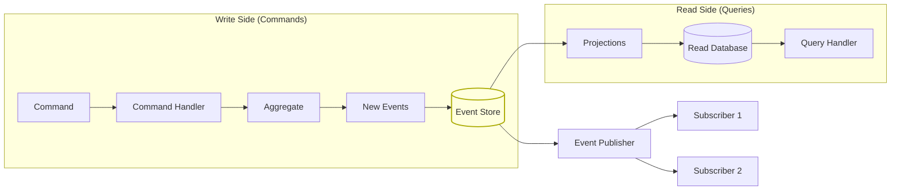
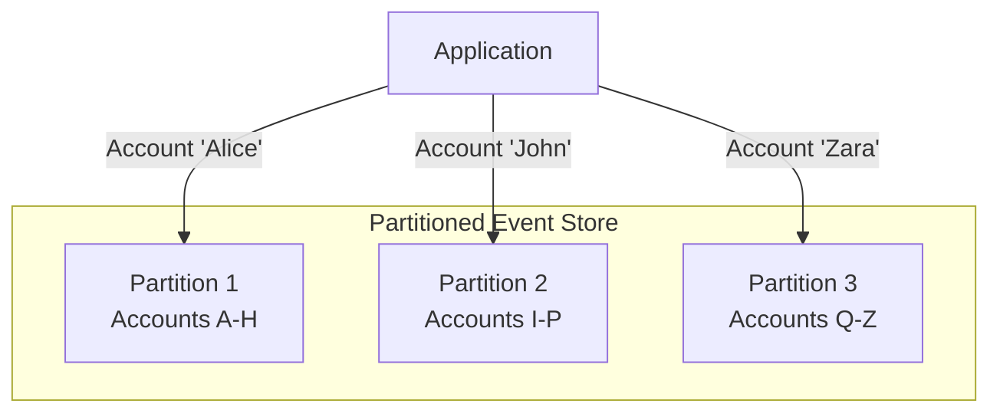
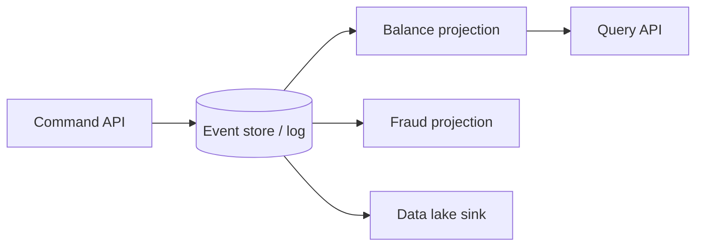
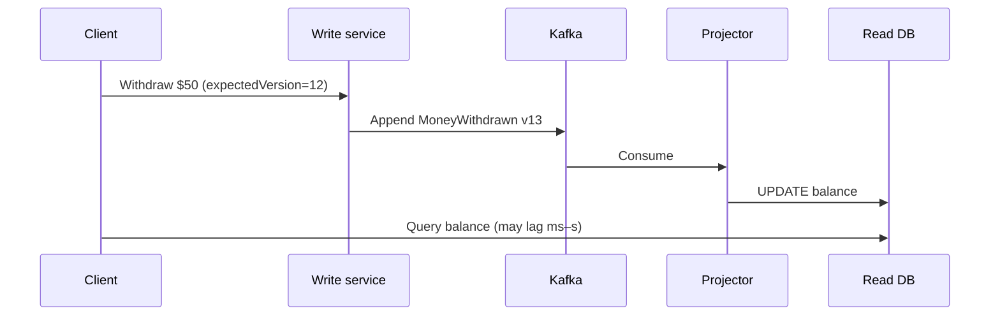

# Event Sourcing at Scale

## What Is Event Sourcing?

Instead of storing the **current state** of your data, you store a **sequence of events** that led to that state.

> Think of it like a bank account: instead of just storing "balance = $500", you store every transaction: +$1000 (salary), -$200 (rent), -$300 (groceries) → balance = $500.

---

## Traditional CRUD vs Event Sourcing

```
CRUD (Store Current State):           Event Sourcing (Store Events):
┌─────────────────────┐              ┌─────────────────────────────┐
│ users table          │              │ events table                 │
│ ┌────┬──────┬──────┐ │              │ ┌───┬────────────┬─────────┐│
│ │ id │ name │ email│ │              │ │ # │ event_type │ data     ││
│ ├────┼──────┼──────┤ │              │ ├───┼────────────┼─────────┤│
│ │ 1  │ Bob  │ b@.. │ │              │ │ 1 │ UserCreated│ name=Al ││
│ └────┴──────┴──────┘ │              │ │ 2 │ NameChanged│ name=Bob││
│                       │              │ │ 3 │ EmailSet   │ e=b@..  ││
│ You see WHAT it is    │              │ └───┴────────────┴─────────┘│
│ You DON'T know HOW   │              │                             │
│ it got there          │              │ You see the FULL HISTORY    │
└─────────────────────┘              └─────────────────────────────┘
```

---

## Core Architecture



---

## Code Example: Event-Sourced Bank Account

### Step 1: Define Events

```typescript
// events.ts — Immutable facts that happened

interface BaseEvent {
  eventId: string;
  aggregateId: string;
  timestamp: Date;
  version: number;
}

interface AccountCreated extends BaseEvent {
  type: "AccountCreated";
  data: { ownerId: string; currency: string };
}

interface MoneyDeposited extends BaseEvent {
  type: "MoneyDeposited";
  data: { amount: number; description: string };
}

interface MoneyWithdrawn extends BaseEvent {
  type: "MoneyWithdrawn";
  data: { amount: number; description: string };
}

interface AccountFrozen extends BaseEvent {
  type: "AccountFrozen";
  data: { reason: string };
}

type AccountEvent =
  | AccountCreated
  | MoneyDeposited
  | MoneyWithdrawn
  | AccountFrozen;
```

### Step 2: Build the Aggregate (Apply Events to State)

```typescript
// aggregate.ts

class BankAccount {
  public id: string = "";
  public balance: number = 0;
  public currency: string = "USD";
  public isFrozen: boolean = false;
  public version: number = 0;

  private uncommittedEvents: AccountEvent[] = [];

  // --- Rebuild state from events (hydration) ---
  static fromEvents(events: AccountEvent[]): BankAccount {
    const account = new BankAccount();
    for (const event of events) {
      account.apply(event);
    }
    return account;
  }

  private apply(event: AccountEvent): void {
    switch (event.type) {
      case "AccountCreated":
        this.id = event.aggregateId;
        this.currency = event.data.currency;
        this.balance = 0;
        break;
      case "MoneyDeposited":
        this.balance += event.data.amount;
        break;
      case "MoneyWithdrawn":
        this.balance -= event.data.amount;
        break;
      case "AccountFrozen":
        this.isFrozen = true;
        break;
    }
    this.version = event.version;
  }

  // --- Business logic produces new events ---
  deposit(amount: number, description: string): void {
    if (this.isFrozen) throw new Error("Account is frozen");
    if (amount <= 0) throw new Error("Amount must be positive");

    this.addEvent({
      type: "MoneyDeposited",
      data: { amount, description },
    });
  }

  withdraw(amount: number, description: string): void {
    if (this.isFrozen) throw new Error("Account is frozen");
    if (amount > this.balance) throw new Error("Insufficient funds");

    this.addEvent({
      type: "MoneyWithdrawn",
      data: { amount, description },
    });
  }

  private addEvent(partial: Partial<AccountEvent>): void {
    const event = {
      ...partial,
      eventId: crypto.randomUUID(),
      aggregateId: this.id,
      timestamp: new Date(),
      version: this.version + 1,
    } as AccountEvent;

    this.apply(event);
    this.uncommittedEvents.push(event);
  }

  getUncommittedEvents(): AccountEvent[] {
    return [...this.uncommittedEvents];
  }

  clearUncommittedEvents(): void {
    this.uncommittedEvents = [];
  }
}
```

### Step 3: Event Store

```typescript
// event-store.ts

class EventStore {
  constructor(private db: Database) {}

  async save(
    aggregateId: string,
    events: AccountEvent[],
    expectedVersion: number,
  ): Promise<void> {
    // Optimistic concurrency: ensure no one else wrote since we loaded
    const currentVersion = await this.getLatestVersion(aggregateId);

    if (currentVersion !== expectedVersion) {
      throw new ConcurrencyError(
        `Expected version ${expectedVersion}, got ${currentVersion}`,
      );
    }

    // Append events (never update or delete!)
    for (const event of events) {
      await this.db.query(
        `INSERT INTO events (event_id, aggregate_id, type, data, version, timestamp)
         VALUES ($1, $2, $3, $4, $5, $6)`,
        [event.eventId, event.aggregateId, event.type,
         JSON.stringify(event.data), event.version, event.timestamp],
      );
    }

    // Publish events for projections and subscribers
    await this.publishEvents(events);
  }

  async getEvents(aggregateId: string): Promise<AccountEvent[]> {
    const result = await this.db.query(
      `SELECT * FROM events WHERE aggregate_id = $1 ORDER BY version ASC`,
      [aggregateId],
    );
    return result.rows;
  }

  async getEventsAfterVersion(
    aggregateId: string,
    version: number,
  ): Promise<AccountEvent[]> {
    const result = await this.db.query(
      `SELECT * FROM events WHERE aggregate_id = $1 AND version > $2 ORDER BY version`,
      [aggregateId, version],
    );
    return result.rows;
  }
}
```

---

## Scaling Challenges and Solutions

### Challenge 1: Event Stream Gets Too Long (Snapshotting)

After 1 million events, rebuilding the aggregate from scratch is slow.

```typescript
class SnapshotStore {
  async saveSnapshot(aggregateId: string, state: any, version: number) {
    await this.db.query(
      `INSERT INTO snapshots (aggregate_id, state, version)
       VALUES ($1, $2, $3)
       ON CONFLICT (aggregate_id) DO UPDATE SET state = $2, version = $3`,
      [aggregateId, JSON.stringify(state), version],
    );
  }

  async loadAggregate(aggregateId: string): Promise<BankAccount> {
    // 1. Load latest snapshot
    const snapshot = await this.getLatestSnapshot(aggregateId);

    let account: BankAccount;
    let fromVersion: number;

    if (snapshot) {
      // Start from snapshot
      account = BankAccount.fromSnapshot(snapshot.state);
      fromVersion = snapshot.version;
    } else {
      account = new BankAccount();
      fromVersion = 0;
    }

    // 2. Apply only events AFTER the snapshot
    const newEvents = await this.eventStore.getEventsAfterVersion(
      aggregateId,
      fromVersion,
    );

    for (const event of newEvents) {
      account.apply(event);
    }

    // 3. Take new snapshot if many events since last snapshot
    if (newEvents.length > 100) {
      await this.saveSnapshot(aggregateId, account.toSnapshot(), account.version);
    }

    return account;
  }
}
```

```
Without snapshots:             With snapshots:
Load 1,000,000 events         Load snapshot (version 999,900)
Apply each one                 Load 100 events after snapshot
⏱️ 30 seconds                  Apply 100 events
                               ⏱️ 5 milliseconds
```

---

### Challenge 2: Read Performance (CQRS Projections)

You can't query events efficiently ("show me all accounts with balance > $1000"). Build **projections** (materialized views).

```typescript
// projections/account-balance-projection.ts

class AccountBalanceProjection {
  constructor(private readDb: Database) {}

  async handle(event: AccountEvent): Promise<void> {
    switch (event.type) {
      case "AccountCreated":
        await this.readDb.query(
          `INSERT INTO account_balances (id, owner_id, balance, currency)
           VALUES ($1, $2, 0, $3)`,
          [event.aggregateId, event.data.ownerId, event.data.currency],
        );
        break;

      case "MoneyDeposited":
        await this.readDb.query(
          `UPDATE account_balances SET balance = balance + $1 WHERE id = $2`,
          [event.data.amount, event.aggregateId],
        );
        break;

      case "MoneyWithdrawn":
        await this.readDb.query(
          `UPDATE account_balances SET balance = balance - $1 WHERE id = $2`,
          [event.data.amount, event.aggregateId],
        );
        break;
    }
  }
}

// Now you can query efficiently:
// SELECT * FROM account_balances WHERE balance > 1000 ORDER BY balance DESC
```

---

### Challenge 3: Event Schema Evolution

Events are immutable. But your schema needs to evolve.

```typescript
// Version 1: MoneyDeposited
{ type: "MoneyDeposited", data: { amount: 100 } }

// Version 2: Added currency field
{ type: "MoneyDeposited", data: { amount: 100, currency: "USD" } }

// Upcaster: transforms old events to new schema at read time
class EventUpcaster {
  upcast(event: any): AccountEvent {
    if (event.type === "MoneyDeposited" && !event.data.currency) {
      // Old event without currency → add default
      return {
        ...event,
        data: { ...event.data, currency: "USD" },
      };
    }
    return event;
  }
}
```

---

### Challenge 4: Event Store at Scale (Partitioning)



```sql
-- PostgreSQL partitioned event table
CREATE TABLE events (
    event_id UUID PRIMARY KEY,
    aggregate_id TEXT NOT NULL,
    type TEXT NOT NULL,
    data JSONB NOT NULL,
    version INT NOT NULL,
    timestamp TIMESTAMPTZ NOT NULL
) PARTITION BY HASH (aggregate_id);

CREATE TABLE events_p0 PARTITION OF events FOR VALUES WITH (MODULUS 8, REMAINDER 0);
CREATE TABLE events_p1 PARTITION OF events FOR VALUES WITH (MODULUS 8, REMAINDER 1);
-- ... up to p7
```

---

## When to Use Event Sourcing

| ✅ Good Fit | ❌ Bad Fit |
|---|---|
| Audit trail is critical (finance, healthcare) | Simple CRUD applications |
| Complex domain with many state transitions | Data rarely changes |
| Need to replay/reprocess historical data | Team unfamiliar with event-driven patterns |
| Event-driven architecture already in place | Reporting-heavy with complex queries |
| Need temporal queries ("what was state at time X") | Simple read-heavy workloads |

---

## Key Takeaways

- **Events are immutable facts** — append-only, never update or delete
- **Aggregates** = rebuild current state by replaying events
- **Snapshots** = performance optimization for long event streams
- **Projections** = optimized read models built from events (CQRS)
- **Schema evolution** = use upcasters, never modify stored events
- Event sourcing gives you a **complete audit trail** and the ability to **rebuild any state at any point in time**
- It's **complex** — don't use it unless the benefits justify the cost

---

## Senior Pitfalls

| Mistake | Impact | Fix |
|---------|--------|-----|
| Unbounded event streams without snapshots | Replay takes hours after deploy | Snapshot every N events; compact projections |
| Schema changes without upcasting | Cannot replay old events | Versioned events + upcasters in projection pipeline |
| Using event store as only query model | Read path cannot serve UX | CQRS projections with rebuild playbook |
| Global ordering requirement on all events | Throughput ceiling | Partition by aggregate ID; order per stream only |
| Deleting "bad" events from log | Audit and legal failure | Compensating events; never mutate history |

---

## Production-grade Practice

1. **Build:** Model one aggregate with event stream, snapshot policy, and a projection rebuilt from scratch in CI.
2. **Debug:** Introduce a schema v2 event; verify upcaster and projection correctness on historical replay.
3. **Measure:** Track replay time, projection lag, and store growth rate; SLO on catch-up after deploy.
4. **Capacity plan:** Project storage for 3 years of events at peak write rate; plan compaction and cold tier archival.

---

## FAANG Interview Deep Dive

### Real-world examples

| Company | Pattern | Architecture choices |
|---------|---------|----------------------|
| **LinkedIn** | Event sourcing on member activity | Kafka as durable log; separate **command** services append domain events; read models rebuilt via Samza/Flink-style consumers. Chose **per-entity streams** (member, company) over one global table to preserve ordering without hot partitions. |
| **Stripe** | Ledger-style money movement | Immutable **balance transactions** as facts; disputes and refunds are new events, never row overwrites. Snapshots + idempotent command IDs for p99 write latency; auditors replay streams for regulatory windows. |
| **Uber** | Trip / marketplace state | High-churn aggregates (trip lifecycle) use event logs + projections; **not** full ES everywhere—ES where audit and reprocessing justify cost; elsewhere CDC + OLTP. |



### Interview Q&A

### Q: How do you handle optimistic concurrency when two commands hit the same aggregate at once?
**A:** Load aggregate at version *v*, apply business rules, append events at *v+1…*. On save, compare **expected version** to store; mismatch → `ConcurrencyConflict`, client retries with refresh or merge policy. At scale, keep aggregates **small** (one order, one account) so contention is localized; avoid “god aggregates” that become serial bottlenecks.

### Q: When would you snapshot, and how do you avoid snapshot/event skew?
**A:** Snapshot every *N* events or on a schedule; store `(aggregate_id, version, payload)`. On load: snapshot at version *S*, then replay events where `version > S`. Take snapshots **asynchronously** after successful append so the write path stays fast; if snapshot lags, you only replay more events—never skip versions.

### Q: How do you evolve event schemas without rewriting history?
**A:** Never mutate stored events. Add **version** or new event types; use **upcasters** at read/replay time; dual-write new shape for a transition window if needed. Projections should tolerate multiple versions or normalize in the projector.

### Q: Event sourcing vs audit table + CDC—staff-level tradeoff?
**A:** Audit table answers “what changed on this row.” Event sourcing answers “what did we **decide** and why” (intent, rejected commands if you log them). ES shines when **replay rebuilds multiple read models** or temporal queries are first-class; CDC + OLTP is cheaper when you only need warehouse sync and occasional audit.

### Q: How do you partition an event store at billions of events/day?
**A:** Partition by **aggregate_id** (hash) so all events for one aggregate co-locate; global indexes (by user_id) are **async projections**, not primary store queries. Tier cold streams to object storage; keep hot retention on SSD/Kafka with compaction policies per aggregate type.

### Common mistakes candidates make

- Treating the event store as the **query database** (missing CQRS projections).
- **Large aggregates** (entire customer with all orders) → unbounded streams and lock contention.
- **Deleting or updating** events “to fix bugs” instead of compensating events.
- Ignoring **GDPR/erasure** until legal asks (no tombstone/crypto-shred plan).
- Snapshotting **without version** alignment, causing silent state corruption on replay.

### Scale numbers

| Dimension | Illustrative FAANG-scale targets |
|-----------|----------------------------------|
| Write throughput | 50k–500k events/s cluster-wide; single aggregate ~10–100 commands/s max before redesign |
| Stream length | Snapshot every 500–5k events; replay budget **<100 ms** p99 per command path |
| Storage | ~200–800 bytes/event JSON → **1B events ≈ 200–800 GB** raw; 3× with indexes/replicas |
| Kafka partitions | Order/account keys → **3k–12k partitions** for parallel consumers; avoid **>1 MB/s per partition** sustained |
| Consumer lag | Projections: **<30 s** p95 for user-facing reads; analytics **minutes** OK |
| Cost lever | Move cold history to S3 + query via Iceberg; keep 7–30 days hot on Kafka |

```sql
-- Staff interview: idempotent append with version check
INSERT INTO events (aggregate_id, version, type, data)
SELECT $1, $2, $3, $4
WHERE (SELECT COALESCE(MAX(version), 0) FROM events WHERE aggregate_id = $1) = $2 - 1;
-- 0 rows inserted => concurrency conflict, no partial write
```

### Staff system design prompt (walkthrough sketch)

**Prompt:** Design event-sourced **wallet** service for 100M users, 50k writes/s peak.

| Layer | Decision |
|-------|----------|
| Write API | Command handler → aggregate `Wallet` → append to **Kafka** (compacted changelog + event topic) |
| Read API | CQRS: `balance_by_user` in Cassandra/Dynamo keyed by `user_id` |
| Consistency | Per-wallet ordering via partition key; **no cross-wallet transactions** |
| Failure | Projector lag → stale balance UI with version stamp; payments use **write model** balance check |



### Additional interview Q&A

### Q: How do you test event-sourced systems?
**A:** **Given-when-then** on command streams: given events `[A,B]`, when command `C`, expect events `[D]` or rejection. Property tests: `fold(events) == fold(events ++ noop)` after idempotent replay. Contract tests on **event JSON schema** in CI.

### Q: Multi-region active-active with event sourcing?
**A:** Hard mode: **single writer per aggregate** (home region) or CRDT-style aggregates (rare in finance). Most FAANG patterns: **active-passive** per shard with Kafka mirroring for read replicas; conflict resolution is **last-writer-wins** only if business allows.

### Failure mode matrix

| Symptom | Likely cause | Mitigation |
|---------|--------------|------------|
| Projection hours behind | Slow consumer, poison event | DLQ bad events; scale consumers to partition count |
| Replay 10× slower than live | Single-threaded projector | Parallelize by `aggregate_id % N` with idempotent sinks |
| Version gaps in stream | Publisher bug or manual delete | Alert on monotonic version; never DELETE from store |
