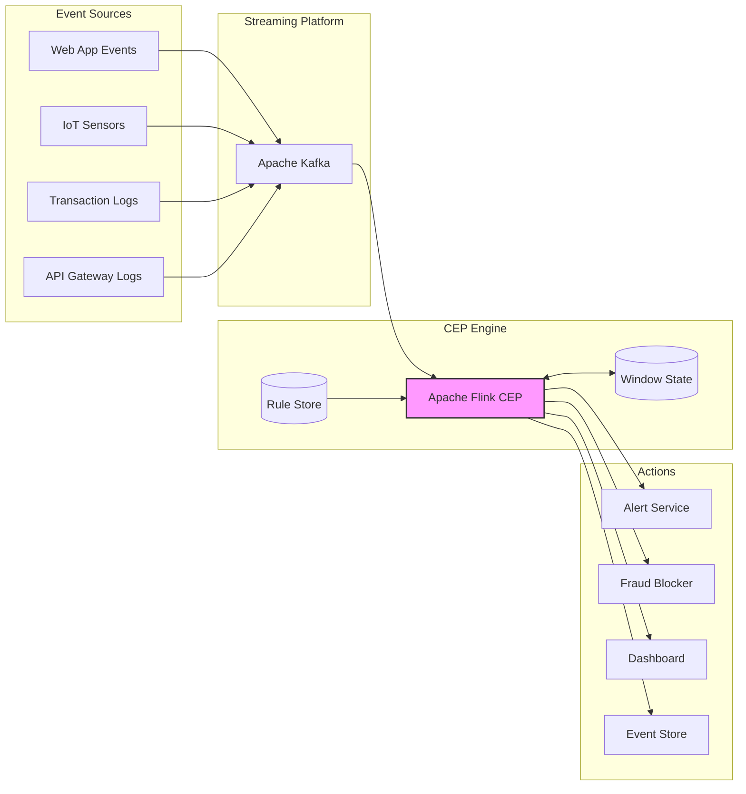
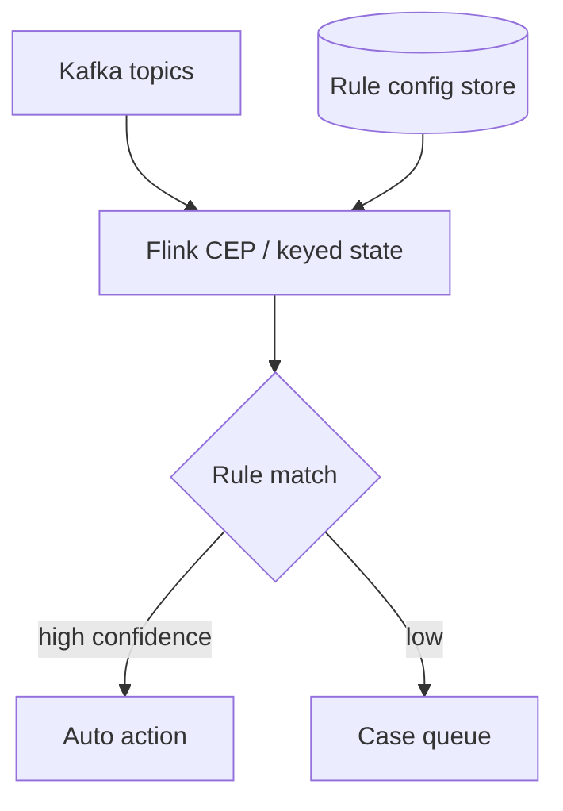
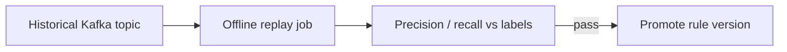

# Complex Event Processing (CEP)

## What Is CEP?

Simple event processing handles one event at a time: "Order placed → send confirmation email." But what if you need to detect **patterns across multiple events over time**?

> **Complex Event Processing (CEP)** analyzes streams of events in real-time to detect patterns, correlations, and anomalies — turning raw events into actionable insights.

---

## Simple vs Complex Event Processing

```
Simple Event Processing:              Complex Event Processing:
┌─────────────┐                       ┌─────────────────────────────────┐
│ Event A → ✅ │  React to single      │ Event A + Event B within 5min   │
│              │  events               │ AND NOT Event C                 │
│ Event B → ✅ │                        │ FROM same user                  │
│              │                       │ → Trigger fraud alert 🚨        │
└─────────────┘                       └─────────────────────────────────┘

"Send email when          "Alert when a user logs in from 2 different
 order is placed"          countries within 10 minutes"
```

---

## Real-World CEP Use Cases

```mermaid
graph TB
    subgraph "Fraud Detection"
        F1[Login from US] --> F2[Login from Russia<br/>within 5 min]
        F2 --> FA[🚨 Impossible Travel Alert]
    end

    subgraph "IoT Monitoring"
        I1[Temp > 80°C] --> I2[Pressure > 100 PSI]
        I2 --> I3[3 readings in 1 min]
        I3 --> IA[🚨 Equipment Failure Alert]
    end

    subgraph "Stock Trading"
        S1[Price drops 5%] --> S2[Volume spikes 3x]
        S2 --> S3[Within 30 seconds]
        S3 --> SA[📈 Auto-sell trigger]
    end

    style FA fill:#fdd,stroke:#c00
    style IA fill:#fdd,stroke:#c00
    style SA fill:#dfd,stroke:#0a0
```



---

## CEP Pattern Types

### 1. Sequence Pattern

Events must occur in a specific **order**.

```
Pattern: A → B → C (in order, within 10 minutes)

Event Stream: ... A ... B ... C ... 
                  └─────────────┘
                  Match! ✅ (if within 10 min)
```

### 2. Conjunction (AND)

Multiple events must **all** occur within a time window.

```
Pattern: A AND B AND C (within 5 minutes, any order)

Event Stream: ... B ... A ... C ...
                  └─────────────┘
                  Match! ✅
```

### 3. Disjunction (OR)

**Any one** of the specified events triggers the rule.

```
Pattern: A OR B OR C

Event Stream: ... X ... B ... Y ...
                        │
                        Match! ✅
```

### 4. Negation (NOT / Absence)

An event that was **expected but didn't happen**.

```
Pattern: A followed by NOT B within 30 minutes

Event Stream: ... A ... (30 min pass, no B) ...
                                               │
                                         Match! ✅

Use case: "Order placed but NOT confirmed within 30 min → alert"
```

### 5. Aggregation

Patterns based on **aggregate values** over a window.

```
Pattern: AVG(temperature) > 80 over last 5 minutes

Event Stream: 75, 78, 82, 85, 83 → AVG = 80.6 → Match! ✅
```

---

## Code Example: CEP Engine (Python)

```python
import time
from collections import defaultdict
from dataclasses import dataclass, field
from typing import Callable

@dataclass
class Event:
    type: str
    data: dict
    timestamp: float = field(default_factory=time.time)
    source: str = ""

@dataclass
class CEPRule:
    name: str
    description: str
    pattern: Callable  # Function that evaluates the pattern
    action: Callable   # What to do when pattern matches
    window_seconds: int = 300  # Time window for pattern matching

class CEPEngine:
    """A simple Complex Event Processing engine."""

    def __init__(self):
        self.rules: list[CEPRule] = []
        self.event_buffer: dict[str, list[Event]] = defaultdict(list)
        self.window_size = 600  # Max buffer window (10 min)

    def add_rule(self, rule: CEPRule):
        self.rules.append(rule)
        print(f"Rule added: {rule.name}")

    def process_event(self, event: Event):
        """Process an incoming event against all rules."""
        # Add to buffer (keyed by relevant grouping)
        group_key = event.data.get("user_id", "global")
        self.event_buffer[group_key].append(event)

        # Clean old events
        self._clean_buffer(group_key)

        # Check all rules
        for rule in self.rules:
            events_in_window = [
                e for e in self.event_buffer[group_key]
                if event.timestamp - e.timestamp <= rule.window_seconds
            ]

            if rule.pattern(events_in_window, event):
                print(f"🚨 Rule matched: {rule.name}")
                rule.action(events_in_window, event)

    def _clean_buffer(self, group_key: str):
        now = time.time()
        self.event_buffer[group_key] = [
            e for e in self.event_buffer[group_key]
            if now - e.timestamp <= self.window_size
        ]


# --- Define Rules ---

# Rule 1: Impossible Travel Detection
def impossible_travel_pattern(events: list[Event], current: Event) -> bool:
    """Detect logins from different countries within 10 minutes."""
    if current.type != "user_login":
        return False

    login_events = [e for e in events if e.type == "user_login"]
    if len(login_events) < 2:
        return False

    countries = set(e.data.get("country") for e in login_events)
    return len(countries) >= 2  # Logged in from 2+ countries


def impossible_travel_action(events, current):
    user_id = current.data["user_id"]
    countries = [e.data["country"] for e in events if e.type == "user_login"]
    print(f"🚨 FRAUD ALERT: User {user_id} logged in from {countries} "
          f"within {events[-1].timestamp - events[0].timestamp:.0f}s")


# Rule 2: Brute Force Detection
def brute_force_pattern(events: list[Event], current: Event) -> bool:
    """Detect 5+ failed logins within 2 minutes."""
    if current.type != "login_failed":
        return False
    
    failures = [e for e in events if e.type == "login_failed"]
    return len(failures) >= 5


def brute_force_action(events, current):
    user_id = current.data["user_id"]
    print(f"🔒 SECURITY: Locking account {user_id} — "
          f"{len([e for e in events if e.type == 'login_failed'])} failed attempts")


# Rule 3: Abandoned Cart (Negation pattern)
def abandoned_cart_pattern(events: list[Event], current: Event) -> bool:
    """Cart created but no checkout within 30 minutes."""
    if current.type != "heartbeat":  # Check periodically
        return False
    
    cart_events = [e for e in events if e.type == "cart_created"]
    checkout_events = [e for e in events if e.type == "checkout_completed"]
    
    for cart in cart_events:
        cart_age = current.timestamp - cart.timestamp
        has_checkout = any(
            c.timestamp > cart.timestamp for c in checkout_events
        )
        if cart_age > 1800 and not has_checkout:  # 30 min
            return True
    return False


# --- Wire It Up ---
engine = CEPEngine()

engine.add_rule(CEPRule(
    name="Impossible Travel",
    description="Login from 2+ countries within 10 minutes",
    pattern=impossible_travel_pattern,
    action=impossible_travel_action,
    window_seconds=600,
))

engine.add_rule(CEPRule(
    name="Brute Force",
    description="5+ failed logins within 2 minutes",
    pattern=brute_force_pattern,
    action=brute_force_action,
    window_seconds=120,
))

# Simulate events
engine.process_event(Event("user_login", {"user_id": "u1", "country": "US"}))
time.sleep(0.1)
engine.process_event(Event("user_login", {"user_id": "u1", "country": "Russia"}))
# Output: 🚨 FRAUD ALERT: User u1 logged in from ['US', 'Russia'] within 0s
```

---

## CEP with Apache Flink (Production-Grade)

```java
// Flink CEP — production-grade complex event processing

import org.apache.flink.cep.CEP;
import org.apache.flink.cep.PatternStream;
import org.apache.flink.cep.pattern.Pattern;
import org.apache.flink.cep.pattern.conditions.SimpleCondition;

// Define the pattern: failed login → failed login → failed login (3x within 1 min)
Pattern<LoginEvent, ?> bruteForcePattern = Pattern
    .<LoginEvent>begin("first_failure")
    .where(new SimpleCondition<LoginEvent>() {
        public boolean filter(LoginEvent event) {
            return !event.isSuccess();
        }
    })
    .followedBy("second_failure")
    .where(new SimpleCondition<LoginEvent>() {
        public boolean filter(LoginEvent event) {
            return !event.isSuccess();
        }
    })
    .followedBy("third_failure")
    .where(new SimpleCondition<LoginEvent>() {
        public boolean filter(LoginEvent event) {
            return !event.isSuccess();
        }
    })
    .within(Time.minutes(1));  // All 3 within 1 minute

// Apply pattern to stream
DataStream<LoginEvent> loginStream = env.addSource(kafkaSource);

PatternStream<LoginEvent> patternStream = CEP.pattern(
    loginStream.keyBy(LoginEvent::getUserId),
    bruteForcePattern
);

// React to matched patterns
patternStream.select(matchedEvents -> {
    LoginEvent first = matchedEvents.get("first_failure").get(0);
    return new SecurityAlert(
        first.getUserId(),
        "BRUTE_FORCE",
        "3 failed logins within 1 minute"
    );
}).addSink(alertSink);
```

---

## CEP Architecture



---

## CEP Frameworks Comparison

| Framework | Language | Latency | Scalability | Best For |
|---|---|---|---|---|
| **Apache Flink CEP** | Java/Scala | Very low (~ms) | Excellent | Production streaming |
| **Esper** | Java | Very low | Good | Financial trading |
| **Apache Kafka Streams** | Java | Low | Excellent | Kafka-native apps |
| **AWS Kinesis Analytics** | SQL | Low | Auto-scaling | AWS-native |
| **Custom (Python)** | Python | Medium | Limited | Prototyping |

---

## Key Takeaways

- CEP detects **patterns across multiple events** — not just one event at a time
- Core pattern types: **Sequence**, **AND**, **OR**, **NOT** (absence), **Aggregation**
- **Time windows** are essential — patterns are meaningless without a time boundary
- Use **Apache Flink CEP** for production; build a custom engine for prototyping
- CEP is critical for **fraud detection**, **IoT monitoring**, **algorithmic trading**, and **security**
- The hardest part isn't the engine — it's **defining the right rules** with domain experts

---

## Senior Pitfalls

| Mistake | Impact | Fix |
|---------|--------|-----|
| Stateful windows without watermark handling | Late events silently dropped or double-counted | Event-time windows, allowed lateness, side outputs |
| Rule explosion in production without testing | False positives block legitimate users | Shadow mode rules; gradual rollout with metrics |
| CEP on unpartitioned global stream | Single task bottleneck | KeyBy account/session; align windows per key |
| Storing full event history in operator state | RocksDB OOM on redeploy | TTL state, incremental aggregates |
| Mixing control and data plane alerts | Ops cannot tune without deploy | External rule DSL with hot reload and audit |

---

## Production-grade Practice

1. **Build:** Implement one fraud rule (velocity over 5-minute window) in Flink/Kafka Streams with event-time and lateness.
2. **Debug:** Inject late and duplicate events; verify counts and alert firing match spec.
3. **Measure:** False positive/negative rate on labeled sample; latency from event to alert.
4. **Capacity plan:** Size state backend for max keys in window at peak EPS; plan rescaling and savepoint strategy.

---

## FAANG Interview Deep Dive

### Real-world examples

| Company | CEP use case | Architecture choices |
|---------|--------------|----------------------|
| **Uber** | Fraud, safety, marketplace abuse | **Kafka** (~7T msgs/day fleet-wide) feeds Flink jobs; rules keyed by `user_id` / `device_id`; **event-time** windows for trip sequences; actions to block, throttle, or route to human review—not inline in API thread. |
| **Netflix** | Playback anomalies, account sharing signals | Stream joins between auth, device, and playback events; **session windows**; separate **online** (ms) vs **nearline** (minutes) rule tiers to control state cost. |
| **Stripe** | Payment fraud (velocity, card testing) | CEP on authorization stream + graph features; **NOT** patterns (“auth without capture in 30m”); idempotent alert IDs so duplicate rule fires don’t double-block merchants. |



### Interview Q&A

### Q: How is CEP different from “a Flink job with a filter”?
**A:** CEP matches **temporal patterns** (sequence, absence, conjunction) over **per-key state** with bounded memory via windows. A filter is stateless per record. Absence (“A but not B within T”) needs **timers** and careful watermark handling—classic CEP, not a simple `where`.

### Q: Event time vs processing time for fraud rules?
**A:** **Event time** preserves correctness on replay and after outages; processing time is easier but wrong after lag spikes (false negatives on “5 failures in 2 minutes”). Use watermarks + **allowed lateness**; metric `late_events_dropped` for tuning.

### Q: How do you scale CEP when one key is hot (e.g., shared NAT IP)?
**A:** **Salting** hot keys into sub-keys with merge step, cap per-key state (ring buffer of last N events), or route ultra-hot keys to dedicated **heavy hitter** pipeline. Alert on state size per key; brute-force on one IP shouldn’t OOM a TaskManager.

### Q: How do you test and deploy rule changes safely?
**A:** **Shadow mode**: evaluate new rules, emit metrics only. Version rules in config store; blue/green job with same input topic, different consumer group. Rollback = flip routing, not redeploy API.

### Q: Negation patterns in distributed systems—pitfall?
**A:** “No event B after A within T” requires a timer fired at A+T; if processing is late, you may fire false positives unless you use event-time timers and handle **out-of-order** A/B. Document SLA: negation is approximate under extreme lag unless lateness is unbounded (expensive).

### Common mistakes candidates make

- **Unbounded** in-memory buffers per user (no window cap) → OOM.
- Rules on **processing time** then claiming audit-grade fraud detection.
- **Global** sequence patterns without partitioning → false correlations across users.
- Ignoring **duplicate events** (at-least-once Kafka) → double alerts unless idempotent actions.
- Coupling CEP **actions** synchronously in payment path instead of async decision service.

### Scale numbers

| Dimension | Illustrative targets |
|-----------|---------------------|
| Ingest | Uber-scale Kafka **millions msg/s** aggregate; single CEP job often **100k–2M events/s** after filtering |
| Flink parallelism | **512–4096** subtasks for large jobs; **keyBy** aligns with Kafka partitions |
| State | RocksDB **TB** per cluster; checkpoint interval **30–180 s**; checkpoint duration **<60 s** p95 |
| Latency | Fraud **<100–500 ms** p99 event-time to action; IoT rules **1–5 s** OK |
| False positive cost | Tune rules for **<0.1%** auto-block rate on good users; human queue for edge cases |
| Consumer lag | CEP input lag **<5 s** p99** for online fraud; **<2 min** for batch-like rules |

```java
// Interview talking point: idempotent side effect
alertSink.send(new Alert(alertId, userId, ruleVersion)); // alertId = hash(userId, windowStart, ruleId)
```

### Rule lifecycle table (production CEP)

| Stage | Owner | Artifact |
|-------|-------|----------|
| Design | Fraud PM + eng | Rule doc with FP/FN cost model |
| Implement | Streaming eng | Flink CEP or keyed state machine |
| Validate | Data science | Backtest on labeled historical stream |
| Deploy | SRE | Shadow → canary % traffic → full |
| Monitor | On-call | `matches/min`, `actions/min`, state bytes |



### Additional interview Q&A

### Q: CEP vs ML model in fraud—where is the line?
**A:** **CEP** for interpretable, low-latency rules (velocity, geo impossibility). **ML** for subtle patterns; often ML score **feeds** CEP as another event type (`RiskScoreHigh`). Staff answer: never pure black-box block without CEP **guardrails** and appeal path.

### Q: How do you bound memory for session windows at scale?
**A:** **Session gap** timeout (30 min), max sessions per key, **TTL** in state backend; evict oldest on cap. For unbounded sessions, move to **batch** nearline job.

### Pattern → engine mapping

| Pattern | Flink CEP | Kafka Streams | Custom Python |
|---------|-----------|---------------|---------------|
| Sequence A→B→C | Native | Manual state | OK for POC |
| NOT B within T | Timers + watermarks | Tricky | Error-prone |
| Aggregation window | SQL / DataStream | KTable window | Pandas too slow |

### Uber-scale ops checklist

- [ ] Input topic **compacted** only if changelog semantics intended  
- [ ] **RocksDB** incremental checkpoints to S3  
- [ ] **Async** actions (block user) decoupled from match latency  
- [ ] Runbook for **disable rule** without stopping entire job  
