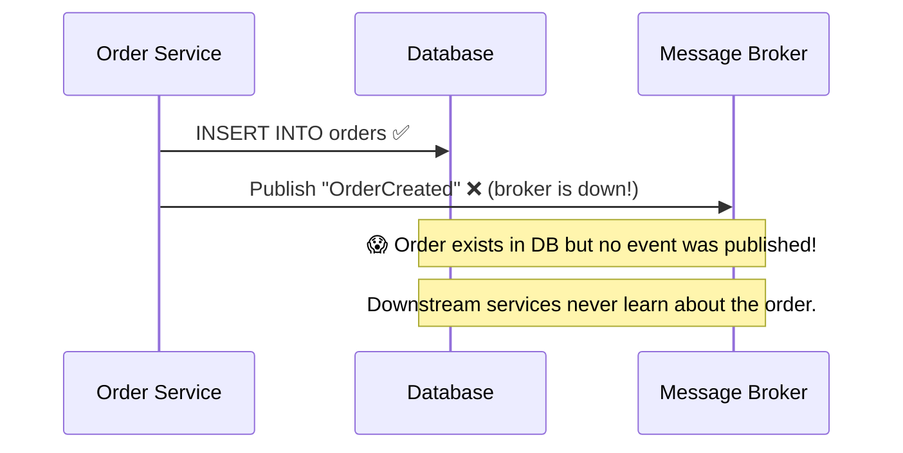
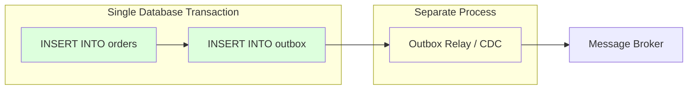
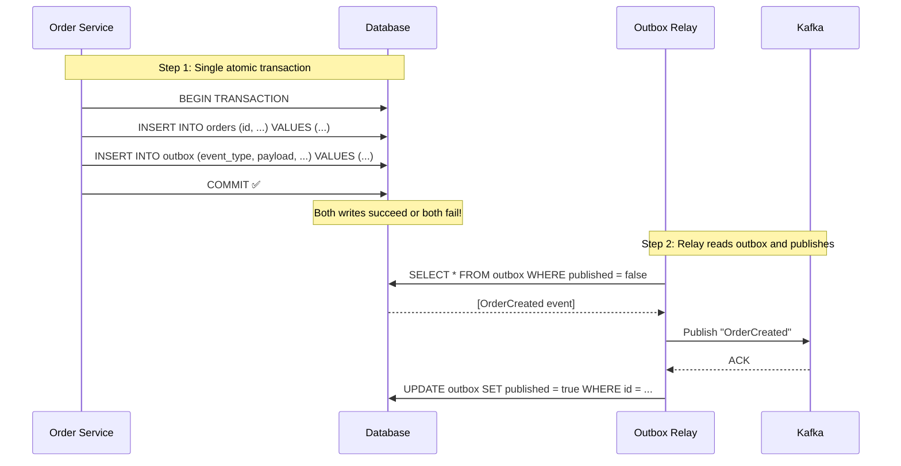
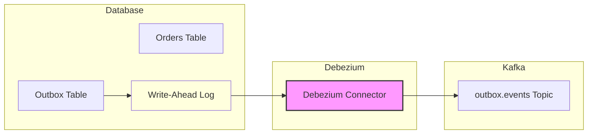
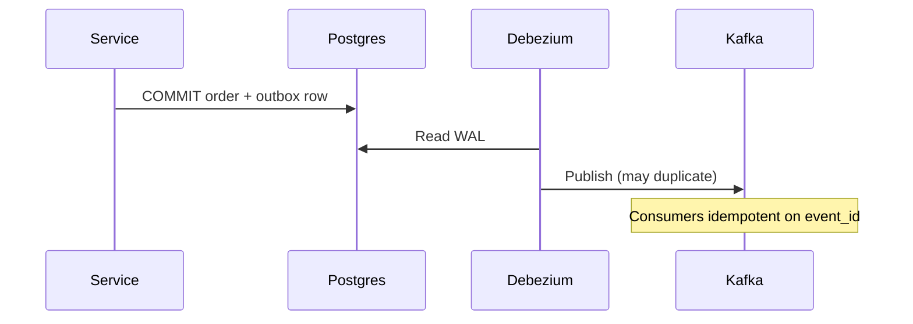
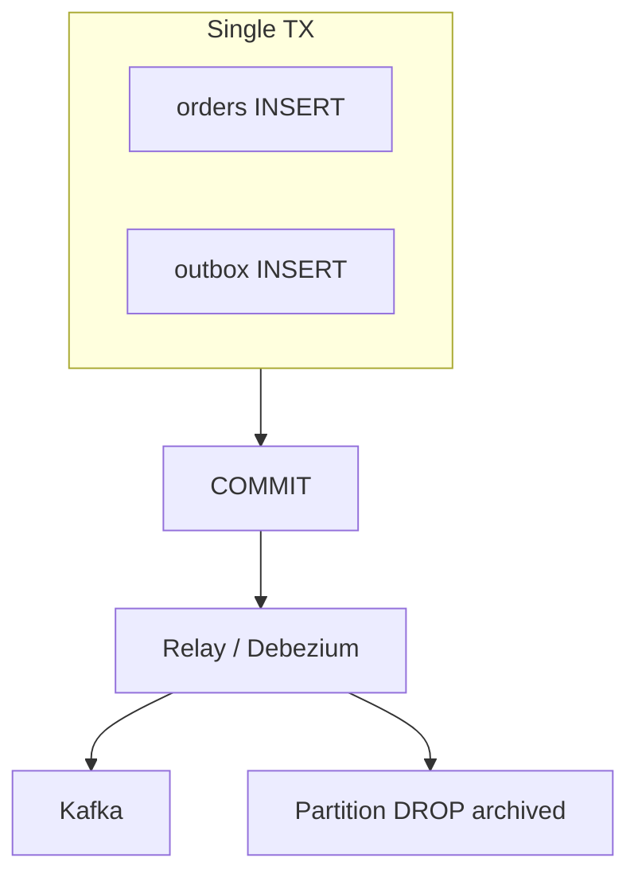

# Transactional Outbox Pattern

## The Problem: Dual Write

You need to do two things when an order is placed:
1. **Save to the database** (INSERT into orders table)
2. **Publish an event** to Kafka/RabbitMQ

What happens if the database write succeeds but the message publish fails? Or vice versa? You get **inconsistency**.



> **The Dual Write Problem**: You can't atomically write to a database AND publish a message. One might succeed while the other fails.

---

## The Solution: Transactional Outbox

Instead of publishing directly to the message broker, **write the event to an outbox table in the same database transaction** as your business data. A separate process reads the outbox and publishes to the broker.



### How It Works



---

## Code Example

### Step 1: The Outbox Table

```sql
CREATE TABLE outbox (
    id            UUID PRIMARY KEY DEFAULT gen_random_uuid(),
    aggregate_type VARCHAR(255) NOT NULL,     -- e.g., "Order"
    aggregate_id   VARCHAR(255) NOT NULL,     -- e.g., "order-123"
    event_type     VARCHAR(255) NOT NULL,     -- e.g., "OrderCreated"
    payload        JSONB NOT NULL,            -- The event data
    created_at     TIMESTAMPTZ DEFAULT NOW(),
    published      BOOLEAN DEFAULT FALSE,
    published_at   TIMESTAMPTZ
);

CREATE INDEX idx_outbox_unpublished ON outbox (created_at) WHERE published = FALSE;
```

### Step 2: Write Business Data + Outbox in One Transaction

```python
import json
import uuid
from datetime import datetime

class OrderService:
    def __init__(self, db, event_types):
        self.db = db

    async def create_order(self, customer_id: str, items: list) -> str:
        order_id = str(uuid.uuid4())
        
        async with self.db.transaction() as tx:
            # 1. Write business data
            await tx.execute(
                """INSERT INTO orders (id, customer_id, items, status, created_at)
                   VALUES ($1, $2, $3, 'created', NOW())""",
                order_id, customer_id, json.dumps(items),
            )
            
            # 2. Write event to outbox (SAME transaction!)
            event_payload = {
                "orderId": order_id,
                "customerId": customer_id,
                "items": items,
                "status": "created",
                "timestamp": datetime.utcnow().isoformat(),
            }
            
            await tx.execute(
                """INSERT INTO outbox 
                   (aggregate_type, aggregate_id, event_type, payload)
                   VALUES ($1, $2, $3, $4)""",
                "Order", order_id, "OrderCreated", json.dumps(event_payload),
            )
        
        # If we get here, BOTH writes committed atomically ✅
        return order_id
```

### Step 3: The Outbox Relay (Polling-Based)

```python
import asyncio
import json
from aiokafka import AIOKafkaProducer

class OutboxRelay:
    """
    Polls the outbox table and publishes events to Kafka.
    Runs as a separate background process.
    """

    def __init__(self, db, kafka_producer: AIOKafkaProducer):
        self.db = db
        self.producer = kafka_producer
        self.poll_interval = 1.0  # seconds

    async def start(self):
        print("Outbox relay started")
        while True:
            try:
                await self.process_outbox()
            except Exception as e:
                print(f"Error processing outbox: {e}")
            await asyncio.sleep(self.poll_interval)

    async def process_outbox(self):
        # Fetch unpublished events (oldest first)
        rows = await self.db.fetch(
            """SELECT id, aggregate_type, aggregate_id, event_type, payload
               FROM outbox
               WHERE published = FALSE
               ORDER BY created_at ASC
               LIMIT 100
               FOR UPDATE SKIP LOCKED""",  # Lock rows to prevent double-processing
        )

        for row in rows:
            topic = f"events.{row['aggregate_type'].lower()}"
            
            # Publish to Kafka
            await self.producer.send_and_wait(
                topic=topic,
                key=row["aggregate_id"].encode(),  # Same aggregate → same partition
                value=json.dumps({
                    "eventId": str(row["id"]),
                    "eventType": row["event_type"],
                    "aggregateId": row["aggregate_id"],
                    "payload": json.loads(row["payload"]),
                }).encode(),
            )

            # Mark as published
            await self.db.execute(
                """UPDATE outbox SET published = TRUE, published_at = NOW()
                   WHERE id = $1""",
                row["id"],
            )

        if rows:
            print(f"Published {len(rows)} events")
```

---

## Better Approach: Change Data Capture (CDC)

Instead of polling the outbox table, use **CDC** to stream database changes directly to Kafka. **Debezium** is the most popular tool for this.



```json
// Debezium connector configuration
{
  "name": "outbox-connector",
  "config": {
    "connector.class": "io.debezium.connector.postgresql.PostgresConnector",
    "database.hostname": "db.internal",
    "database.port": "5432",
    "database.user": "debezium",
    "database.dbname": "orders_db",
    
    "table.include.list": "public.outbox",
    
    "transforms": "outbox",
    "transforms.outbox.type": 
      "io.debezium.transforms.outbox.EventRouter",
    "transforms.outbox.route.by.field": "aggregate_type",
    "transforms.outbox.route.topic.replacement": "events.${routedByValue}",
    "transforms.outbox.table.field.event.id": "id",
    "transforms.outbox.table.field.event.key": "aggregate_id",
    "transforms.outbox.table.field.event.type": "event_type",
    "transforms.outbox.table.field.event.payload": "payload"
  }
}
```

### Polling vs CDC Comparison

| Aspect | Polling | CDC (Debezium) |
|---|---|---|
| **Latency** | Poll interval (1-5s) | Near real-time (~ms) |
| **DB load** | Periodic queries | Reads WAL (minimal load) |
| **Complexity** | Simple | Requires Debezium infra |
| **Ordering** | Manual ordering needed | WAL guarantees order |
| **Missed events** | Possible if relay crashes | WAL position is checkpointed |
| **Best for** | Small scale, simplicity | Production, high throughput |

---

## Cleaning Up the Outbox

The outbox table will grow forever. Clean it up:

```sql
-- Option 1: Delete published events older than 7 days
DELETE FROM outbox 
WHERE published = TRUE 
AND published_at < NOW() - INTERVAL '7 days';

-- Option 2: Partition by date for fast drops
CREATE TABLE outbox (
    id UUID, ...
) PARTITION BY RANGE (created_at);

CREATE TABLE outbox_2024_01 PARTITION OF outbox
    FOR VALUES FROM ('2024-01-01') TO ('2024-02-01');
-- Just DROP the old partition instead of DELETE
```

---

## Guarantees

```
┌────────────────────────────────────────────────────────────┐
│                    Delivery Guarantees                       │
│                                                              │
│  Outbox pattern provides AT-LEAST-ONCE delivery:            │
│                                                              │
│  ✅ Every event is published (no event lost)                 │
│  ⚠️  An event MIGHT be published twice (relay crashes       │
│      after publish but before marking as published)          │
│                                                              │
│  → Consumers MUST be idempotent!                            │
│                                                              │
│  Idempotency key = event ID (UUID in outbox table)          │
└────────────────────────────────────────────────────────────┘
```

---

## Key Takeaways

- **Never do dual writes** — you can't atomically write to a DB and publish a message
- The outbox pattern wraps both writes into a **single database transaction**
- A **relay process** (polling or CDC) reads the outbox and publishes to the broker
- Use **Debezium CDC** for production — it's more reliable and lower latency than polling
- Delivery is **at-least-once** — consumers must handle duplicate events (idempotency)
- **Clean up** the outbox table regularly to prevent unbounded growth

### AWS service map

| Role | Service | Notes |
|------|---------|--------|
| OLTP + outbox table | RDS / Aurora Postgres | Same TX as business row; index `(published, created_at)` |
| Relay (poll) | ECS Fargate / Lambda on schedule | `FOR UPDATE SKIP LOCKED`; not in request path |
| Relay (CDC) | DMS or MSK Connect + Debezium | Lower lag than polling; WAL permissions |
| Broker | MSK or SQS FIFO | MSK for replay/log; SQS FIFO for simpler ordering per group id |
| Consumer | Lambda (MSK/SQS trigger) or ECS | Idempotent on `event_id`; partial batch failures on SQS |
| Ops | CloudWatch alarms on oldest unpublished age | DLQ for poison relay batches |

---

## Senior Pitfalls

| Mistake | Impact | Fix |
|---------|--------|-----|
| Outbox relay polling full table each tick | DB CPU meltdown | Indexed `published_at`, batch with SKIP LOCKED |
| Same DB transaction missing for business write | Dual-write race | Single TX: business row + outbox row |
| Publishing before commit visible to relay | Consumers see ghost events | Relay only marks published after commit boundary |
| No idempotency on consumers | Duplicate side effects on relay retry | `event_id` dedup table or natural keys |
| Outbox growth when broker is down | Disk full; app cannot write | Backpressure, DLQ, alert on oldest unpublished age |

---

## Production-grade Practice

1. **Build:** Add outbox table and relay worker for one domain event; prove atomicity with integration tests.
2. **Debug:** Kill broker mid-relay; verify no duplicate publishes and catch-up when broker returns.
3. **Measure:** Lag from commit to publish p99; SLO and alert on backlog age.
4. **Capacity plan:** Rows/sec into outbox at peak vs relay throughput; scale relay workers and partition outbox by shard.

---

## FAANG Interview Deep Dive

### Real-world examples

| Company | Outbox / publish path | Architecture choices |
|---------|----------------------|----------------------|
| **Stripe** | Payment and ledger events | DB transaction commits business + outbox; **at-least-once** to Kafka; consumers dedupe on **event id** for effectively-once money side effects. |
| **Airbnb** | Reservation / payout workflows | Outbox or **CDC (Debezium)** from OLTP; separate relay fleet; domain events feed data platform and search—not dual-write to ES from request thread. |
| **Uber** | Trip and billing domains | High-volume services use **log-based CDC** over polling; outbox table co-located with shard DB; publish keyed by `aggregate_id` for partition ordering. |



### Interview Q&A

### Q: Does the outbox give exactly-once delivery to Kafka?
**A:** No. It gives **atomic intent to publish** with the DB write. Relay can crash after publish before `published=true` → **duplicate** Kafka records. End-to-end exactly-once needs idempotent consumers, inbox, or transactional Kafka consume-process-produce (heavier).

### Q: Polling relay vs Debezium—when do you insist on CDC?
**A:** CDC when **p99 relay latency <1 s** matters, outbox volume **>1k rows/s**, or you want **ordering tied to commit sequence**. Polling is fine for low-QPS internal apps with 5–30 s SLA.

### Q: How do you order events for one aggregate?
**A:** Relay publishes with **key = aggregate_id** to one Kafka partition; single in-order consumer per partition. Never parallel-publish same aggregate across partitions.

### Q: What if the outbox relay falls behind?
**A:** Monitor **oldest unpublished age**; scale relay workers with `SKIP LOCKED`; partition outbox table by time; alert before SLA (e.g., **60 s**). Backpressure: throttle writes only if disk risk—prefer scale relay first.

### Q: How does outbox interact with event sourcing?
**A:** Event store append **is** the source of truth; outbox can be **projection of same transaction** (write events table + outbox for integration) or CDC reads event table directly—avoid writing two different payloads in one tx without single source.

### Common mistakes candidates make

- Marking `published=true` **before** Kafka ACK → lost messages on crash.
- **No idempotency** on consumers despite claiming “exactly-once.”
- Huge JSON payloads in outbox → DB bloat; store reference + blob in S3 for large artifacts.
- Missing **index** on `(published, created_at)` → relay scans kill OLTP.
- Using outbox to **call HTTP** inside DB transaction (anti-pattern).

### Scale numbers

| Dimension | Illustrative targets |
|-----------|---------------------|
| Outbox insert rate | **5k–50k rows/s** per large service; batch relay **100–500 rows** per poll |
| Relay lag SLA | **<1 s** p99 (CDC); **<10 s** (polling at scale) |
| Table size | Retain published **7–14 days**; **100M rows** → plan partition DROP |
| Kafka | **acks=all**, `min.insync.replicas=2`; partition count **≥ consumer parallelism** |
| DB load | CDC WAL read **<<** repeated `SELECT * FROM outbox` at 10k+ QPS |
| Cost | Extra **~15–25%** write amplification on Postgres vs dual-write “hope”; worth it for correctness |

```python
# Relay: publish THEN mark published in same worker; on crash, safe duplicate
await producer.send_and_wait(topic, key=agg_id, value=payload, headers={"event-id": str(row_id)})
await db.execute("UPDATE outbox SET published=TRUE WHERE id=$1", row_id)
```

### Outbox vs alternatives (staff comparison)

| Approach | Atomic with DB? | Typical at Stripe/Uber scale |
|----------|-----------------|------------------------------|
| Dual write | ❌ | Anti-pattern |
| Outbox + relay | ✅ | Default OLTP integration |
| CDC on business table | ✅ (single writer) | Analytics, search sync |
| Kafka txn in app | ⚠️ | Stream processors, not CRUD APIs |

### Additional interview Q&A

### Q: Multi-tenant outbox—one table or per service DB?
**A:** **Per service database** (microservice boundary): outbox lives with aggregates it references. Shared outbox table across domains → coupling and blast radius. Sharding: outbox rows follow **same shard key** as orders.

### Q: How do you handle outbox during DB failover?
**A:** Relay uses **replica lag-safe** cursor or primary only; after failover, relay resumes from last published **event id**; expect burst of duplicates—consumers idempotent. Test **failover drill** quarterly.



### Monitoring dashboard (what interviewers want named)

| Metric | Alert threshold (example) |
|--------|---------------------------|
| `outbox_oldest_unpublished_age` | > 60 s page |
| `relay_publish_errors_rate` | > 0.1% of batch |
| `outbox_table_size_gb` | growth > 20%/week |
| `kafka_record_error_rate` | any sustained spike |
