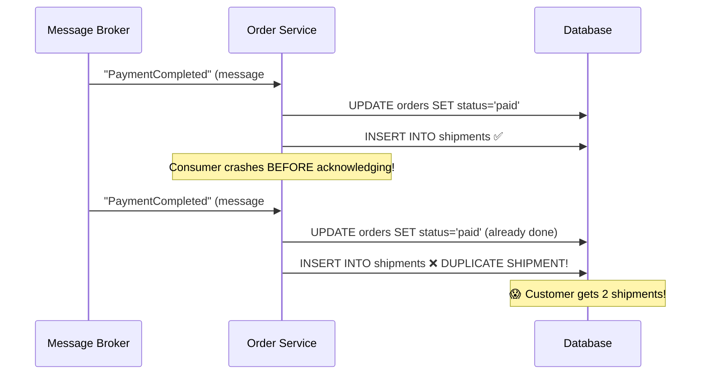
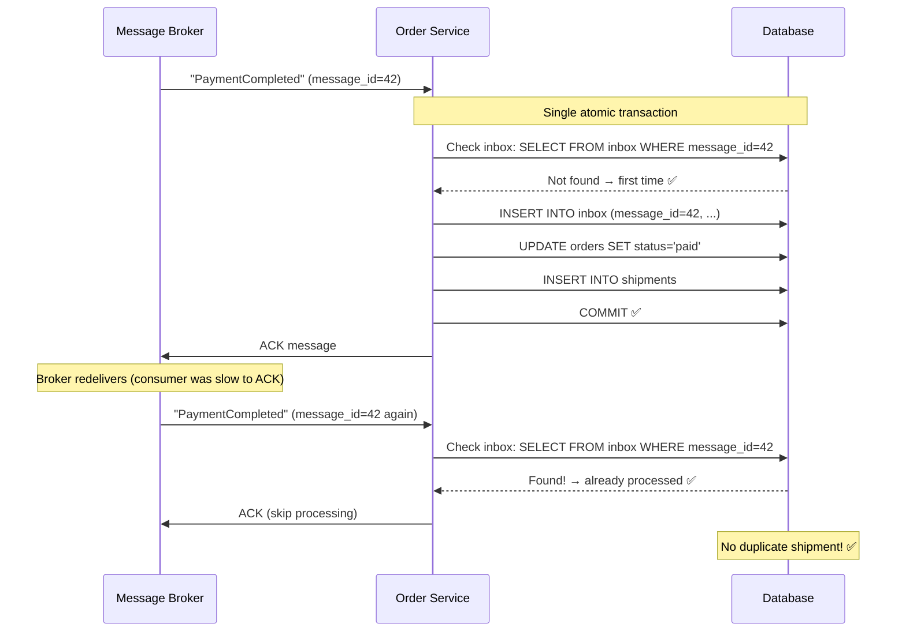
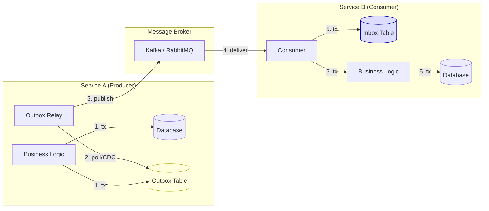
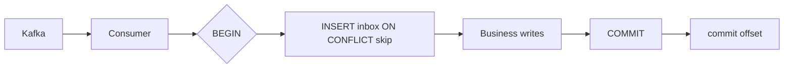
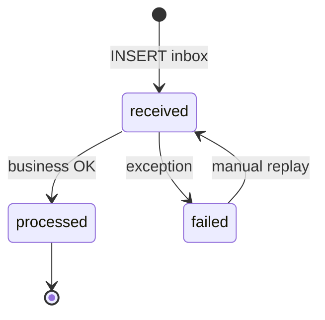

# Transactional Inbox Pattern

## What Problem Does It Solve?

The Outbox pattern solves the **producer** side (reliably publishing events). The **Inbox pattern** solves the **consumer** side:

> How do you ensure a consumed message is processed **exactly once**, even if the message is delivered multiple times?

---

## The Problem Without an Inbox



The root cause: **message acknowledgment and business processing are not atomic.** The broker can redeliver a message that was already partially or fully processed.

---

## The Solution: Transactional Inbox

Store the incoming message in an **inbox table** within the **same transaction** as your business logic. Before processing any message, check if it's already in the inbox.



---

## Code Example

### Step 1: The Inbox Table

```sql
CREATE TABLE inbox (
    message_id    VARCHAR(255) PRIMARY KEY,   -- Unique ID from the message
    source_topic  VARCHAR(255) NOT NULL,
    event_type    VARCHAR(255) NOT NULL,
    payload       JSONB NOT NULL,
    received_at   TIMESTAMPTZ DEFAULT NOW(),
    processed_at  TIMESTAMPTZ,
    status        VARCHAR(20) DEFAULT 'received'  -- received | processed | failed
);

-- Cleanup index
CREATE INDEX idx_inbox_cleanup ON inbox (processed_at) WHERE status = 'processed';
```

### Step 2: Idempotent Message Consumer

```python
import json
from datetime import datetime

class InboxConsumer:
    """
    Consumes messages idempotently using the Inbox pattern.
    Ensures each message is processed exactly once.
    """
    
    def __init__(self, db, handlers: dict):
        self.db = db
        self.handlers = handlers  # event_type → handler function
    
    async def handle_message(self, message) -> bool:
        """
        Process a message exactly once.
        Returns True if processed, False if duplicate.
        """
        message_id = message.headers.get("message-id") or message.key
        event_type = message.headers.get("event-type")
        payload = json.loads(message.value)
        
        async with self.db.transaction() as tx:
            # Step 1: Check if already processed (idempotency check)
            existing = await tx.fetchrow(
                "SELECT status FROM inbox WHERE message_id = $1",
                message_id,
            )
            
            if existing:
                if existing["status"] == "processed":
                    print(f"⏭️  Skipping duplicate message: {message_id}")
                    return False
                # If status is 'failed', we might want to retry
            
            # Step 2: Insert into inbox
            await tx.execute(
                """INSERT INTO inbox (message_id, source_topic, event_type, payload)
                   VALUES ($1, $2, $3, $4)
                   ON CONFLICT (message_id) DO NOTHING""",
                message_id, message.topic, event_type, json.dumps(payload),
            )
            
            # Step 3: Process the message (business logic)
            handler = self.handlers.get(event_type)
            if not handler:
                print(f"⚠️  No handler for event type: {event_type}")
                return False
            
            try:
                await handler(tx, payload)
            except Exception as e:
                await tx.execute(
                    """UPDATE inbox SET status = 'failed'
                       WHERE message_id = $1""",
                    message_id,
                )
                raise
            
            # Step 4: Mark as processed (same transaction!)
            await tx.execute(
                """UPDATE inbox SET status = 'processed', processed_at = NOW()
                   WHERE message_id = $1""",
                message_id,
            )
        
        print(f"✅ Processed message: {message_id}")
        return True


# --- Business Logic Handlers ---

async def handle_payment_completed(tx, payload):
    """Process a PaymentCompleted event."""
    order_id = payload["orderId"]
    
    # Update order status
    await tx.execute(
        "UPDATE orders SET status = 'paid', paid_at = NOW() WHERE id = $1",
        order_id,
    )
    
    # Create shipment
    await tx.execute(
        """INSERT INTO shipments (order_id, status, created_at)
           VALUES ($1, 'pending', NOW())""",
        order_id,
    )


async def handle_inventory_reserved(tx, payload):
    """Process an InventoryReserved event."""
    order_id = payload["orderId"]
    await tx.execute(
        "UPDATE orders SET inventory_reserved = TRUE WHERE id = $1",
        order_id,
    )


# --- Wire It Up ---
consumer = InboxConsumer(
    db=database,
    handlers={
        "PaymentCompleted": handle_payment_completed,
        "InventoryReserved": handle_inventory_reserved,
    },
)
```

### Step 3: Kafka Consumer Loop

```python
from aiokafka import AIOKafkaConsumer

async def run_consumer():
    kafka_consumer = AIOKafkaConsumer(
        "events.payment",
        "events.inventory",
        bootstrap_servers="kafka:9092",
        group_id="order-service",
        enable_auto_commit=False,   # Manual commit for safety!
        auto_offset_reset="earliest",
    )
    
    await kafka_consumer.start()
    
    try:
        async for message in kafka_consumer:
            try:
                processed = await consumer.handle_message(message)
                
                # Only commit offset after successful processing
                await kafka_consumer.commit()
                
            except Exception as e:
                print(f"Error processing message: {e}")
                # Don't commit — message will be redelivered
                # Inbox ensures idempotency on retry
    finally:
        await kafka_consumer.stop()
```

---

## Outbox + Inbox: The Complete Picture



```
Service A                          Service B
┌──────────────────────┐          ┌──────────────────────┐
│ 1. Business write    │          │ 5. Check inbox       │
│ 2. Outbox write      │  ──→    │ 6. Process business   │
│    (same tx)         │  Kafka   │ 7. Mark processed     │
│ 3. Relay publishes   │  ──→    │    (same tx)          │
└──────────────────────┘          └──────────────────────┘

 Guaranteed: event        Guaranteed: event processed
 is published              exactly once
```

---

## Inbox Table Cleanup

```sql
-- Delete processed messages older than 30 days
-- Keep them for a while for debugging and auditing
DELETE FROM inbox
WHERE status = 'processed'
AND processed_at < NOW() - INTERVAL '30 days';

-- Monitor failed messages
SELECT event_type, COUNT(*), MIN(received_at)
FROM inbox
WHERE status = 'failed'
GROUP BY event_type;
```

---

## Inbox vs Application-Level Idempotency

| Approach | Inbox Pattern | Application-Level |
|---|---|---|
| **How** | Inbox table + dedup by message ID | Business logic checks (e.g., order status) |
| **Guarantee** | Works for ANY message type | Must be designed per use case |
| **Example** | `IF message_id IN inbox → skip` | `IF order.status == 'paid' → skip` |
| **Pros** | Generic, reusable | No extra table |
| **Cons** | Extra table + storage | Easy to miss edge cases |
| **Best for** | Framework/library approach | Simple, well-understood flows |

> **Best practice:** Use **both**. The inbox catches duplicates generically. Application-level idempotency provides defense in depth.

---

## Key Takeaways

- The Inbox pattern is the **consumer-side counterpart** to the Outbox pattern
- It prevents **duplicate processing** by tracking processed message IDs in a database table
- **All writes** (inbox insert + business logic) must be in the **same transaction**
- Use **manual offset commits** in Kafka — only commit after your transaction succeeds
- **Clean up** old inbox records periodically
- Combine with **application-level idempotency** for defense in depth
- Together, Outbox + Inbox provide **exactly-once semantics** end-to-end

---

## Senior Pitfalls

| Mistake | Impact | Fix |
|---------|--------|-----|
| Processing message before inbox insert commits | Lost message on crash after side effect | Inbox insert in same TX as handler idempotency record |
| Inbox dedup key too coarse | Legitimate events skipped | Key on broker message ID + consumer group |
| Never pruning processed inbox rows | Table bloat slows inserts | Retention job; partition by time |
| At-least-once consumer without inbox | Duplicate charges on retry | Inbox + business logic in one transaction |
| Sharing inbox table across unrelated consumers | Lock contention | Per-consumer inbox or schema isolation |

---

## Production-grade Practice

1. **Build:** Pair inbox table with handler so duplicate deliveries are no-ops; test with forced redeliveries.
2. **Debug:** Simulate consumer crash after DB commit but before offset commit; verify no double processing.
3. **Measure:** Inbox lag, duplicate suppression rate, and handler error rate to DLQ.
4. **Capacity plan:** Inbox insert rate at peak fan-out; index and partition strategy for 90-day retention.

---

## FAANG Interview Deep Dive

### Real-world examples

| Company | Consumer idempotency | Architecture choices |
|---------|---------------------|----------------------|
| **Stripe** | Payment webhooks + internal events | **Idempotency keys** on API + inbox/dedup store for async handlers; never create two charges on redelivery. |
| **Netflix** | Billing and entitlement updates | Inbox or **dedup table** in consumer shard DB; manual offset commit after tx; failed messages → DLQ with `message_id` for replay tooling. |
| **Airbnb** | Payout and reservation consumers | Kafka consumer groups per service; **inbox** for generic dedup; business rules (`if status=paid skip`) as second layer. |



### Interview Q&A

### Q: Inbox vs Kafka transactional consume-process-produce?
**A:** Kafka transactions (EOS) tie offset commit to output topic in one broker transaction—great for **stream processors**, awkward for **arbitrary SQL** side effects. Inbox pattern fits **OLTP consumers** writing to Postgres/MySQL with clear dedup audit trail.

### Q: What is your idempotency key—offset, UUID, or business key?
**A:** Prefer **producer-assigned event_id** (UUID in outbox) in headers—not Kafka offset (changes on repartition/replay). Business key (`payment_id`) works only if one message per lifecycle stage.

### Q: Message fails after inbox insert but before processed—retry behavior?
**A:** Status `received` vs `processed`; retry handler either continues in same tx or uses **pessimistic lock** on inbox row. Avoid leaving `processed` false forever—exponential backoff + DLQ after N attempts.

### Q: Can inbox + outbox claim end-to-end exactly-once across two services?
**A:** **Effectively-once**: Service A outbox → Kafka (at-least-once) → Service B inbox + business tx. Duplicates absorbed at B. Cross-service **distributed transactions** (2PC) are avoided at FAANG scale.

### Q: Performance cost of inbox on every message?
**A:** One extra **INSERT + SELECT** per message—~1–3 ms on indexed PK. At **>20k msg/s**, shard consumers, batch rarely (lose simplicity), or use **Redis SETNX** with DB as source of truth for audit-only paths.

### Common mistakes candidates make

- **Auto-commit** Kafka offsets before DB commit.
- `ON CONFLICT DO NOTHING` then **still running business logic** without checking insert success.
- Using **consumer offset** as message_id across redeploys.
- Inbox table on **different DB** than business data (no atomicity).
- Never cleaning inbox → multi-TB table and slow dedup checks.

### Scale numbers

| Dimension | Illustrative targets |
|-----------|---------------------|
| Consumer throughput | **1k–15k msg/s** per consumer group with inbox on Postgres; higher on Cockroach/Spanner |
| Dedup lookup | PK on `message_id` → **<2 ms** p99 |
| Retention | Processed rows **30–90 days** for dispute/debug |
| Lag | **<1 min** p99 consumer lag for payment paths |
| DLQ rate | **<0.01%** steady state; page if **>0.1%** |
| Partitions | **≥ max parallel consumers**; 1 consumer per partition rule |

```sql
-- Pattern: only process if we won the insert
INSERT INTO inbox (message_id, ...) VALUES ($1, ...)
ON CONFLICT (message_id) DO NOTHING
RETURNING message_id;
-- NULL => duplicate, ACK and skip business logic
```

### Kafka consumer settings (production table)

| Setting | Value | Why |
|---------|-------|-----|
| `enable.auto.commit` | `false` | Offset after DB commit |
| `isolation.level` | `read_committed` | If upstream uses transactions |
| `max.poll.interval.ms` | Tuned to handler p99 | Avoid rebalance during long tx |
| `max.poll.records` | Lower for fat messages | Prevent tx timeout |

### Additional interview Q&A

### Q: Poison message stuck in retry loop?
**A:** After N failures, move to **DLQ** with same `message_id`; mark inbox `failed` with error blob; manual replay tool inserts **new** processing attempt only after fix—never delete inbox row (audit).

### Q: Inbox with horizontally scaled consumers?
**A:** Same `message_id` always maps to **one partition** via key; inbox PK prevents double process across instances. **Different** messages parallelize per partition.



### Stripe-style defense in depth

1. **Inbox** dedup by `event_id`  
2. **Unique constraint** on `shipments(order_id)`  
3. **Status machine** `paid → shipped` only once  

| Layer stops | Duplicate shipment? |
|-------------|---------------------|
| Inbox only | Maybe if bug skips check |
| + DB unique | **No** |
