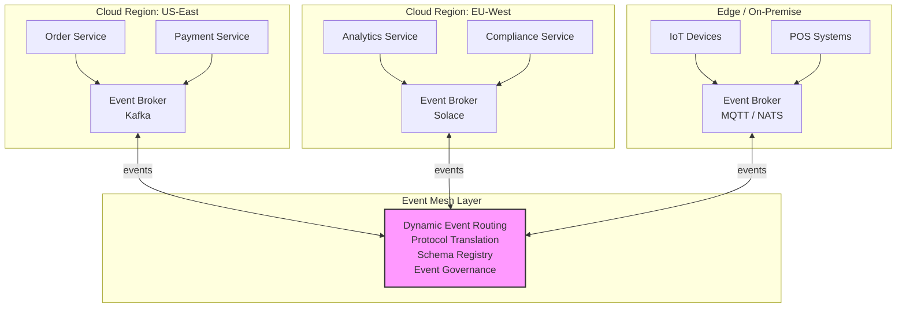
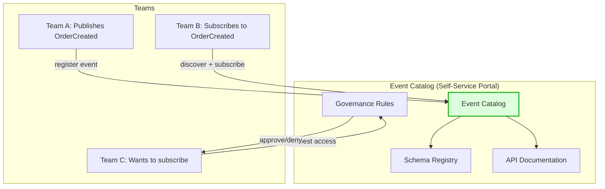
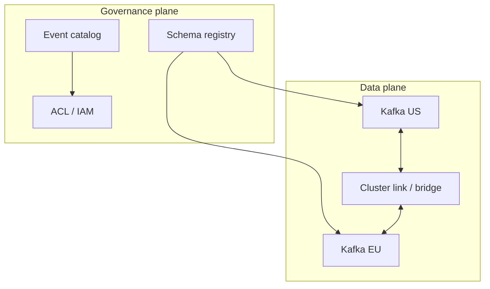

# Event Mesh Architecture

## What Is an Event Mesh?

Think of a **service mesh** — it connects microservices for request/response (HTTP/gRPC). An **event mesh** does the same thing for **events**: it connects event producers and consumers across environments, clouds, and regions.

> An **Event Mesh** is a configurable, dynamic infrastructure layer for distributing events among decoupled applications, cloud services, and devices — regardless of where they are deployed.

---

## From Single Broker to Event Mesh

```
Evolution:

Stage 1: Single Broker               Stage 2: Cluster
┌──────────────┐                     ┌──────────────────────┐
│  RabbitMQ    │                     │  Kafka Cluster       │
│  (single)    │                     │  ┌────┐┌────┐┌────┐  │
│              │                     │  │ B1 ││ B2 ││ B3 │  │
└──────────────┘                     │  └────┘└────┘└────┘  │
                                     └──────────────────────┘

Stage 3: Multi-Cluster               Stage 4: Event Mesh
┌──────────┐  ┌──────────┐          ┌─────────────────────────────────┐
│ Kafka    │  │ Kafka    │          │        EVENT MESH               │
│ (US)     │──│ (EU)     │          │  ┌─────┐  ┌──────┐  ┌───────┐  │
└──────────┘  └──────────┘          │  │Kafka│──│Solace│──│Rabbit │  │
 Bridge / MirrorMaker               │  │(US) │  │(EU)  │  │(Edge) │  │
                                     │  └─────┘  └──────┘  └───────┘  │
                                     │    Dynamic routing + discovery  │
                                     └─────────────────────────────────┘
```

---

## Event Mesh Architecture



---

## Core Capabilities

### 1. Dynamic Event Routing

Events are routed based on **topics, content, and subscriptions** — not hardcoded point-to-point connections.

```yaml
# Event Mesh routing configuration
routes:
  - name: order-events-to-analytics
    source:
      broker: kafka-us-east
      topic: "events.orders.*"
    destination:
      broker: solace-eu-west
      topic: "analytics/orders/{eventType}"
    filter:
      eventType: ["OrderCreated", "OrderCompleted"]
    transform:
      - remove_pii: true  # Strip PII before sending to analytics

  - name: iot-alerts-to-cloud
    source:
      broker: mqtt-edge
      topic: "sensors/+/alerts"
    destination:
      broker: kafka-us-east
      topic: "iot.alerts"
    filter:
      severity: ["critical", "high"]
```

### 2. Protocol Translation

The mesh translates between different messaging protocols:

```
┌────────────┐         ┌──────────────┐         ┌────────────┐
│  Kafka     │ ──────► │  Event Mesh   │ ──────► │  MQTT      │
│  (binary   │         │  (translates  │         │  (IoT      │
│   Avro)    │         │   protocols)  │         │   JSON)    │
└────────────┘         └──────────────┘         └────────────┘
                              │
                              ▼
                       ┌────────────┐
                       │  AMQP      │
                       │  (RabbitMQ │
                       │   format)  │
                       └────────────┘
```

```python
# Protocol translation example (conceptual)
class EventMeshTranslator:
    def translate(self, event, source_protocol: str, target_protocol: str):
        # Normalize to canonical format
        canonical = self.to_canonical(event, source_protocol)
        
        # Convert to target format
        return self.from_canonical(canonical, target_protocol)
    
    def to_canonical(self, event, protocol):
        if protocol == "kafka":
            return {
                "id": event.headers.get("event-id"),
                "type": event.headers.get("event-type"),
                "source": event.topic,
                "data": self.deserialize_avro(event.value),
                "time": event.timestamp,
            }
        elif protocol == "mqtt":
            payload = json.loads(event.payload)
            return {
                "id": payload.get("id"),
                "type": payload.get("type"),
                "source": event.topic,
                "data": payload.get("data"),
                "time": payload.get("timestamp"),
            }
    
    def from_canonical(self, canonical, protocol):
        if protocol == "amqp":
            return {
                "routing_key": f"{canonical['type']}.{canonical['source']}",
                "headers": {"event-id": canonical["id"]},
                "body": json.dumps(canonical["data"]),
            }
```

### 3. Event Discovery and Governance



```yaml
# Event catalog entry
event:
  name: OrderCreated
  version: 2.1
  owner: order-team
  description: "Published when a new order is successfully created"
  schema:
    type: avro
    registry: schema-registry.internal
    subject: order-created-value
  topic: events.orders.created
  sla:
    availability: 99.9%
    max_latency_ms: 100
    throughput: 10000/sec
  access:
    public: false
    approved_consumers:
      - analytics-team
      - fulfillment-team
      - compliance-team
  data_classification: PII
  retention: 30 days
```

---

## Event Mesh vs Other Patterns

| Feature | Single Broker | Multi-Cluster | Event Mesh |
|---|---|---|---|
| **Protocols** | One (e.g., Kafka only) | One | Multiple |
| **Regions** | Single | Multi (manual) | Multi (dynamic) |
| **Discovery** | Manual config | Manual config | Self-service catalog |
| **Governance** | None | Basic | Full (access control, schemas) |
| **Routing** | Topic-based | Topic + bridge | Dynamic, content-based |
| **Environments** | Cloud only | Cloud only | Cloud + Edge + On-prem |
| **Complexity** | Low | Medium | High |

---

## Event Mesh Platforms

| Platform | Type | Strengths |
|---|---|---|
| **Solace PubSub+** | Commercial | Purpose-built event mesh, multi-protocol |
| **Confluent** | Commercial | Kafka-centric, Schema Registry, Cluster Linking |
| **AWS EventBridge** | Managed | AWS-native, event bus with rules |
| **Azure Event Grid** | Managed | Azure-native, serverless events |
| **Apache Kafka + MirrorMaker 2** | Open source | DIY mesh with Kafka |
| **NATS** | Open source | Lightweight, multi-cloud, built-in mesh |

---

## NATS as a Lightweight Event Mesh

```go
// NATS: Built-in multi-cluster mesh with leaf nodes

// Publisher (US cluster)
nc, _ := nats.Connect("nats://us-east.nats.internal:4222")
js, _ := nc.JetStream()

// Publish — event is automatically available across all clusters
js.Publish("orders.created", []byte(`{
    "orderId": "ORD-123",
    "customerId": "CUST-456",
    "total": 99.99
}`))

// Subscriber (EU cluster — different NATS cluster)
nc2, _ := nats.Connect("nats://eu-west.nats.internal:4222")
js2, _ := nc2.JetStream()

// Subscribe — NATS mesh routes events across clusters automatically
sub, _ := js2.Subscribe("orders.created", func(msg *nats.Msg) {
    fmt.Printf("EU received order event: %s\n", string(msg.Data))
    msg.Ack()
})
```

```
NATS Super-Cluster (built-in mesh):

┌──────────────┐    Gateway     ┌──────────────┐    Gateway     ┌──────────────┐
│  US Cluster   │◄─────────────►│  EU Cluster   │◄─────────────►│ APAC Cluster │
│ ┌────┐┌────┐  │               │ ┌────┐┌────┐  │               │ ┌────┐┌────┐ │
│ │ N1 ││ N2 │  │               │ │ N3 ││ N4 │  │               │ │ N5 ││ N6 │ │
│ └────┘└────┘  │               │ └────┘└────┘  │               │ └────┘└────┘ │
└──────────────┘               └──────────────┘               └──────────────┘

Subscribers in any cluster automatically receive events from any publisher.
No bridges, no MirrorMaker, no manual config.
```

---

## When to Use an Event Mesh

| Scenario | Use Event Mesh? |
|---|---|
| Single cloud, single broker | ❌ Overkill |
| Multi-region Kafka | ⚠️ Maybe (MirrorMaker might suffice) |
| Multi-cloud (AWS + GCP + Azure) | ✅ Yes |
| Cloud + Edge + On-premise | ✅ Definitely |
| Multiple teams with different brokers | ✅ Yes |
| Need event governance and discovery | ✅ Yes |

---

## Key Takeaways

- An Event Mesh is to **events** what a Service Mesh is to **requests**
- It provides **dynamic routing, protocol translation, and event governance** across environments
- You don't need an event mesh for simple setups — start with a single broker
- Consider it when you have **multi-cloud, multi-region, or multi-protocol** requirements
- **NATS** offers a lightweight, built-in mesh; **Solace** is the most feature-complete commercial option
- The **event catalog** (discovery + governance) is often more valuable than the routing itself

---

## Senior Pitfalls

| Mistake | Impact | Fix |
|---------|--------|-----|
| Mesh without event catalog | Teams publish incompatible schemas | Schema registry + contract tests in CI |
| Dynamic routing without authZ | Any service subscribes to PII streams | mTLS, topic ACLs, and data classification tags |
| Turning mesh into sync RPC via request-reply abuse | Latency and coupling return | Governance on interaction styles; prefer events |
| No dead-letter and replay path | Poison message blocks shard | DLQ, quarantine, and replay tooling per topic |
| Central broker as single blast radius | Regional outage stops all flows | Federation, cell-based topics, hub-spoke DR |

---

## Production-grade Practice

1. **Build:** Register one event type in catalog with schema, owners, and sample consumers; enforce CI compatibility check.
2. **Debug:** Trace one event from publisher through mesh to two subscribers; verify routing rules and headers.
3. **Measure:** End-to-end delivery latency p99, schema violation rate, and unauthorized subscribe attempts.
4. **Capacity plan:** Peak events/sec × fan-out × average payload; size brokers and inter-mesh links per cell.

---

## FAANG Interview Deep Dive

### Real-world examples

| Company | Mesh-like capability | Architecture choices |
|---------|---------------------|----------------------|
| **Netflix** | **Data mesh** + event-driven microservices | Domain-owned **event contracts**; internal discovery (Metacat-style catalog); Kafka backbone; governance on PII classification—not one giant enterprise bus. |
| **Uber** | Multi-region **Kafka** + mirroring | Cluster linking / MirrorMaker between regions; **schema registry**; routing by domain topic conventions (`.*.dc.*`); not always a commercial “event mesh” product but same problems. |
| **Airbnb** | **Data platform** + streaming | Kafka + schema registry; **Minerva**-style metrics/events; self-serve topic onboarding with approval workflows—catalog SLAs matter more than broker brand. |



### Interview Q&A

### Q: Event mesh vs “we have Kafka everywhere”?
**A:** Kafka is **transport**. Event mesh adds **federated routing**, **multi-protocol** bridges, and **productized discovery/governance** across org boundaries. Many FAANG teams implement mesh **capabilities** (catalog, standards, linking) without buying a single “mesh” SKU.

### Q: How do you enforce PII rules on cross-region replication?
**A:** **Field-level filtering** in router (strip before EU), separate **classified topics**, contract tests in CI; deny-list in catalog. Replication of raw PII to wrong region is a **compliance incident**, not a consumer bug.

### Q: Schema registry in a mesh—who owns compatibility?
**A:** **Producer team** owns backward-compatible evolution; registry blocks **BREAKING** changes; consumers pin subject versions. Mesh governance = SLAs + approval for new subscribers on restricted events.

### Q: When is MirrorMaker enough vs full mesh?
**A:** **Homogeneous Kafka**, few regions, topic mapping 1:1 → MM2/Cluster Linking. Mesh when **MQTT edge + Kafka cloud + AMQP legacy** or **dynamic subscription** without ops ticket per route.

### Q: How do you debug “consumer in EU never got US event”?
**A:** Trace **publish time, mesh route ID, transform errors, ACL denial, schema fail**—mesh needs **observability** (OpenTelemetry on routers) like service mesh; without it you’re blind across 4 hops.

### Common mistakes candidates make

- Proposing event mesh for **one team, one cluster** (YAGNI).
- **Mirroring all topics** cross-region → cost + compliance nightmare.
- No **catalog** → shadow consumers and schema drift.
- Protocol translation without **canonical model** → N×M custom mappers.
- Ignoring **ordering** across bridged clusters (global order is false promise).

### Scale numbers

| Dimension | Illustrative targets |
|-----------|---------------------|
| Cross-region replication | **50–500 MB/s** per link; lag **<30 s** p99 for control events |
| Topic count | **10k–50k** topics org-wide; catalog search **<2 s** |
| Schema registry | **1k–10k** subjects; **99.9%** registry availability |
| Router throughput | **100k–1M events/s** per mesh node (vendor-dependent) |
| ACL evaluations | Deny by default; **<5 ms** policy check on subscribe |
| Cost | Cross-region egress **$0.02–0.09/GB**—filter before replicate |

```yaml
# Interview artifact: route with governance hook
route:
  source: { cluster: kafka-us, topic: orders.v1 }
  destination: { cluster: kafka-eu, topic: orders.analytics.v1 }
  transform: [strip_pii, avro_to_json]
  approval: compliance-team
```

### Confluent vs Solace vs DIY (interview framing)

| Capability | Confluent (Kafka mesh) | Solace PubSub+ | DIY Kafka + MM2 |
|------------|------------------------|----------------|-----------------|
| Multi-protocol | Kafka-primary + connectors | Native AMQP/MQTT/JMS | Custom bridges |
| Cluster linking | ✅ | ✅ (federation) | MirrorMaker 2 |
| Event catalog | Stream Catalog / Schema Registry | Event portal | Internal wiki + CI |
| Best when | Kafka-standard org | Heterogeneous brokers | Cost-sensitive, homogenous |

### Additional interview Q&A

### Q: How does Netflix “data mesh” relate to event mesh?
**A:** **Data mesh** = domain ownership of **datasets** + self-serve platform; **event mesh** = runtime **routing** of events. Netflix combines both: teams own Kafka topics/schemas; platform provides discovery and guardrails—not necessarily one vendor “mesh” appliance.

### Q: Edge MQTT → cloud Kafka—what breaks?
**A:** **QoS**, payload size, **offline buffers** on devices, schema mismatch. Mesh/router normalizes to Avro/Protobuf in cloud; edge keeps JSON; **rate limit** per device id.

### Multi-cloud event flow (ASCII)

```
[POS MQTT] --> [Edge gateway] --> [Regional Kafka]
                                      |
                    Event Bridge / Cluster Link
                                      v
                              [Central analytics Kafka]
                                      |
                              [Schema validate + ACL]
```

### Governance KPIs

| KPI | Target |
|-----|--------|
| Time to approve new consumer | **<2 business days** |
| Breaking schema deploys blocked | **100%** in CI |
| Orphan topics (no owner) | **0** in catalog |
