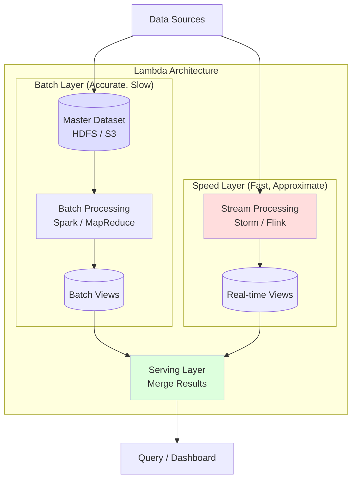
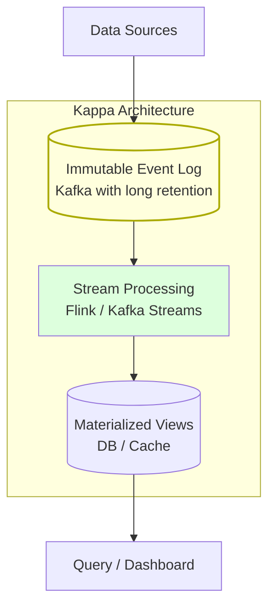
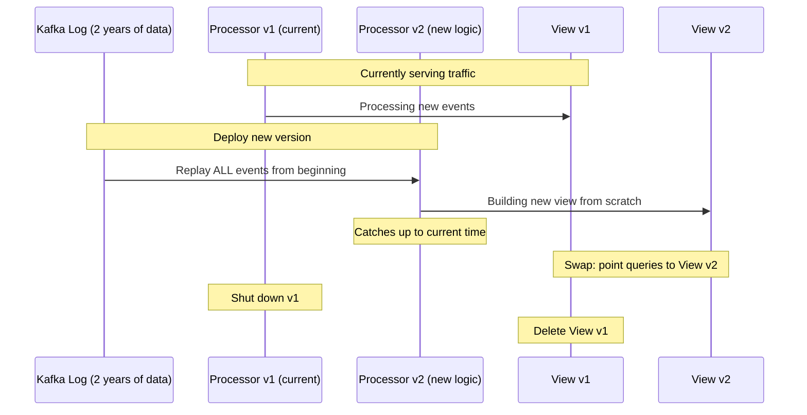
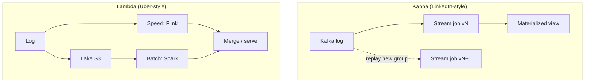
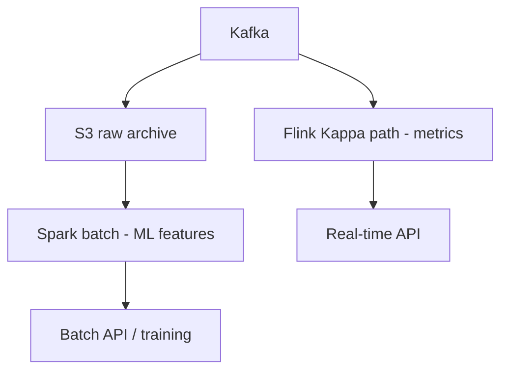

# Kappa Architecture vs Lambda Architecture

## The Core Problem

You need to process both **real-time data** (streaming) and **historical data** (batch). How do you build a data pipeline that handles both?

Two competing architectures emerged: **Lambda** (two paths) and **Kappa** (one path).

---

## Lambda Architecture

Proposed by **Nathan Marz** (creator of Apache Storm). The idea: use **two separate paths** — a batch layer for accuracy and a speed layer for low latency.



### How It Works

```
1. ALL data goes to both layers simultaneously

2. Batch Layer:
   - Stores ALL raw data (immutable master dataset)
   - Periodically recomputes views from scratch (every few hours)
   - Results are ACCURATE but DELAYED
   
3. Speed Layer:
   - Processes data in real-time
   - Only handles recent data (since last batch run)
   - Results are FAST but may be APPROXIMATE

4. Serving Layer:
   - Merges batch views + real-time views
   - Query: batch_result + speed_result = complete answer
```

### Lambda Example: Website Analytics

```python
# --- BATCH LAYER (runs every 6 hours) ---
# Apache Spark job

from pyspark.sql import SparkSession

spark = SparkSession.builder.appName("PageViewsBatch").getOrCreate()

# Read ALL historical page views from S3
raw_data = spark.read.parquet("s3://data-lake/page-views/")

# Compute accurate counts
batch_views = (
    raw_data
    .groupBy("page_url", "date")
    .agg(
        count("*").alias("total_views"),
        countDistinct("user_id").alias("unique_visitors"),
        avg("time_on_page").alias("avg_time_seconds"),
    )
)

# Write to serving layer
batch_views.write.mode("overwrite").parquet("s3://serving/batch-views/")


# --- SPEED LAYER (runs continuously) ---
# Apache Flink / Kafka Streams

from collections import defaultdict

class SpeedLayer:
    def __init__(self):
        self.realtime_counts = defaultdict(lambda: {
            "views": 0, "unique_users": set()
        })
    
    def process_event(self, event):
        key = f"{event['page_url']}:{event['date']}"
        self.realtime_counts[key]["views"] += 1
        self.realtime_counts[key]["unique_users"].add(event["user_id"])
    
    def get_realtime_view(self, page_url, date):
        key = f"{page_url}:{date}"
        counts = self.realtime_counts[key]
        return {
            "views": counts["views"],
            "unique_visitors": len(counts["unique_users"]),
        }


# --- SERVING LAYER ---
class ServingLayer:
    def __init__(self, batch_store, speed_layer):
        self.batch = batch_store
        self.speed = speed_layer
    
    def query(self, page_url, date):
        # Get batch results (accurate, but hours old)
        batch_result = self.batch.get(page_url, date)
        
        if date == today():
            # For today: batch doesn't have it yet, use speed layer
            speed_result = self.speed.get_realtime_view(page_url, date)
            return speed_result
        else:
            # For historical: batch is accurate
            return batch_result
```

---

## Kappa Architecture

Proposed by **Jay Kreps** (co-creator of Apache Kafka). The idea: **why maintain two codebases?** Use a single stream processing layer for everything.



### How It Works

```
1. ALL data goes into an immutable log (Kafka with long/infinite retention)

2. Stream processing builds materialized views in real-time

3. Need to reprocess? Replay the log from the beginning with a new version
   of your processing logic

4. No batch layer needed — the log IS the source of truth

Key insight: If you can replay the entire log, you get the same result
as a batch job — but using the same code as your streaming job.
```

### Kappa Example: Same Analytics, One Path

```python
# Kappa: Single stream processing job handles everything

from faust import App, Record

app = App('page-views', broker='kafka://kafka:9092')

class PageView(Record):
    page_url: str
    user_id: str
    timestamp: float

# Materialized view (like a database table, built from the stream)
page_view_counts = app.Table(
    'page_view_counts',
    default=lambda: {"views": 0, "unique_users": []},
    partitions=8,
)

# Single processing logic — works for both real-time AND historical
@app.agent(app.topic('page-views', value_type=PageView))
async def process_page_views(stream):
    async for event in stream:
        key = f"{event.page_url}:{event.timestamp // 86400}"  # daily bucket
        
        current = page_view_counts[key]
        current["views"] += 1
        if event.user_id not in current["unique_users"]:
            current["unique_users"].append(event.user_id)
        
        page_view_counts[key] = current


# Query the materialized view (always up-to-date)
@app.page('/api/views/{page_url}')
async def get_views(web, request, page_url):
    today_key = f"{page_url}:{int(time.time()) // 86400}"
    result = page_view_counts[today_key]
    return web.json({
        "page_url": page_url,
        "total_views": result["views"],
        "unique_visitors": len(result["unique_users"]),
    })
```

### Reprocessing in Kappa

When you need to fix a bug or change logic:



```python
# Reprocessing command
# Deploy v2 with a new consumer group → starts from beginning

# 1. Deploy v2 processor (reads from offset 0)
# kafka-consumer-groups --reset-offsets --to-earliest \
#   --group page-views-v2 --topic page-views --execute

# 2. Wait for v2 to catch up to the latest offset
# 3. Switch serving layer to point to v2's materialized view
# 4. Shut down v1, delete v1's views
```

---

## Head-to-Head Comparison

```
Lambda Architecture:                    Kappa Architecture:
                                        
  ┌─────────────┐                       ┌─────────────────┐
  │ Batch Path   │ ← Accurate          │ Single Stream    │
  │ (Spark)      │                      │ (Flink/Kafka     │
  ├─────────────┤                       │  Streams)        │
  │ Speed Path   │ ← Fast              │                  │
  │ (Storm)      │                      │ Reprocess by     │
  └──────┬──────┘                       │ replaying log    │
         │ merge                        └────────┬────────┘
  ┌──────▼──────┐                       ┌────────▼────────┐
  │ Serving     │                       │ Materialized    │
  │ Layer       │                       │ View            │
  └─────────────┘                       └─────────────────┘
  
  TWO codebases                         ONE codebase
  TWO systems to maintain               ONE system to maintain
```

| Factor | Lambda | Kappa |
|---|---|---|
| **Codebases** | Two (batch + stream) — must keep in sync | One (stream only) |
| **Complexity** | High (two pipelines to manage) | Lower (one pipeline) |
| **Accuracy** | Batch guarantees correctness | Correct if stream processing is correct |
| **Latency** | Real-time (speed layer) | Real-time |
| **Reprocessing** | Run batch job on full dataset | Replay event log |
| **Storage** | Master dataset + views | Event log (Kafka) + views |
| **Requirement** | Large batch infra (Spark cluster) | Long-retention event log (Kafka) |
| **Best for** | ML training + real-time serving | Pure event-driven systems |

---

## When to Use Which?

```
┌──────────────────────────────────────────────────┐
│ Can you store ALL your raw data in Kafka         │
│ (or a similar event log) with sufficient         │
│ retention?                                        │
└─────────────────┬──────────────────┬─────────────┘
                  │ YES              │ NO
                  ▼                  ▼
          ┌───────────────┐  ┌──────────────────┐
          │ Use Kappa     │  │ Use Lambda        │
          │               │  │ (need S3/HDFS     │
          │ Simpler,      │  │  for long-term    │
          │ one codebase  │  │  storage)         │
          └───────┬───────┘  └──────────┬───────┘
                  │                      │
  ┌───────────────▼──────────────┐  ┌───▼──────────────────────┐
  │ Do you need ML model         │  │ Lambda is also better    │
  │ training on historical data? │  │ when batch and stream    │
  │                              │  │ logic are fundamentally  │
  │ YES → Lambda might be better │  │ different                │
  │ (Spark for training +        │  │                          │
  │  Flink for serving)          │  │                          │
  └──────────────────────────────┘  └──────────────────────────┘
```

### Use Lambda When:
- You need **ML model training** on full historical datasets (Spark)
- Batch and stream logic are **fundamentally different**
- You have **petabytes** of data that can't fit in Kafka retention
- You need complex **SQL-like batch analytics** (data warehouse)

### Use Kappa When:
- Everything is an **event stream**
- You can retain all data in Kafka (or similar log)
- You want to maintain **one codebase** instead of two
- **Correctness** of stream processing is sufficient
- You're building an **event-sourced** system

---

## Real-World Usage

| Company | Architecture | Why |
|---|---|---|
| **LinkedIn** | Kappa (created it) | Event-driven, Kafka-native |
| **Netflix** | Lambda → Kappa (migrating) | Simplification |
| **Uber** | Lambda | ML training + real-time pricing |
| **Twitter/X** | Lambda | Large-scale batch analytics + real-time feed |
| **Spotify** | Kappa-ish | Event-driven recommendations |

---

## Key Takeaways

- **Lambda** = two paths (batch + speed) → accurate but complex
- **Kappa** = one path (stream only) → simpler but requires replayable event log
- **Kappa is preferred** for new systems when Kafka can store your data long enough
- Lambda still wins when you need **different processing** for batch vs real-time (e.g., ML training)
- The trend is moving toward Kappa as stream processing frameworks (Flink) become more capable
- In practice, many teams use a **pragmatic hybrid**: Kappa for most things, occasional batch jobs for ML

---

## Senior Pitfalls

| Mistake | Impact | Fix |
|---------|--------|-----|
| Kappa for heavy historical recompute | Stream replay cost exceeds batch | Hybrid: stream for real-time, batch for backfill |
| Lambda with divergent batch and stream logic | Two bugs for one metric | Shared library for business rules; single test suite |
| Unbounded stream replay after bug fix | Days to catch up | Versioned outputs, incremental fix jobs |
| Choosing Kappa without idempotent sinks | Duplicate rows on redeploy | Idempotent writes, upserts, or compaction |
| Batch SLAs forced onto stream-only design | Missed daily reporting deadlines | Explicit batch window or materialized views |

---

## Production-grade Practice

1. **Build:** For one metric, implement stream path and document when batch backfill would run; compare code duplication.
2. **Debug:** Replay 24h of Kafka after logic bug; measure catch-up time and downstream duplicate handling.
3. **Measure:** Lag, replay cost ($), and correctness diff between batch gold table and stream projection.
4. **Capacity plan:** Storage for infinite retention vs compacted topics; choose retention from replay RTO requirements.

---

## FAANG Interview Deep Dive

### Real-world examples

| Company | Architecture | Architecture choices |
|---------|--------------|----------------------|
| **LinkedIn (Jay Kreps)** | **Kappa** origin story | Kafka retention + Samza/Flink; reprocess with **new consumer group** from earliest offset; batch layer minimized for many pipelines. |
| **Uber** | **Lambda-style hybrid** | **Trillions** of events/day on Kafka; **real-time** pricing/supply on Flink; **batch Spark** on data lake for ML training and reconciliation—two paths when logic/cost differs. |
| **Netflix** | Migration **Lambda → Kappa** | Kepler-style streaming maturity; long-retention log; fewer duplicate batch/speed codepaths for recommendations metrics. |



### Interview Q&A

### Q: Kappa reprocessing—how long does a full replay take at scale?
**A:** Bounded by **log size / read throughput**. Example: **10 PB** retention can’t sit in Kafka—Kappa applies to **bounded retention** or **tiered log** (Kafka hot + S3 cold replay via Flink batch). Staff answer: define **reprocess SLA** (hours) and partition parallelism **= f(partitions, sink QPS)**.

### Q: When does Lambda still win over Kappa at Netflix/Uber scale?
**A:** **ML training** on petabyte tables, **ad-hoc SQL** on full history, or when stream and batch semantics **differ** (approximate speed vs exact batch). Kappa wins when **same code** on replay is the correctness model.

### Q: How do you avoid dual-codepath drift in Lambda?
**A:** Shared **library** for business rules, test vectors run against both; or **batch collects from stream output** (batch = correction layer only). Netflix’s migration goal: **one primary path**.

### Q: Serving layer merge in Lambda—interview pitfall?
**A:** Merging batch + speed views for **unique counts** is hard (sets don’t add). Use **HyperLogLog** in speed + exact batch, or **only speed for today** and batch for closed days—document approximation.

### Q: Kafka retention for Kappa—practical number?
**A:** Often **7–30 days** hot; **years** in lake with **Iceberg**; “Kappa” becomes **stream + lake replay** hybrid—honest staff answer beats textbook purity.

### Common mistakes candidates make

- Claiming Kappa eliminates **batch** entirely at petabyte ML shops.
- **Unique visitor** merge across Lambda layers without set semantics plan.
- Reprocessing **without** keyed state migration plan (rocksdb incompatible across versions).
- Ignoring **cost** of full replay on every deploy.
- Using processing-time windows then comparing to **batch truth**.

### Scale numbers

| Dimension | Illustrative targets |
|-----------|---------------------|
| Uber Kafka | **~7T messages/day** order-of-magnitude public talks |
| Kafka retention | Hot **7–14 days**; lake **years** |
| Replay | **2×–10×** realtime duration with 2× parallelism |
| Flink checkpoint | **60–180 s** interval; state **100 GB–10 TB** |
| Batch layer | Spark **10k+** cores for daily jobs; **6–24 h** windows |
| Lag | Speed layer **<1 min**; batch **SLA next morning** |

```bash
# Kappa reprocess pattern (interview CLI fluency)
kafka-consumer-groups --bootstrap-server $BS \
  --group analytics-v3 --topic page-views --reset-offsets --to-earliest --execute
```

### Hybrid “pragmatic” architecture (most FAANG teams)



| Workload | Path |
|----------|------|
| Dashboard “views last hour” | Kappa / Flink |
| Nightly fraud model retrain | Lambda batch on lake |
| Regulatory report (exact) | Batch on closed books |

### Additional interview Q&A

### Q: How does Uber use Lambda for pricing?
**A:** **Speed layer**: streaming features (supply/demand) for sub-minute adjustments; **Batch layer**: historical simulation, ML model training on trip logs in **HDFS/S3**; merge at serve time with explicit **staleness** bounds—staff cite **different SLAs**, not duplicate business logic blindly.

### Q: Iceberg + Kafka = Kappa?
**A:** Modern pattern: **short Kafka retention** + **continuous ingest to Iceberg**; replay from lake with Spark/Flink batch job—**Kappa semantics**, **Lambda storage economics**.

### Cost comparison (illustrative)

| Item | Lambda (daily Spark) | Kappa (always-on Flink) |
|------|----------------------|-------------------------|
| Compute | Spike 6h/night | 24/7 cluster |
| Engineering | 2 codepaths | 1 codepath + replay ops |
| Break-even | Batch rare, stream heavy | Stream is core product |

### Migration checklist (Lambda → Kappa)

- [ ] Prove stream job matches batch on **30 days** golden set  
- [ ] Automate **consumer group** replay for deploys  
- [ ] Retire speed layer only after **closed-day** batch agrees  
