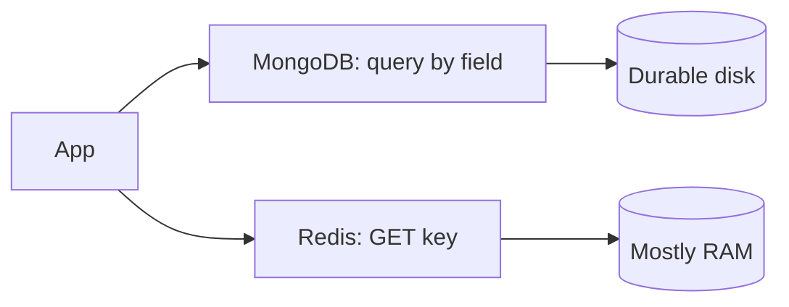
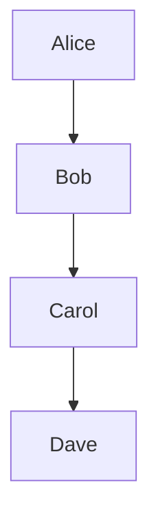
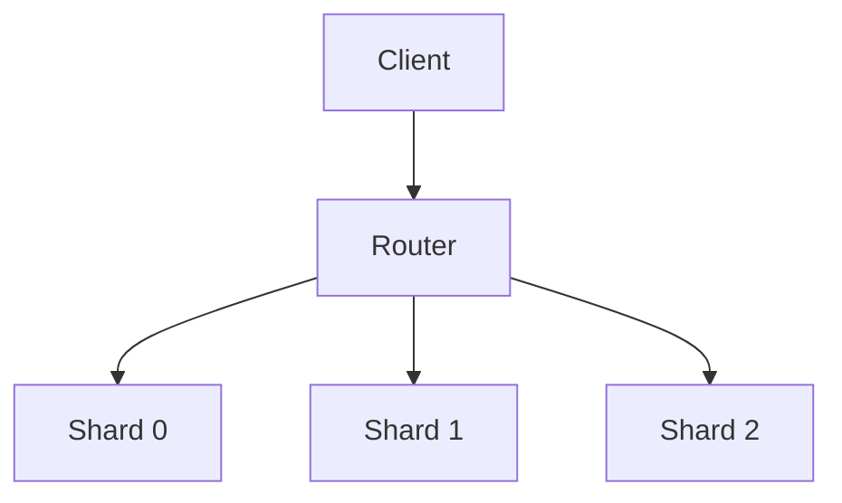
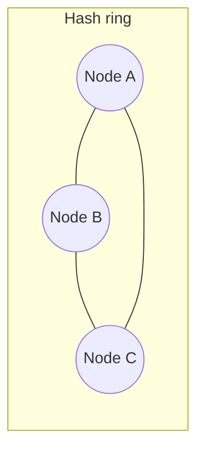
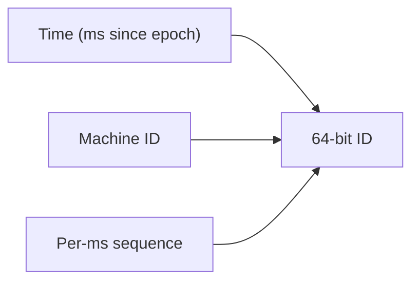

# NoSQL, Partitioning, and Distributed IDs

This guide is about how large systems store data when one database server is not enough. You will learn when to pick document stores, key-value caches, wide-column databases, and graph databases. You will also learn how data is split across machines (sharding), how requests find the right shard, how to avoid “hot” shards, and how to generate unique IDs without a single global counter. Everything is written in plain language with diagrams, code, and interview-style depth.

---

## NoSQL Decision Boundaries: Document vs Relational

A **relational database** (Postgres, MySQL) stores rows in tables with a fixed schema. Relationships are enforced with foreign keys. Joins combine data at read time.

A **NoSQL** label usually means “not only SQL.” In practice it means the database optimizes for a different access pattern than normalized tables plus joins.

| Signal | Lean relational | Lean document NoSQL |
|--------|-----------------|---------------------|
| Data shape is stable, many entities relate | Yes | No |
| Queries need ad-hoc joins across entities | Yes | Rarely |
| Read pattern is “load one aggregate by ID” | Sometimes | Often |
| Schema changes weekly per feature team | Painful in SQL | Easier in documents |
| Strong multi-row transactions across many tables | Critical | Often relaxed |

**Plain rule:** If your product is “invoice + line items + customer + tax rules” with reports that slice any dimension, relational usually wins. If your product is “user profile JSON + nested settings + activity feed blob,” a document store often wins.

```python
# Relational: two tables, join at read time
# users(id, email)  orders(id, user_id, total)

# Document: one read gets the whole aggregate
user_doc = {
    "_id": "user_42",
    "email": "a@b.com",
    "orders": [{"id": "o1", "total": 99.0}],
}
```

**Key insight:** NoSQL is not “faster SQL.” It is a trade: you give up flexible joins and sometimes strict transactions to get simpler scaling and schema flexibility for one dominant access pattern.

---

## Document vs Key-Value Stores (MongoDB vs Redis)

**Document store (e.g. MongoDB):** Keys point to structured documents (JSON-like). You can index fields, run range queries, and sometimes do secondary lookups.

**Key-value store (e.g. Redis):** Keys point to opaque values (strings, hashes, lists). Operations are simple: GET, SET, INCR. Extremely low latency.



| Use case | MongoDB | Redis |
|----------|---------|-------|
| User profile with nested arrays | Strong fit | Awkward (large blobs) |
| Session token → user id | Overkill | Perfect |
| Leaderboard top 100 | Possible with indexes | Sorted sets shine |
| Full-text search on bio | Atlas search / limited | Not the tool |
| Durability + complex queries | Yes | Cache layer, not source of truth |

```python
# Redis: cache a denormalized view
import redis
r = redis.Redis()
r.setex(f"profile:{user_id}", 300, json.dumps(profile))

# MongoDB: source of truth with indexed queries
db.users.find_one({"email": "a@b.com"})
```

**Key insight:** Redis wins when the key fully describes the access path and TTL/cache semantics matter. MongoDB wins when you need durable documents and field-level queries without rebuilding everything in application code.

---

## Columnar vs Wide-Column Stores

**Columnar analytics (BigQuery, ClickHouse):** Data is stored column-by-column. Aggregations (`SUM`, `COUNT`, filters on few columns) scan less data.

**Wide-column / row-oriented at scale (Cassandra, HBase):** Data is grouped into **column families** (think: a named bundle of columns that are stored together for one row key). You design tables around **partition key + clustering key**, not arbitrary joins.

**Column family in plain English:** A row is identified by a **row key**. Under that key you have named groups of columns. In Cassandra, a “table” is really “how rows are partitioned and sorted on disk.”

```
Row key: user_42
  |-- profile: { name, email }      # logical column family
  |-- activity: { last_login, ... }
```

| Workload | Columnar | Wide-column |
|----------|----------|-------------|
| BI dashboard over billions of events | Excellent | Poor fit |
| Time-series writes per device ID | OK | Excellent |
| Random updates to any row | Poor | Designed for it |
| Flexible ad-hoc SQL | Columnar SQL | CQL is narrow |

**Key insight:** Pick columnar for **analytics scans**. Pick wide-column when **write volume + partition key access** dominate and you can model queries upfront.

---

## Graph Database Decision Boundary (Neo4j)

A **graph database** stores **nodes** and **edges** as first-class citizens. Traversals (“friends of friends within 3 hops”) are the main query, not a join afterthought.

Use a graph when:

- The question is inherently about **relationships** (fraud rings, permissions inheritance, knowledge graphs).
- Depth-limited traversal is common; storing edge tables in SQL leads to recursive CTEs or many round trips.

Skip a graph when:

- Relationships are simple (one foreign key).
- You need heavy aggregations over flat facts (use warehouse/columnar).



```cypher
// Neo4j-style: paths are the product
MATCH (u:User {id: $id})-[:FOLLOWS*1..3]->(other)
RETURN DISTINCT other
```

**Key insight:** If removing the graph still leaves you with “SELECT * FROM users WHERE id = ?”, you do not need Neo4j. If the product feature is the path, the graph wins.

---

## Sharding and Partitioning

**Partitioning** splits data into chunks (**partitions**). **Sharding** means those chunks live on different machines.

Each record has a **partition key**. The system computes `shard = route(partition_key)` and sends reads/writes there.



### Range partitioning

Sort keys by value; ranges map to shards.

- Pros: range scans (`BETWEEN`) stay on few shards.
- Cons: latest data often hits the “max” shard → **hot tail**.

### Hash partitioning

`shard = hash(key) % N`

- Pros: even spread if keys are diverse.
- Cons: range queries fan out to all shards.

```python
def shard_for(user_id: str, num_shards: int) -> int:
    return hash(user_id) % num_shards  # production: use stable hash (murmur3)
```

**Key insight:** Partitioning is a **routing problem**. Choose the key that matches your hottest queries, not the prettiest entity diagram.

---

## Hot Partitions and the Celebrity Problem

A **hot partition** is one shard receiving far more traffic than others. Causes:

- Skewed keys (all events for `celebrity_id=1`).
- Time-based keys (`date=2026-10-26` as partition key).
- Monotonic inserts on range shards.

**Celebrity problem:** One logical entity drives global fan-out (millions of followers hit one partition).

Mitigations:

| Technique | Idea |
|-----------|------|
| Salted keys | `partition = hash(user_id + salt_bucket)` split one logical user across buckets |
| Write sharding + read merge | Scatter writes, aggregate in app |
| Separate hot path | Cache, dedicated queue, read replicas for one key |
| Avoid bad partition keys | Use `user_id` not `country` if US is 80% traffic |

```python
# Salting writes for a hot user
for bucket in range(8):
    key = f"feed:{user_id}:{bucket}"
    write_shard(hash(key))
```

**Key insight:** Hashing fixes **many** hotspots; celebrities need **product-level** fan-out design (CDN, cache, async aggregation).

---

## Consistent Hashing

When shard count changes, `hash(key) % N` remaps **most** keys. **Consistent hashing** maps keys and servers onto a **ring**; only keys between old and new node move.



**Virtual nodes (vnodes):** Each physical server owns many small arcs on the ring. That smooths load and speeds recovery when a node dies.

```python
import bisect

class ConsistentHash:
    def __init__(self, nodes, replicas=100):
        self.ring = []
        self.owners = {}
        for node in nodes:
            for i in range(replicas):
                h = hash(f"{node}:{i}")
                self.ring.append(h)
                self.owners[h] = node
        self.ring.sort()

    def node_for(self, key: str) -> str:
        h = hash(key)
        i = bisect.bisect(self.ring, h) % len(self.ring)
        return self.owners[self.ring[i]]
```

**Key insight:** Consistent hashing minimizes **data movement** on cluster resize; vnodes minimize **load imbalance**.

---

## Distributed ID Generation: Why Auto-Increment Breaks

A single `AUTO_INCREMENT` column is a **central choke point**:

- Every insert needs coordination → latency and failure domain of one DB.
- Sharded databases cannot share one counter without cross-shard locks.
- Replicas break the illusion: two writers can get conflicting IDs if not careful.

You need **decentralized** ID generation: each machine can mint IDs independently with low collision risk.

**Key insight:** IDs are not just labels; they encode **ordering**, **uniqueness**, and sometimes **routing**. Design all three on purpose.

---

## UUID, ObjectId, and Snowflake Compared

| Property | UUID v4 | MongoDB ObjectId | Snowflake-style 64-bit |
|----------|---------|------------------|------------------------|
| Size | 128 bits | 96 bits (12 bytes) | 64 bits |
| Sortable by time | No (random) | Yes (timestamp prefix) | Yes (timestamp high bits) |
| Coordination | None | None (per-process) | Per-machine sequence |
| Index locality | Poor (random inserts) | Better | Excellent |
| Guessability | Opaque | Somewhat predictable | Predictable if you know layout |

```python
import uuid
import time

def uuid4_id() -> str:
    return str(uuid.uuid4())

# Snowflake-like (simplified)
EPOCH_MS = 1_600_000_000_000
class Snowflake:
    def __init__(self, machine_id: int):
        self.machine_id = machine_id
        self.seq = 0
        self.last_ms = -1

    def next_id(self) -> int:
        now = int(time.time() * 1000)
        if now == self.last_ms:
            self.seq = (self.seq + 1) & 0xFFF
            if self.seq == 0:
                while now <= self.last_ms:
                    now = int(time.time() * 1000)
        else:
            self.seq = 0
        self.last_ms = now
        return ((now - EPOCH_MS) << 22) | (self.machine_id << 12) | self.seq
```

**When to use which:**

- **UUID v4:** Public opaque IDs, no ordering needed, global uniqueness without infrastructure.
- **ObjectId:** MongoDB native, time-roughly-sortable documents.
- **Snowflake:** High-insert OLTP, B-tree friendly clustering, internal services.

---

## Snowflake ID Design (Bit Layout)

Typical 64-bit layout:

```
| timestamp (ms) | datacenter + machine | sequence |
|    41 bits     |       10 bits        | 12 bits  |
```



- **Timestamp:** Rough ordering across machines (if clocks sane).
- **Machine ID:** Uniqueness across processes (assigned by config or coordination service).
- **Sequence:** Up to 4096 IDs per millisecond per machine (with 12 bits).

**Key insight:** Snowflake trades **strict global order** for **practical sortability** and **huge throughput** without a central database sequence.

---

## Clock Skew and ID Ordering

Wall clocks on different servers **drift**. NTP corrects slowly; jumps can happen after VM migration.

Effects on Snowflake IDs:

- Machine A clock ahead of B → A’s IDs look “newer” even if B wrote later in real time.
- Same millisecond rollover depends on monotonic **sequence**, not wall clock alone.

Practices:

- Use **logical clocks** when causal order matters (see coordination guide).
- Treat Snowflake order as **approximate** for UX, not financial ledger truth.
- Detect backward clock steps: refuse to mint IDs until time catches up.

```python
def next_id_safe(gen):
    now = time.time()
    if now < gen.last_wall:
        raise RuntimeError("clock moved backwards; stall ID generation")
    return gen.next_id()
```

**Key insight:** **Sortable IDs ≠ true time order** in distributed systems; never use them as the only conflict resolver.

---

## Keyset Pagination (Cursor Pagination)

`OFFSET` pagination: `LIMIT 20 OFFSET 100000` forces the database to **scan and discard** 100k rows → **O(offset)** cost.

**Keyset pagination** uses the last seen sort key as a cursor:

```sql
-- Bad at scale
SELECT * FROM posts ORDER BY created_at DESC LIMIT 20 OFFSET 100000;

-- Keyset: O(1) index seek per page
SELECT * FROM posts
WHERE created_at < :cursor_time
   OR (created_at = :cursor_time AND id < :cursor_id)
ORDER BY created_at DESC, id DESC
LIMIT 20;
```

```python
def fetch_page(db, last_created_at, last_id, limit=20):
    return db.query(
        """
        SELECT * FROM posts
        WHERE (created_at, id) < (%s, %s)
        ORDER BY created_at DESC, id DESC
        LIMIT %s
        """,
        (last_created_at, last_id, limit),
    )
```

Requirements:

- Stable sort columns (tie-breaker like `id`).
- Cannot jump to “page 47” without walking cursors (usually acceptable in feeds).

**Key insight:** Feeds and timelines should almost always be **cursor-based**, not offset-based.

---

## Bloom Filters

A **Bloom filter** is a compact bit array plus hash functions. It answers: “Is this key possibly in the set?”

- **False positives:** Yes (might say “maybe present” when not).
- **False negatives:** Never (if it says “not present,” it is not present).

Use cases:

- LSM/SSTable: skip disk reads for keys definitely absent.
- Cache: avoid hitting DB for known misses (negative cache with care).

```python
import mmh3
from bitarray import bitarray

class BloomFilter:
    def __init__(self, size, num_hashes):
        self.bits = bitarray(size)
        self.bits.setall(0)
        self.size = size
        self.num_hashes = num_hashes

    def add(self, key: str):
        for i in range(self.num_hashes):
            idx = mmh3.hash(key, i) % self.size
            self.bits[idx] = 1

    def maybe_contains(self, key: str) -> bool:
        for i in range(self.num_hashes):
            idx = mmh3.hash(key, i) % self.size
            if not self.bits[idx]:
                return False
        return True
```

**Key insight:** Bloom filters buy **IO reduction** with bounded memory; tune false positive rate vs size.

---

## Hot and Cold Storage, Archival

**Tiered storage** moves data by age or access frequency:

| Tier | Media | Typical data |
|------|-------|--------------|
| Hot | NVMe / RAM cache | Last 7 days of events |
| Warm | Standard SSD | Last 90 days |
| Cold | Object storage (S3 Glacier) | Years of logs, compliance |

Lifecycle policies automate transition:

```python
# Conceptual lifecycle rule
if object.age_days > 30 and object.tier == "hot":
    move_to("warm_s3")
if object.age_days > 365:
    move_to("glacier")
    drop_from_search_index()
```

Design points:

- **Search index** only on hot/warm; cold is restore-on-query.
- **Legal hold** blocks deletion regardless of tier.
- Rehydration latency (minutes to hours) is part of the API contract.

**Key insight:** Archival is a **product feature** (export time, query SLA), not just cheaper disks.

---

## FAANG Interview Deep Dive

**Q1: How do you choose a partition key for a social feed?**  
**A:** Start from the dominant write and read paths. If each user reads their own inbox, partition by `recipient_user_id`. If you store one global celebrity timeline, splitting by `user_id` still hotspots the celebrity shard—use fan-out on write (push to follower inboxes), aggressive caching, or salted buckets for the celebrity’s outbound edge. Validate skew with production-like key distributions, not uniform test data.

**Q2: When would you shard Postgres vs move to Cassandra?**  
**A:** Shard Postgres when you still need transactions, constraints, and moderate scale with careful schema design (Citus, manual sharding). Move to Cassandra when you need multi-datacenter write availability, predictable partition-key access, and can denormalize. The interview hinge is whether you can give up cross-partition ACID and ad-hoc joins.

**Q3: Explain consistent hashing to a junior engineer.**  
**A:** Imagine a circle numbered 0..2^32. Hash each server to many points on the circle (vnodes). Hash a key to a point; walk clockwise to the first server point—that owns the key. Adding a server only steals arcs from its neighbors, so most keys stay put. Contrast with `mod N`, which reshuffles almost everything when N changes.

**Q4: Why not use UUID v4 as primary keys everywhere?**  
**A:** Random 128-bit IDs fragment B-tree indexes—inserts touch random pages, caches work harder, and range scans by time need a separate column. UUIDs are fine for external correlation IDs. Internal high-QPS tables often use time-leading IDs (Snowflake, ULID) or bigserial on a single leader with read replicas for reads only.

**Q5: What is the celebrity problem in sharding?**  
**A:** One key absorbs disproportionate QPS or storage (viral user, global config row). Hashing does not help if the key is one. Mitigations: application caches, async pipelines, read replicas dedicated to that key, splitting logical streams (per-region copies), and rate limiting at the edge.

**Q6: How do Bloom filters change read latency in LSM trees?**  
**A:** Each SSTable may have a Bloom filter per SSTable or per data block. On a point read, the engine checks filters before disk IO. False positives cost an extra read; false negatives are impossible, so you never skip a file that actually contains the key. Size filters from target FP rate and available memory.

**Q7: Compare OFFSET vs keyset pagination for an API.**  
**A:** OFFSET is simple for “page numbers” in admin UIs with small tables. For infinite scroll at scale, keyset uses an indexed cursor `(sort_key, id)` and constant time per page. Document that clients cannot jump arbitrary pages without storing cursors. Mention stable ordering when values update (use immutable sort keys).

**Q8: How do you generate IDs in multi-region active-active?**  
**A:** Avoid one global sequence. Use Snowflake with unique `machine_id` per region+host, or UUIDv7/time-sortable IDs with clock discipline. For strict ordering within one entity, use a per-entity version column updated transactionally on one leader. Never assume ID order equals causality across regions.

---

## Senior Pitfalls

| Mistake | Impact | Fix |
|---------|--------|-----|
| Partitioning by low-cardinality field (e.g. `country`) | Massive hot shards, uneven disk | High-cardinality key aligned to access path; composite keys |
| Using Redis as system of record without persistence plan | Data loss on failover | AOF/RDB + replication; or Redis only as cache |
| `OFFSET` pagination on billion-row tables | DB CPU spikes, tail latency | Keyset cursors; export jobs for bulk scans |
| Snowflake IDs with duplicate `machine_id` | Rare but catastrophic ID collisions | Provision IDs via coordination service; automate audits |
| Ignoring false positives in Bloom-filter negative cache | Serving stale “not found” | Do not cache negatives without TTL; confirm on DB |
| Archiving without rehydration SLA in the API | Support fires, broken compliance exports | Document latency; async restore jobs with status |

---

## Production-grade Practice

1. **Partition key lab:** Take a sample workload (e.g. 1M users, Pareto follower distribution). Implement hash vs range routing in Python; measure simulated QPS per shard and document hotspot keys.

2. **Consistent hash simulator:** Build a ring with 3 nodes × 100 vnodes; add a 4th node and count what fraction of keys would remap vs naive `mod 4`.

3. **Snowflake mint service:** Implement a thread-safe Snowflake generator with clock-backward detection; load-test 50k IDs/sec on one process; plot ID monotonicity gaps when NTP adjusts.

4. **Keyset API:** Expose a `/feed?cursor=` endpoint using `(created_at, id)` tuples; prove with `EXPLAIN` that queries avoid sequential scans compared to `OFFSET` on a seeded Postgres table.
