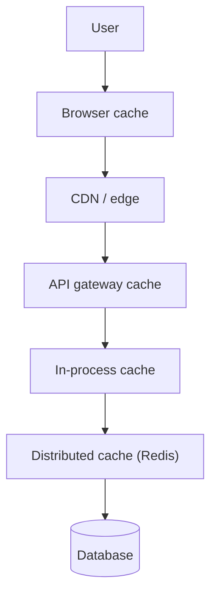
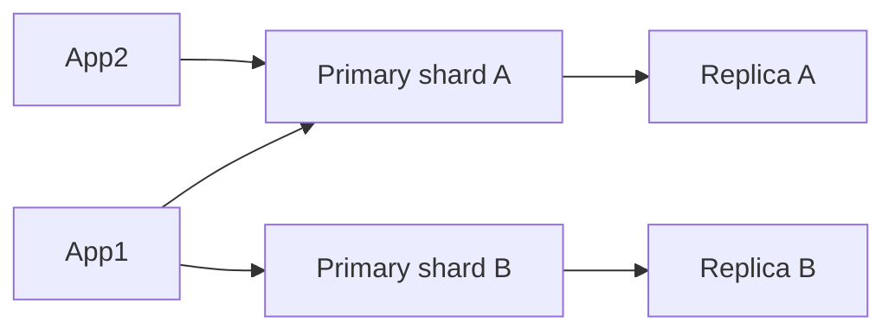
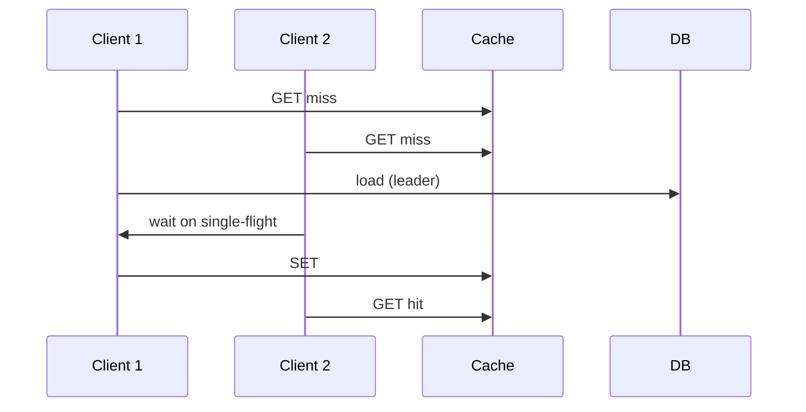

# Caching and Fast Reads

Caching means keeping a copy of expensive data closer to the user or closer to the CPU so the next read is cheap. This guide walks through every layer from the browser to the database, how distributed caches like Redis are built, how entries expire and get evicted, and how to survive stampedes when a popular key expires. The goal is fast reads without lying to users when things break.

---

## Caching Layers (End-to-End)

A typical read path stacks several caches. Each layer has different TTL, scope, and invalidation rules.



| Layer | What is cached | Typical TTL | Invalidation |
|-------|----------------|-------------|--------------|
| Browser | Static assets, `Cache-Control` | Hours–days | Versioned URLs |
| CDN | HTML fragments, images, API GET | Seconds–hours | Purge API, cache keys |
| API gateway | Auth introspection, rate-limit counters | Seconds | Short TTL |
| App process | Parsed config, hot objects | Seconds | Local TTL / event |
| Redis | Query results, sessions | Minutes | Explicit delete / TTL |
| DB | Page cache, buffer pool | Automatic | Engine-managed |

**Plain explanation:** Each hop removes work from the next. A miss at CDN still might hit Redis; only a full stack miss reaches the database.

```python
# Illustrative cache-aside at app layer
def get_user(user_id: str):
    key = f"user:{user_id}"
    cached = redis.get(key)
    if cached:
        return json.loads(cached)
    user = db.fetch_user(user_id)
    redis.setex(key, 300, json.dumps(user))
    return user
```

**Key insight:** Caching is a **consistency contract** with your users—define what “stale for 30s” means per endpoint.

---

## Distributed Cache Design

A **distributed cache** is shared memory across app servers. Popular choices:

- **Redis:** Rich types, persistence options, cluster mode, replication.
- **Memcached:** Simple GET/SET, multithreaded, no built-in replication (clients shard).

### Partitioning in Redis Cluster

Keys are hashed to **16384 slots**. Each master node owns a slot range. `MOVED`/`ASK` redirects clients when topology changes.

### Replication

Each master can have replicas for read scaling and failover. Failover is not instantaneous—plan for brief write unavailability or use sentinel/cluster automation.



| Concern | Memcached | Redis |
|---------|-----------|-------|
| Data structures | Blob only | Strings, hashes, ZSET, etc. |
| Durability | None | Optional AOF/RDB |
| Atomic ops | Limited | INCR, Lua, transactions |
| Cluster story | Client-side consistent hash | Redis Cluster |

```python
# Client-side sharding (conceptual) — production use cluster-aware client
shards = [redis.Redis(host=f"redis-{i}") for i in range(3)]

def cache_set(key, value, ttl=60):
    shard = shards[hash(key) % len(shards)]
    shard.setex(key, ttl, value)
```

**Key insight:** Treat the cache as **coordinated infrastructure**: monitor memory, eviction rate, hit ratio, and cross-AZ latency—not “just another DB.”

---

## Cache Eviction Policies

When memory is full, the cache must **evict** entries. Policies differ in what they optimize.

| Policy | Behavior | Wins when |
|--------|----------|-----------|
| **LRU** (Least Recently Used) | Drop coldest by last access | General web workloads, recency bias |
| **LFU** (Least Frequently Used) | Drop rarely used | Catalog with evergreen hot SKUs |
| **FIFO** | Drop oldest inserted | Simple, predictable |
| **Random** | Drop random key | Uniform access, low bookkeeping |

Redis `maxmemory-policy` examples: `allkeys-lru`, `volatile-lru`, `allkeys-lfu`.

```python
from collections import OrderedDict
import time

class LRUCache:
    def __init__(self, capacity: int):
        self.capacity = capacity
        self.store = OrderedDict()

    def get(self, key):
        if key not in self.store:
            return None
        self.store.move_to_end(key)
        return self.store[key]

    def put(self, key, value):
        if key in self.store:
            self.store.move_to_end(key)
        self.store[key] = value
        if len(self.store) > self.capacity:
            self.store.popitem(last=False)

class LFUCache:
    def __init__(self, capacity: int):
        self.capacity = capacity
        self.freq = {}
        self.key_time = {}
        self.data = {}

    def _evict(self):
        victim = min(self.data, key=lambda k: (self.freq[k], self.key_time[k]))
        del self.data[victim], self.freq[victim], self.key_time[victim]

    def get(self, key):
        if key not in self.data:
            return None
        self.freq[key] += 1
        self.key_time[key] = time.time()
        return self.data[key]

    def put(self, key, value):
        if key not in self.data and len(self.data) >= self.capacity:
            self._evict()
        self.data[key] = value
        self.freq[key] = self.freq.get(key, 0) + 1
        self.key_time[key] = time.time()
```

**Key insight:** LRU is a good default; switch to LFU when **frequency** matters more than **recency** (e.g. configuration blobs touched once per hour but critical).

---

## TTL Expiration and Cache Reapers

**TTL (time to live)** means an entry self-deletes after N seconds.

### Lazy expiration

On read, if expired, delete and treat as miss. Cheap but **dead keys** can linger in memory until touched.

### Active expiration

Background **reaper** samples keys and deletes expired ones (Redis does both lazy and periodic active expiration).

### TTL jitter

If 10,000 keys share `TTL=60` set at deploy time, they expire together → **thundering herd**.

```python
import random

def set_with_jitter(redis, key, value, base_ttl=300):
    jitter = random.randint(0, int(base_ttl * 0.1))
    redis.setex(key, base_ttl + jitter, value)
```

| Strategy | Pros | Cons |
|----------|------|------|
| Fixed TTL | Simple | Synchronized expiry |
| TTL + jitter | Spreads reload spikes | Slightly longer tail staleness |
| Sliding TTL on access | Hot keys stay warm | More writes to cache |

**Key insight:** Expiration is a **load scheduler**—without jitter, TTL becomes a periodic DDoS against your database.

---

## Cache Concurrency Control

### Thundering herd

Many clients miss the same key at once and all hammer the database.

### Request coalescing / single-flight

Only **one** backend fetch runs per hot key; others wait on the same in-flight result.

```python
import asyncio
from typing import Dict, Awaitable, Any

class SingleFlight:
    def __init__(self):
        self.inflight: Dict[str, asyncio.Future] = {}

    async def do(self, key: str, fn: Awaitable[Any]):
        if key in self.inflight:
            return await self.inflight[key]
        fut = asyncio.get_event_loop().create_future()
        self.inflight[key] = fut
        try:
            result = await fn
            fut.set_result(result)
            return result
        except Exception as e:
            fut.set_exception(e)
            raise
        finally:
            self.inflight.pop(key, None)

sf = SingleFlight()

async def load_user(user_id):
    return await sf.do(f"user:{user_id}", fetch_user_from_db(user_id))
```

### Early recomputation (probabilistic refresh)

Refresh cache **before** expiry if key is hot (e.g. at 90% of TTL).

### Lock per key (mutex)

Redis `SET key NX EX 5` as short-lived lock while rebuilding.



**Key insight:** Single-flight turns N database queries into **1** without sacrificing correctness if failures clear the in-flight slot.

---

## Cache Availability and Database Fallback

Caches fail. Memory pressure causes evictions. Networks partition. Design **degraded mode**:

1. **Cache-aside (lazy):** App talks to DB on miss; cache is optional acceleration.
2. **Circuit breaker on cache:** Stop retrying Redis if error rate high; go straight to DB with tighter rate limits.
3. **Stale-if-error:** Serve last known good value from local memory if Redis down (only for non-critical reads).
4. **Read replicas:** Shift read load when cache cold start after outage.

```python
class ResilientCache:
    def __init__(self, redis, db, breaker):
        self.redis = redis
        self.db = db
        self.breaker = breaker

    def get_user(self, user_id):
        if self.breaker.allow("redis"):
            try:
                val = self.redis.get(f"user:{user_id}")
                if val:
                    return json.loads(val)
            except redis.RedisError:
                self.breaker.record_failure("redis")
        # fallback path
        return self.db.fetch_user(user_id)
```

| Scenario | User-visible effect | Mitigation |
|----------|---------------------|------------|
| Redis down | Higher DB latency | Breaker, scale DB reads, backoff |
| Cold cache after restart | Latency spike | Warmup job, staggered deploy |
| Stale data | Wrong prices, old avatar | TTL + invalidation on write |
| Partial cluster failover | Some keys miss | Retry other node, client topology refresh |

**Key insight:** Never make cache availability part of your **write path** unless you have a proven story for durability elsewhere.

---

## Write-Through, Write-Behind, and Invalidation (Bonus Depth)

**Cache-aside:** App writes DB first, deletes or updates cache on write.

**Write-through:** Write cache and DB synchronously—consistent but slower writes.

**Write-behind:** Write cache first, async flush to DB—fast but risk loss on crash.

```python
def update_user_cache_aside(user_id, fields):
    db.update_user(user_id, fields)
    redis.delete(f"user:{user_id}")  # invalidate, not update — simpler under races
```

**Key insight:** **Delete on write** beats **update on write** when multiple fields and concurrent writers exist.

---

## CDN and HTTP Caching Semantics

For public GET resources:

- `Cache-Control: max-age=3600, public`
- `ETag` / `If-None-Match` for validation without full body
- `Vary: Accept-Encoding` when gzip/br differ

API responses that are user-specific should use `private` or `no-store`.

**Key insight:** CDN caching is **HTTP contract engineering**—wrong headers leak one user’s data to another.

---

## Measuring Cache Health

Metrics that matter:

- **Hit ratio** = hits / (hits + misses) — segment by endpoint.
- **Latency p99** cache vs DB path.
- **Evicted keys per second** — memory too small?
- **Single-flight wait time** — herd partially controlled?

```python
# Pseudo-metrics
metrics.increment("cache.hit", tags={"key_prefix": "user"})
metrics.increment("cache.miss", tags={"key_prefix": "user"})
```

---

## FAANG Interview Deep Dive

**Q1: Design caching for a product detail page with inventory.**  
**A:** CDN caches static assets. API uses cache-aside for product metadata with short TTL (30–120s). Inventory uses shorter TTL or no cache; optionally cache with explicit invalidation on stock change. Never cache “in stock” for high-concurrency checkout without version checks. Document stale reads vs oversell protection (reservation in DB).

**Q2: What happens when a popular cache key expires during a flash sale?**  
**A:** Thundering herd on the backing service. Mitigate with single-flight, request coalescing, pre-warm before sale, TTL jitter, and serving stale-while-revalidate for non-purchase reads. For purchase path, rely on DB row locks or inventory service, not cache truth.

**Q3: Redis vs Memcached for a 200-node fleet?**  
**A:** Memcached if you need simple horizontal RAM pooling and client-side hashing. Redis if you need richer structures, persistence, replication, or atomic counters/rate limits. Interview follow-up: Redis Cluster ops complexity vs Memcached “dumb but fast.”

**Q4: Explain cache stampede vs dogpile.**  
**A:** Same problem: many workers rebuild the same key. Solutions: mutex, single-flight, early async refresh, probabilistic early expiration. Mention lock TTL must exceed rebuild time or use token verification.

**Q5: How do you invalidate cache on write in microservices?**  
**A:** Options: (1) direct delete of known keys from writer, (2) pub/sub broadcast invalidation, (3) versioned cache keys (`user:42:v17`), (4) short TTL accept staleness. Avoid global “flush all” in production. Prefer version keys when delete fan-out is huge.

**Q6: When is write-through correct?**  
**A:** When read-after-write consistency from cache is required and write volume is moderate (session stores, feature flags). Not for high-write analytics ingestion.

**Q7: How do you test cache behavior?**  
**A:** Chaos: kill Redis mid-test, measure DB QPS and error budget. Load test with synchronized TTL. Assert single-flight with concurrent asyncio tasks. Monitor hit ratio drop after deploy (cold cache).

**Q8: Edge cache vs origin cache duplication—is it waste?**  
**A:** Not necessarily; layers serve different radii. CDN reduces bandwidth and latency globally; Redis reduces DB load in the region. Coordinate TTL so CDN does not amplify stale data beyond product tolerance.

---

## Senior Pitfalls

| Mistake | Impact | Fix |
|---------|--------|-----|
| Caching personalized responses at CDN without `Vary` | Data leaks across users | `private`, `no-store`, or edge auth |
| Identical TTL on millions of keys | Periodic DB meltdown | Jitter, staggered refresh |
| Updating cache instead of delete on write | Race shows old merged state | Invalidate/delete; let next read populate |
| No breaker when Redis fails | Retry storm amplifies outage | Fail open to DB with limits |
| LRU on scanning workloads | One-off scans evict hot set | Separate cache namespace or LFU |
| Treating cache hit ratio as sole KPI | Hides latency outliers | Track p99, DB QPS, error rate |

---

## Production-grade Practice

1. **Hit ratio dashboard:** Instrument cache-aside for one service; graph hit/miss by key prefix for 24h; tune TTL on the worst miss prefix.

2. **Single-flight implementation:** In Python asyncio, fire 100 concurrent requests for one key with a mocked 200ms DB; verify exactly one DB call.

3. **TTL jitter experiment:** Populate 10k keys with and without jitter; plot expiry-minute DB QPS histogram.

4. **Failover drill:** In staging, stop Redis during steady load; document p99 API latency and implement a circuit breaker threshold that triggers graceful degradation.

---

## Local In-Process Caches (Caffeine-Style Patterns)

Even with Redis, each app instance should keep a **tiny** L1 cache for config and ultra-hot keys (microseconds access). Rules:

- Cap entries (e.g. 1,000 keys) to avoid GC pressure.
- TTL shorter than Redis to limit inconsistency window across pods.
- Never cache security tokens that must revoke instantly unless you accept delay.

```python
from functools import lru_cache
import time

@lru_cache(maxsize=512)
def feature_flags_snapshot(version: int):
    # version bumps on pub/sub invalidation
    return load_flags_from_redis()
```

**Key insight:** L1 + L2 (Redis) is a **two-tier** system—measure both hit ratios separately.

---

## Cache Key Design

Good keys are explicit, versioned, and avoid collisions:

```
v2:product:{id}:summary
session:{session_id}
ratelimit:{api_key}:{minute_bucket}
```

Avoid unbounded key cardinality (per-request keys) that exhausts memory. Use hashes for grouped fields when Redis memory is tight.

**Key insight:** Key design is **schema design** for RAM—bad keys are worse than bad SQL tables because eviction is silent.
