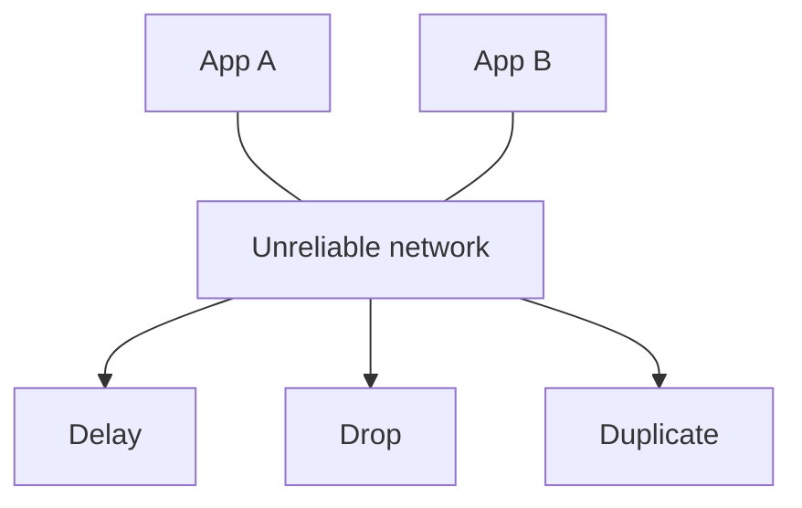
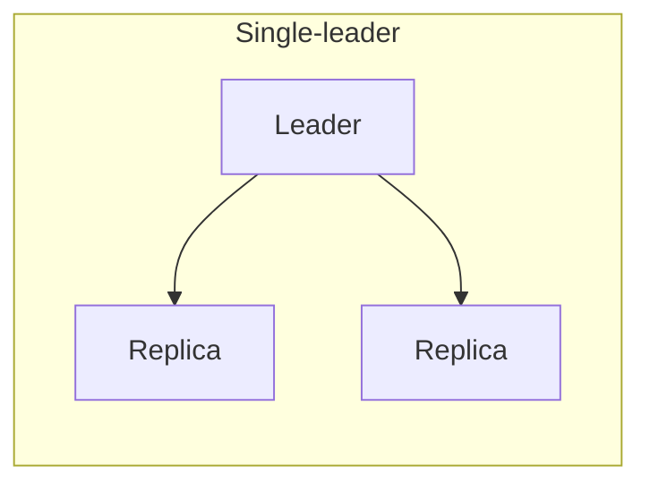
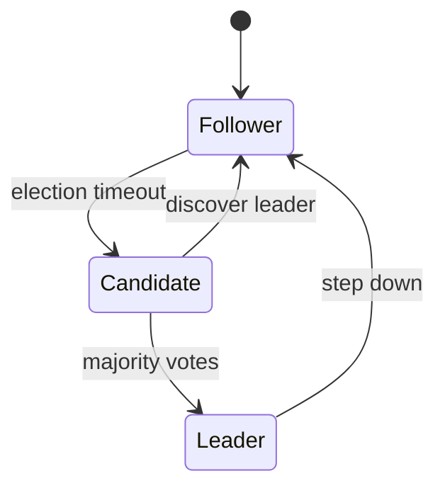

# Distributed Coordination

When many computers work together, they cannot share one memory or one clock. This guide explains what breaks (networks, clocks, crashes), how systems choose consistency, how leaders are elected, how locks work (and fail), and how protocols like Raft and gossip keep clusters alive. You will also see practical patterns: circuit breakers, metadata services, and distributed hash tables.

---

## Distributed Systems Foundations: Three Harsh Truths

1. **The network is unreliable.** Messages delay, duplicate, or disappear. You cannot distinguish “slow” from “dead” without timeouts.
2. **Clocks lie.** Wall time jumps backward and drifts apart. “Happened before” is not the same as “timestamp A < timestamp B.”
3. **Processes crash.** A node stops mid-write; recovery must assume torn state unless you log carefully.

Every coordination design is a response to these truths.



**Key insight:** If your design only works when the network is perfect, it is not a distributed system design—it is a demo.

---

## Consistency Models

**Consistency** answers: “If I write, what will the next reader see?”

### Strong consistency

After a write completes, all reads see that write (as if one copy). Usually one leader orders writes.

*Example:* Bank balance after transfer—next read shows new balance from any replica that serves reads (or reads go to leader).

### Eventual consistency

Replicas converge if no new writes arrive; reads may be stale for a while.

*Example:* YouTube view count on edge—approximate for minutes.

### Causal consistency

If operation A caused B, everyone sees A before B; unrelated ops may reorder.

*Example:* Comment thread: reply must not appear before parent comment is visible.

### Read-your-writes

A user always sees their own updates, even if others see stale data.

*Example:* After you edit profile, your session hits a replica that includes your write (sticky session or leader read).

| Model | Latency | Complexity | User surprise |
|-------|---------|------------|---------------|
| Strong | Higher | Leader, failover | Low |
| Eventual | Low | Simple replication | Stale UI possible |
| Causal | Medium | Metadata per write | Moderate |
| RYW | Medium | Session routing | Low for self |

```python
# Read-your-writes via sticky routing
def get_profile(user_id, session):
    replica = session.last_write_replica or pick_replica(user_id)
    return replica.read(f"user:{user_id}")
```

**Key insight:** Pick the **weakest** model that still matches product promises—strong everywhere is expensive.

---

## Replication Topologies

### Single-leader

All writes go to one leader; replicas apply the log asynchronously or semi-sync.

- Pros: clear ordering, simpler reasoning.
- Cons: leader is bottleneck and failover event.

### Multi-leader

Writes accepted at multiple sites; leaders replicate to each other.

- Pros: low write latency multi-region.
- Cons: write conflicts need resolution (last-write-wins, CRDT, manual).

### Leaderless (quorum)

Client writes to W nodes, reads from R nodes; overlap ensures freshness if `R + W > N`.

- Pros: high availability.
- Cons: read repair, sloppy quorum complexity.



**Key insight:** Failover in single-leader systems is a **coordination problem**, not just DNS.

---

## CAP and PACELC

### What CAP actually says

In the presence of a **network partition**, you must choose between **Consistency** and **Availability** (for linearizable reads/writes). Without partition, you can have both.

**Myth:** “Pick two of three forever.” Partition is not always on—design for both modes.

### PACELC (extension)

If **P**artition → choose **A** or **C**; **E**lse → choose **L**atency or **C**onsistency.

| System | During partition | Normal operation |
|--------|------------------|------------------|
| Dynamo-style | Available, stale reads | Low latency |
| etcd/ZK | Consistent, may reject | Consistent |

**Key insight:** PACELC forces you to state the **non-partition** trade-off, which is where most user hours are spent.

---

## Clocks and Ordering

### Physical clocks

`time.time()` across machines is approximate. NTP sync helps but does not give global truth.

### Logical clocks (Lamport)

Each process increments counter; on message send/receive, bump to `max(local, received) + 1`. Gives **partial order** if A → B then Lamport(A) < Lamport(B). Reverse not guaranteed.

```python
class Lamport:
    def __init__(self):
        self.t = 0

    def tick(self):
        self.t += 1
        return self.t

    def on_receive(self, remote_t):
        self.t = max(self.t, remote_t) + 1
        return self.t
```

### Vector clocks

Per-node counters track knowledge of each node—detect concurrent events and conflicts.

**Key insight:** Use **logical** order for correctness; use **physical** time for UX and TTL only.

---

## Consensus (Paxos Simplified)

**Goal:** Multiple nodes agree on a single sequence of values despite failures.

**Paxos (one sentence):** Proposers pitch values; acceptors promise not to accept older rounds; a value is chosen when a majority accepts the same round.

Why hard: many edge cases, subtle liveness issues.

**Raft** was designed to be teachable while solving the same problem (log replication).

**Key insight:** Consensus is for **small, critical metadata** (who is leader, config), not every user click.

---

## Raft Explained Clearly

Raft decomposes into:

1. **Leader election** — randomized timeouts; candidate requests votes; majority wins.
2. **Log replication** — client writes go to leader; leader appends to log; followers replicate; commit when majority stored.



States:

- **Follower:** respond to leader/candidate.
- **Candidate:** ask for votes.
- **Leader:** accept client writes, replicate.

Safety: at most one leader per term with majority partitioning.

```python
# Illustrative log entry
log_entry = {"term": 5, "index": 102, "command": "SET config=x"}
```

**Key insight:** The **committed** prefix of the log is identical on all survivors—everything else is recovery detail.

---

## Leader Election: Split Brain and Fencing

**Split brain:** Two nodes think they are leader and both accept writes → corruption.

Prevention:

- Require **majority** vote (quorum).
- **Epoch / term** numbers—higher term wins; stale leaders must step down.
- **Fencing token:** Storage layer rejects writes with outdated token.

```python
# Fencing token monotonically increases with each leadership grant
def write_with_fence(storage, token, data):
    if token < storage.current_fence:
        raise StaleLeaderError()
    storage.put(data, fence=token)
```

**Key insight:** Leader election without **fencing** is announcement only—not safety.

---

## Distributed Locks and Leases

A **lock** means “only one worker does this job.” In one machine, mutexes work. Distributed:

- Lock stored in Redis/ZK/etcd with TTL (**lease**).
- Holder must **heartbeat** to extend lease.
- Crash without release → lease expires → another worker proceeds.

Problems:

- GC pause longer than lease → two holders (use fencing).
- Clock skew on expiry (prefer ZK ephemeral sequential nodes).

```python
import uuid

def acquire_lock(redis, name, ttl_sec=30):
    token = str(uuid.uuid4())
    ok = redis.set(name, token, nx=True, ex=ttl_sec)
    return token if ok else None

def release_lock(redis, name, token):
    # Lua: delete only if value matches token
    script = """
    if redis.call('get', KEYS[1]) == ARGV[1] then
        return redis.call('del', KEYS[1])
    else
        return 0
    end
    """
    redis.eval(script, 1, name, token)
```

**Key insight:** A distributed lock is a **lease with an owner token**, not a mutex.

---

## Redis Redlock and Fencing Tokens

**Redlock:** Acquire lock on N independent Redis masters with quorum; same TTL; same unique value.

**Martin Kleppmann critique:**

- Clock jumps can cause two clients to think they hold lock.
- Not equivalent to consensus; failure modes under delay/GC.

**When Redlock is OK:** Coarse-grained tasks where duplicate execution is **idempotent** and harm is low (nightly batch), with short TTL and fencing to downstream resources.

**When it is not OK:** Strong mutual exclusion on financial inventory without fencing.

**Key insight:** Pair locks with **fencing tokens** on the resource being protected.

---

## Circuit Breakers and Timeouts

Prevent cascading failure when dependency is unhealthy.

States:

- **Closed:** requests pass; failures counted.
- **Open:** fail fast; no calls for cooldown.
- **Half-open:** trial request; success closes, failure reopens.

```python
import time
from enum import Enum

class State(Enum):
    CLOSED = 1
    OPEN = 2
    HALF_OPEN = 3

class CircuitBreaker:
    def __init__(self, failure_threshold=5, cooldown=10.0):
        self.state = State.CLOSED
        self.failures = 0
        self.failure_threshold = failure_threshold
        self.cooldown = cooldown
        self.opened_at = 0.0

    def allow(self):
        if self.state == State.CLOSED:
            return True
        if self.state == State.OPEN:
            if time.time() - self.opened_at >= self.cooldown:
                self.state = State.HALF_OPEN
                return True
            return False
        return True  # half-open: one trial

    def record_success(self):
        self.failures = 0
        self.state = State.CLOSED

    def record_failure(self):
        self.failures += 1
        if self.failures >= self.failure_threshold:
            self.state = State.OPEN
            self.opened_at = time.time()
```

**Key insight:** Timeouts turn “hang forever” into **actionable failure**—always set them on external calls.

---

## Gossip Protocol

Nodes periodically exchange small state with random peers—**epidemic broadcast**.

Uses:

- Cluster membership (who is alive).
- Spread soft state (cache invalidation hints).
- CRDT synchronization friendly.

Properties:

- Eventually everyone hears update.
- No central coordinator required for spread.
- Bandwidth: O(log N) rounds typical.

```python
import random

def gossip_round(node, peers, message):
    for p in random.sample(peers, k=min(3, len(peers))):
        p.receive(message)
```

**Key insight:** Gossip is for **probabilistic dissemination**, not atomic agreement.

---

## Metadata Service and Node Discovery

**ZooKeeper / etcd / Consul** provide:

- Strongly consistent key-value for small data.
- Ephemeral nodes (session dies → key vanishes).
- Watch notifications.
- Leader election helpers.

| Service | Typical use |
|---------|-------------|
| etcd | Kubernetes control plane |
| ZooKeeper | Kafka old stacks, Hadoop |
| Consul | service mesh + DNS |

```text
/service/payment/leader → host:port (watched by followers)
```

**Key insight:** These stores are **low volume, high correctness**—never shove gigabyte payloads.

---

## Distributed Hash Tables (Chord, Kademlia)

**DHT:** Peers route a key to the responsible node in O(log N) hops using a structured overlay.

**Chord:** Keys and nodes on a ring; each node keeps **finger table** pointing to successors at powers of two distance.

**Kademlia:** XOR metric; used in BitTorrent, IPFS—**k-buckets** of neighbors.


**Key insight:** DHTs power **peer-to-peer** routing without central directory at scale.

---

## Two-Phase Commit vs Saga (Coordination for Transactions)

**2PC:** Coordinator asks participants to prepare; all yes → commit; any no → abort. Blocking if coordinator dies.

**Saga:** Sequence of local transactions with compensating actions—fits microservices.

Not full consensus, but operational coordination pattern staff should know.

---

## FAANG Interview Deep Dive

**Q1: When do you need Raft/etcd vs a SQL primary?**  
**A:** etcd for cluster metadata, locks, leader pointers, small config with watch APIs. SQL primary for business data with queries. Do not store large blobs in etcd; keep latency predictable with tiny keys.

**Q2: Explain split brain and how to prevent it.**  
**A:** Two leaders write divergent state. Prevent with quorum election, fencing tokens on storage, and clients respecting term/epoch. Mention STONITH is rare in cloud—fencing is softer approach.

**Q3: Is Redis lock enough for cron job exclusivity?**  
**A:** Only if duplicate runs are safe or downstream uses fencing. Use Redlock-aware critique: prefer ZK/etcd lease with ephemeral sequential node if correctness matters, or DB advisory lock with owner column.

**Q4: Strong vs eventual—how do you explain to PM?**  
**A:** Strong: “Everyone sees the same truth immediately; slower and fragile during outages.” Eventual: “Updates propagate; you might see old data briefly; faster and stays up.” Tie to feature: likes vs wallet.

**Q5: What problem does vector clock solve that Lamport does not?**  
**A:** Detect concurrent writes (siblings) for conflict resolution. Lamport only guarantees if A causally precedes B then timestamp order; concurrent events may appear ordered arbitrarily.

**Q6: Walk through Raft leader failure.**  
**A:** Followers timeout, candidate election, new leader with higher term, old leader steps down on contact. Uncommitted entries from old leader may be rolled back if not replicated to majority. Clients retry with new leader.

**Q7: CAP during regional network cut?**  
**A:** Choose whether EU users can write with US stale reads or system rejects writes to preserve global consistency. PACELC: normal path may still favor latency with async replication.

**Q8: Why gossip for membership?**  
**A:** Scales without central fan-in; tolerates message loss via re-gossip; convergence time acceptable for failure detection at seconds scale. Not for financial ledger.

---

## Senior Pitfalls

| Mistake | Impact | Fix |
|---------|--------|-----|
| Distributed lock without lease TTL | Deadlock forever if holder dies | TTL + heartbeat + fencing |
| Ignoring GC pauses vs lease length | Double leaders | Shorter work chunks; fencing tokens |
| Using wall clock for ordering | Silent reorder bugs | Logical clocks / DB versioning |
| etcd as application database | Cluster meltdown, SLA miss | Right-size store; SQL for data |
| Circuit breaker without half-open | Stuck open or flapping | Tune thresholds; probe success |
| Gossip for must-deliver-once events | Lost messages | Use log-based queue (Kafka) |

---

## Production-grade Practice

1. **Raft visualizer:** Run `etcd` or a Raft demo cluster locally; kill leader pod; measure election time and client retry behavior.

2. **Lock lease math:** Pick job duration distribution; set lease = p99 duration + margin; simulate holder pause (STW GC) and document duplicate execution rate.

3. **Breaker tuning:** Wrap a flaky HTTP dependency with the circuit breaker above; inject 50% failures; chart open-state percentage vs error budget.

4. **Consistency contract doc:** For one API, write which guarantees apply (RYW, eventual, strong) and how sticky routing or read-from-leader is implemented.
