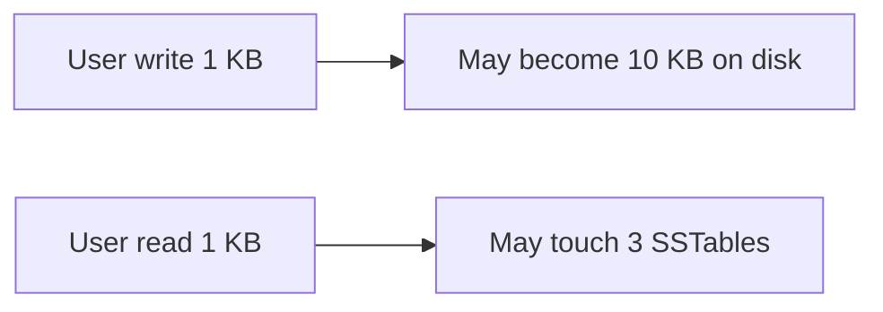
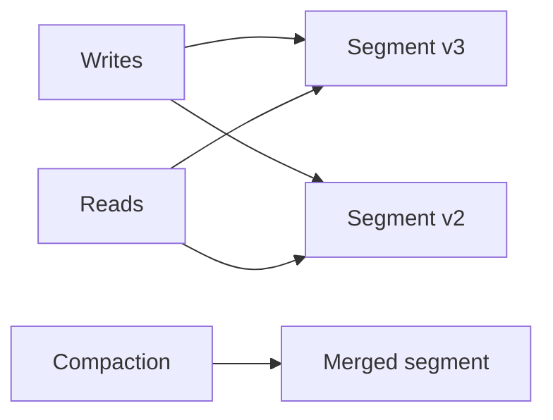
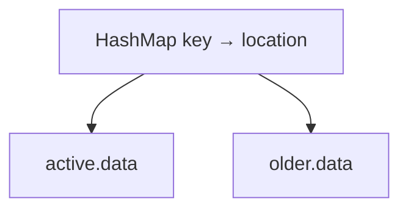
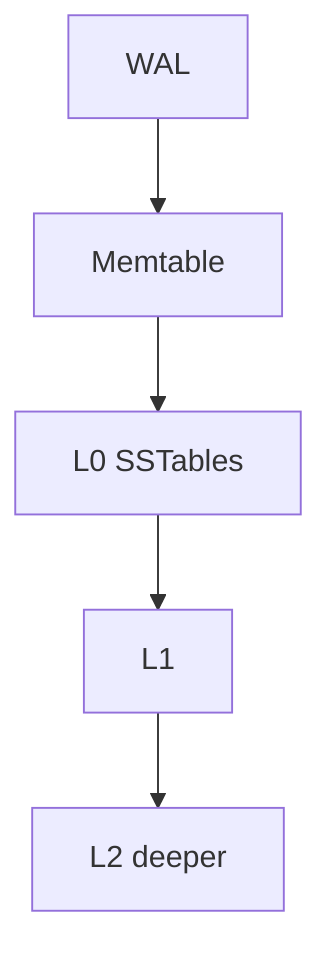
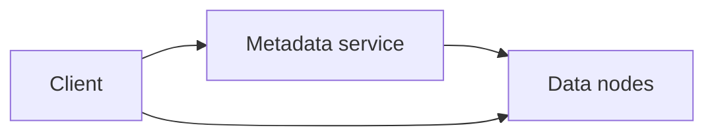

# Storage Engines

A storage engine is the part of a database that reads and writes bytes on disk (and in memory). This guide starts from a toy append-only file and builds up to LSM-trees, Bitcask, and object storage like S3. You will learn amplification trade-offs, compaction, durability, checksums, and how partition managers route keys to shards. The LSM-tree section is the one most staff interviews expect you to know cold.

---

## Storage Engine Design Constraints

- **Disk is slow** compared to RAM (microseconds vs milliseconds).
- **Memory is small** compared to data—everything cannot fit in RAM.
- **Sequential IO** is much cheaper than random IO on spinning disks; still matters on SSDs at scale.
- **Crash safety** requires careful ordering: log first, then apply.

Design forces:

| Goal | Typical technique |
|------|-------------------|
| Fast writes | Append-only, batch |
| Fast point reads | Indexes in memory |
| Range scans | Sorted files, B-trees |
| Durability | WAL + fsync policy |

**Key insight:** Every engine picks which operation is cheap and which is expensive—there is no free lunch.

---

## The Three Amplifications

1. **Write amplification:** Bytes written to disk per byte of logical user write (compaction rewrites data).
2. **Read amplification:** IO operations per logical read (check multiple files/levels).
3. **Space amplification:** Disk used vs logical data size (duplicates until compaction).



Tuning compaction changes all three simultaneously.

**Key insight:** Staff interviews ask you to **trade** amplifications for a workload (write-heavy vs read-heavy).

---

## A File-Backed Dictionary (Simplest Engine)

Append-only log file: each write adds a line `key=value\n`. Read scans entire file (slow). Delete writes tombstone `key=`.

```python
import json
from pathlib import Path

class AppendOnlyKV:
    def __init__(self, path: Path):
        self.path = path
        self.index = {}  # key -> file offset
        self._rebuild_index()

    def _rebuild_index(self):
        self.index.clear()
        if not self.path.exists():
            return
        with self.path.open("rb") as f:
            while True:
                offset = f.tell()
                line = f.readline()
                if not line:
                    break
                key, val = line.decode().strip().split("=", 1)
                if val == "__TOMBSTONE__":
                    self.index.pop(key, None)
                else:
                    self.index[key] = offset

    def put(self, key: str, value: str):
        with self.path.open("ab") as f:
            offset = f.tell()
            f.write(f"{key}={value}\n".encode())
        self.index[key] = offset

    def get(self, key: str):
        off = self.index.get(key)
        if off is None:
            return None
        with self.path.open("rb") as f:
            f.seek(off)
            line = f.readline().decode().strip()
            _, val = line.split("=", 1)
            return val
```

**Key insight:** Append-only is the **DNA** of WALs and LSM memtables—simple and crash-friendly.

---

## Custom Binary File Format

Fixed-size records enable O(1) offset lookup without scanning.

Layout:

```
[Header: magic, version, record_size, count]
[Record 0][Record 1]...[Record N-1]
```

Each record: `key_len | key | val_len | value | checksum`

```python
import struct
import hashlib

HEADER = struct.Struct(">4sHI")  # magic, version, record_size
RECORD_HDR = struct.Struct(">II")  # key_len, val_len

def pack_record(key: bytes, val: bytes) -> bytes:
    body = key + val
    crc = hashlib.crc32(body) & 0xffffffff
    return RECORD_HDR.pack(len(key), len(val)) + body + struct.pack(">I", crc)
```

**Key insight:** Fixed records waste space for variable keys but **simplify** mmap and offset math.

---

## Byte-Range Indexed Object Storage

One large **data file** holds objects sequentially. A separate **index** maps `key → (offset, length)`.

```
index: {"photo/abc.jpg": (1048576, 98234)}
data file: [blob at offset ...]
```

Reads: one index lookup + one `pread`—no parsing whole file.

```python
def read_object(index, data_path, key):
    offset, length = index[key]
    with open(data_path, "rb") as f:
        f.seek(offset)
        return f.read(length)
```

**Key insight:** Separating **metadata index** from **blob bytes** is how S3-scale systems scale independently.

---

## Immutable Versioned Data Files

**Write-once segments:** New data goes to new files; old files are never mutated. Compaction **merges** segments and drops deleted keys.

Benefits:

- Safe concurrent reads while writing new segment.
- Simple replication (copy whole file).



**Key insight:** Immutability turns concurrency from locks into **version selection**.

---

## Log-Structured Storage

Components:

1. **Memtable** — in-memory sorted structure (skip list, red-black tree).
2. **WAL** — append log for crash recovery before memtable flush.
3. **Segment / SSTable files** — immutable sorted runs on disk.

Write path: append WAL → update memtable → flush when full.

**Key insight:** Converts random writes into **sequential append**, the classic LSM advantage.

---

## Bitcask Storage Engine

Bitcask (Riak heritage): all keys live in an in-memory **hash map** pointing to `(file_id, offset, length)` on disk.



- Writes go to active append-only file.
- Reads: hash lookup + disk read.
- Compaction merges files and drops tombstones.

Limits: RAM must hold **all keys** (not all values).

```python
# Conceptual keydir entry
keydir = {
    b"user:1": (file_id=2, offset=4096, length=128),
}
```

**Key insight:** Bitcask is unbeatable when **key cardinality fits RAM** and values are large blobs on disk.

---

## LSM-Tree Storage Engine (Core Model)

**LSM = Log-Structured Merge tree.**

Levels of increasing size (L0, L1, ...). Each level holds sorted runs (SSTables).

Write:

1. Append to **WAL**.
2. Insert to **memtable** (sorted).
3. When memtable full, **flush** to L0 SSTable (immutable).
4. **Compaction** moves data down levels, merging runs.

Read:

1. Check memtable + immutable memtable.
2. Search L0..Ln SSTables (newest first within level rules).
3. Use **Bloom filters** and **sparse indexes** to skip files.



**Key insight:** LSM optimizes **write throughput**; reads pay via amplification unless tuned.

---

## Memtable, WAL, and SSTable

| Piece | Role |
|-------|------|
| **WAL** | Durability before memtable acknowledged; replay on crash |
| **Memtable** | Mutable sorted buffer in RAM |
| **SSTable** | Immutable sorted key-value blocks on disk, with index + Bloom |

SSTable internals:

- Data blocks (sorted KV pairs).
- Block index (last key per block).
- Bloom filter per SSTable (optional per block).

Flush trigger: memtable size threshold or time.

```python
def write_path(eng, key, value):
    eng.wal.append(key, value)
    eng.wal.fsync()  # policy: group commit for perf
    eng.memtable.put(key, value)
    if eng.memtable.size > eng.flush_threshold:
        eng.flush_memtable_to_l0()
```

**Key insight:** `fsync` policy is the **durability vs latency** dial.

---

## LSM Read Path: Bloom Filters and Sparse Index

**Sparse index:** Store every Nth key’s offset—binary search within SSTable to find candidate block, then scan block.

**Bloom filter:** If filter says “no,” skip entire SSTable IO.

Worst case: check every level’s overlapping SSTables (especially L0).

Optimizations:

- **Partitioned indexes** for large SSTables.
- **Caching** index and filter blocks in block cache.

**Key insight:** Point reads are “find the newest version among candidates”—**tombstones** matter for deletes.

---

## Compaction and Amplification

### Size-tiered compaction

Merge similarly sized SSTables into bigger ones. Higher write amp, fewer files.

### Leveled compaction

L0 → L1 → L2 with size ratio (often 10×). Lower read amp, more write amp.

| Strategy | Write amp | Read amp | Space amp |
|----------|-----------|----------|-----------|
| Size-tiered | Higher | Higher | Can spike |
| Leveled | Lower reads | Higher writes | More predictable |

**Tombstones** must propagate until compacted past `gc_grace` window.

**Key insight:** Compaction is a **background garbage collector**—if it falls behind, read latency explodes.

---

## Object Storage vs Database

| Need | Object storage (S3) | Database (Postgres) |
|------|---------------------|---------------------|
| Large blobs, few updates | Ideal | Awkward |
| ACID row transactions | No | Yes |
| Partial update of small fields | Replace whole object | Row/column update |
| Ad-hoc SQL analytics | Export to warehouse | Native |
| Cost at petabyte scale | Very low $/GB | Expensive |

**Key insight:** S3 is **filesystem at datacenter scale**; DB is **indexed mutable state machine**.

---

## S3 Object Storage Architecture (Conceptual)

Logical model:

- **Bucket** namespace.
- **Object key** + **version id**.
- **Metadata** (small, in metadata service).
- **Data** in chunk servers / storage nodes.

Request flow:

1. Client PUT → metadata service records key → version → placement.
2. Data streamed to storage nodes with replication.
3. GET resolves metadata → data nodes serve byte ranges.



**Key insight:** S3 strong consistency for read-after-write of new objects (modern model)—still not a join engine.

---

## Range Partitioning vs Consistent Hashing for Storage

**Range:** Keys `A-M` on node 1—good range scans, hotspot risk on latest range.

**Consistent hash:** Even spread, painful range queries.

Hybrid: **range shards** within hash buckets, or **dynamic splitting** when shard grows (Bigtable, DynamoDB).

**Key insight:** Storage systems often **split** shards automatically when size or QPS exceeds threshold.

---

## Partition Manager and Map Table

A **partition manager** tracks:

- Which partition owns which key range or hash ring segment.
- Partition state: `ACTIVE`, `SPLITTING`, `MIGRATING`.

**Map table** (routing table) cached on clients/gateways:

```
partition_id → {start_key, end_key, replicas[]}
```

On split, manager updates map; clients refresh via watch or periodic poll.

```python
class PartitionMap:
    def route(self, key: str):
        for p in self.partitions:
            if p.contains(key):
                return p.primary
        raise KeyError("no partition")
```

**Key insight:** Routing metadata is **small but critical**—use consensus store for manager state.

---

## Metadata Database for Object Storage

Stores:

- Object catalog (key, version, size, checksum, ACL).
- Placement hints (which erasure-coded fragments).
- Bucket policies.

Not the multi-GB payload—only pointers and attributes.

**Key insight:** Metadata tier is often **SQL or strongly consistent KV**; data tier is **append-friendly blob stores**.

---

## Append-Only Stream Layer

Many systems ingest writes as **ordered logs** (Kafka, WAL segments) before compaction into SSTables or column files.

Benefits:

- Replay for recovery and new consumers.
- Decouples write burst from compaction speed.


**Key insight:** The stream is the **source of truth timeline**; derived files are **materialized views**.

---

## Durability and Replication

**Durability on one node:**

- `write()` to OS buffer ≠ on disk.
- `fsync()` commits to device (policy: per write vs group commit).

**Replication:**

- **Replication factor** RF=3 common.
- **Quorum writes:** W=2 of 3 must ack before success.
- **Quorum reads:** R chosen to meet consistency goal (`R+W>N`).

```python
def replicate(key, value, nodes, W=2):
    acks = 0
    for n in nodes:
        if n.write(key, value):
            acks += 1
        if acks >= W:
            return True
    return False
```

**Key insight:** Quorum math is how leaderless designs buy availability without a single master.

---

## End-to-End Checksums

Corruption happens (disk bit rot, bad RAM, network glitch).

Practice:

- **Per-record CRC** in SSTable blocks.
- **Checksum on wire** (gRPC metadata).
- **Client verifies** after download (S3 ETag / MD5 or SHA256).

```python
def verify(payload: bytes, expected_crc: int) -> bool:
    return (hashlib.crc32(payload) & 0xffffffff) == expected_crc
```

**Key insight:** Checksums detect problems; they do not fix them—**replication + repair** fixes.

---

## B-Trees vs LSM (Interview Anchor)

| | B-tree (InnoDB) | LSM (RocksDB, Cassandra) |
|---|-----------------|----------------------------|
| Write pattern | Update pages in place | Append + merge |
| Read | Few lookups | Maybe many layers |
| Range scan | Excellent | Good after compaction |
| Write amp | Moderate | Compaction dependent |

**Key insight:** OLTP with mixed workload on one machine often B-tree; **write-heavy** or **very large** data often LSM.

---

## FAANG Interview Deep Dive

**Q1: Walk through an LSM write and crash recovery.**  
**A:** Write appended to WAL, fsync per policy, inserted into memtable. On crash, replay WAL into fresh memtable. On memtable full, flush immutable SSTable to L0, truncate or segment WAL. Mention duplicate keys resolved by newest sequence/timestamp.

**Q2: Why does L0 hurt read performance?**  
**A:** L0 SSTables may overlap key ranges; point read checks all L0 files. Compaction promotes to non-overlapping L1+ levels reducing candidates. Bloom filters mitigate but L0 bloat is a smell.

**Q3: Design object storage for photos.**  
**A:** Metadata DB for key, user id, size, checksum; blob in erasure-coded backend; CDN for hot reads; multipart upload for large files; lifecycle to cold tier. Mention idempotency keys on upload.

**Q4: Explain write amplification to a PM.**  
**A:** “We rewrite the same data multiple times during background cleanup—like copying a messy closet to stay organized. Faster writes now, more disk work later.” Tie to SSD wear and cloud cost.

**Q5: When choose Bitcask?**  
**A:** Predictable all-keys-in-RAM footprint, mostly point reads, large values. Anti-pattern: billions of tiny keys exceeding RAM.

**Q6: How does compaction interact with reads?**  
**A:** Compaction holds old and new files briefly—increased space amp. Reads must check both until old file deleted. Throttle compaction to protect p99 reads.

**Q7: Quorum read after quorum write—still stale?**  
**A:** Possible if read hits different set without overlap guarantee; use synchronous quorum, read repair, or leader-based reads for strong behavior.

**Q8: Checksums fail mid-request—what now?**  
**A:** Retry another replica; if all fail, alert data loss event; restore from replica or backup; scrubbing job finds latent corruption.

---

## Senior Pitfalls

| Mistake | Impact | Fix |
|---------|--------|-----|
| `fsync` never on WAL | Silent data loss on crash | Match durability SLA to fsync policy |
| Ignoring tombstones in reads | Deleted keys resurrect | GC grace + compaction monitoring |
| L0 file explosion | Read p99 spikes | Increase compaction bandwidth |
| Storing blobs inside Postgres rows | Table bloat, backup pain | Object store + pointer |
| No checksum on replication | Corrupt replicas propagate | Verify on ingest; scrub |
| Single partition manager without HA | Routing outages | Consensus-backed metadata |

---

## Production-grade Practice

1. **Mini-LSM:** Implement memtable + WAL + flush to sorted JSON lines; add Bloom filter stub; measure read amp vs number of files.

2. **Amplification spreadsheet:** Given 1 KB writes/sec and leveled compaction ratio 10, estimate daily write amp under simplified assumptions.

3. **Byte-range store:** Build index sqlite + one `data.bin`; benchmark random reads vs storing whole files per key.

4. **Chaos on durability:** Kill process mid-write with and without WAL fsync; document how many records recover and propose group-commit tuning.
