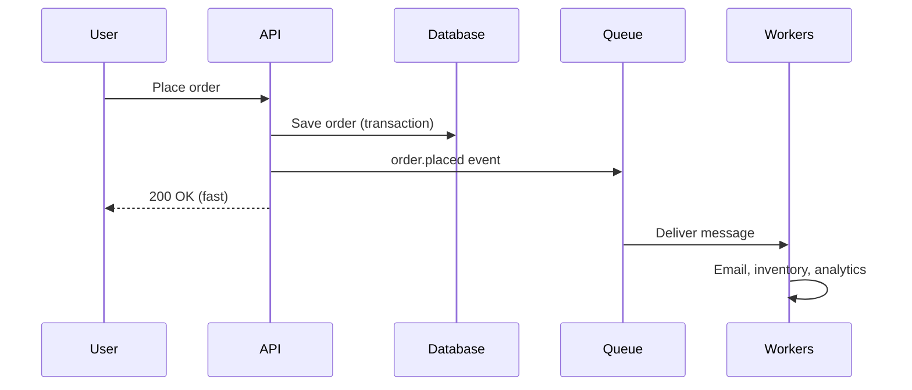
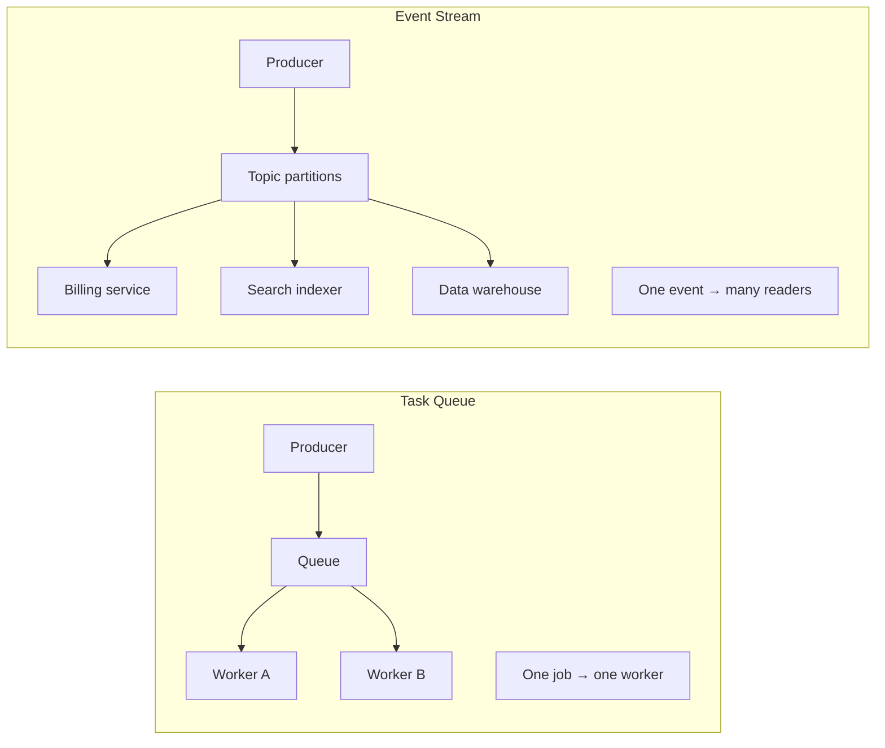
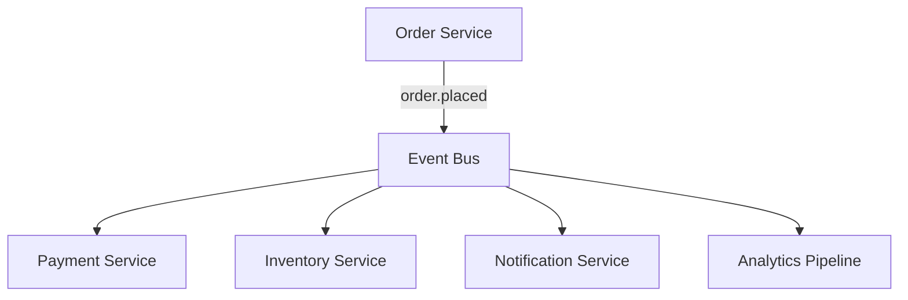
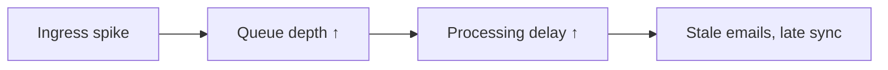
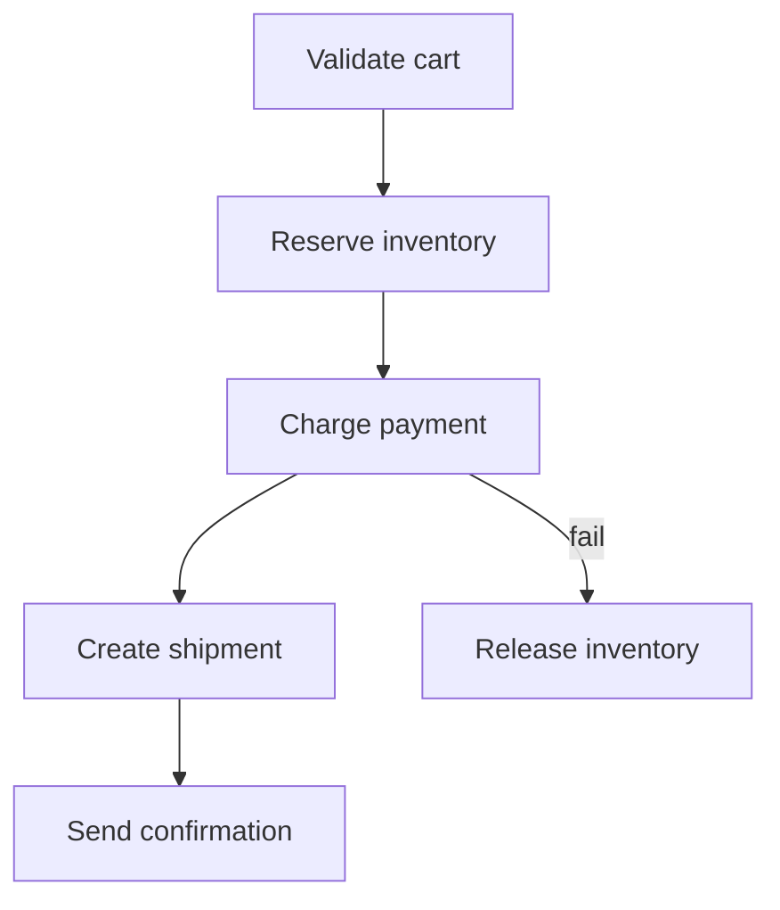
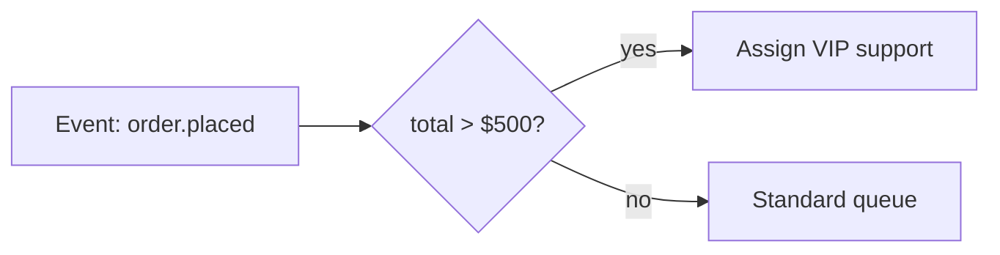
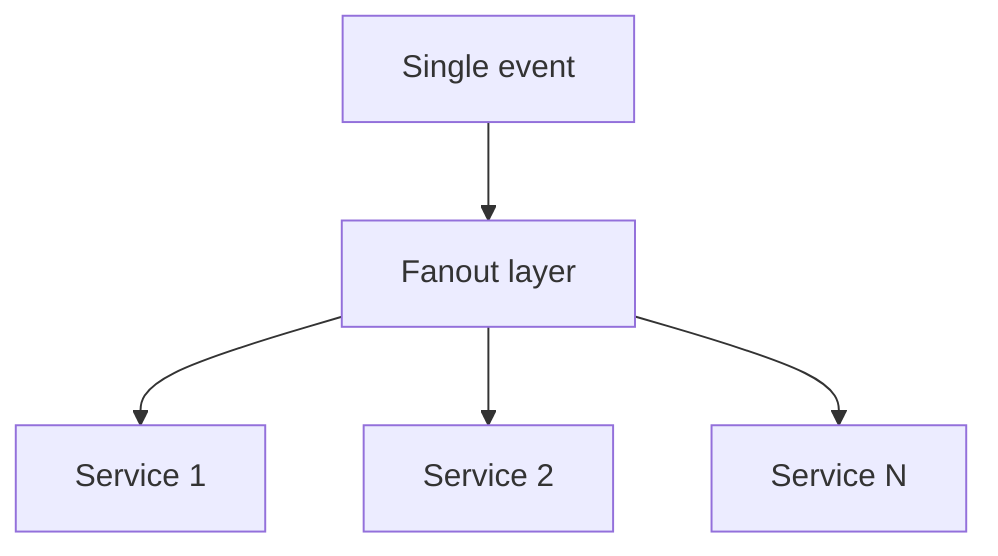
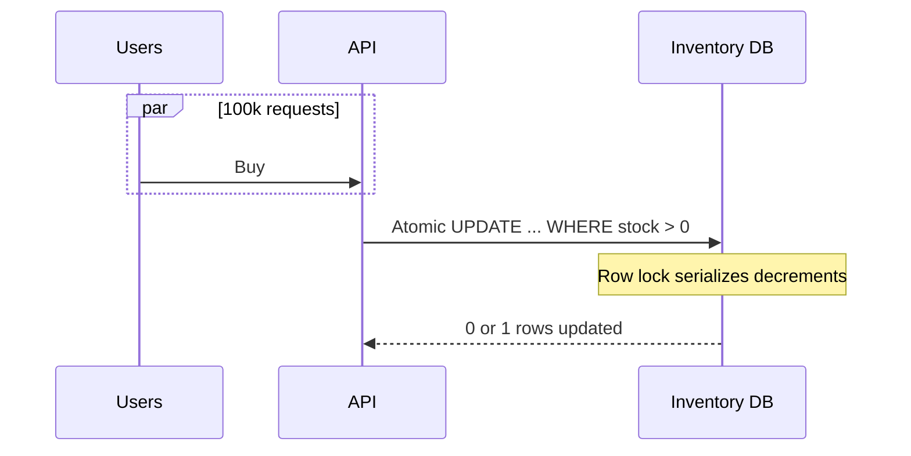

# Async Work, Queues, Streams, and Fanout

This guide is about **doing work without making the user wait**, and **moving information between services** in ways that survive spikes, failures, and growth. When a user clicks "Place order," they should get a fast response while emails, inventory updates, and analytics happen in the background. When something important happens in your product (an order is placed, a payment completes), other teams' services should learn about it without tight coupling. We cover task queues, event streams, schedulers, simple SQL queues, workflow engines, rules, fanout, and a classic flash-sale inventory problem.

---

## Why Not Everything Should Be Synchronous

A **synchronous** request means: the client sends one HTTP call, the server does *all* the work in that request, and only then returns a response. That is simple to reason about, but it breaks down when work is slow, unreliable, or bursty.

**Reasons to go async:**

| Situation | User experience if sync | Better approach |
|-----------|-------------------------|-----------------|
| Send welcome email (2–5 s) | Page feels slow | Enqueue email job; return "order confirmed" |
| Generate PDF invoice | Timeouts on mobile networks | Background worker + poll or webhook |
| Call third-party payment API | One outage blocks checkout | Retry in worker with idempotency |
| Reindex 10k products | Admin UI hangs | Job queue + progress bar |

**Mental model:** separate **command path** (must be fast and correct for the user) from **effect path** (side effects that can lag slightly).

```python
# Anti-pattern: everything in the HTTP handler
def place_order(request):
    order = db.create_order(request.data)
    send_email(order)           # slow
    update_inventory(order)     # can fail
    notify_analytics(order)     # not critical for response
    return {"order_id": order.id}

# Pattern: commit the fact, delegate the rest
def place_order(request):
    order = db.create_order(request.data)
    queue.publish("order.placed", {"order_id": order.id})
    return {"order_id": order.id, "status": "confirmed"}
```



**Key insight:** Async is not "faster CPU." It is **shorter critical path** for the user and **absorption of variance** (retries, backoff, parallel workers) off the request thread.

---

## Task Queue vs Event Stream

These are often confused because both use "messages." The difference is **intent** and **consumer model**.

| Dimension | Task queue (RabbitMQ, SQS, Redis queues) | Event stream (Kafka, Pulsar, Kinesis) |
|-----------|------------------------------------------|----------------------------------------|
| Primary job | "Do this work" (job) | "This happened" (fact) |
| Typical consumer | One worker processes a message (competing consumers) | Many independent consumer groups read the same stream |
| Retention | Delete after ack (often) | Retain for days (replay, audit) |
| Ordering | Per-queue, not global | Per-partition ordering |
| Replay | Usually hard | First-class |



**When to use a task queue:** send email, resize image, charge card with retries — work that should happen **once** (with idempotency).

**When to use a stream:** `order.placed` — billing, fulfillment, recommendations, and analytics all need the same fact, possibly at different speeds.

**Key insight:** Tasks are **verbs** (process_payment). Events are **nouns in past tense** (payment.completed). Mixing them without discipline leads to duplicate processing or lost audit trails.

---

## Event Bus for Product Events

An **event bus** is the wiring that lets services publish **domain events** without knowing subscribers.

Example events:

- `order.placed` — cart became an order
- `payment.completed` — money captured
- `user.signup` — account created

**Decoupling benefits:**

1. **Publisher** does not need a list of HTTP endpoints.
2. **Subscribers** can be added without changing the order service.
3. **Failure isolation** — if recommendations are down, checkout still works.

```python
# Publisher (order service) — schema matters
def emit_order_placed(order):
    bus.publish(
        topic="order.placed",
        key=str(order.user_id),  # partition by user for ordering
        payload={
            "event_id": str(uuid.uuid4()),
            "occurred_at": datetime.utcnow().isoformat(),
            "order_id": order.id,
            "user_id": order.user_id,
            "total_cents": order.total_cents,
        },
    )
```



**Contract discipline:** version your event schema (`order.placed.v2`), use immutable `event_id` for dedup, and document **required vs optional** fields.

**Key insight:** The bus is not a database. Consumers must tolerate **at-least-once delivery** and **duplicate events** unless you invest in exactly-once end-to-end (rare and expensive).

---

## Queue Lag, Backpressure, and Autoscaling

**Queue lag** (or consumer lag) means messages are arriving faster than workers can process them. The queue depth grows; latency from "published" to "processed" increases.

**What to monitor:**

| Metric | What it tells you |
|--------|-------------------|
| Queue depth / age of oldest message | Backlog size |
| Consumer lag (streams) | Offset behind head |
| Processing time p95 | Worker slowness vs insufficient workers |
| Error rate / DLQ rate | Poison messages |



**Autoscaling signals:**

- Scale workers on **queue depth** or **lag**, not only CPU.
- Add **cooldown** so you do not flap during oscillating load.
- Cap max workers to protect downstream DB.

**Backpressure** means slowing producers when consumers cannot keep up:

- Return `503` or rate-limit API that enqueues work.
- Use **bounded queues** in memory (drop or reject when full).
- For streams, increase partitions and consumers together (partitions are the parallelism unit in Kafka).

**Key insight:** Unbounded queues feel safe but hide outages until lag is hours old. Prefer **visible lag SLOs** (e.g., 95% of jobs processed within 60 s).

---

## Distributed Task Scheduler (Cron at Scale)

**Cron at scale** is harder than `crontab` on one server:

- Only **one** instance should run `charge_subscriptions` at 00:00 UTC.
- If the leader dies mid-job, another node must **recover**.
- Clock skew and duplicate triggers cause **double runs**.

**Building blocks:**

1. **Leader election** (etcd, ZooKeeper, DB advisory lock) — who may schedule.
2. **Job store** — next run time, last status, lease.
3. **Workers** — execute with **idempotency keys**.

```python
# Simplified lease-based "run if leader" pattern
def try_run_daily_reconciliation():
    with db.advisory_lock("job:daily_reconciliation"):
        job = db.get_job("daily_reconciliation")
        if job.last_run.date() == date.today():
            return  # already ran
        run_reconciliation()  # must be idempotent
        db.mark_job_run("daily_reconciliation")
```

**Exactly-once** for scheduled jobs is a myth at the distributed layer. Aim for **at-most-once trigger + idempotent effect** or **at-least-once + dedup table**.

**Missed job recovery:** persist `scheduled_for`; on leader takeover, scan jobs where `scheduled_for < now` and `status != completed`.

**Key insight:** Schedulers are **small distributed systems**. Treat missed fires and duplicate fires as normal; design jobs to survive both.

---

## Postgres SKIP LOCKED Work Queue

You can build a **simple work queue** without Redis/RabbitMQ using PostgreSQL row locks.

**Pattern:** table `jobs(id, payload, status, run_at)`; workers `SELECT ... FOR UPDATE SKIP LOCKED` to claim rows.

```sql
CREATE TABLE jobs (
    id         BIGSERIAL PRIMARY KEY,
    kind       TEXT NOT NULL,
    payload    JSONB NOT NULL,
    status     TEXT NOT NULL DEFAULT 'pending',
    run_at     TIMESTAMPTZ NOT NULL DEFAULT now(),
    locked_at  TIMESTAMPTZ,
    attempts   INT NOT NULL DEFAULT 0
);

CREATE INDEX jobs_pending_run_at ON jobs (run_at)
    WHERE status = 'pending';
```

```python
def claim_job(conn) -> dict | None:
    with conn.cursor() as cur:
        cur.execute("""
            UPDATE jobs
            SET status = 'processing',
                locked_at = now(),
                attempts = attempts + 1
            WHERE id = (
                SELECT id FROM jobs
                WHERE status = 'pending' AND run_at <= now()
                ORDER BY run_at
                FOR UPDATE SKIP LOCKED
                LIMIT 1
            )
            RETURNING id, kind, payload;
        """)
        row = cur.fetchone()
    return row
```

**Pros:** one less moving part, ACID, easy ops for small teams.

**Cons:** polling load, not ideal for millions of msgs/sec, long transactions hurt.

**Key insight:** `SKIP LOCKED` lets multiple workers claim **different** rows without blocking each other — the SQL equivalent of competing consumers.

---

## DAG Workflow Orchestration (Airflow, Temporal)

Real business processes are **graphs**: charge card → ship only if paid → email after ship.

A **DAG** (directed acyclic graph) workflow engine provides:

- **Dependencies** between steps
- **Retries** with backoff per step
- **State** (running, failed, compensating)
- **Visibility** (which step failed for order #123)



**Airflow** — great for **batch/data** pipelines, time-based schedules, ops-heavy DAGs.

**Temporal** (and similar) — great for **long-running transactional workflows** with signals, timers, and saga-style compensation in application code.

```python
# Temporal-style pseudocode: each step is retryable
@workflow.defn
class CheckoutWorkflow:
    @workflow.run
    async def run(self, cart_id: str):
        await workflow.execute_activity(reserve_inventory, cart_id)
        try:
            await workflow.execute_activity(charge_payment, cart_id)
        except PaymentFailed:
            await workflow.execute_activity(release_inventory, cart_id)
            raise
        await workflow.execute_activity(create_shipment, cart_id)
```

**Key insight:** Orchestrators own **orchestration state**; activities own **side effects**. Never store "payment succeeded" only in workflow memory without confirming the activity completed.

---

## Rule Engine and Trigger Framework

Product teams love **"when X happens, if Y, then Z"** without deploying new code every time.

**Event → condition → action:**



```python
class Rule:
    def matches(self, event: dict) -> bool:
        return event["type"] == "order.placed" and event["total_cents"] > 50000

    def actions(self, event: dict) -> list[callable]:
        return [lambda: assign_vip_support(event["order_id"])]

def dispatch(event, rules: list[Rule]):
    for rule in rules:
        if rule.matches(event):
            for action in rule.actions(event):
                queue.enqueue(action)
```

**Production concerns:**

- **Ordering** — rules may conflict; define precedence.
- **Safety** — sandbox actions; audit who changed rules.
- **Volume** — compile hot paths; do not interpret JSON per event at 100k/s.

**Key insight:** Start with a **small explicit rule list** in code; move to a UI-driven engine only when product velocity truly needs it — engines add operability cost.

---

## Fanout Patterns

**Fanout** means one incoming message or event is delivered to **many** consumers.

| Style | Mechanism | Tradeoff |
|-------|-----------|----------|
| Push fanout | Broker copies to N queues (RabbitMQ fanout exchange) | Simple; broker does work |
| Pull fanout | Stream + consumer groups (Kafka) | Replay; consumers at own pace |
| Application fanout | Service calls N APIs | Tight coupling; avoid at scale |

**Bounded vs unbounded fanout:**

- **Bounded** — known subscriber list (3 internal services).
- **Unbounded** — plugin ecosystem, webhooks per customer — need **per-tenant queues** and rate limits.



**Key insight:** Fanout multiplies load. One `user.signup` event × 50 microservices × 2 retries = 100 handler executions — design **thin events** (ids + types) and let consumers fetch details.

---

## Flash Sale Inventory Locking

**Problem:** 100 items, 100k concurrent buyers — you must not oversell.

**Wrong approach:** read `stock` in app memory, decrement in Python — races guarantee overselling.

**Better layers:**

1. **Atomic decrement in DB** with check.
2. **Short-lived reservation** (hold stock 5 min).
3. **Queue order requests** to smooth spikes (optional).

```sql
-- Single-row atomic update: only succeeds if stock > 0
UPDATE inventory
SET stock = stock - 1
WHERE sku = 'FLASH-001' AND stock > 0
RETURNING stock;
-- If 0 rows returned → sold out
```

```python
def try_purchase(user_id: str, sku: str) -> str:
    with db.transaction():
        row = db.execute(
            "UPDATE inventory SET stock = stock - 1 "
            "WHERE sku = %s AND stock > 0 RETURNING stock",
            (sku,),
        ).fetchone()
        if not row:
            raise SoldOut()
        order_id = create_pending_order(user_id, sku)
        # Optional: reservation expires via scheduled job
        schedule_release_if_unpaid(order_id, ttl_seconds=300)
        return order_id
```

**Redis Lua** (alternative): single-threaded execution per key — `DECR` if value > 0.

**CDN / edge** cannot be source of truth for inventory; edge can only **reject early** using cached "likely sold out."



**Key insight:** Flash sales are a **correctness** problem first and a **throughput** problem second. Serialize decrements on the inventory row (or shard per SKU); add queuing only after correctness is proven.

---

## FAANG Interview Deep Dive

**Q1: When would you choose SQS over Kafka for a new feature?**

**A:** SQS when you need a **managed task queue** with minimal ops: one consumer group competes for jobs, delete-on-success is fine, no replay requirement, and throughput is within SQS limits. Kafka when multiple teams must **read the same event history**, you need **replay** for new consumers or bug fixes, **high sustained throughput**, or stream processing (Flink) over the log. For "send receipt email," SQS; for "order lifecycle facts consumed by 8 systems," Kafka.

**Q2: How do you prevent duplicate side effects with at-least-once delivery?**

**A:** **Idempotency keys** stored in a durable dedup store (DB unique constraint on `payment_id`, or Redis SET with TTL). Side effects must be keyed by business id, not message id alone. For money, use **ledger + idempotent API** on the processor. Document which operations are naturally idempotent (PUT same state) vs which need explicit dedup (POST charge).

**Q3: Your queue lag is 2 hours during a sale. Walk through mitigation.**

**A:** Short term: scale consumers (verify DB/API downstream can take it), disable non-critical consumers, increase partition count if stream-bound. Medium: **backpressure** at enqueue API, shed load with 503, pre-warm workers. Long term: separate **hot SKU shards**, cache "sold out," async checkout confirmation, load test with realistic fanout. Always check **poison messages** inflating retries.

**Q4: Design a distributed cron that runs a billing job once per day globally.**

**A:** Leader election for scheduler tick; job table with `next_run_at`, `locked_by`, `lease_expires`; worker claims job with lease renewal; **idempotent billing** keyed by `(account_id, billing_period)`; on failure, retry with exponential backoff; metrics on `last_success`; alert if `now - last_success > 25h`. Handle **clock skew** using DB time, not wall clock on nodes.

**Q5: Compare orchestration (Temporal) vs choreography (event bus only).**

**A:** Choreography scales teams and avoids central failure point but **global state** ("where is order 7?") is hard. Orchestration gives **clear saga state**, timeouts, and compensation in one place — better for money/shipping. Hybrid is common: orchestrate checkout; choreograph post-order analytics.

**Q6: How does SKIP LOCKED differ from SELECT FOR UPDATE?**

**A:** `FOR UPDATE` blocks until the row is free — workers pile up on the same row. `SKIP LOCKED` skips rows already locked, so concurrent workers grab **different** pending jobs — higher throughput for queue tables.

**Q7: Explain fanout vs consumer group in Kafka.**

**A:** One **partition** is consumed by one consumer in a group (per partition). **Fanout across services** = different **consumer groups** on the same topic — each group gets all messages. Within one group, partitions divide work — not fanout, **load sharing**.

**Q8: Flash sale: 50k RPS, 100 units — single row bottleneck?**

**A:** Yes, one hot row serializes — acceptable for **100 decrements**; 49.9k get fast "sold out." Optimize **failure path** (cached sold-out flag after stock=0), connection pooling, and avoid heavy work in the transaction. Sharding by SKU if many hot products. Do not distribute inventory across nodes without a single atomic authority per SKU.

---

## Senior Pitfalls

| Mistake | Impact | Fix |
|---------|--------|-----|
| Treating Kafka like a task queue (single consumer deletes work) | Lost replay; wrong scaling model | Separate topics for tasks vs facts; use consumer groups correctly |
| No idempotency on workers | Duplicate charges, duplicate emails | Business-key dedup + unique constraints |
| Unbounded queue during outage | Hours of lag; thundering herd on recovery | Backpressure, DLQ, lag alerts, max retention policy |
| Fat events with PII in every fanout | Compliance blast radius, huge bandwidth | Thin events + fetch on consume |
| Cron on every app server without leader lock | Job runs N times | Advisory lock / leader election |
| Long transactions holding SKIP LOCKED rows | Throughput collapse | Short claim → process → mark done in separate steps |
| Flash sale logic outside DB atomic update | Overselling, angry customers | `UPDATE ... WHERE stock > 0` or equivalent atomic primitive |

---

## Production-grade Practice

1. **Build a mini queue in Postgres:** Create `jobs` table, write a Python worker pool using `SKIP LOCKED`, implement retry with `run_at` delay and `attempts` cap, and a dead-letter status. Load-test with 10 workers and measure claims/sec.

2. **Simulate queue lag:** Publish 100k messages to Redis or SQS locally; run 2 slow consumers (sleep 100ms/msg). Add autoscaling rule on depth. Graph depth vs processing latency.

3. **Event contract exercise:** Define `payment.completed.v1` JSON schema; add a consumer that fails on missing fields; upgrade to v2 with optional field and document compatibility rules.

4. **Flash sale lab:** SQLite or Postgres table `stock=100`; run a parallel load script (asyncio + 1000 clients) calling your atomic decrement API; assert final stock is 0 and successful orders ≤ 100.

---

*End of guide: async work, streams, orchestration, and fanout foundations for large-scale product systems.*
