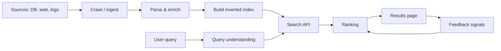
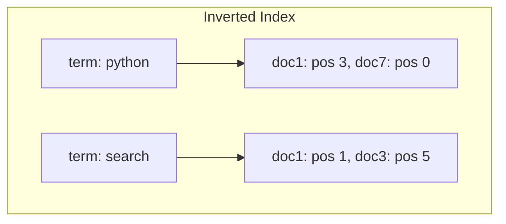
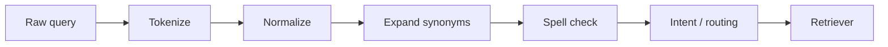
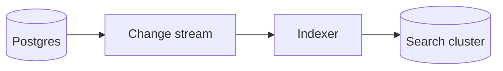
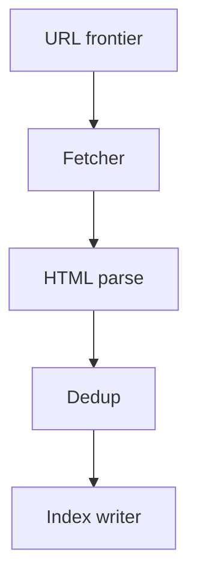

# Search and Retrieval System Design

Search is how users find one useful thing among millions of documents, products, or posts. This guide walks from **crawling and indexing** through **ranking** and **product features** like autocomplete and spell correction. We explain core ideas in plain language: inverted indexes, TF-IDF and BM25, query pipelines, evaluation metrics, sharding, vector hybrid search, and keeping the index aligned with your database.

---

## Information Retrieval: The Full Stack

An **information retrieval (IR)** system answers: "Given a query string, which documents are most relevant?"

**End-to-end pipeline:**



| Layer | Responsibility |
|-------|----------------|
| Ingestion | Get text + metadata into the system |
| Indexing | Make lookup by terms fast |
| Query processing | Normalize and understand intent |
| Retrieval | Candidate documents (cheap) |
| Ranking | Order candidates (expensive ML optional) |
| Serving | Low-latency API, caching, A/B tests |

**Key insight:** Search is two problems: **find candidates quickly** (index) and **order them well** (ranking). Interview designs often over-focus on ranking and under-specify ingestion and sync.

---

## Inverted Index and Posting Lists

A **forward index** maps document → words. Search needs the reverse: word → documents.

**Inverted index:**

- **Dictionary (lexicon):** term → metadata (document frequency, pointer)
- **Posting list:** for each term, list of `(doc_id, positions, optional payloads)`



Example:

| Term | Posting list (simplified) |
|------|---------------------------|
| python | doc1, doc7, doc9 |
| tutorial | doc1, doc3 |

```python
# Toy in-memory inverted index
class InvertedIndex:
    def __init__(self):
        self.postings: dict[str, set[int]] = {}

    def add(self, doc_id: int, tokens: list[str]):
        for t in tokens:
            self.postings.setdefault(t, set()).add(doc_id)

    def lookup(self, term: str) -> set[int]:
        return self.postings.get(term, set())
```

**Key insight:** Posting lists are the hot path. Compression (delta encoding, variable-byte) and skip pointers make intersection of long lists fast.

---

## Boolean and Tiered Search

**Boolean retrieval** combines posting lists with AND, OR, NOT.

- `python AND tutorial` → intersection of two sets
- `python OR rust` → union

At scale, **AND is expensive** if one term is very common ("the").

**Tiered search** (common in production):

| Tier | Purpose | Speed |
|------|---------|-------|
| Fast tier | Filter + cheap scoring (BM25 top fields) | < 50 ms |
| Slow tier | ML rerank, cross-encoder, personalization | + 100–300 ms |


**Key insight:** Retrieve **more than you show** in tier 1 (e.g., 500) so tier 2 has room to promote gems.

---

## TF-IDF Relevance Scoring

**TF-IDF** rewards terms that appear a lot in *this* document but are rare across the corpus.

- **TF (term frequency):** how often term `t` appears in document `d`
- **IDF (inverse document frequency):** rare terms are more informative

Simple formulas:

\[
\text{tf}(t,d) = \text{count of } t \text{ in } d
\]

\[
\text{idf}(t) = \log\frac{N}{df(t)}
\]

where \(N\) = total documents, \(df(t)\) = documents containing \(t\).

\[
\text{score}(d,q) = \sum_{t \in q} \text{tf}(t,d) \times \text{idf}(t)
\]

```python
import math
from collections import Counter

def tf_idf_score(doc_tokens: list[str], query_tokens: list[str], df: dict, N: int) -> float:
    tf = Counter(doc_tokens)
    score = 0.0
    for t in query_tokens:
        if t not in tf:
            continue
        idf = math.log((N + 1) / (df.get(t, 0) + 1))
        score += tf[t] * idf
    return score
```

**Key insight:** Raw TF favors long documents. Production systems use **normalized TF** or skip straight to BM25.

---

## BM25: Production Ranking

**BM25** (Best Matching 25) is the workhorse lexical ranker in Elasticsearch, Lucene, and many custom engines.

Intuition per query term:

- More occurrences help, with **diminishing returns**
- Document length is **normalized** (short docs are not penalized unfairly)
- IDF still down-weights common terms

Typical form (one term):

\[
\text{BM25}(t,d) = \text{idf}(t) \cdot \frac{f(t,d) \cdot (k_1 + 1)}{f(t,d) + k_1 \cdot (1 - b + b \cdot |d|/\text{avgdl})}
\]

- \(f(t,d)\) = term frequency in doc
- \(|d|\) = doc length
- \(k_1, b\) = tuning constants (often 1.2 and 0.75)

**Why BM25 beats naive TF-IDF:**

| Issue | TF-IDF | BM25 |
|-------|--------|------|
| Long documents | Inflated score | Length normalization |
| Term saturation | Linear TF | Saturating curve |
| Parameter tuning | Ad hoc | Well-studied defaults |

**Key insight:** For interviews, say "lexical baseline is BM25; learning-to-rank reorders top-k."

---

## Stop Words and Champion Lists

**Stop words** (`the`, `a`, `is`) carry little discriminative power and bloat posting lists. Common approach: remove at index time for English; **keep for phrase queries** if needed.

**Champion lists** (or **top-k per term**): for very frequent terms, only index or prioritize the **best N documents** per term to cap list size — trading recall on ultra-common terms for memory and speed.

**Key insight:** Removing stop words speeds indexing but can break queries like "The Who" — use a **protected phrase list** or n-gram fallback.

---

## Query Understanding Pipeline

Raw user text is messy. **Query understanding** standardizes it before retrieval.



| Step | Example |
|------|---------|
| Tokenize | `"Wi-Fi phones"` → `["wi", "fi", "phones"]` or keep phrase |
| Normalize | lowercase, unicode NFKC, stem ("running" → "run") |
| Expand | `laptop` → also `notebook` (careful with precision) |
| Spell check | `iphoen` → `iphone` |
| Intent | navigational vs transactional vs informational |

```python
def normalize_query(q: str) -> list[str]:
    q = q.lower().strip()
    tokens = q.split()  # use proper locale-aware tokenizer in prod
    return [t for t in tokens if t not in STOP_WORDS]
```

**Key insight:** Spell correction before retrieval fixes recall; **over-aggressive** correction hurts precision ("god" → "good").

---

## Search Feedback and Relevance Signals

Ranking improves from **implicit feedback**:

| Signal | Meaning | Caveat |
|--------|---------|--------|
| CTR | Click / impression | Position bias |
| Dwell time | Time before back | No click on answer in snippet |
| Purchases | Strong for e-commerce | Sparse |
| Skips | User refined query | Negative signal |

**Learning to rank (LTR):** train a model on features (BM25, doc age, popularity, user segment) to predict click or satisfaction. Often **two-stage**: BM25 → LTR on top 500.

**Key insight:** Log **impression lists** (what was shown), not just clicks — otherwise you cannot train debiased models.

---

## Search Evaluation Metrics

**Precision@k:** Of top k results, how many are relevant?

Example: 3 relevant in top 5 → Precision@5 = 3/5 = 0.6

**Recall@k:** Of all relevant docs, how many appear in top k?

If 10 relevant exist and you found 4 in top k → Recall@k = 0.4 (depends on k and total relevant)

**MRR (Mean Reciprocal Rank):** For one query, RR = 1/rank of first relevant hit. MRR averages over queries.

Query A: first good result at rank 2 → RR = 0.5

**NDCG (Normalized Discounted Cumulative Gain):** Graded relevance (0,1,2,3). Rewards putting highly relevant items higher with logarithmic discount.

\[
DCG@k = \sum_{i=1}^{k} \frac{2^{rel_i} - 1}{\log_2(i+1)}
\]

NDCG = DCG / ideal DCG.

| Metric | When to use |
|--------|-------------|
| Precision@k | "Are top results good?" |
| Recall@k | "Did we find enough?" (support, legal) |
| MRR | Single correct answer (FAQ) |
| NDCG | Graded relevance (shopping) |

**Key insight:** Offline metrics need **human labels** or **click models**; always validate with online A/B tests.

---

## Search Index Synchronization

The **source of truth** is usually OLTP (Postgres). The **search index** is a derived, eventually consistent view.

**Patterns:**

| Pattern | How it works | Pros / cons |
|---------|--------------|-------------|
| Dual write | App writes DB + search | Simple; inconsistent on partial failure |
| CDC (Debezium) | DB log → stream → indexer | Reliable; lag in seconds |
| Outbox table | Transactional outbox + worker | Same as CDC without external log |
| Periodic batch | Nightly rebuild | Stale; OK for low churn |



**Deletes matter:** tombstone `doc_id` in index when row deleted.

**Key insight:** Never rely on dual write without idempotent upsert keyed by `doc_id` and version or `updated_at`.

---

## Search Index Sharding

Indexes outgrow one machine. **Sharding** splits data.

| Strategy | Split by | Query routing |
|----------|----------|---------------|
| Document shard | doc_id hash | Scatter-gather all shards |
| Term shard | term hash | Route query terms to shards (harder) |

Most systems (Elasticsearch): **primary shards by doc_id**, replicas for read throughput.

```python
def shard_for_doc(doc_id: str, num_shards: int) -> int:
    return hash(doc_id) % num_shards
```

**Key insight:** More shards ≠ faster forever — each query hits all shards; **force merge** and segment count affect latency.

---

## Crawler and Indexing Pipeline

For **web** or external content:

| Concern | Practice |
|---------|----------|
| Politeness | Rate limit per host; respect crawl-delay |
| robots.txt | Legal and ethical boundary |
| Freshness | Recrawl by priority (sitemap, change freq) |
| Dedup | Canonical URL, content hash SimHash |



**Key insight:** Crawling is a **scheduling problem** — prioritize URLs that change often and drive traffic.

---

## Vector Search and Hybrid Retrieval

**Dense retrieval:** embed query and documents into vectors; find nearest neighbors (ANN).

**Keyword (BM25):** exact token matches, SKUs, rare names.

**Hybrid:** combine scores — often `score = α * bm25 + (1-α) * cosine` or **reciprocal rank fusion (RRF)**.

```python
def rrf(rank_lists: list[list[str]], k: int = 60) -> list[str]:
    scores: dict[str, float] = {}
    for ranks in rank_lists:
        for i, doc_id in enumerate(ranks):
            scores[doc_id] = scores.get(doc_id, 0) + 1 / (k + i + 1)
    return sorted(scores, key=scores.get, reverse=True)
```

**Key insight:** Vectors excel at semantic match; keywords excel at SKUs and proper nouns — production almost always needs **both**.

---

## Design: Autocomplete

**Goal:** Suggest completions as the user types with low latency.

**Trie (prefix tree):** each node is a character; path from root spells prefix.

Enhancements:

- Store **top-k popular** completions at each node (precomputed)
- Weight by **recent popularity** or CTR
- Personalize with user's history (separate small index)

```python
class TrieNode:
    def __init__(self):
        self.children: dict[str, TrieNode] = {}
        self.suggestions: list[str] = []  # precomputed top 5

def autocomplete(root: TrieNode, prefix: str) -> list[str]:
    node = root
    for ch in prefix:
        if ch not in node.children:
            return []
        node = node.children[ch]
    return node.suggestions
```

**Serving:** edge cache hot prefixes; shard trie by first 2 characters if huge.

**Key insight:** Autocomplete is **prefix retrieval + ranking**, not full search — precompute suggestions to avoid scanning millions of terms per keystroke.

---

## Design: Did You Mean and Spell Correction

**Noisy channel model:** user meant `w` but typed `q`; pick word maximizing \(P(w) \cdot P(q|w)\).

**Edit distance (Levenshtein):** min inserts/deletes/substitutions to transform strings.

```python
def levenshtein(a: str, b: str) -> int:
    dp = list(range(len(b) + 1))
    for i, ca in enumerate(a, 1):
        prev, dp[0] = dp[0], i
        for j, cb in enumerate(b, 1):
            cur = dp[j]
            cost = 0 if ca == cb else 1
            dp[j] = min(dp[j] + 1, dp[j - 1] + 1, prev + cost)
            prev = cur
    return dp[-1]
```

**Candidates:** dictionary terms within distance 2; filter by **language model frequency** and **keyboard neighbors**.

**Phonetic matching (Soundex, Metaphone):** helps "Smith" vs "Smyth."

**N-gram overlap:** compare character trigrams of query vs corpus terms for OCR-style errors.

**Key insight:** Only suggest correction when confidence is high — show "Search instead for X" rather than silent rewrite.

---

## Design: Related Searches

**Related queries** increase discovery ("iphone 15 case" → "magsafe charger").

Signals:

- **Session co-occurrence** — queries in same session
- **Click graph** — users who clicked A also clicked B
- **Query clustering** — embed queries, k-means, label cluster


Privacy: aggregate only; k-anonymity thresholds (do not show related for ultra-rare queries tied to one user).

**Key insight:** Related search is **offline batch + online lookup**, not per-request graph traversal.

---

## Design: Recent Searches

**Per-user history** powers quick re-search and personalization.

Storage:

- Key: `user_id` → ordered list of `(query, timestamp)` capped at N (e.g., 20)
- **TTL** (90 days) for privacy compliance
- **Incognito** mode skips write

```python
def add_recent(redis, user_id: str, query: str, max_items: int = 20):
    key = f"recent:{user_id}"
    redis.lpush(key, json.dumps({"q": query, "ts": time.time()}))
    redis.ltrim(key, 0, max_items - 1)
    redis.expire(key, 90 * 86400)
```

**Key insight:** Recent searches are **PII** — encrypt at rest, allow user delete, and never log in plain text in analytics without consent.

---

## FAANG Interview Deep Dive

**Q1: Design search for an e-commerce catalog with 50M SKUs.**

**A:** Ingest via CDC from product DB; index title, brand, attributes; BM25 on text + filters on category; facets on brand/price; autocomplete on title prefixes; sync lag SLO 1–5 min; shard by doc_id; replicas for QPS; cache hot queries; LTR on top 200 with click/purchase labels; spell check on brand dictionary.

**Q2: Why inverted index instead of scanning every document?**

**A:** Scanning is O(corpus size) per query. Inverted index lookup per term is O(posting list length). Intersection for AND is proportional to lists, not full corpus — the difference between milliseconds and minutes.

**Q3: How do you handle a query with a very common term and a rare term?**

**A:** Process **rare term first** (smallest posting list), intersect into larger lists; consider stop word removal for the common term unless required; use skip pointers; if still huge, require additional filter or phrase constraint.

**Q4: Explain NDCG vs MRR for your shopping search.**

**A:** MRR cares only about first relevant hit — good for navigational queries. NDCG supports graded relevance (exact match vs substitute) and position discount — better when multiple good items exist and order among top 10 matters.

**Q5: Dual write vs CDC for index sync?**

**A:** Dual write risks drift when search write fails after DB commit. CDC/outbox gives ordered, retryable propagation with idempotent indexing by `doc_id` + `version`. Choose CDC for production scale.

**Q6: When would hybrid search hurt?**

**A:** When embedding model mismatches domain (SKU-heavy), vector search adds latency and infra cost without recall gain; or when fusion weights are untuned and semantic results drown exact SKU matches. Tune α per category or use RRF.

**Q7: Autocomplete at 10k QPS — bottleneck?**

**A:** Trie lookup is cheap; **ranking personalization** and **network** dominate. Precompute top suggestions per prefix, CDN cache first 3 characters, debounce client, separate read replicas.

**Q8: How evaluate spell correction offline?**

**A:** Curated set of (misspelling, intended query, should_correct bool); measure precision/recall of suggestions; segment by query frequency; A/B test impact on zero-result rate and revenue.

---

## Senior Pitfalls

| Mistake | Impact | Fix |
|---------|--------|-----|
| Indexing HTML boilerplate | Irrelevant matches | Boilerplate removal, main content extraction |
| No delete path in index | Ghost products, compliance issues | Tombstones via CDC |
| Stemming product SKUs | Broken exact match | Protect alphanumeric tokens |
| Single shard Elasticsearch | Cannot scale | Plan shards at index creation |
| Training LTR on raw clicks | Position bias | IPS, debiased models, impression logging |
| Vector-only search | Misses exact IDs | Hybrid + RRF |
| Storing recent searches without TTL | Privacy incident | TTL, delete API, encryption |

---

## Production-grade Practice

1. **Build a toy inverted index:** Index 1000 text files; implement AND query with set intersection; compare latency to linear scan.

2. **BM25 playground:** Implement simplified BM25 scoring in Python; tune \(k_1, b\) on a labeled set of 50 query-doc pairs.

3. **Sync simulation:** Postgres products table + outbox events; worker upserts to in-memory index; inject failures and verify eventual consistency.

4. **Autocomplete trie:** Load 100k queries from a public dataset; precompute top 5 suggestions per node by frequency; measure lookup time for random prefixes.

---

*End of guide: lexical and hybrid retrieval, query UX, and operating search at scale.*
