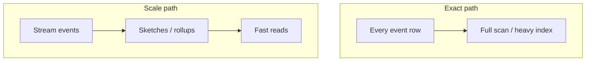
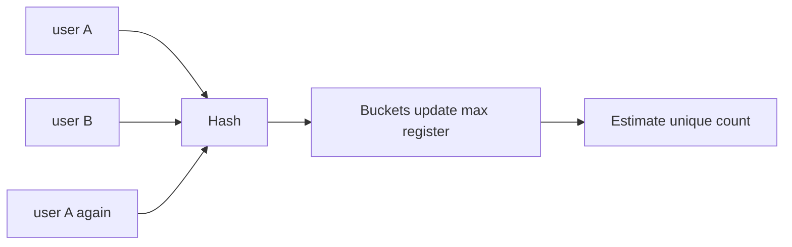
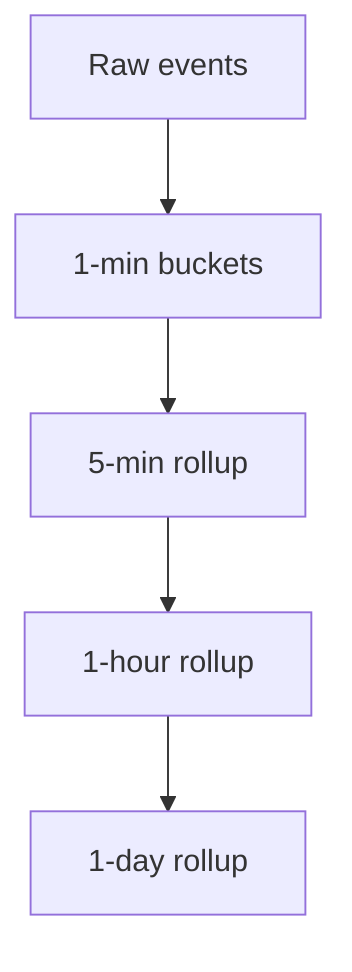
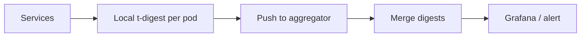
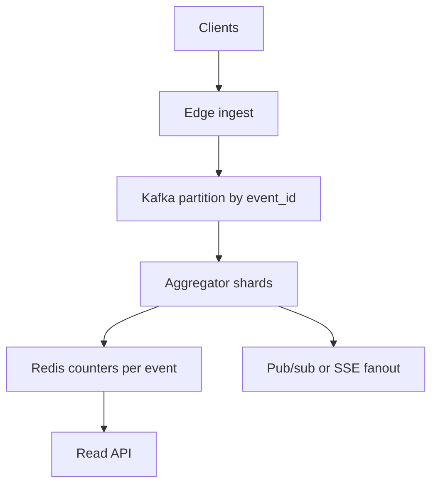

# Analytics at Scale and Probabilistic Sketches

Analytics systems answer questions like "how many unique users today?" and "what is p99 latency?" when storing every row or sorting billions of values is impossible. This guide explains **why exact SQL counts break**, how **YouTube-style view counters** work, **sketches** (HyperLogLog, Count-Min, t-digest), **time-window rollups**, and a design for **live reactions** at millions of events per second — in language a senior engineer can follow without prior exposure to each term.

---

## Counting at Scale: Why `SELECT COUNT(*)` Fails

At **billions of rows**, exact counts are slow because the database must **scan** or maintain a **heavy index** that still fights write amplification.

| Approach | Cost |
|----------|------|
| Full table scan | Minutes, locks, IO storm |
| Exact `COUNT(*)` on hot table | Contends with writes |
| Materialized count column | Must update on every insert/delete |

**What we actually need in products:**

- **Approximate** counts (±1–2%) for dashboards
- **Per-minute** trends, not one global number
- **Unique users** without storing every user id forever



**Key insight:** Separate **OLTP truth** (this user owns this row) from **analytical aggregates** (how many-ish) with different storage and SLOs.

---

## View Counting at Scale (YouTube Model)

A **view** sounds simple: increment a counter. At scale:

- **Duplicates** — user refreshes, bot traffic
- **Write rate** — millions of increments per minute on popular videos
- **Accuracy vs cost** — product accepts slight lag

**Common pattern:**

1. **Ingest** view events to a stream or log.
2. **Batch aggregate** in windows (e.g., 10 s) per video_id.
3. **Dedup** within window using `(user_id, video_id)` or cookie + TTL.
4. **Flush** batched increments to a store (Redis `INCRBY`, or Cassandra counter column).
5. **Display** cached count + optional "views updated periodically" lag (30–60 s).

```python
# Batcher pseudocode (per video shard)
buffers: dict[str, int] = defaultdict(int)
seen: dict[tuple[str, str], float] = {}  # (user, video) -> expiry

def record_view(user_id: str, video_id: str):
    key = (user_id, video_id)
    now = time.time()
    if key in seen and seen[key] > now:
        return  # dedup within 1 hour
    seen[key] = now + 3600
    buffers[video_id] += 1

def flush():
    for video_id, delta in buffers.items():
        redis.incrby(f"views:{video_id}", delta)
    buffers.clear()
```

**Eventual accuracy:** global count may be **slightly under** truth during crashes before flush; over-counting is worse — favor idempotent dedup keys.

**Key insight:** Sharded counters (per `video_id` key) avoid one hot row; batching amortizes writes.

---

## Impression Counting for Ads

An **impression** means "this ad was shown." Billing and reporting depend on counts.

| Guarantee | Meaning |
|-----------|---------|
| At-least-once | Duplicates possible; need dedup |
| Exactly-once | Ideal for billing; expensive end-to-end |

**Dedup window:** accept duplicate events with same `impression_id` within 24–48 h.

```python
def count_impression(impression_id: str) -> bool:
    # SET NX with TTL — first seen wins
    return redis.set(f"imp:{impression_id}", 1, nx=True, ex=172800)
```

**At-least-once pipeline:** SDK → edge → Kafka → aggregator. Dedup at aggregator with **idempotency key** from ad server.

**Key insight:** For money, store **raw impression logs** in cheap object storage for audit even if dashboards use sketches.

---

## HyperLogLog: Cardinality in ~12 KB

**Cardinality** = count of **distinct** values (unique visitors).

**HyperLogLog (HLL)** estimates distinct count with fixed small memory (often ~12 KB per sketch) and ~1–2% error.

**Magic in plain English:**

1. Hash each item to a long binary string.
2. Look at the **longest run of leading zeros** in the hash (plus a small correction).
3. Rare long runs suggest many unique items were seen (birthday-paradox style).
4. Combine many buckets with harmonic mean for stability.

You never store the items — only **bucket maxima**.

```python
# Using Redis built-in HLL (production shortcut)
def track_unique_user(redis, campaign_id: str, user_id: str):
    redis.pfadd(f"hll:campaign:{campaign_id}", user_id)

def estimate_uniques(redis, campaign_id: str) -> int:
    return redis.pfcount(f"hll:campaign:{campaign_id}")
```



**Key insight:** HLL answers "how many uniques?" not "which users?" — no membership test.

---

## Mergeable Sketches for Analytics

**Mergeable** sketches can combine partial results from **shards** or **time windows** without raw data.

| Sketch | Merge operation | Use |
|--------|-----------------|-----|
| HyperLogLog | Union of registers | Global uniques |
| Count-Min | Pointwise min of matrices | Frequency estimates |
| t-digest | Merge centroids | Quantiles |

```python
# Conceptual: merge two HLL states (library handles bit math)
def merge_daily_uniques(hll_mon, hll_tue) -> HyperLogLog:
    return hll_mon.merge(hll_tue)  # same as one stream of both days
```

**Key insight:** MapReduce / Flink windows output sketches; dashboard reads **O(shards)** merges, not O(events).

---

## Bucketed Time-Window Aggregation

Dashboards want **1-min, 5-min, 1-hour** charts.

**Rollup ladder:**



Storage key design:

```
metrics:{name}:{ts_bucket} → count
```

```python
def bucket_ts(ts: float, window_sec: int) -> int:
    return int(ts // window_sec) * window_sec

def increment_metric(name: str, ts: float, value: int = 1):
    b = bucket_ts(ts, 60)
    redis.hincrby(f"metric:{name}", str(b), value)
```

**Late data:** allow updating last N buckets (Flink allowed lateness) or drop with metrics on dropped events.

**Key insight:** Query the **coarsest** bucket that fits the UI time range — do not scan 1-min buckets for a 90-day graph.

---

## Raw Events vs Derived Analytics

| Keep raw events | Pre-aggregate |
|-----------------|---------------|
| Audit, replay, new metrics later | Dashboards, alerts |
| Compliance retention | Low query cost |
| Expensive storage | Cheaper reads |

**Lambda/kappa style:** raw in data lake; streaming job maintains rollups and sketches in Redis/ClickHouse.

**Key insight:** Raw is for **unknown future questions**; rollups are for **known SLAs**.

---

## Count-Min Sketch: Frequency Estimation

**Count-Min Sketch (CMS)** estimates "how many times did item X appear?" like a hash map that **collides on purpose** to save memory.

Structure: `d` rows of `w` counters (depth × width). Each row uses a different hash.

Update: for each row, `counter[hash_i(x)] += 1`

Query: **minimum** across rows (overestimate from collision; min reduces bias).

```python
import mmh3

class CountMinSketch:
    def __init__(self, width: int = 2048, depth: int = 5):
        self.width = width
        self.depth = depth
        self.table = [[0] * width for _ in range(depth)]

    def add(self, item: str, count: int = 1):
        for i in range(self.depth):
            j = mmh3.hash(item, i) % self.width
            self.table[i][j] += count

    def estimate(self, item: str) -> int:
        return min(
            self.table[i][mmh3.hash(item, i) % self.width]
            for i in range(self.depth)
        )
```

**Key insight:** CMS gives **upper-biased** estimates; min pulls down. Error scales with total stream mass / width.

---

## Top-K Heavy Hitters

Find the **most frequent items** in a stream without a hash map of billions of keys.

**Approaches:**

1. **Count-Min + heap** — track candidates, re-estimate with CMS
2. **Space-Saving algorithm** — fixed-size list of counters; evict smallest when full
3. **Two-pass** — CMS filter in stream; exact count top candidates in second pass

```python
class SpaceSaving:
    def __init__(self, k: int = 100):
        self.k = k
        self.counters: dict[str, int] = {}

    def add(self, item: str):
        if item in self.counters:
            self.counters[item] += 1
            return
        if len(self.counters) < self.k:
            self.counters[item] = 1
            return
        # evict min (simplified)
        min_key = min(self.counters, key=self.counters.get)
        del self.counters[min_key]
        self.counters[item] = 1

    def top(self) -> list[tuple[str, int]]:
        return sorted(self.counters.items(), key=lambda x: -x[1])[: self.k]
```

**Key insight:** Heavy hitters are for **alerts and capacity** ("which API key is spamming?"), not exact billing.

---

## Reservoir Sampling

**Goal:** keep a **uniform random sample** of size `k` from a stream of unknown length.

**Algorithm (Vitter):**

- First `k` items fill the reservoir.
- For item `n` (n > k), with probability `k/n`, replace a random slot.

```python
import random

def reservoir_sample(stream, k: int) -> list:
    reservoir = []
    for i, item in enumerate(stream):
        if i < k:
            reservoir.append(item)
        else:
            j = random.randint(0, i)
            if j < k:
                reservoir[j] = item
    return reservoir
```

**Use:** approximate histograms, debug traffic sample, unbiased analytics on huge logs.

**Key insight:** Every item has equal chance `k/n` to be in the sample at end — memory bounded by `k`.

---

## t-Digest: Quantile Sketches

**Quantile** = value at percentile p (p50 median, p99 tail).

Sorting billions of latencies is impossible. **t-digest** clusters nearby values into **centroids** (mean + weight) with more precision at tails.

```python
# Production: use tdigest library
from tdigest import TDigest

td = TDigest()
for latency_ms in stream:
    td.update(latency_ms)

p50 = td.percentile(50)
p99 = td.percentile(99)
```

**Merge:** combine centroids from two digests for per-host → global latency.

**Key insight:** t-digest error is tight at extremes (p99.9) where SLOs live — better than naive histogram for tails.

---

## Streaming Percentile Analytics for Monitoring

**Monitoring** needs p95/p99 every few seconds on metrics streams.

Pipeline:



Alert on **p99 latency > 500ms** for 5 min, not on single spikes (use sliding window merge).

```python
def should_page(p99: float, threshold: float, breaches: int) -> bool:
    return breaches >= 3 and p99 > threshold
```

**Key insight:** Percentile alerts need **minimum sample size** — p99 of 10 requests is noise.

---

## Design: Live Reactions at High Throughput

**Scenario:** live concert; **1M+ reactions/sec** (hearts); UI shows aggregate count + recent burst.

**Requirements:**

- **High write throughput**
- **Approximate global count** OK within 1–2 s
- **Per-user rate limit** (no 1000 hearts/sec from one bot)
- **Fanout** to viewers optional (show "+500 hearts in last second")

**Architecture:**



```python
# Shard aggregator consumes partition
def on_reaction(event_id: str, user_id: str):
    if not rate_limit_allow(user_id, event_id, max_per_sec=5):
        return
    pipe = redis.pipeline()
    pipe.incr(f"reactions:total:{event_id}")
    pipe.incr(f"reactions:window:{event_id}:{current_second()}")
    pipe.execute()

def read_display(event_id: str) -> dict:
    total = int(redis.get(f"reactions:total:{event_id}") or 0)
    burst = int(redis.get(f"reactions:window:{event_id}:{current_second()}") or 0)
    return {"total": total, "burst_per_sec": burst}
```

**Optimizations:**

- **Coalesce** increments in process memory 100 ms before Redis
- **HLL** for "unique reactors" if needed
- **CDN** does not hold write path — only read cached totals

**Key insight:** Separate **write sharding** (Kafka partitions) from **read fanout** (pub/sub); global single Redis key dies on hot events — shard by `event_id`.

---

## FAANG Interview Deep Dive

**Q1: How do you count unique daily active users for 500M users?**

**A:** Per-day HLL per shard (user_id hashed into shard); merge HLLs at query time; optional exact correction on small segments; store 90 days of daily HLL blobs; error ~1% acceptable for DAU chart; for billing use exact id set only on paid subset.

**Q2: View count seems low after deploy — debug?**

**A:** Check dedup TTL too aggressive, batch flush failures, lost Kafka consumer lag, counter shard hot spot returning errors, CDN serving stale read cache, clock skew on window keys.

**Q3: Count-Min vs HyperLogLog?**

**A:** CMS estimates **frequency of a known item**; HLL estimates **number of distinct items** without per-item storage. Use CMS for "how many times did API key X hit"; HLL for "how many unique API keys."

**Q4: Why min when querying Count-Min sketch?**

**A:** Collisions only **increase** counters in each row; true count ≤ each row's value; minimum across independent hash rows is closest unbiased estimate.

**Q5: Design metrics for p99 latency across 10k hosts.**

**A:** Each host maintains t-digest per minute; push to central; merge digests by service; query p99 from merged digest; store 1-min rollups 30 days; alert on rolling 5-min merged p99; require min 100 samples per host-minute.

**Q6: Exactly-once impressions — worth it?**

**A:** For **billing**, use server-generated impression_id + idempotent store + audit log; client beacons are at-least-once by nature. Exactly-once end-to-end often means **effectively-once** at aggregation with strong ids.

**Q7: Reservoir sampling — prove fairness sketch.**

**A:** Induction: after n items, each subset of size k equally likely; item n enters with prob k/n replacing uniform slot — standard proof for uniform reservoir.

**Q8: Live reactions overload Redis — next step?**

**A:** Local aggregation buffers, Redis cluster sharded by event_id, move totals to Cassandra counters, sample fanout updates to clients (update UI 2 Hz not per event), rate limit at edge.

---

## Senior Pitfalls

| Mistake | Impact | Fix |
|---------|--------|-----|
| One global counter row in SQL | Write meltdown on viral content | Shard counters; async batch |
| HLL for "was user X here?" | Wrong tool; cannot query membership | Set or Bloom filter if membership needed |
| No dedup on views/impressions | Inflated metrics, wrong payouts | Id keys + TTL window |
| p99 on tiny samples | False pages | Min sample threshold |
| Storing all raw events forever | Cost explosion | TTL tiers + rollups |
| Merging incompatible sketch params | Wrong estimates | Same width/depth/compression across shards |
| Exact uniques at billion scale | OOM | HLL or sampled exact |

---

## Production-grade Practice

1. **HLL experiment:** Generate 1M random user ids with 100k unique; compare `len(set)` vs Redis `PFCOUNT`; plot error vs sketch size.

2. **Implement Count-Min:** Stream 10M items from Zipf distribution; compare CMS estimate vs true count for top 10 items.

3. **Rollup job:** Read nginx access log; emit 1-min request counts per path to Redis; build a 24-hour chart from rollups only.

4. **t-digest latency:** Simulate log-normal latencies; merge per-"host" digests; report p50/p95/p99 vs exact numpy percentiles.

---

*End of guide: approximate analytics, sketches, and real-time counters without boiling the ocean.*
