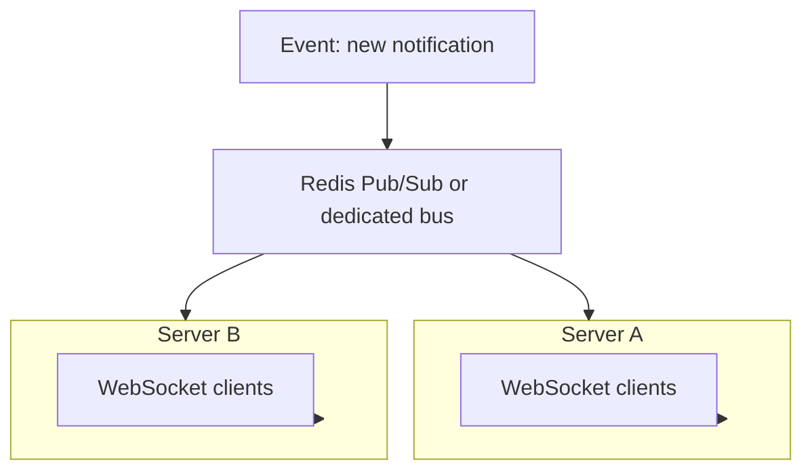
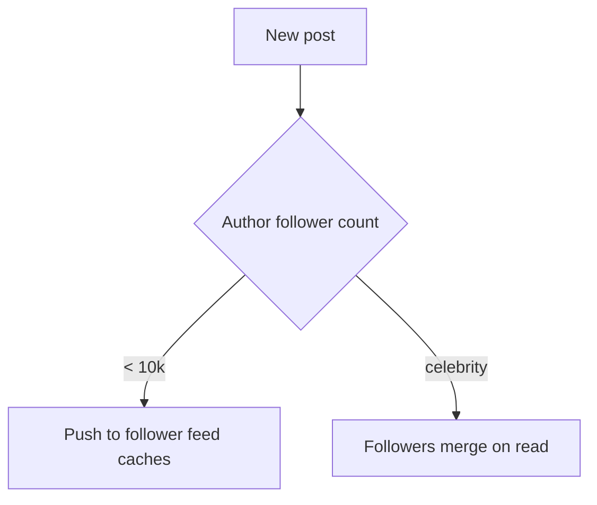
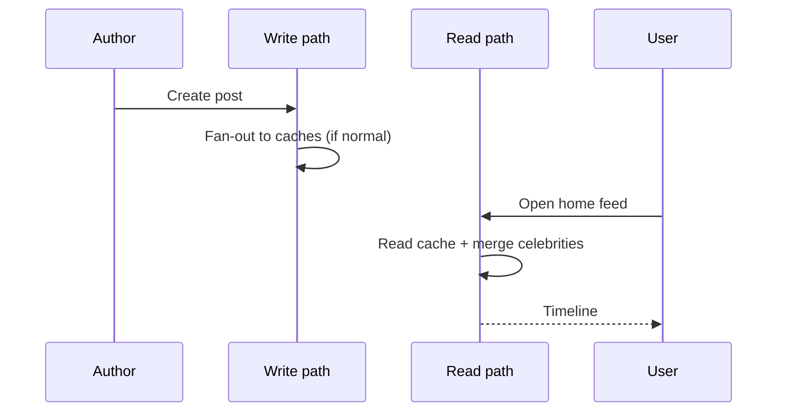
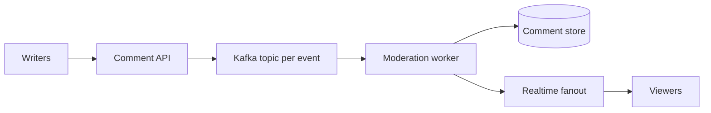

# Realtime Social Feeds and Live Product Features

Social products combine **graphs** (who follows whom), **feeds** (what to show in the home timeline), and **realtime delivery** (badges, reactions, live comments). This guide explains WebSockets vs alternatives, database modeling, Twitter-style fan-out tradeoffs, unread badges, hashtags, reactions, photo tags, and live commentary — in basic wording with diagrams, code, and interview depth.

---

## Realtime Database and WebSocket Scaling

A **realtime** layer pushes server updates to clients without the client polling every second.

**Challenge at millions of connections:**

- **Memory** — each connection holds buffers and state
- **Fanout** — one new post may notify many followers
- **Sticky routing** — connection lives on one server; cross-server pub/sub needed



**Patterns:**

| Piece | Role |
|-------|------|
| Connection gateway | Terminates WS, auth, heartbeat |
| Pub/sub backbone | Redis, NATS, or custom |
| Presence | Optional; who is online |
| Backpressure | Drop/slow low-priority pushes if client lagging |

```python
# Conceptual: server subscribes user channel on connect
async def on_connect(user_id: str, ws):
    channel = f"user:{user_id}:events"
    async for msg in pubsub.listen(channel):
        await ws.send_json(msg)
```

**Key insight:** WebSocket scale is **connection management + fanout**, not raw HTTP QPS — plan for **horizontal gateways** and **O(followers)** write amplification on hot users.

---

## WebSockets vs SSE vs Long Polling

| Transport | Direction | Browser support | Best for |
|-----------|-----------|-----------------|----------|
| **WebSocket** | Bidirectional | Excellent | Chat, games, collaborative edits |
| **SSE (Server-Sent Events)** | Server → client only | Good (HTTP/2) | Live feeds, notifications, stock ticks |
| **Long polling** | Pseudo push via repeated HTTP | Universal | Legacy fallback, simple alerts |

```mermaid
flowchart LR
    subgraph ws [WebSocket]
        C1[Client] <--> S1[Server]
    end
    subgraph sse [SSE]
        C2[Client] <-- S2[Server]
    end
```

**Long polling:** client holds request open until event or timeout; then immediately opens new request. High overhead vs WS.

**SSE:** one HTTP stream; auto-reconnect in browsers; works through many proxies; no binary duplex.

**WebSockets:** single TCP; low header overhead; need heartbeats and auth refresh strategy.

**Key insight:** If clients only **receive** updates (notification bell), **SSE** is often simpler than WebSocket. Use WebSocket when the client sends **frequent** messages upstream.

---

## Social Network Database Modeling

Core entities:

- **User** — profile, settings
- **Post** — content, author, timestamps
- **Follow** — directed edge follower → followee
- **Like/Reaction** — user + target post
- **Feed cache** — materialized list of post ids per user (optional)

```sql
CREATE TABLE users (
    id         BIGSERIAL PRIMARY KEY,
    handle     TEXT UNIQUE NOT NULL,
    created_at TIMESTAMPTZ NOT NULL DEFAULT now()
);

CREATE TABLE posts (
    id         BIGSERIAL PRIMARY KEY,
    author_id  BIGINT NOT NULL REFERENCES users(id),
    body       TEXT NOT NULL,
    created_at TIMESTAMPTZ NOT NULL DEFAULT now()
);

CREATE TABLE follows (
    follower_id  BIGINT NOT NULL REFERENCES users(id),
    followee_id  BIGINT NOT NULL REFERENCES users(id),
    created_at   TIMESTAMPTZ NOT NULL DEFAULT now(),
    PRIMARY KEY (follower_id, followee_id)
);

CREATE INDEX follows_followee ON follows (followee_id);
```

**Read patterns drive design:**

- Profile page: `posts WHERE author_id = ? ORDER BY created_at DESC`
- Followers list: `follows WHERE followee_id = ?`

**Key insight:** Normalize writes in SQL/NoSQL; **denormalize reads** into feed caches or search indexes when home timeline latency matters.

---

## Social Graph: Follows and Fan-out (FlockDB / Twitter)

**Adjacency list** stores edges:

- `follows(follower, followee)` — "who I follow"
- Reverse index on `followee` — "my followers"

**Fan-out** = when user posts, deliver to followers' feeds.

| Strategy | On write | On read |
|----------|----------|---------|
| **Push (fan-out on write)** | Insert post id into each follower's feed cache | Read cache — fast |
| **Pull (fan-out on read)** | Store post only on author timeline | Merge followed users at read time — slow for heavy readers |
| **Hybrid** | Push for normal users; pull for celebrities | Balance |



**FlockDB** (Twitter-era) optimized **graph edges** at scale — think sharded adjacency lists with efficient bulk reads.

**Twitter-style hybrid:**

- Fan-out write to Redis timelines for most accounts
- For `@celebrity`, followers **merge** celebrity post at read time with their cached timeline

```python
FANOUT_THRESHOLD = 10_000

def publish_post(author_id: int, post_id: int, follower_ids: list[int]):
    if len(follower_ids) > FANOUT_THRESHOLD:
        store_author_post_only(author_id, post_id)
        return
    for fid in follower_ids:
        redis.lpush(f"feed:{fid}", post_id)
        redis.ltrim(f"feed:{fid}", 0, 999)  # cap depth
```

**Key insight:** Fan-out on write trades **write amplification** for **read speed** — celebrities break pure push.

---

## Feed Generation: Push, Pull, Hybrid (Deep Dive)

**Pull model** home timeline query:

```sql
SELECT p.* FROM posts p
JOIN follows f ON f.followee_id = p.author_id
WHERE f.follower_id = :me
ORDER BY p.created_at DESC
LIMIT 50;
```

Works early; breaks when user follows 5k accounts (heavy join).

**Push model** read:

```python
def get_home_feed(user_id: int) -> list[int]:
    ids = redis.lrange(f"feed:{user_id}", 0, 49)
    return hydrate_posts(ids)  # batch load posts table
```

**Hybrid read:**

```python
def get_home_feed(user_id: int) -> list[int]:
    cached = redis.lrange(f"feed:{user_id}", 0, 49)
    celebrity_ids = get_celebrity_authors_followed(user_id)
    celebrity_posts = fetch_recent_posts(celebrity_ids, limit=20)
    return merge_by_time(cached, celebrity_posts)[:50]
```



**Key insight:** Feed ranking (ML) often runs **after** candidate generation — get 500 ids cheaply, rank down to 50.

---

## Design: Newly-Unread Indicator (Badge Count)

**Badge** shows "you have 7 unread notifications" without opening the inbox.

**Naive:** count rows `WHERE read = false` — slow at scale.

**Better:**

| Approach | Idea |
|----------|------|
| Counter per user | `unread_count` incremented on new notif, decremented on read |
| Separate "last seen" | `badge = count(id > last_seen_id)` if monotonic ids |
| HLL / approximate | Rare; usually exact badge expected |

```sql
CREATE TABLE notifications (
    id         BIGSERIAL PRIMARY KEY,
    user_id    BIGINT NOT NULL,
    payload    JSONB NOT NULL,
    created_at TIMESTAMPTZ NOT NULL DEFAULT now(),
    read_at    TIMESTAMPTZ
);

CREATE INDEX notif_user_unread ON notifications (user_id, id)
    WHERE read_at IS NULL;
```

```python
def push_notification(user_id: int, payload: dict):
    db.insert_notification(user_id, payload)
    redis.incr(f"unread:{user_id}")
    realtime.publish(user_id, {"type": "badge", "delta": 1})

def mark_all_read(user_id: int):
    db.execute("UPDATE notifications SET read_at = now() "
               "WHERE user_id = %s AND read_at IS NULL", (user_id,))
    redis.set(f"unread:{user_id}", 0)
```

**Sync issue:** counter drifts if worker fails — periodic **reconciliation job** recomputes from DB nightly.

**Key insight:** Push **delta** over WebSocket for snappy UI; persist **source of truth** in DB for app restart.

---

## Hashtag Extraction and Tag Store

**Hashtag** = `#topic` token linking posts to a topic page.

**Extraction:**

```python
import re

HASHTAG_RE = re.compile(r"#([\w\u0080-\uFFFF]+)", re.UNICODE)

def extract_hashtags(text: str) -> list[str]:
    return [m.group(1).lower() for m in HASHTAG_RE.finditer(text)]
```

**Tag store:**

- Table `hashtags(tag, post_id, created_at)` or inverted index
- **Trending:** count posts per tag in sliding window (Redis `INCR` per `(tag, minute)`)

```python
def record_hashtags(post_id: int, tags: list[str]):
    for tag in tags:
        redis.zincrby("trending:1h", 1, tag)
        db.insert_hashtag_post(tag, post_id)
```

**Trending algorithm (simplified):**

\[
score = \frac{count_{now} - count_{prev}}{decay}
\]

Balance **velocity** vs **spam** (new account flood).

**Key insight:** Normalize tags (`#OpenAI` vs `#openai`); block abusive tags via moderation pipeline.

---

## Reaction Modeling (Like, Love, Laugh)

**Reactions** are edges: `(user_id, post_id, reaction_type)`.

```sql
CREATE TABLE reactions (
    user_id    BIGINT NOT NULL,
    post_id    BIGINT NOT NULL,
    kind       TEXT NOT NULL,  -- like, love, laugh
    created_at TIMESTAMPTZ NOT NULL DEFAULT now(),
    PRIMARY KEY (user_id, post_id)
);

CREATE TABLE reaction_counts (
    post_id    BIGINT PRIMARY KEY,
    like_count INT NOT NULL DEFAULT 0,
    love_count INT NOT NULL DEFAULT 0
);
```

**Write path:** upsert reaction; adjust counts transactionally or async aggregate.

```python
def set_reaction(user_id: int, post_id: int, kind: str):
    db.upsert_reaction(user_id, post_id, kind)
    queue.enqueue("reaction.aggregate", {"post_id": post_id})
```

**Realtime:** publish `reaction.updated` with new totals to viewers watching post.

**Key insight:** One reaction per user per post (PK) prevents duplicate likes; counts can be **eventually consistent** if UI tolerates ±1 briefly.

---

## Design: Photo Tagging Coordinates

**Photo tag** = user tagged at position `(x, y)` normalized 0–1 on image.

```sql
CREATE TABLE photo_tags (
    id          BIGSERIAL PRIMARY KEY,
    photo_id    BIGINT NOT NULL,
    tagged_user BIGINT NOT NULL,
    x           REAL NOT NULL CHECK (x >= 0 AND x <= 1),
    y           REAL NOT NULL CHECK (y >= 0 AND y <= 1),
    status      TEXT NOT NULL DEFAULT 'pending'  -- pending / approved
);
```

**Privacy:**

- Tag creates **pending** notification; tagged user can remove tag
- Respect **block list** — do not notify blocked users

```python
def create_tag(photo_id: int, tagged_user: int, x: float, y: float, by_user: int):
    if is_blocked(tagged_user, by_user):
        raise PermissionError()
    tag_id = db.insert_tag(photo_id, tagged_user, x, y, status="pending")
    notify(tagged_user, {"type": "photo_tag", "tag_id": tag_id})
```

**Storage:** coordinates as floats; render client-side on responsive layouts using **normalized** coords not pixels.

**Key insight:** Tags are **PII + consent** — audit trail and easy untag API.

---

## Design: Live Commentary During Events

**Live comments** during sports/broadcast: high write rate, strict **ordering** expectations, moderation.

**Requirements:**

| Need | Approach |
|------|----------|
| Order | Server-assigned sequence per `event_id` |
| Scale | Shard stream by `event_id` |
| Moderation | Async filter + shadow hide |
| Read | SSE or WebSocket fanout to viewers |



```python
def post_comment(event_id: str, user_id: str, text: str) -> int:
    seq = redis.incr(f"comment_seq:{event_id}")
    comment = {"seq": seq, "user_id": user_id, "text": text}
    stream.publish(f"event:{event_id}", comment)
    return seq

def read_comments(event_id: str, after_seq: int) -> list[dict]:
    return db.query(
        "SELECT * FROM comments WHERE event_id = %s AND seq > %s ORDER BY seq LIMIT 100",
        (event_id, after_seq),
    )
```

**Ordering caveat:** "Total global order" across regions is hard — **per-event monotonic seq** is enough for UX.

**Hot event:** partition Kafka by `event_id`; rate limit per user; coalesce broadcasts (send batches every 200 ms).

**Key insight:** Show comment **immediately to author** (optimistic) but fanout **after** toxicity check when policy requires.

---

## FAANG Interview Deep Dive

**Q1: Design Twitter home timeline for 300M users.**

**A:** Post graph in sharded SQL; hybrid fan-out — push to Redis timeline lists for users with <10k followers; celebrities merged at read; ranking layer on 500 candidates; media from CDN; write path async fan-out workers; read path cache + fallback DB; pagination via cursored post ids; tolerate eventual fan-out lag with SLA.

**Q2: WebSocket vs SSE for notification bell?**

**A:** SSE if only server pushes badge increments — simpler ops, HTTP auth reuse. WebSocket if same connection drives chat upstream. Many apps use SSE for notifications + WS for chat.

**Q3: How prevent celebrity post from fanning out to 50M Redis keys?**

**A:** Hybrid: store post on celebrity timeline only; followers pull-merge celebrity segment on read; optional pre-warm for "active followers" subset only.

**Q4: Badge count drift — how detect and fix?**

**A:** Metrics on negative unread; nightly job `COUNT(*) WHERE read_at IS NULL` vs Redis; alert on divergence; reset counter; root-cause missed decrement on read path.

**Q5: Live comments at 50k msg/s for one event?**

**A:** Single-partition Kafka per hot event (or shard by hash if multiple hot); sequencer per event; batch WebSocket payloads; rate limits; read clients paginate history from DB, realtime only for tail; moderators hide by seq without deleting DB row (tombstone).

**Q6: Consistency model for likes count?**

**A:** Strong if updated in same transaction as reaction row — limits QPS. Eventual via counter table + stream — show approximate then correct; use idempotent aggregate worker.

**Q7: How model blocks in feed generation?**

**A:** Filter at read: remove posts from blocked authors; at fan-out skip pushing to blocker's cache when relationship exists; index `blocks(blocker, blocked)`.

**Q8: Photo tag legal/privacy requirements?**

**A:** Pending approval, notification with untag, exclude minors per policy, geo restrictions, audit log, do not include in public graph until approved.

---

## Senior Pitfalls

| Mistake | Impact | Fix |
|---------|--------|-----|
| Pure fan-out on write for all users | Write storm on celebrity post | Hybrid threshold |
| No cap on feed cache list | Redis memory blowup | `LTRIM` + archive |
| WebSocket without heartbeat | Zombie connections, proxy drops | Ping/pong + idle timeout |
| Global notification counter in one key | Hot key | Per-user keys |
| Trending without spam filter | Attack trends | Velocity + account trust score |
| Storing pixel coords only | Broken on resize | Normalized 0–1 coords |
| Live comments totally ordered globally | Impossible latency | Per-event sequence |

---

## Production-grade Practice

1. **Mini feed:** Implement push fan-out in Redis for 100 synthetic users; measure write time when author has 10k followers.

2. **SSE server:** Python FastAPI `EventSourceResponse` pushing fake badge increments; client JS displays count.

3. **Hashtag trending:** Stream 1M synthetic posts; maintain sliding window counts; print top 10 tags per minute.

4. **Live comment sequencer:** Redis `INCR` per event; WebSocket broadcast to local clients; load-test 1k writers with asyncio.

---

*End of guide: social graphs, feeds, realtime transport, and live engagement at scale.*
